# 销冠养成丨个体私域成交心法Mini 航海实战手册2026

> 来源：[https://my.feishu.cn/docx/N8AIddHNMon0kGxPbCCc6ongn5c](https://my.feishu.cn/docx/N8AIddHNMon0kGxPbCCc6ongn5c)

<https://my.feishu.cn/sync/Lj5sd8APisk896bxImEcYvjMnlF>

---

# 引言：

## 开船第一课

### ⛵新手如何入门【销冠养成丨个体私域成交心法】项目？

开始之前先画个重点：

这次的 21 天航海，一共有 6 次的高手领航直播，如果时间允许，直播一定要到、千万要到、必须要到，因为『看』销售跟『听』销售，是完全不同的概念。

销售是一个特别有趣的学问，是一个用『看』没办法学会的能力，必须得学到后，马上下场『实操』，才能真正的知道，原来这个主题在讲些什么、门道在哪、需要注意的地方在哪。

『看』销售只能看到文字，但是『听』销售可以听到语言的感受、以及不同语气表达出来后的心境，你所获得到的是完全不同的。记得，直播一定要到场。

接下来就要正式进入手册内容啦～

1、项目介绍

生意思维很难培养，我们都想赚钱，撇开上班族的角色不谈，所有的副业、自由职业、创业的领域，都得学会怎么做生意。

那什么是生意？

生意就是把东西卖出去，不管是实体产品还是虚拟产品，把东西卖出去就是一种销售行为。

如果你尝试过副业，一定会发现 90%以上的副业都有一个共性，就是卖出某种东西，就算是接商单，都得学会卖出『自己』。

还有个有趣的现象，只要你看过成功者的自传，会发现大多数成功的企业家，他们在创业初期，一定花很多的时间历练过销售。

销售本来就是一个『概率行为』，好的销售之所以业绩好，就是因为他刻意的、有意识的、有方向的做很多很多可以提升成交率的事情。

就跟SCYS的航海一样，为什么每次的航海，总可以有这么活跃的报名？

因为航海前的三个月就开始预热，从找热门文章到最近趋势、到圈友的讨论热络程度、.......可能光是航海的发船前准备，就有超过 30 个以上的步骤，到最后那一刻招生，瞬间就爆满。

销售也是如此。

为什么我的东西卖不出去，这是能找到理由的；为什么我的东西能卖出去，这也是能找到理由的。

如果，我能知道自己缺了哪些步骤，导致东西最终没卖出去，这时候我只需要补上我缺的环节，是不是东西就可以顺利的卖出去？

那你有没有属于一套自己的『销售系统』，我也把这个称为销售流程。

这一次的航海，就是把我实战过 14 年的销售历练，变成一套适合每一个人的 sop，只要你按照这个流程走，就可以清楚的知道我目前缺了什么、该补上什么、原来是这个原因东西卖不出去、.....

让你的『把东西卖出去』，可以变得更有确定性，进而让成交率提升的更高。

销售这门学问很特别，光看光学，是很难学会的，必须要下场实战才能在这个领域有所成长。

## 一、列名单：所有的生意都得知道『我要卖给谁』

### 01、我的第一个 100 人

如果现在让你拿出一张纸----不借助任何的工具、不能看手机电脑，凭着印象写出 100 个名单，你是否能做到？

如果不行，就代表你对于身边的『人名』是没有概念的。如果你对人名没概念，那又怎么知道你的东西能卖给谁呢？

（1）列名单的目的

现在有特别多好用并且方便的工具，可以让我们更有效率的整理名单，但是再好的工具都不如『手写名单』，列出名单的真正意义，不单纯只是整理自己到底认识多少人。

想想一个场景，你把微信打开一看通讯录 5000 人，会发现有多数人是不熟悉的，甚至连名字都叫不出来，也就是通讯录有多少人跟你有多少名单，完全是两回事。

所以名单的用意在于：深刻的印象。

当你对某个名单印象深刻的时候，就会时时刻刻的关注他。

看他的日常、看他的朋友圈、看他的公众号，就跟以前读书的时候，有个你喜欢的人、或者是讨厌的人，你都会因为这样的理由对某个人『刻意的关注』，名单的目的就是让你刻意的关注某一个人。

因为刻意关注，你就能从很多蛛丝马迹中，找出这个人『可能有什么需求』、又或者是『我能想办法创造什么需求』。

比如：

你是卖摄影课的销售，有天看到某人的朋友圈拍了一张老婆的照片（但是拍的不太好看），这时候因为你刻意的持续关注，是不是就能透过这则朋友圈，找到一个好理由跟他聊天，并且问问他是否有拍照的需求？

（2）如何列名单

当我们知道了列名单的目的，那么我们应该要怎么把 100 人的名单列出来？

有一个最好的方式：

打开你的微信聊天页面，把最上面往下数的前 100 人都写出来，这就是你人生的第一张 100 人名单（群不算）。

当然，如果列出 100 个名单这事情，对你来说是没有难度的，那就按照你的方法来写出人名，只要能写出 100 个就可以。

建议手写，因为---

手写人名可以加强大脑记忆，相比电子文档，手写能让人对名单成员产生更深刻的心理链接与感知。

（3）操作注意事项

第一阶段的 100 人名单千万不要『挑』也不要『筛』，前 100 人是谁就写下谁，也别管跟这个人熟不熟，陌生与否。

有人列的时候心里会想，这个人应该不是我的客户，先不要写吧、这个人我不熟感觉也不会买，也不写、这个人过去跟我有仇，也不写、...... 当第一阶段列名单有太多想法的时候，最后名单就列不出来了。

因为任何的名单，就算一开始你完全陌生的，某一天也会变成熟悉名单，所以名单不管是谁，就算是亲戚家人也能写上去，先完成第一个属于自己的百人名单。

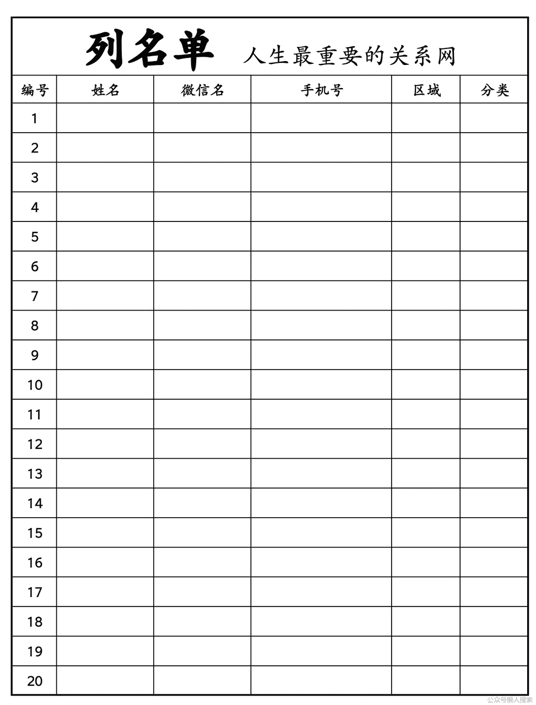

### 02、名单分类（抽屉理论）

（1）名单分类重要性

有没有发现，当你准备想卖东西的时候....

有些人就容易说好、有些人就会考虑考虑、有些人甚至看到后完全不回你，为什么会有这样的状况？

因为，我们跟每个名单的『关系层次』是不同的。

如果，我们手上可以有一份，跟所有名单的『关系分类』，可能是跟这人认识多久、他是否跟我买过东西、有没有过革命交情、一起同寝室过、一起出去玩过七天特别开心、曾经得罪过他、......

当你对于每个人名都可以清楚的知道，跟这个人经历过些什么。

或者是完全的陌生，当有一天你需要把东西卖出去的时候，是不是就能马上知道我要卖给谁，有谁是需要再聊几次天再卖的。

你肯定碰过这种状况，我开口跟某个朋友卖产品，结果对方也没什么考虑就说不要、不买，这时候你一定很失望，为什么会被拒绝，天都要塌了！！

这时候是因为你产品介绍的不好吗？并不是，而是你找错人卖了。

也就是：

你的名单分类越清晰，你卖东西的成交率就越高，同时，如果你名单分类的越清晰，你就越不容易出现对关系的『失望』。

我们必须要对名单，有一个清晰的『分类定义』。

定义越清晰，你在真正有需求的时候，就知道到现在我需要找谁。

就像多数的销售工作（像是保险或者是微商），每个季度都会有佣金加倍、或者是产品准备停卖这样的状况，遇到这种特殊状况就是准备要大卖的时间点。

遇到这种阶段，如果你手边已经有非常清晰的分类名单，是不是就能在有限的时间里，让成交率可以提升的更高，因为你找的人都是特别有意向的客户或者朋友。

（2）如何应用“抽屉理论”？

1.  准备谈成交的最大忌讳就是，我把对的产品卖给错的人。

想一想：

今天有一个 16800 的产品，我对面坐的人是小王，今天才刚加好友（第一层抽屉），一上来就跟他说：

“小王，我看你根骨奇佳，你就适合我这一万多块钱的课！”

他会有什么想法？“你有病吧？”或者“你是不是喜欢我？”

所以，抽屉理论是一个判断标准，能更精准的预估成交率。

1.  作为产品匹配的“标尺”

如果今天小王跟你买过了一个 1 万多块钱的产品（代表小王已经在第六层抽屉），你再卖他一个 99 块钱的引流课程，你们觉得这件事情对吗？（不妥），会发现怪怪的。

之所以怪，理由是因为对于那个花 16800 的人来说，他可能是你的黑卡用户，99 的东西你应该是要送他，而不是卖他。

因为小王心里会觉得：“我在你这边都这么高级了，你还让我去付这 99 元？这种产品不应该直接送我吗？”

💡所以，抽屉分类的目的在于，能不能够更好地知道，你的客户目前在什么样的阶段。

案例反思：

有一个人，我们线下见过两次，他跟我说对我的某种课程特别有兴趣。回到家之后，我做了一个 8000 块的产品，就跟他说：“这东西你要不要买？”

他聊了半个小时，聊天记录上说了特别多，代表他可能感兴趣。放在过去，我会以为他应该要买，他不买我就会觉得是我的问题。

但是，用了抽屉理论之后，我会知道，他对于这个产品的兴趣和我们之间的关系，还到不了 8000 块这个层次。所以我就有心理准备，他应该不会买。这里面最大的问题就是我的抽屉分类出了问题。

（3）名单如何分类

名单该怎么分类，我做一个示范，这是我针对销售场景的名单分类：

• 第一层：刚加的好友。我们之间不评估任何关系

标准--> 完全没说过话，或者说过的话不超过 10 句

• 第二层： 交流超过 30 分钟。能够聊 30 分钟，代表你们之间有一定的了解。

标准-->最少聊天超过 30 分钟

• 第三层： 产生首次付费。聊完之后，这个人给我付过一次费。

标准-->总付费金额不超过 1000 元

• 第四层： 产生多次付费。他给我付过多次费，但累计金额不超过 5000 块。

标准-->付费的金额在 1000～5000 元之间。

• 第五层： 线下见面并有私交，私交可以是一起出去玩两天一夜以上，除了是付过费用之外，还是不错的朋友

标准-->除了付费之外，同时还有朋友之间的交情、互相帮过忙的交情

• 第六层： 支付过高客单价。等于底下全部都符合之后，这个人他单次给我付了 5 位数以上的课程费用。

标准-->符合前五项的同时，单次支付超过万元以上的产品

这是我的分类逻辑，你也可以有属于自己的一套分类方式，就类似

• 第一层：刚加入好友完全陌生

• 第二层：我群发某一段讯息，对方回应我 666

• 第三层：进了我某一个免费群，在里面跟我有互动

• ...................

基于不同的业务场景，每个人都会有属于自己的分类。

这部分可以先按照你自己的逻辑，你会怎么分类你的关系（作业会写到），然后再来参考我的，这样的方式是最好的，先自己思考再参考。

每个人的名单分类，其实没有基准，因为产品逻辑不同、也有人会觉得，我用『是否付费』当成名单分类会不会太过利益。

就像是我问了 ai，他给出了这样的分类答案：

第一步：确定分类维度（三个核心指标）

在分类前，先看这三个指标：

• 互动指标： 认识多久？聊过几次？有没有深度共鸣（如，聊超过 30 分钟）？

• 交易指标： 付过费吗？付过几次？累计金额是多少？

• 私交指标： 是否线下见过？是否有过共同经历（同寝、旅游）？是否有过互助（寄特产、帮小忙）？

第二步：设置分级阶梯（以文中销售场景为例）

你可以将名单由浅入深分为六个抽屉：

1.  第一层（弱关系）： 刚加好友。【动作：不评估、不推销】

1.  第二层（有互动）： 产生过深度交流，有观点共鸣。【动作：建立好感】

1.  第三层（轻度信任）： 产生首次小额付费。【动作：交付价值，建立交易习惯】

1.  第四层（中度信任）： 多次复购，但总额不高。【动作：挖掘深度需求】

1.  第五层（强信任/私交）： 线下见过面，有私下的互助往来。【动作：情感维护】

1.  第六层（核心资产）： 支付过高客单价。【动作：提供黑卡级尊享服务】

关键是，你的每一层名单都要有这样的结构

• 与名单的关系长度：认识一天、聊过五次、...

• 清晰的事件：支付过 1000 元、有过三天两夜的相处、一起租过房、....

• 必须发生的事件：一定要付超过 5000 元、一定要同居两周以上、一定要.....

只要符合这样的定义，你的名单分类就能真正用在实战上。

备注：

每个人都有属于自己的名单分类『定义』，定义越清晰，你就能更清楚地知道，每一个名单应该放在哪一层。

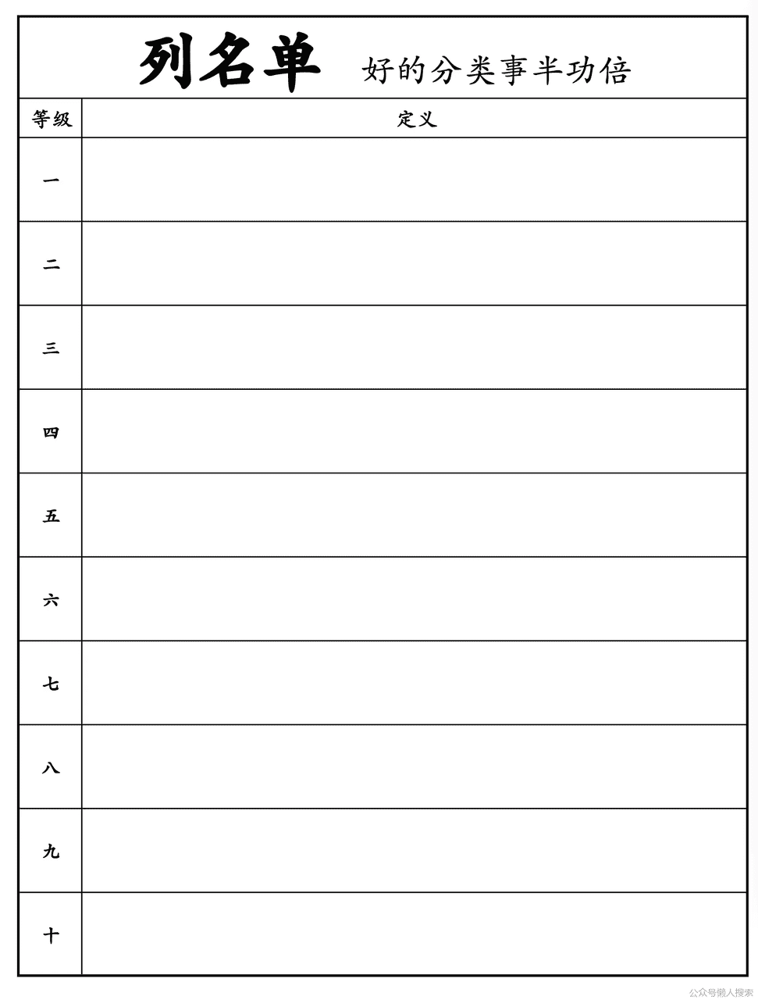

### 03、持续增加新名单客户

1、线下增加新名单

抽屉总要放东西，我们要如何去丰富我的抽屉？也就是名单怎么来？

养成增加名单的好习惯：“固定时间，固定数量”

我觉得，在丰富抽屉这个事上，要有一个好习惯，叫 “固定时间，固定数量”。

如果

• 第一周的周二去见三个客户

• 第二周说太累了不跑了

• 第三周又说体力好，周三周五再次去见五个客户

这样并没有不好，毕竟，最终都去认识新客户了不是吗？

但没有固定时间，肌肉就不能形成记忆。如果你习惯早上 7 点起来打卡，有没有发现，常常 7 点一到，闹钟还没响，眼睛都会自动张开。

💡任何的销售都有一个属于自己的增加名单的好习惯，好习惯就是一种肌肉记忆。

为什么好习惯那么重要？

因为“固定”这件事情，就能在身边的好友中建立起影响力。

我当时的工作是“一日三访”。

每一天不见三个人，我是不回家的。因为 2018 年我团队崩盘，从零开始在杭州，没有任何人脉。当时我的老师说：做销售你就得跑。

我开始参加各种不同的线下活动，那时候也真的是穷，只能挑免费的活动参加。

我每天就固定参加一场活动，而且会选在下午 1 点到 3 点。

因为这个时间点出现的人，要么没工作，要么是创业者，要么是来找机会，他们想成长的意愿是特别高的。

所以我当时就选择固定这个时间去认识新人，并给自己做了一个表格。我一年下来，平均大概线下见了 1000 多个人。从 2018 年的下半年一直到 2020 年，我总共认识了 3000 多个线下见过面的好友。

• 固定时间： 每周一到周五的下午 13:00～15:00

• 固定数量： 一周最少见 21 人

2、线上增加新名单

你是否会固定的更新朋友圈、小红书、公众号、视频号、抖音、.......或是其他的平台。

不管你做的是什么业务，肯定要有个『对外』的展示平台，同时还要再该平台有固定周期的更新，可能日更、可能一周三次、也可能一周一次，不管哪一种都好。

这里也要做到跟线下增加名单一样的原则

固定时间： 每周一、三、五的中午十二点更新小红书

固定数量： 每次更新 2 篇，一周固定更新 6 篇

固定时间： 每天公众号日更文章

固定数量： 一周写 7 篇

固定时间： 每天上午十点，在某一个群里面互动

固定数量： 每次互动最少 30 分钟

不管什么平台或者什么方式，只要可以让『其他人』关注到你、或者是因为你的某某内容特别好想加你好友的举动都行。

只要持续的有更新，你的内容肯定会越来越好，就会越来越多人看，你就能让自己有源源不绝的新名单流入，初期可能会少，但是没关系！只要时间一长，你就能为自己创造一条名单的被动收入系统。

又或者是混群、购买新课程、主动加入你喜欢文章底下的微信....这些都是主动或者是被动的让自己增加新名单。

每次的作业原则：

• 区分基础作业、进阶作业

• 进阶作业需要『打印资料，共 15 页』

• 基础作业：不需要手写，只需要用电脑任意格式完成

• 进阶作业：需要手写、同时也要上传电脑，任意格式都可

• 不管是哪种作业，皆需要拍照上传

3、第一个作业（表格 1.1～1.7）

作业规则：

基础作业：（任意格式）

• 20 个人名

• 名单分类五个等级

进阶作业：

• 打出 100 个人名

• 手写 100 个人名

• 手写名单分类五个以上等级

提交形式：

1.  基础作业：截图上传电脑或者手机任意格式

1.  进阶作业：加上手写表格拍照上传

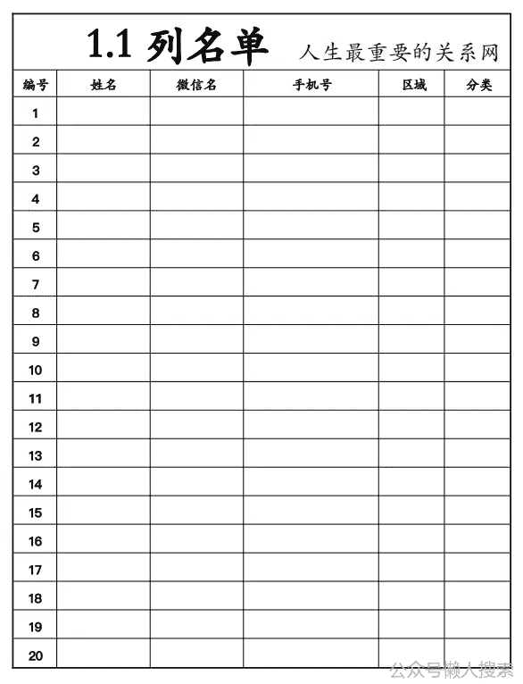

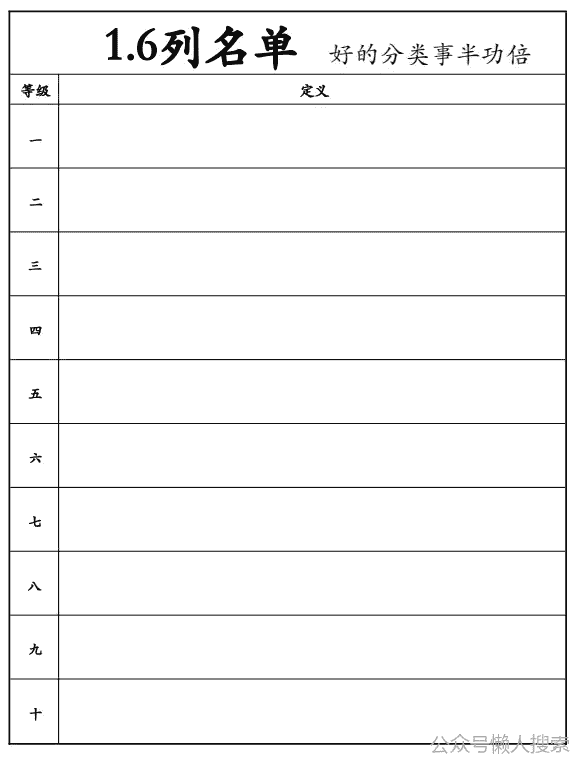

## 二、邀约：有人了，我要怎么开启聊天！

### 01、邀约类型

邀约分两种，第一种邀约叫作线下邀约。第二种邀约叫做线上邀约。

1、线下邀约的定义：见到面

（1）线下邀约的原则

线下邀约的原则就叫见到面。

但见到面也有好坏。

但是线下这见到面有两种，一种叫好的见到面，一种叫坏的见到面。

（2）最差的邀约（坏的见到面）你想方设法去堵别人

最明确的底线定义：

我称这个叫邀约，就是我邀约的原则是我一定要见到他，最差的邀约就要到家门口去堵他。

我 2012 年刚做直销的时候……我真的到他们家去堵他。

我知道他住哪，我知道他几点上班，我 7 点就到他们家，带着一份早餐，一杯咖啡就到。

并且点出核心训练逻辑：所有的邀约，一定要从最差练习。

所有的人一定是从最差的邀约开始的，每一个人都是这么来的。

（3）最好的邀约（好的见到面）别人想方设法要见你

最好的线下邀约，不是你“去见到他”，而是对方“想尽办法要见你”：

什么叫最好的邀约啊？最好的邀约就是对方讲说：根源老师……我希望你能够安排一天我们见个面……你跟我讲什么时间都行，我一定会想办法配合你。

这个叫最好的邀约，就是对方想尽办法要见你。

对方一定说：拜托你一定要给我时间，我一定要好好见到你。这叫最好的邀约。

但是你也不可能每次都做到最好的邀约……因为有些新朋友……不认识，所以我就没有办法让他对我有印象，让他对我有好感。

但是我会尽量地让我最好的邀约的次数可以变多。

（4）为什么要定义邀约

所有的技能，都能透过次数的练习慢慢进步，但最可怕的是，我正在进步中，可是我却给自己错误的『认知』。

以前我训练销售的时候，小明很沮丧的跟我说：

今天我见到客户了，但是讲不到三分钟，客户马上就说有事情要走。

小明的背景，完全没做过销售，是一个纯小白，如果对于邀约没有定义，我可能就会把小明骂一顿，你怎么只留住客户三分钟，就不能死缠烂打再跟客户多说点话吗！

但是过去的小明，根本就不曾有过邀约客户谈产品的经验，一次邀约成功的经验都没有，但今天最少做到了『逮到客户三分钟』，虽然只是最差的邀约，但最少已经邀约成功，接下来只需要调整话术、或者是见面说的话，就可以慢慢的从最差邀约，转变成最好的邀约。

这都需要过程，之所以要定义明确，就是为了知道过程中，我到底有没有进步，用一个更客观的判断来定自当下的结果，才知道下一步应该怎么走。

2、线上邀约的定义：让对方愿意回你讯息

线上邀约讲得很“单纯”，核心不是聊多深，而是先让对方“回你”：

那我们回到一个定义，什么叫线上邀约的。

你要如何想办法让对方愿意回你讯息，这叫线上邀约。

你一定常常收到类似的消息

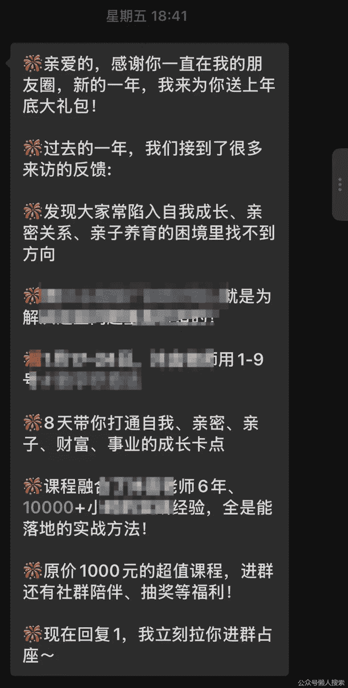

这是目前我们很常见到的『群发式邀约』，因为这次的主题是『个体』私域成交心法，如果一些特别完善的企业，因为量太大，只好用群发的方式筛选用户，我认为是没有问题的。

但是，如果你是『个体』，我特别不建议这么做，因为这样做的效果已经不是『有没有』的问题了，而是会伤害你现有的人脉。

想想一个场景，要是现在你收到类似的讯息，你真的会觉得这个人特别认真，我一定要加入他的群、买他的产品，还是你会想把这个人删除又或者是放进折叠？

线上邀约最核心的定义是：对方『愿意回你』，也就代表你发给对方的讯息，要让他看到之后会产生『好奇』、或者是『有兴趣』、甚至是『我就看看你想干嘛』。

我举几个简单的例子，如果今天你看到某个陌生人这么发讯息给你，你会回应个一两句，还是觉得反感？

“小明，我看到你最新的公众号，文章写太好了！

『发一张图片』然后说，我好喜欢你最新的朋友圈，尤其照片拍的特别好看

我今天才注意到你的个性签名，这句话突然让我心里一震

你的头像是不是有换过，怎么感觉跟之前不一样

你叫十六啊，我的通讯录有很好多你的兄弟姊妹！！！”

有没有发现，我刚刚举的例子中，都跟产品、销售、或者是某某目的性没有关系，就是一个闲话家常，让对方可能会好奇的开场白，因为邀约的重点都不是卖什么产品，而是让用户至少『愿意先回你』。

线上邀约开场白原则：

• 我说话他愿意回我。

• 你们最少能聊到 10 句话以上。

第二个原则很重要，如果你给对方发一段讯息，他只回：收到。这个就不是一个合格的邀约，因为对方没有想跟你聊天的欲望，所以十句是个最重要的判断基准。

3、邀约的持续动作：第二天一定要再找他（线上邀约的延伸）

在这段里，把“邀约”延伸成一种“持续出现、持续曝光”的纪律：

就算你第一天聊得不好，我都会要求第二天你得再找他。

原因很直白：

是因为大多数的客户如果说你跟他不熟悉的话，第一天你很难让他对你产生好的印象或者好的信任感，很难的。

所以如果说你第二天不找他，他真会把你忘记，那你第一天做的就白做了。

对“第二天再找他”的关键词是：

增加你的曝光度，我写白话点就是增加出现的次数。

并且你把“见面/出现”跟“交情”绑在一起：

如果没有增加『出现的次数』，你们之间是不会有交情的。只要不会有交情，你们就产生不了私情，当没有私情你们就没有进阶的可能性。

4、第二个作业：（表格 2.1）

任务规则

基础作业：（任意格式）

• 3 种线上邀约开场话术

进阶作业：

• 10 种线上邀约开场话术

• 手写 10 种线上邀约开场话术

提交形式：

1.  基础作业：截图上传电脑或者手机任意格式

1.  进阶作业：加上手写表格拍照上传

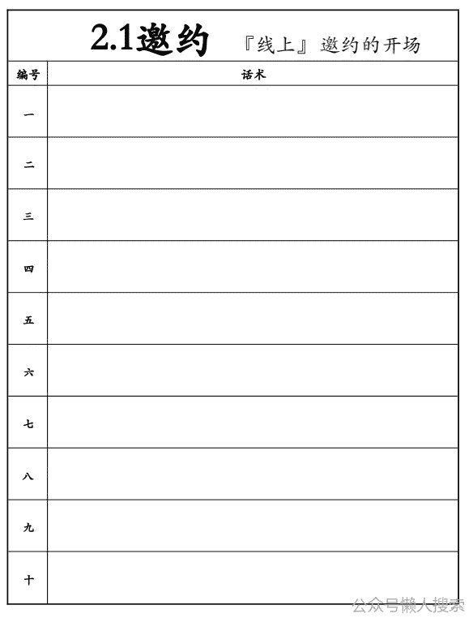

注意事项：

当你写完话术的当下，一定要把自己假想成：如果我是客户看到这句话，会不会愿意回复？如果当下你都不愿意回复，就代表这句话的开场不行，用这个为判断基准。建议不要太长，找到一些合适的场景。

就类似：我刚看到你朋友圈的照片，拍的太好看了！！！

像是这一类的『轻度开场，让对方既不反感、又会想知道你想说什么』

## 三、商品展示：如何正确的讲产品

### 01、展示产品：不是讲「商品」，而是讲「三种展示」

在我的销售流程里，「商品展示」不是把产品说明书丢给对方，也不是把「价格、流程、案例」一口气讲完。

商品展示的定义其实叫做：危机或者梦想，或者未来趋势，你要告诉他能够得到什么呀？你找我，你可以得到什么？你可以获得什么？以及如何做。

而且这里面大原则绝口不提产品，产品是不能提的，你只能提到梦想、危机跟未来趋势其中一个。

因为一开口你就介绍产品，这个大家都会，所有人都懂的，这个叫本分，本分能够做得好不一定会成交。

我说的「展示产品」，核心不是展示产品本身，而是用三种展示，让对方开始认真思考：我为什么要找你？找你到底有什么好处？

（因为这时代跟上个时代不一样，上个时代叫做，你很优秀，别人就会愿意为你付费。这时代不是，他们会比较，会评估。)

一般来说，我们最常见的『商品展示』有两种

• 对方一问产品，直接丢海报

• 如果你更新小红书，这个自动更新的 ai 系统特别适合你，blalalalala、......

这是最常见的两种介绍产品方式，并不是不好，而是这样的说法属于介绍产品的『本分』行为，就很像读书的时候，有一种老师会说特别多案例，让你听了感觉有趣好玩、但有一类老师只是把课本的内容重新念一次给你听，那还不如看课本就好。

商品展示真正的用意，是要让客户听完后『产生想买的欲望』，所以真正的谈产品，并不是说产品的本身，而是要以这三个重点来介绍产品

• 危机

• 梦想

• 未来趋势

完整的介绍产品架构：

💡危机 or 梦想 or 未来趋势 = 结果 ＋ 如何做

1、危机展示

如果我是一个海报设计师，应该要怎么用『聊危机』的方式展示商品：

传统方式：

卖课程肯定要做海报，我先给你发过去我的案例，然后一张海报是 399 元，这是我的自我介绍跟产品详情（丢一张海报给用户），接著就等客户回复，买或者不买。

更好的方式：

我会先处理一个关键点：“在介绍产品之前我其实有个提问，我想确认几个事情……我能知道一下，为什么你会选择找我吗？”

接着我会告诉他：“海报这件事情做与不做的重点不是太大……我们自己都可以改的，所以其实做海报这件事情不一定要找人做。”

然后把危机放大：

“我第一次做海报的时候，我大概花了一个月的时间，因为设计的领域我完全不熟悉，最终做出来的海报我自己都觉得好丑，重点是我光是海报就花了 10 天的时间，比我做课程的时间还久……如果那个时候我就直接找别人做，那就代表我能够省下最少 10 天的时间。”

也就是：

不找专业的人，你会付出时间、效率、机会成本。

“通常放大危机是最容易成交的，因为你把他最终不找你，可能会遇到什么不好的事情，可能会损失一些什么放大，他心里，就会评估了到底要不要花这个钱。”

当你把客户心中的『意愿』以及『为什么需要』放大的时候，客户才会愿意听你说产品，因为大多数的状况下，客户自己都不太清楚，我是不是真的需要，就单纯的『想问问』。

2、梦想展示

背景：如果我要卖SCYS会员，会员价格一年 3365 元，属于客单价比较高的产品了。

传统方式：

这个星球特别好，你一定要来，我发一张星球详细介绍海报给你看（发海报）（或者是发一大段的星球文字介绍）

更好的方式：

如果我们的未来可以变成：

一年 12 个月只需要工作 9 个月，可以放假 3 个月、又或者是比别人提早 10 年退休，在或者是生活品质可以比现在更好，你会不会希望未来可以有这样的工作状态？

这几年我感觉自己被工作的环境局限住了，很想突破一点圈层，让新的一年可以比过去更好，你要不要跟我一起，去关注点新的领域，让我们明年都可以更进一步.......

（只要对方有兴趣，就可以自然的把SCYS聊进去）

3、未来趋势展示

未来趋势是让对方看到：

你拥有这个能力，接下来会更强、更值钱、更有效率。比如我会讲到：“赚钱这件事情跟工作这个事情讲求的是效率。”

• 现在好像不用 ai 都落伍了，你有在了解吗？

• 感觉身边的同事每个都有一个副业做着，我也想了解

• 你知道出海吗？听说今年出海赚钱会更容易一些

• 我一个朋友通过小红书，这个月多赚了几千块

................

类似这样的趋势话题，当对方也跟你聊上的时候，就能顺势的在把SCYS的产品切进去，就像是：

我最近加入一个星球，才发现原来 ai 可以这么用，这群人真的太厉害了，然后就能继续说，先引发客户的兴趣后，准备聊产品对方才会愿意听。

### 02、展示自己：厉害的销售，都知道怎么『卖自己』

展示自己这件事情，它其实是一种信任感的延伸，展示自己是代表，我如何让对方可以对我有信任感。

到底什么是信任感，是否能把信任感量化？如果可以量化，就代表可以变成执行步骤。

信任感量化有四大阶段，分别是：

1、仪表

线下仪表：

穿著是否得体、身上的味道、衣服有没有烫、外表干不干净、.....任何跟外表相关的评判标准，都是仪表的定义，这张表格是一个初步检查表，每次我要见客户之前，都会用这个表格重新查看一下自己当下的状态，准备好才出门。

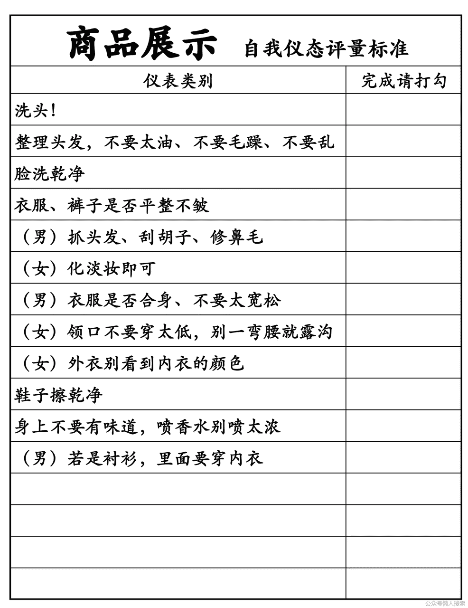

线上仪表：

头像是否刻意挑过，会不会一看就记住

昵称是否特别、好不好念、第一次看到会不会觉得特别

朋友圈设定的是三天可见、还是全部可见？

个性签名会不会特别编辑过

拍一拍的赘词有不有趣

是否有视频号、小红书又或者是公众号的固定更新

..........

也就是，任何新用户看到你的时候，再不跟你聊天之前，看到你的所有对外的展示，会不会对你感兴趣，想像一个场景，今天你加了一个新朋友，结果点开他的头像，啥都没显示，昵称还是一个『。』你会对这样的人有什么印象？

2、专业度

当用户问你产品的时候，是否能快速的给出答案、或者是身上能拿出专业的资料，而不是一问三不知，你得有一个检视标准，想像一些客户可能会问你的问题，然后当下问自己，我是否能答的出来。

3、讨人喜欢

你的表达能不能让对方喜欢、是否知道怎么给出情绪价值、说话可以让对方愿意听下去吗、挑不挑食、....... 尤其是学会好好说话，是讨人喜欢最关键、也最需要学习的。

就像是：

• 你开口聊天的时候会不会夸奖对方

• 聆听对方说完话之后再讲，而不是客户说两句就马上插嘴

• 到客户家吃饭会不会主动帮帮忙，而不是只跟大爷一样坐在沙发上

• ......

4、谈话的高度

过去经验越丰富、谈话高度就能聊的越精彩。

5、第三个作业：（表格 3.1～3.3）

任务规则

基础作业：（任意格式）

• 只需要完成 3.1 表格

• 小红书、淘宝上或者是任意平台，分别找到一张休闲搭配、一张正式搭配的照片

（上传两张照片即可）

进阶作业：

• 完成 3.1～3.3 表格

• 手写 3.1+3.3 表格

• 小红书、淘宝上或者是任意平台，分别找到一张休闲搭配、一张正式搭配的照片，接著对标你找到的服装，帮自己穿上相同的衣服。

（可用 ai 直接换装）

（休闲跟正式挑一套即可）

提交形式：

1.  基础作业：截图上传电脑或者手机任意格式+照片上传

1.  进阶作业：加上手写表格拍照上传+照片上传

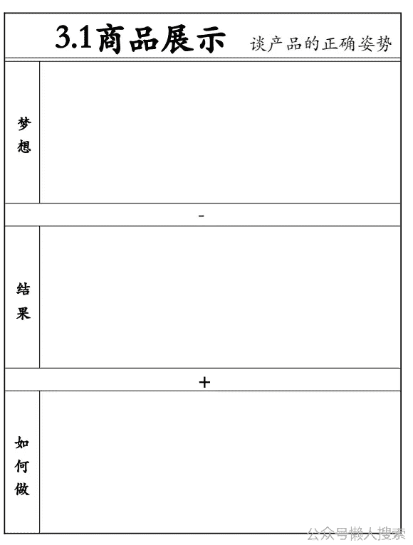

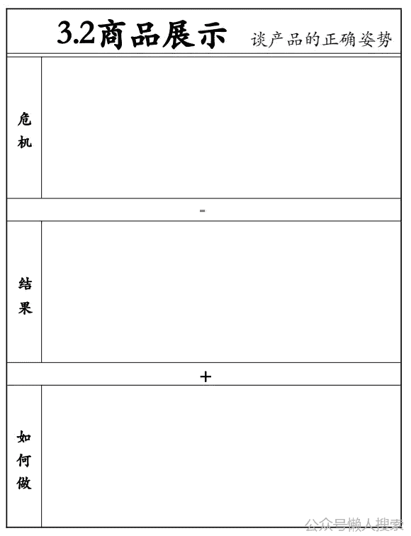

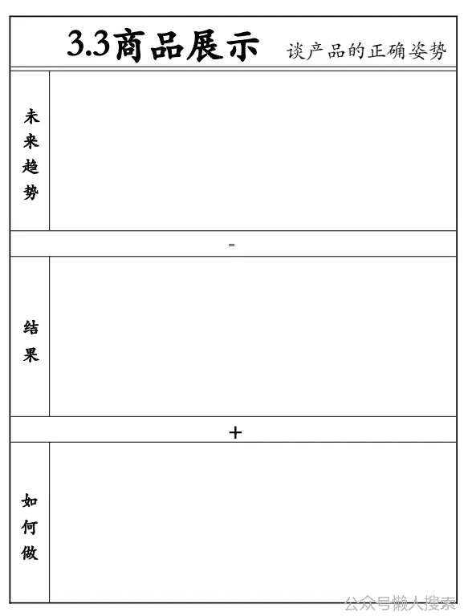

## 四、成交：销售的结果

### 01、如何做「成交」

1、「成交」的定义

成交这件事，中间一定有一座桥，这座桥我把它叫做「前情提要」。

你是否碰过一些粗鲁的销售，一开场也没聊、啥也没说就直接：

• 这产品你要不要买

• 直接丢出一大段话术

• 马上甩一张海报给你

• 聊的正开心突然说，跟你介绍一个产品.....

很多时候，我们之所以不想回复销售，不是因为产品没需求，而是大多数的销售都会让客户『很难下台』，总觉得销售开口，你就得给我付钱，是一件理所当然的事情。

但这样的思维是可以调整的，『卖东西』之前，最少要礼貌一点、尊重一下用户对吧！

前情提要就是，我准备讲产品之前，会先询问一下客户是否『有意愿听』，就类似：

因为刚刚聊到了SCYS，能感觉你也特别有意愿，我的副业是推广这个星球，你想不想听我介绍一下这个产品，大概十分钟左右。

也就是，正式介绍产品之前，要让客户知道你下一步要干什么，客户才能有准备。

当这句话问出去之后，客户可能会说好、或者是不好，如果说不好那肯定就不介绍，如果客户说好，我就会继续说：

因为这是一个需要付费的星球，金额并不低，金额是 xxxx 元，因为每个人对于学习的预算都不同，我先把价格跟你说，让你有个心理准备，边听的过程你也能边考虑。

又或者是这样的话术：

「其实我挺尴尬的，也挺不好意思，因为听到你有需求，我就马上跟你介绍产品……

要不这样子，我能知道一下，你是否对于这事情有真实需求？如果有，你给我个时间……那如果你真没空，也觉得我这个做推销的你就觉得不舒服，那你跟我讲，我就不打扰你。」

当然，客户最终愿意买肯定是最好的，但是用这样的方式，能更尊重对方，心理更舒服一些

2、成交的两个层次

我对成交的定义很直接：

「成交其实就是收钱，我收到钱了。所以，成交就是如何跟对方可以收到钱。」

而且我会再强调一次关键节点：

「只要没开口谈收钱，所有的问题都有待商榷。」

成交的第一步就是：开口问

• 你要怎么付款，支付宝或者微信都行

• 要今天下决定吗？

• 如果考虑好了，我可以现在跟你收钱吗？

只要不开口，你不会知道客户到底『要还是不要』，因为多数的客户是不会主动下决定的，所以成交这个环节，我们一定要当帮客户下决定的人，这个下决定的因素就是『开口收钱』。

收钱我也会区分层次：

「成交分为两块，第一个叫做最差的成交，第二个叫做最好的成交。」

最差的成交

最差的成交是什么样？

「对方给你钱之后讲说，你别再来烦我了……这叫最差的成交。」

我前两年做销售的时候，有好多单子都是客户只为了捧场，就希望我别再烦他了，反正就几百快，跟你买个一两瓶得了。

虽然知道客户购买的原因，也知道他很烦躁，但是这也属于成交，只不过是最差的成交，销售初期会有很多最差成交是正常的，毕竟经验不足，但最少还是把钱收到了。

最好的成交

最好的成交是什么样？

他付了我钱之后讲说：老师，很谢谢你跟我说这个产品，如果不是因为你，我感觉还要多花很多冤枉钱……老师，钱我已经转到了，你确认查收一下。

我钱转好了，等等一定要留下来吃饭，让我好好的请你吃饭，如果不是你跟我说这个单子，我都不知道过去花了这么多不该花的钱，一定又让我请你吃饭。

所有的成交，都是从最差的慢慢变成最好的，就像现在我的成交，有时候也会出现最差的成交，但是没关系，我们要做的就是，让最好成交的次数，可以出现的更多次。

成交就是收钱，不管是哪一种收钱，只要收到钱就代表你的成交是完成的。

3、成交的技巧

成交有很多种方式，只要能把钱收到，就代表你成交，就算是求求对方给你一次机会，这个都算是成交，以下我会列举一些成交的小技巧

新手成交：

• 求求你成交法：（适合低课单价产品，300 元内）

坦白跟对方说我真的需要这单业绩，希望你能给我一次机会，如果我东西没卖出去，就会怎么样怎么样（讲一个合理的理由，让对方听了也觉得可怜的理由，类似老板就会开除我）

• 死缠烂打成交法：（适合低课单价产品，300 元内）

天天找他、天天找他、天天找他、每天都发讯息甚至是打电话给他，只要常常在他身边出现，出现到他都觉得你太烦了，只要金额不是太高，当你开口的那一刻，对方会愿意支持你的，但是客户心理的想法是（我买，拜托你别烦我了）。

老手成交

• 二选一成交法：

目前你的状况，适合你的方案有 A 和 B，因为刚刚聊天的过程中，能感受到你特别有意愿跟急迫性，这两种你会选择哪一种？

• 高低落差成交法：

聊产品的时候，先卖一个比较贵的产品（可能是三千元以上），最后客户如果说考虑考虑，你马上就说：那要不这样，这个产品的价格确实比较高，我们有一个更有性价比的，只需要 399 元，你要不先尝试看看，毕竟这是你第一次了解我的产品，这个金额是一个很合适的试错成本。

• 今天打折成交法：

今天买的话，可以给你多打 8 折，明天的话就得原价了，刚刚能感觉到你的意愿度是很高的，你要想過了一晚，就得多付个几百（甚至几千元），我也是想帮你多省点钱，因为你是真的有需求。

• 快售完成交法：

今天不买明天就没了（或者是目前就剩下 3 套）。

• 先说自己缺点成交法：

坦白来说，我们的产品跟 A 公司相比，确实贵了 10%，如果真的因为有价格考量，我也会建议你买 A 公司的产品，但如果你是一个追求好服务跟产品质量的，那你真的可以考虑一下我的产品。

• 七天无理由成交法：

反正你有需求，七天之内只要不满意都能全额退费，大胆放心的用吧，真不行退就好了，七天快到之前我还会提醒你。

• 订金成交法：

要不你先付订金，三天之后如果真的觉得不好，我订金也能全额退给你。

4、第四个作业：（表格 4.1～4.2）

任务规则

基础作业：（任意格式）

• 破成交完成 2 个

• 好成交完成

进阶作业：

• 破成交完成 5 个

• 手写破成交 5 个

• 好成交完成 5 个

• 手写好成交 5 个

提交形式：

1.  基础作业：截图上传电脑或者手机任意格式

1.  进阶作业：加上手写表格拍照上传

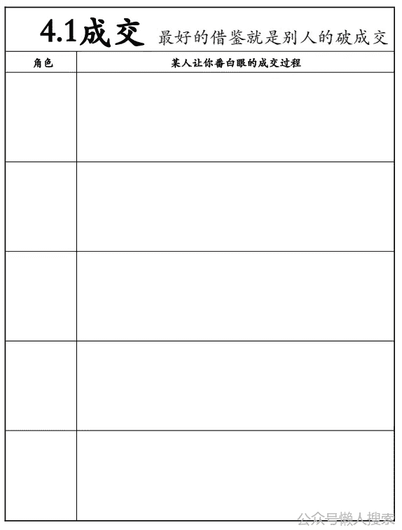

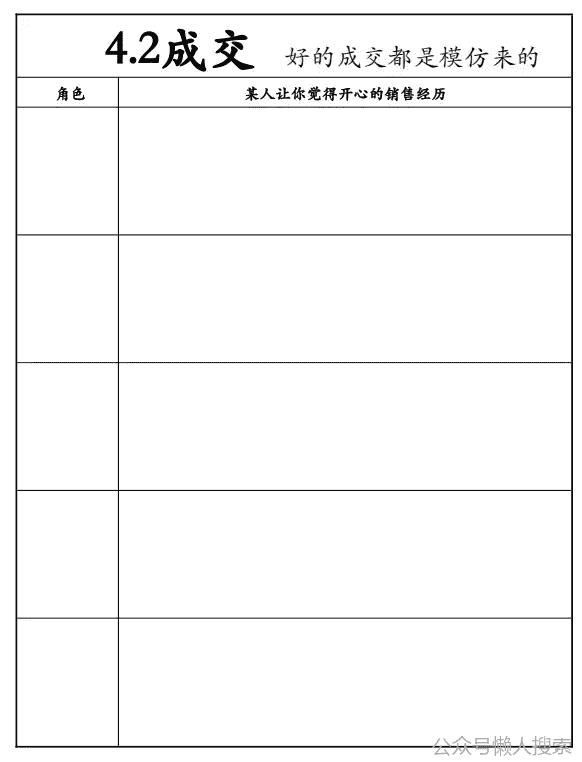

## 五、售后服务

### 01、如何去做售后服务

定义：售后服务的定义叫做：给出产品之外的其他价值。

产品本身你当然要服务好，但那叫本分。

更重一点：千万记得，售后服务不能只有给出产品本身的服务，这是销售的大忌。

很多人会以为自己很认真在服务，可是客户会觉得你很无趣。你没有做错，但他不会想再次跟你买产品。

1、“只做本分”远远不足

我用保险举例，因为我以前当过保险业务员。假设你买了一张保单，你已经付钱的那一刻，第二天我找你，认真解释保单内容，你会觉得对不对？对。

但如果第二次见面、第三次见面，我还一直跟你谈保单，或者一直谈专业内容，你会有什么感觉？你会觉得：

• “你是不是只会这个？”

• “怎么每次见面都讲这些？”

• 客户会慢慢不想再见你。

所以，把产品服务好叫本分，但售后服务真正的关键在于：“除了能够给出我卖的产品以外，我还能给出些什么？”

2、售后服务最终拼的是什么

售后服务拼的是：我会什么。当你做得好，客户会发生一连串变化：

他会喜欢你、喜欢跟你聊天、喜欢跟你吃饭、喜欢跟你喝下午茶，甚至会喜欢把朋友介绍给你认识。

这时候就回到一个很现实的问题：目前的你拥有什么样的技能，可以拿得出手服务客户？说到这，可以梳理自己的『技能树』，梳理的原则：但凡写的出来的技能都算

技能树举例：

早起、做饭、做家事很厉害、收纳超强、对于猫很了解、会变魔术、打字很快、做档案特别厲害、擅長使用 ai、看文章特别快、写笔记很有逻辑、字很好看、超有网感、10 秒睡著........

原则：

能写出越多越好，最好可以写超过 50 个，不管这些技能你是否熟练，都没有关系，只要能写的出来就可行。

有一次我去客户家（成交过一次的客户），刚好看到他们家的书柜比较乱，客户也在忙著煮饭，我就问一声，这书柜我顺便帮你整理整理，客户回头说好阿，你就当自己家吧。

然后，我就把每一本书按照高低重新排过一次，结果过没几天跟客户见面，客户又再次跟我买了一张几千元的单子，我就好奇的问他，怎么突然又想买了。

客户说：我发现你跟其他业务不太一样，因为你特别会整理家，那次我看完你整理的书柜后，就觉得你是的特别靠谱的人。

这就是售后服务带来的意外惊喜，你永远都不知道，看似不重要的技能跟习惯，突然某一天就会有大用。

案例：从 999 元到 25 万，因为我帮他解决了爱情问题

这个案例是一个在别的平台报了我课的学员，他下课之后过了三天就来找我。我们聊了 20 分钟，我知道这个人有 6 位数以上的预算。我也通过一些话术探测到他大概的预算范围。

聊了三天之后，聊得挺不错的。照理来讲，我应该要卖他课了。但是他会去上别人的时间管理课，我发现他对于销售暂时可能没有兴趣，而我的销售课 4000 多块，他的预算比四千要多太多了，所以我暂时没开口销售产品。

后来，他买了我这个 25 万单价的课程的原因，是因为我解决了他爱情的问题。

有一天他给我发信息，我没有回。第二天早上，我跟他说对不起，并发了电影截图说：“昨天我老婆在看电影，所以我没有回你。”他就说：“老师，我跟你朋友聊天，发现我特别羡慕你，跟你老婆关系挺好。”我就说：“我觉得你也可以。”我就给了他经营爱情的方法。

聊着聊着，过了两天他就说：“老师，你上次说的那个产品，我想考虑一下，能跟我详细地聊一聊吗？”

也就是说，这个人是从 999 元的课，转到 20 多万的课，中间没有任何的过渡产品。就因为售后服务的定义，叫做“给出产品以外的价值”。

假设你是卖保险的，你肯定不能一见客户就跟他讲保单。

你总不可能在售后服务的时候，还跟他讲三天保单吧？但如果说今天你去他们家做客，可以跟他聊酒，聊八卦。我学了 7 年的命理，我可以逗你开心。他看书，你会说：“诶，这本书我看过。”

3、做售后服务，也是在减少麻烦

再补一个很容易忽略的点：收钱之前把流程讲清楚，你就能减少售后服务的麻烦。

因为这个时代太多的人在收钱这事情上太粗糙了。付钱真的不容易，辛辛苦苦赚到的钱要付给别人，哪那么容易？

所以我会习惯在收钱之前多一段：

• 先确认对方到底要不要

• 我会耽误你多久（“借我 2 分钟”）

• 费用与优惠讲清楚

• 流程讲清楚（付费、确认、拉群）

• 你会让对方感觉到：“原来你的收钱这么严谨，我更信任你。”

我以前也是收钱收得快，后面问题一堆；现在我会把收钱放慢，多解释一下、多说一下。

把前面做细，后面售后要补的洞就会少很多。

4、第五个作业：（表格 5.1）

任务规则

基础作业：（任意格式）

• 20 个我会的技能

进阶作业：

• 40 个我会的技能

• 手写 40 个我会的技能

提交形式：

1.  基础作业：截图上传电脑或者手机任意格式

1.  进阶作业：加上手写表格拍照上传

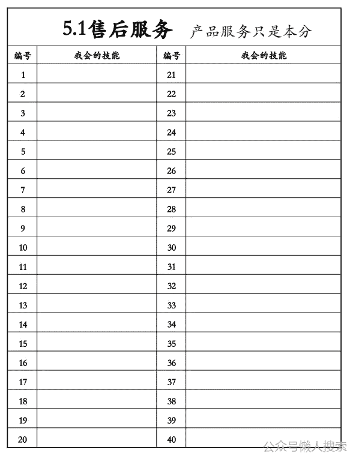

最后想说：

这是一个很稀缺的能力，一个懂销售技巧的人，不管在什么领域都可以快速的成为那个最亮眼的人。

