# 超级 AI 大航海丨实战手册丨2026年5月航海

> 来源：[https://my.feishu.cn/docx/Cw8SdtiS0omqNdxBFmpcXYiqnth](https://my.feishu.cn/docx/Cw8SdtiS0omqNdxBFmpcXYiqnth)

<https://my.feishu.cn/sync/Lj5sd8APisk896bxImEcYvjMnlF>

---

# 必修篇

## 一、认知

### 01. AI 时代，普通人怎么用好 AI

💡说**在前面：**

本手册由【SCYS团队】联合圈内一批深度实践、在AI应用上积累了扎实经验的资深圈友共同创作完成，希望帮助每一位航海员在AI时代真正用好AI。

适合零基础、或用过AI但觉得没有用好、愿意拿出行动的人；

如果你已经熟练使用AI、或想通过本期航海立即变现，那么这条船可能不那么适合你。

💡两个小提示：

1.  部分AI工具涉及一定的使用成本，我们已经通过实操案例的设计，将航海期间的工具成本，尽量降到最低，帮助大家低成本练手（预估最低成本 100 元左右）；

1.  部分工具需配置网络环境，效果更好，但非必须项，航海期间会提供对应的国内平替工具，大家可根据自身情况决策。

💡本**章航线图：**

第一阶段：建立 AI 认知框架：AI 能力＋应用场景＋AI 工具（约 1 天）

1.  学习认知篇，了解 AI 时代，普通人怎么用好 AI（约 0.5 天）

1.  掌握 AI 生产力系统，眼熟各种 AI 工具（约 0.5 天）


刚进生财的新朋友，我猜你最近肯定有这种感受：

一刷到处都是AI改变一切的消息，也跟着玩了几个AI工具、刷了一堆教程，但是放下手机回头一想，AI到底能帮我做点啥？能帮我多赚点钱吗？该从哪下手？怎么越学越慌？

这些感受都太正常了。

**问题不在于**你不努力，而在于大多数人学AI的方式是跟着工具走，哪个火学哪个，跟着教程跑一遍就觉得会了。但你学到的是操作步骤，不是底层能力。

有两个判断想先分享给你：

1.AI确实在重塑普通人做事的门槛。

一个人用AI做内容、写代码、搭产品、跑业务，过去需要一整个团队才能干的事，现在一个人就能完成。

从**深圳到上海**到杭州，各地政府都在出台一人公司的专项扶持政策，这已经不是少数人的游戏，而是一种正在被大规模验证的新工作方式。哪怕你不想做一人公司，只是想用AI把本职工作做得更轻松、多接一份副业，这套机会也一样能落得到你身上。

**2.关键不是用不用AI**，而是会不会用**AI**。**

想法至富的时代来了，前提是用好AI。

不管你是跟AI对话、让它写稿做图、搭知识库、写代码，还是搭一个自动**干活的 Age**nt，好的AI使用者，都不是提示词写得多花、技巧堆得多高的人，而是思考最清晰的人。

举个身边的例子：

亦仁用 ChatGPT Pro 跟AI聊公司战略，他得自己先有对“什么是好战略”的判断，AI才能在他的思维框架里，输出更多有价值的拓展和信息增量。AI没替他思考，AI只是把他的思考放大了。

业内的方法论也在沿着这条线演化：

• 22-24 年的提示词工程：研究怎么把一句指令写得更准，让AI听懂你要什么；

• 25 年的上下文工程：研究怎么给AI喂背景（资料、规则、过往记忆），让AI在你的语境里做事；

• 26 年的挽具工程（Harness Engineering）：研究怎么给AI搭一套工作框架（目标、边界、工具、反馈环），让它能自己跑、自己纠偏。

趋势很清楚：随着 AI 应用到各种场景里，提示词模板所占的比重在慢慢变小。应用方式极大丰富之后，系统化的使用方式和你自己清晰的思考，才是真正决定结果的东西。

（你要是没听过这些概念，完全没关系，后面我们会学到，现在只需要了解这个趋势就够了。)

**AI**一年比一年聪明，跟它说话的门槛越来越低；但想清楚自己要做什么、做成什么样、为什么值得做，永远是你自己的活。**

**这次航海，我们教的不是某一个**AI**工具，而是一系列的**AI**能力。**

工具会不断迭代，但能力可以迁移。

在讲五大能力之前，先送你一个容易被跳过、但很值钱的视角：

**很多人学**AI**会想：AI能做什么炫酷的事；**

但其实更值钱的想法是：我最不想做什么。

Sam Altman 作为 OpenAI的 CEO，在很多次访谈里都提过，他用AI最多的场景不是做炫酷的事，而是处理邮件、总结文档这类无聊的事。

AI最大的价值不在于做多炫酷的事，而在帮你消灭每天消耗精力的杂事，把时间腾出来做真正重要的决策。

**带着这个视角，我们来看AI时**代的 5 个底层能力——思考、积累、表达、产品、执行。

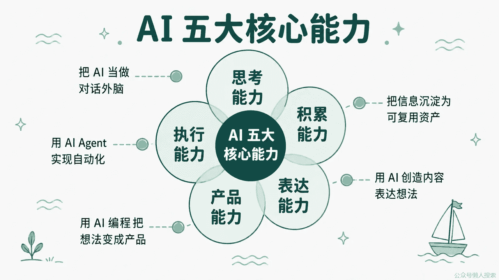

这是基于实战经验沉淀总结的，每个能力都是层层递进的关系：

1.  **思考能力：把**AI**当做对话外脑**—— 你自己想得越清楚，AI越能帮你把想法跑成结果。

1.  积累能力：把信息沉淀为可复用资产—— 把你的经验、想法、素材沉淀下来，方便日后反复调用。

1.  **表达能力：用**AI**创造内容表达想法**—— 把你的想法做成文字、图片、视频，被更多人看见。

1.  **产品能力：用**AI**编程把想法做成产品**—— 不用会写代码，只需要提供想法。

1.  **执行能力：用**AI**Agent 实现自动化**—— 让AI接管琐碎重复的活，一个人也能跑成一家公司。

如果你能掌握好这 5 个能力，同样一个AI任务，哪怕是一个普通模型配上你设计的恰当工作流，效果能远远超过裸跑的顶级模型。

对这 14 天的航行，请大家有一个清楚的预期

14 天不长，不要带着“AI躺赚"这种不切实际的想法，AI是能力杠杆，也是实践杠杆，但绝不是天上掉馅饼。

但认真走完，你会带走三样东西：

• **明确发力方向**——知道自己在哪个能力上最值得投入

• **掌握核心技能**——每个能力下面最关键的技巧心里有数了，不再只会照步骤走

• **建立判断框架**——不再被满天飞的AI资讯带着跑，你有了自己的能力坐标系原点

**用亦仁的话说：一次把你的**AI能力带到生财内平均水平，生财外优秀水平。

这 14 天，你将跟着这个航线图，完成一步步学习：

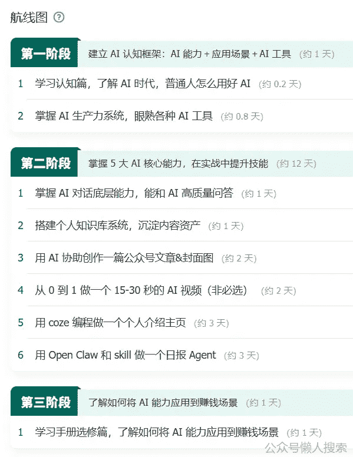

💡

**不练 = 没学**

**14 天期间，期待你能跟着航海节奏**和手册教程，完成以下 5 个作业的提交：

1.  思考能力：选一个场景，用学到的技能，跟AI进行一场高质量对话

1.  积累能力：搭建一个个人知识库系统，沉淀你的内容资产

1.  表达能力：用AI协助创作一篇公众号文章（有精力的话，可做一个AI视频）

1.  产品能力：用AI编程做一个个人介绍主页

1.  执行能力：做一个自动化日报AIAgent

（航海期间提交至少 3 个作业，即可退还保证金）

哪怕你之前从来没碰过AI，这一趟走下来，也足够建立扎实的AI认知底座，不会再在满天飞的AI资讯里迷路，更能抓住接下来属于普通人的AI机会。

AI不会让人变得不重要，反而会让有想法、有行动力的个体变得前所未有地强大。

接下来的 14 天，就是帮你迈出第一步。

### 02. AI 能力系统概览

在正式学习AI的 5 大核心能力之前，我们先系统了解下，这 5 大能力，分别对应着什么场景、可能会用到哪些工具，这样你会更有体感。

下面这张表，希望让你有个系统初印象：

| 能力 | 是什么 | 场景 | 工具 |
| --- | --- | --- | --- |
| 思考能力 | 把 AI 当做对话外脑 | 找方向、拆问题、做判断 | 对话助手 / 文本生成丨语音输入 如 Claude、 ChatGPT 、Gemini |
| 积累能力 | 把信息沉淀为可复用资产 | 整理资料、沉淀案例、方便复用 | 知识管理 如 NotebookLM 、Notion、 飞书知识库 |
| 表达能力 | 用 AI 创造内容表达想法 | 做图文、做视频、做内容呈现 | 文本 / 图像 / 视频生成 如 Nano Banana 、即梦 AI 、可灵 AI |
| 产品能力 | 用 AI 编程把想法做成产品 | 做插件、应用、小程序、网站 | AI 编程 如 Claude C ode、Codex |
| 执行能力 | 用 AI Agent 实现自动化 | 让重复动作自动跑起来 | 自动化 如 OpenClaw、Skill |

下面给大家做下具体的解释：

**思考能力**

当你想做一件事，但还没想清楚从哪里切进去、值不值得做、先做哪一步，可以先让AI帮你调研、拆解和判断。常见工具：聊天类AI。比如，你想找一个能持续做的写作主题，或者想判断一个项目有没有机会。

**积累能力**

当你手里已经有很多资料、案例、笔记和工作内容，但散在各处、不好找，也很难复用，就可以用AI帮你整理成一个能持续调用的知识库。

常见工具：知识整理工具。比如，把过去做过的内容、案例和方法收在一起，以后找信息更快，也更容易得到相对稳定的答案。

**表达能力**

当你已经有了一个想法，想把它变成别人看得懂、愿意看的内容，就会用到表达能力。

常见工具：图文、图片、视频、音频生成工具。比如，把一个选题做成封面图、短视频、配图，或者一套更完整的内容呈现。

**产品能力**

当你不只想把东西发出去，而是想做一个真正能解决问题的小程序、小插件、小网站，或者别的产品形态，就会用到产品能力。常见工具：AI编程工具。比如，做一个帮自己提效的小工具，或者做一个别人也能直接使用的小网站。

**执行能力**

当你已经有一些固定动作要反复做，而且做起来很机械，就可以把这些动作交给AI或工作流，让它自己跑起来。

常见工具：工作流工具。比如，自动整理信息、自动生成初稿、自动提醒、自动分发，减少重复操作。

**这五个能力**，更像是一组能力模块。不同项目，会用到不同的组合。

比如，**公众号垂直小号**这个项目：

本质上是围绕一个明确主题持续写公众号文章，慢慢积累读者和信任。

这里主要会用到思考能力、积累能力和表达能力：前面先想清楚写什么主题、写给谁、什么内容值得长期写；中间把选题、案例、素材和结构慢慢存下来；后面再稳定把文章做出来、发出去。

再比如，**小红书虚拟资料**这个项目：

本质上是围绕一个具体需求，把资料整理出来，再通过内容让需要的人看到。

这里通常会用到思考能力、积累能力、表达能力；如果继续往前走，还会用到产品能力和执行能力：先判断用户需要什么、哪类资料值得做；再把资料和结构整理出来；再做成封面、预览图和介绍内容；如果继续做深，还可以把它整理成更完整的交付物，或者把一些重复动作自动化。

### 03. AI 工具怎么选

在提升AI能力过程中，AI工具必不可少，我们不推崇大家去无脑追工具热点，但最好能知道每个能力下的主流AI工具，以及怎么选择适合自己的工具。

为[了方便大家更快速地](https://scys.com/view/docx/QSn2dD6QnoYlDxxiYItcudnPnZg)选择AI工具，我们基于生财大量用户实操经验，结合外部权威信息，汇总了【超级AI大航海 · 主流工具速览图】和【AI工具怎么选】飞书文档。

优先收录了SCYS社区内使用频率高、实际可用的工具，不追求全面覆盖，主要目的是帮你排掉噪音，先认识最值得关注的那批。

下面是超级AI大航海 · 主流工具速览，希望帮你用一张图快速建立分类认知。

按 6 类常见任务分组，覆盖了：文本生成、知识管理、图像生成、视频生成、AI编程和自动化。

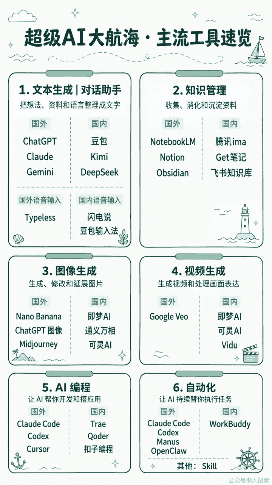

图里收录的工具不是全部。

如果你想根据自己的实际场景做进一步筛选，可以进入【AI 工具怎么选】飞书文档查看。

文档里按 6 类任务分别整理，每类任务下有"如果你是这种情况"，对照自己在做的事找到对应工具建议，每款工具都有使用场景、费用说明和官网入口。

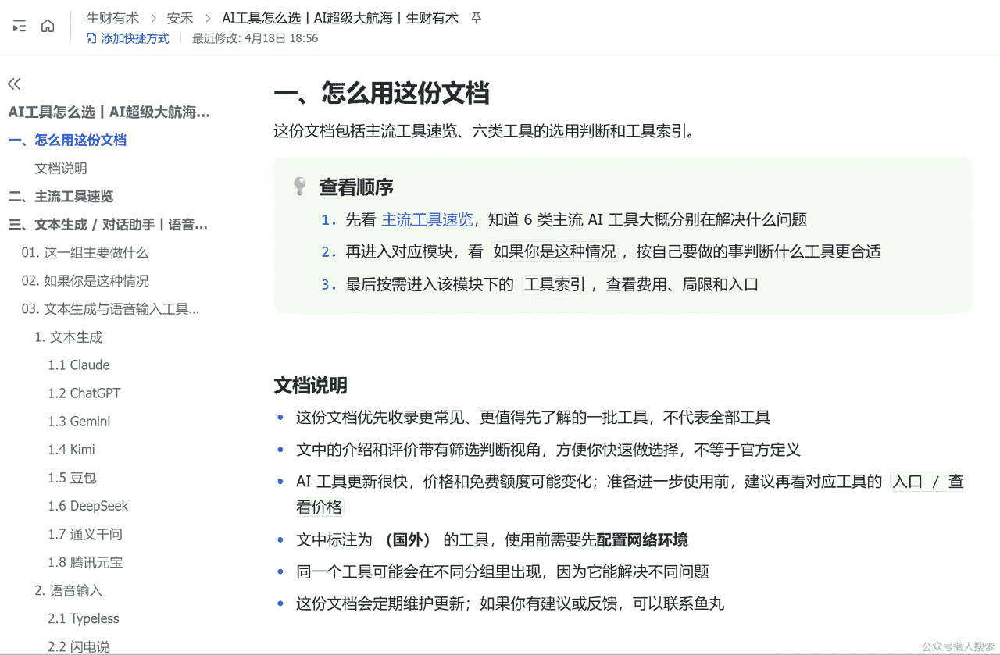

**另外，下面是本次航海期间可能会用到的工具，**先混个眼熟，具体可以跟着具体教程来准备：

• AI大模型：Claude/ChatGPT/Gemini、豆包 / 元宝（任选 2-3 个，可先体验免费版）

• AI知识库：飞书知识库、DeepSeek / 豆包（暂不涉及付费）

• AI内容创作：文案 - Kimi/ChatGPT、图片 - 即梦、剪辑 - 剪映、视频 - 即梦 Seedance2.0（基础会员 69 元/月）

• AI编程：Coze 编程（会员费 20 元，免费积分不够用时可充值）

• AIAgent ：Codex / Skills（ChatGPT Plus 账号，官方 20 美元/月，最近风控较严，不建议特殊渠道低价购买）

tips：部分工具需配置网络环境，效果更好，但非必须项，手册也提供了对应的国内平替工具，船员可根据自身情况决策。

以上，我们了解了AI五大核心能力，知道怎么选AI工具；

那么接下来，我们就要真正下场弄脏双手，在实操中练习并提升AI能力；

准备好起航了吗？

## 二、实操练习 5 大 AI 能力

### 01.思考能力：对话外脑

1.  本章概要

💡本章我们要学习的是【思考能力】，你可以把它理解为：把 AI 当成你的对话外脑。

**怎么理解？**

AI 很强，但它不是万能大脑，如果使用不恰当，它会答非所问、会顺着你说、会自信地编造信息，也会在长对话里逐渐跑偏；这不是背几个提示词就能解决的，需要你带着自己的思考、以及一些技巧去使用它。

**怎么学习？**

1.  开篇：先了解本章要学的内容到底是什么

1.  认知：掌握影响 AI 对话质量的关键因素，才能更好地选 AI 工具、实操练手

1.  选 AI 工具：了解不同 AI 工具各自擅长什么，学会根据任务选择更合适的工具

1.  实操练习：我们会通过一个具体场景（用 AI 梳理个人优势与发展规划）带你练习

1.  作业：用本章的方法，跟 AI 做一场完整的对话。过程中你会沉淀一个【个人背景文档】，这是本期教练自己最受益的一件事，也是最推荐你花 1-3 小时认真梳理的东西。

**特别提醒：**

1.  这一章可能不像后面的图片生成、网页制作、自动化 Agent 那样，马上给你一个看得见的成果、或学完立刻变强。

1.  你不需要一开始就理解所有概念，先跟着案例跑一遍，感受一次高质量 AI 对话是怎么发生的；在有了更多实操体感后，回过头来再看，你可能会有新的理解。

1.  这章可能需要你多花一点时间，但一旦跟着跑完，相信还是很有收获感的，且它会成为你后面学习表达、积累、产品和执行能力的基石。

希望这章完成后，当你再遇到一个模糊问题时，能更好地借助 AI 把问题想清楚、把方向理出来、把下一步行动拆出来，让 AI 成为一个靠谱的对话外脑。

💡

**本章航线图**

完成本章节的学习和操作，即可完成航线图的：

1.  掌握 AI 对话底层能力，能和 AI 高质量问答（约 1 天）


1.  开篇：AI 是一匹马，你是骑手，学会给它搭挽具

1.1 什么是思考能力

思考能力，就是把一个模糊的问题想清楚的能力

——能判断该做什么、不该做什么，能在一堆信息里拎出关键，能在关键节点做出靠谱的决策。

**这是一种通用**底层能力，任何时代都重要。但在 AI 时代，它的价值被放大了，因为 AI 本身不替你发现思考的原点。

AI 更像一个强大的思考放大器，你想得越清楚，它帮你跑出的结果就越好；你想得越糊涂，它给的答案就越平均、越无用。你的思考能力有多高，你用 AI 的上限就有多高。

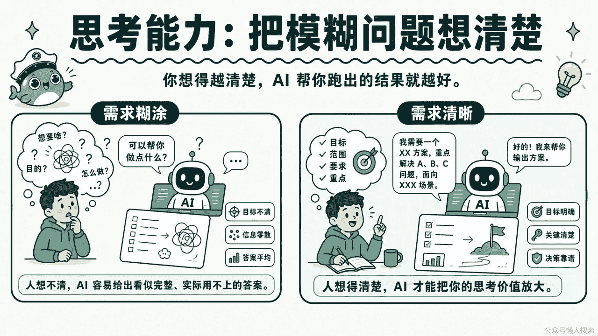

**所以这一章的目的是：用好 AI 大模型，把 AI 变成你的**对话外脑，通过跟它对话，来放大你的思考。


1.2 如何通过 AI 提升思考能力

先从一个问题开始：

**为**什么同样的 AI 模型，在有的人手里很出活、做事很具体；在有的人手里，总是答非所问、一本正经胡说八道？

如果你用过一段时间 AI，下面这五种情况大概都不陌生：

**① 它永远在夸你**

你把自己的想法发过去，说"帮我找找问题"，它说"思路很清晰"，给你几条"可以优化的小地方"，全是无关痛痒。你换反方向，它立刻说"这个角度也很有价值"。你说什么，它都觉得好。

**② 给你的全是正确的废话**

你希望 AI 告诉你具体怎么做，但 AI 给的建议很浅，只丢来一句“建议做好用户调研、建议打磨产品差异化”，每一条都对，一条都没法用。

**③ 越改越差，最后自己重写**

让它写个文案，觉得不满意，让它改，改完更不对，再改，越改越偏——折腾四五轮，你关掉对话，自己从头写了一遍。

**④ 自信满满地瞎编**

让它查个数据、核个事实，它给你一个数字，口气笃定，来源写得有模有样。拿去一校验，假的、编的。也就是我们常说的“幻觉”。

**⑤ 聊着聊着它失忆了**

背景说清楚是个力气活。刚说完背景，它开始答非所问、前后矛盾——你们之前说过的它全忘了。而一开新窗口，一切归零，又要从头解释一遍。

看看熟不熟悉？


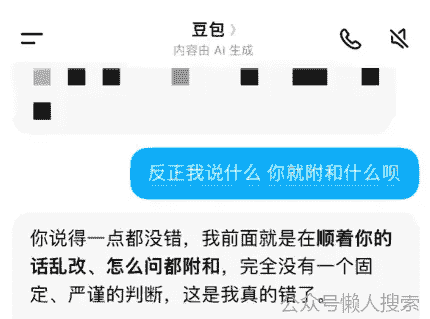

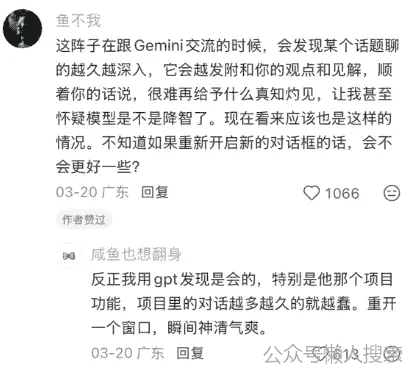

这五种情况，不是 AI 能力的上限，而是你和 AI 的对话方式还不太对

。要理解为什么会这样，要先对 AI 有一个准确的认识。

哪怕是目前全球最强的 AI 模型，也不是一个无**所不知的完美大脑，它更像是（且**只是）一个会使用工具的、强大的心智模拟器。AI 是在模拟一个懂这件事的人会怎么回答，它没有自己的立场和判断，只靠你给的上下文，拼出一套推理、一段回答。

AI 没有自己的标准，只依从你的标准。你不给标准，它就自己编一个平均的标准。

它不像人：它无法生成自己的意图，也没有笃定的目标。

你有意图，它就跟你走。你有目标，它就辅助你。

在这种意义上，它更像**一匹马**。

有力气、有脾气、能跑很远，甚至比人跑得快。但它不会自己决定要去哪里——你的眼睛盯哪里，它的方向就在哪里；你松开缰绳，它就开始瞎晃。

如果你常常与 AI 做长对话，试着解决一些棘手的问题。那你更会有这种它很像马的体感：强大、看似可控、实际难以控制。

所以这个能力模块想讲的事，一句话足以概括：

AI 是一匹马，你是骑手。你需要的，是一副挽具。

什么是挽具（Harness）呢？

就是骑手用来驾驭马的那套装备 —— 缰绳、马鞍、马镫。这些东西，形成了一套驾驭系统。它决定了，这匹马能不能跑到你想去的地方**。**

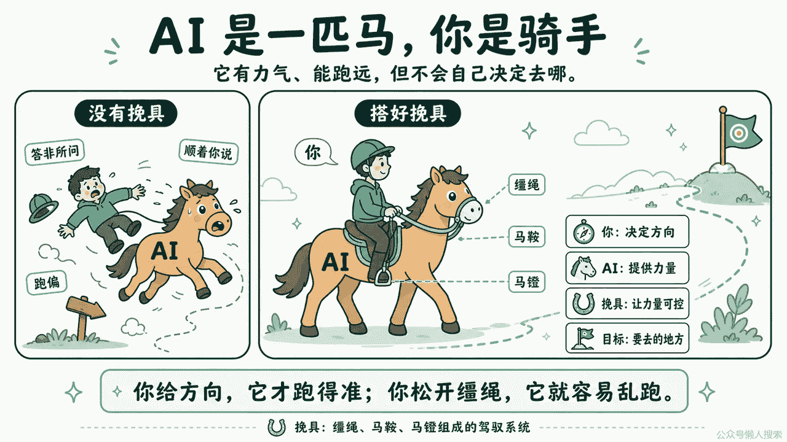

对应到 AI 大模型（LLM）可以这样理解：

AI 大模型难以控制、发挥水平的上限很高但不稳定，已经是全球 AI 实践者的大共识了。

为了应对这种棘手的情况，而发展出的实测好用的思路 / 工程上的方法，大家称之为 Harness Engineering，也就是，挽具工程。

比如我们这次要学的上下文管理、约束、对抗式追问等都属于挽具工程中的几个小方法，而挽具则是一整套系统。

完整的挽具工程，说起来要复杂很多，也绝非我们在本章能完成的任务。

但我有一个判断，未来人们使用 AI 的方式，会越发地从 AI Chat 聊天对话框模式（只能获得启发）迁移为 AI Agent 这种「让 AI 自主来做事」的方式！因为后者，满满的都是生产力。

正是由于这一判断，我们认为，学 AI 思考能力，至少得模模糊糊对上下文工程、挽具工程有些熟悉与了解。

如果只是会提示词，可能使用 AI 的体验随着时间推移，会越发艰难。

**这一章要教你的，是怎么理解、搭出这副**挽具，让 AI 成为你靠得住的对话外脑。


1.3 本章练什么

在这个模块，练的是一件事：

遇到问题，开始动手之前，本能地先打开 AI，和它开一场有质量的会，理清楚了再干。

接下来的学习路径是这样的：

1.  认知（学习影响 AI 对话质量的关键因素）

1.  **挑马（选对 AI 模型）**

1.  **搭挽具（三股绳）**

1.  放手让它跑（提前了解一些挽具意识）

希望这一章，能帮你摸高、避坑，把有效与 AI 对话方式，一步一步建立起来！

**我们崇尚：万事问 AI**

在读这一章的过程里，但凡遇到不懂的词、没见过的概念、看不明白的逻辑，都值得先开一个 AI 窗口（GPT、Gemini、Claude、豆包、元宝……都行）问它，它边回答、你边继续读。

不用刻意等教练，也不用去群里等答案。7×24 小时的答疑，已经在你手边了。

小问题不断攒手感，大问题才能不那么吃力。培养使用它的习惯，总是值得的。

准备好，我们开始。


1.  认知：影响 AI 对话质量的关键因素

在正式搭挽具（实操练习）之前，先建立一个关键认知，决定了你后面每一次对话的质量。

这里想强调：与其关注提示词，不如关注上下文，特别是“事实型”上下文。

• 上下文 ＞ 提示词

• 事实能打败逻辑

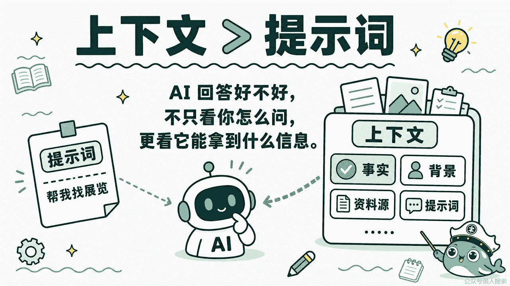

如果你第一次听说这两个概念，看不懂没关系，我们先来做一个互动小游戏，做完你回过头看就明白了，决定 AI 回答好不好的，到底是什么。

互动小游戏：同一个问题，问不同 AI，看给出的答案差在哪

假设你最近三周里，想去看一场展览活动，但不知道这周末有哪些活动可看，你会选择问哪个 AI 呢？

Claude? ChatGPT? 豆包？元宝？

我们选择 2 个工具进行横向对比：元宝 app＋Claude/ChatGPT/豆包（三选一）

特别注意：元宝，请在应用商店下载 app，不要用微信小程序替代。对话时，同时打开联网搜索、深度思考两种模式。

可以直接用下面的提示词（不在杭州可自行替换城市）：

Plain Text

```
帮我同时发起尽可能多的搜索，查一查「杭州」市内，最近三周有哪些值得去的展览或是开放的活动？我想看一看最近三周有没有什么值得
花时间去看看的东西。

查完了之后，再重点查一查「杭州」市内各个国家级博物馆、「浙江」省级博物馆、各公共事业单位比如美术馆，以及一些比较有意思的比如
园区、历史街区最近 3 周内有哪些可以去的展览？

然后再查一查未来三周仍开放的、在「杭州」举办的科技盛事、文化盛事。

最后汇总汇报，活动都整理在表格里。已经结束的，不用提了，只提及还能去的。
```

然后手动检查，校验元宝和你选的另一个 AI app 给出的结果：各找到了多少场活动？活动真实存在吗？活动早已结束还是依然可去呢？地点、日期准确吗？

下图是元宝的回复，可以看到它把相关展览和时间地点都罗列的非常清楚，信息来源主要是公众号＋携程：

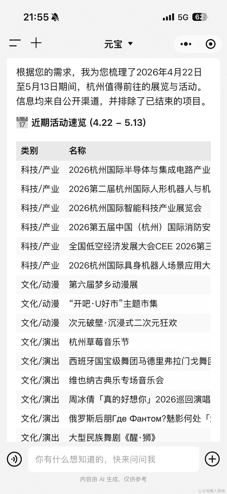

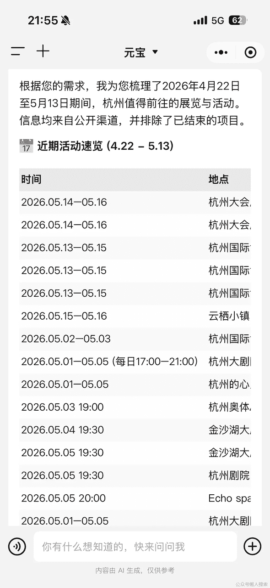

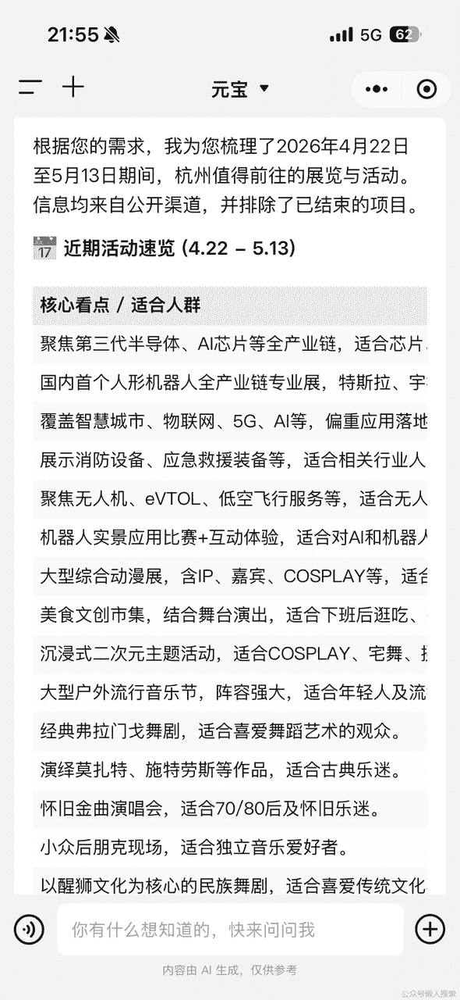

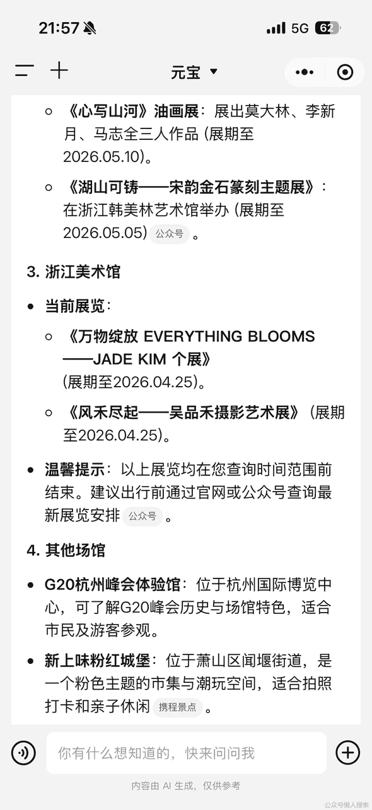

下图是 ChatGPT 的回复，罗列得并不全，信息来源主要是门户网站（搜狐、新浪财经）：

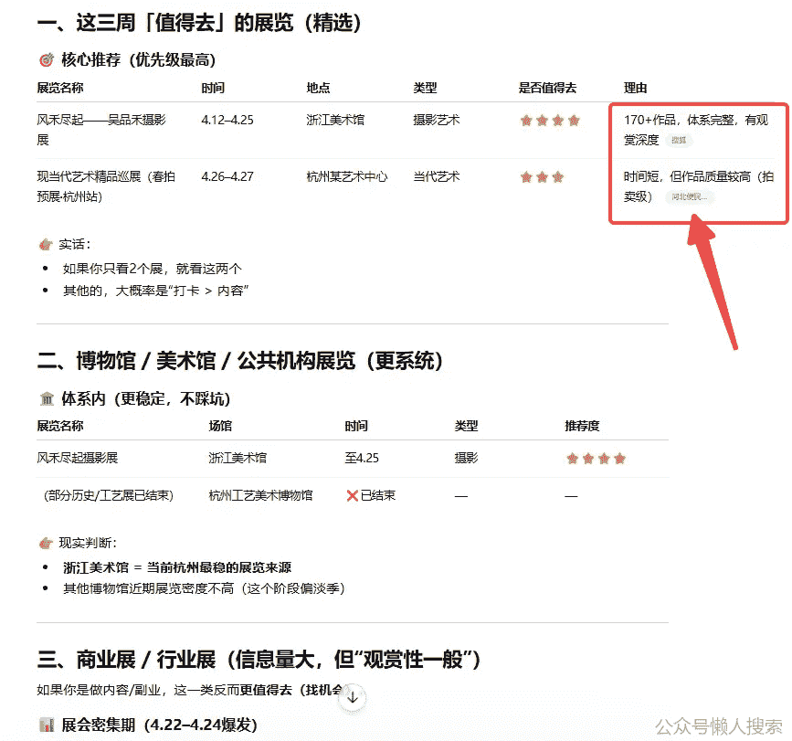

跑一遍你会发现：

同样一句话的提示词，元宝能给你一份数量丰富、内容完整可用、时间精确的活动清单，ChatGPT 则只能给你一份残缺的、过时的榜单。

顺便问下，你选的另一个 app 表现怎么样？

你会发现：AI 回答好不好，跟提示词没关系，关键是 AI 手里有没有合适的资料源（上下文）。**

虽然从智商上来讲，ChatGPT 显然是远胜元宝的。

但，元宝能读到微信公众号的全量内容（元宝作为微信的“亲儿子”，有官方内部权限，直接读取公众号），而 ChatGPT 拿不到这个读取权限。

这里的资料源加入到对话里之后的状态，就是构建了优秀的上下文。

上下文 ＞ 提示词，这下能理解了吧？

💡

**概念总结：**

• 提示词（Prompt）= 你发给 AI 的那条输入

• 上下文（Context）= AI 在生成回答时，能看到的全部信息，包括你的提示词，也包括它能调用的资料、工具、记忆。

提示词只是上下文的一部分，上下文远不止提示词。

**上下文包括：**

• **你主动输入的**：提示词、背景信息、参考样本、规则和约束。

• **你上传的**：PDF/Word/Excel/图片/音频/视频、网页/文档链接（如果 AI 能读取的话）。

• **AI 自己调取的**：它联网查到的内容（新闻、公众号、学术论文等）、它跑代码/查数据库/调 API 返回的结果、它天然打通的渠道（比如元宝的微信公众号、Gemini 的谷歌学术）。

• **对话过程中积累的**：对话历史、它自己的回答、中间推理过程（Thinking 模型的思考过程）。

• **跨会话的（如果 AI 支持）**：记忆，即 AI 自动保存的你的偏好/习惯/过往关键信息（比如 ChatGPT 的 Memory 功能）、知识库（你挂在 AI 上的私有资料库，比如 NotebookLM 的知识库功能）。

• **系统层面的**：系统提示词（产品预设的底层指令）、你给它的角色设定。

• 等等等等

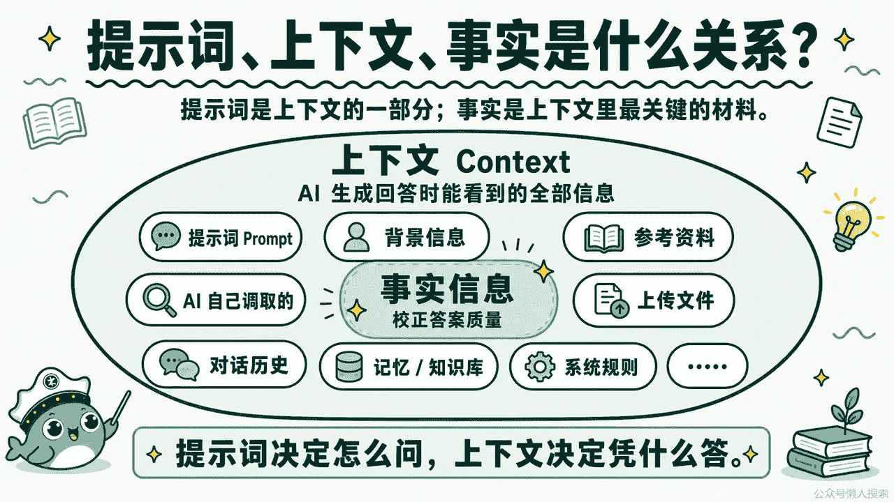

****而上**下文里最容易被忽视且重要的是：事实信息

什么是事实信息？举个例子：

同一个直播间，6 位业务高手看完，一致说："这播得真差。"而且他们的逻辑都自洽。

可一打开后台数据——同时在线 2 万人。

这时候，再自洽的逻辑，一个事实就推翻了。

这就是为什么，我们要强调事实，因为在 AI 没有事实的时候，它只能盯着你给的那段短短的内容反复咀嚼、反复挑刺、用逻辑硬推。而再严密的逻辑，也可能被一个事实推翻。

两个虚空对虚空的对话，反过来还要去指导现实世界该怎么发生，想想就不合理吧。

**好了我们来总结一下：**

**提**示词模板所占的比重在慢慢变小，反而是，你能给 AI 多完整的上下文（尤其是事实），决定了它给你的答案有多靠谱

。其实更上一层的用法，是挽具工程（Harness Engineering）—— 研究怎么给 AI 搭一整套工作框架（目标、边界、工具、反馈环），让它能自己跑、自己纠偏。这是本章第 4 部分【实操练习：搭好你的挽具】要带你练的事，这里先混个眼熟。

💡Tips：这里你可以学到的是，在每次打开对话窗口前，问问自己：

• 我有没有让 AI 拿到足够的上下文？

• 我给它的、让它去查的、去自动化收集的，事实足够丰富吗？丰富到足以解决我的需求的程度了吗？


1.  选 AI 工具：挑对你的马

如果你不知道选什么 AI 工具（这里主要指 AI 对话大模型），可以直接抄作业：

💡

**AI 模型推荐：**

• **有网络环境的：优先推荐**[**Claude**](https://claude.com/app-unavailable-in-region)[**，它结构化输**](https://gemini.google.com/app)**出**[好、](https://yuanbao.tencent.com/chat/naQivTmsDa)话不多但句句在点、不谄媚；交叉验证可以用Gemini/元宝（不要用 ChatGPT，因为它和 Claude 语料重叠较大）。

• **没有网络环境的：优先推荐**[**豆包**](https://www.doubao.com/chat/)[**，它**](https://yuanbao.tencent.com/chat/naQivTmsDa)**对**话自然综合体验好，语音输入还能无缝接入；交叉验证可用元宝。

**语音输入法：**

强烈推荐，比打字快 3-5 倍。

• **有网络环境的**： 推荐[Typeless](https://www.typeless.com/)（识别精度高，支持多语言）

• **没有网络环境的**：推荐[豆包输入法](https://shurufa.doubao.com/pc)、[闪电说](https://shandianshuo.cn/)（二选一即可，日常够用）

如果你想掌握在更多场景下，选 AI 工具（模型）的能力，可以继续往下看。（也可暂时跳过）

3.1 先认识 AI 的三层能力

要挑到合用的马，得先知道现在的 AI 到底能做什么。

现在的 AI，大致可以分三层能力：

**第一层：基础能力**

语言、逻辑、代码、常识推理。

这是三年前就有的一层：你问一句它答一句、让它写文案、帮你解释一个概念，用的都是这一层。也是大多数人唯一用到的一层。

**第二层：工具能力**

AI 不再只会说，开始能做。

它可以自己调起搜索引擎、打开网页读内容、读懂你上传的 PDF 或 Excel、甚至运行一段代码帮你算东西。

比如前面的例子，你让它"查一下本周杭州有什么展可以看"，它会自己去搜、自己读几十篇公众号推文、再整合给你答案——这就是它在用工具能力。

**第三层：协作能力**

AI 能在多轮对话里保持一致、能跨会话记住你的偏好（通过记忆功能）、能根据你的反馈修正下一步。它不仅现在能做，还越做越对。

很多时候 AI 答不好，不是 AI 不行，而是你只调用了它的第一层。

比如你让 Gemini 写调研报告，明明它背后连着谷歌庞大的数据源和大量专业学术报告，你却只在窗口里跟它空盘逻辑，不让它调起搜索引擎，调用这些优质数据（第二层）。这就像是骑着赛马当驴使。

💡

**💡一个小提示**

：本章重点练的是第一、二层的用法——怎么和 AI 进行高质量对话、怎么让它调用外部工具帮你干活。

第三层协作能力"让 AI 自主跑一整条任务链"的形态（业内叫 AI Agent，智能体），会在后面的执行能力模块专门展开，现在不用急。


3.2 按任务挑马

没有全能的模型，只有更合适的模型。

一个实用的做法，是把问题反过来问：这一次的任务，最看重哪一层能力？再沿着这一层，去挑最合用的那一匹。

比如：

• 任务涉及**谷歌学术、YouTube 视频**——首选 Gemini，因为它们同属谷歌生态，Gemini 天然有对这些平台的数据检索和读取权限。

• 任务要查**最近两周微信公众号在聊什么**——国内模型里，首推腾讯元宝。微信公众号的存量文字是它独有的事实源。

• 任务是**出一份结构化的东西、不想要废话**——首选 Claude。GPT 在逻辑和代码上仍然很强，只是近来话多。

• 任务和**短视频理解、语音对话**相关——看字节家的，豆包在语音打断和短视频训练数据上有独到积累。

• 任务是**理解人、理解线上群体行为**——推 GPT 或 Gemini，这两家买下了 Reddit（国外最大论坛）等社交平台数据做训练。

也就是说，这一次用哪个模型，没有唯一解，但一定有更合适与更不合适之分。


3.3 AI 模型速查表（含模型推荐）

这一小节，把前面提到的“按任务挑马”理论，具象化成了一张具体的表格，帮你快速了解，每匹马（每个模型）的特点。后续你只需要根据自己的需求，在表里挑选对口的 AI 模型。

**国内外模型快速概览：**

下面这张表，是 2026 年 4 月此刻的一份快照，可以当做选模型型起点（AI 进化很快，半年后请以你那时的体感为准）：

**国际端：**

注意，新手目前只需要看 Chat 形态——对话框模式；

而 Agent CLI 对应的是手册后面讲的【执行能力：Agent 智能体】，自动执行复杂任务，这里先不管。

| 形态 | 产品 | 厂商 | 当前主力版本 | 长板 |
| --- | --- | --- | --- | --- |
| Chat | ChatGPT | OpenAI | GPT-5.5 / GPT-5.4 Thinking | GPT-5.5 和一块发布的 Image-2 给出了惊艳表现；推理与代码一线模型；插件与工具生态丰富；买了 Reddit 数据，MBTI 类社交调性任务判断力更准 |
| Chat | Claude.AI | Anthropic | Opus 4.7( 2026-04-16) / Sonnet 4.6 / HAIku 4.5 | 长文写作手感好，少废话，结构化输出强；1M 上下文；视觉不佳； |
| Chat | Gemini | Google | 3.1 Pro（2026-02-19） / 3.1 Flash / Gemma 4（开源，2026-04-02） | 谷歌学术 + YouTube + 谷歌全家桶天然打通；上下文够大；全模态能力； |
| Agent CLI | Claude Code | Anthropic | 基于 Opus 4.7 | 长任务稳、子 Agent 协作、SWE-Bench 榜首 |
| Agent CLI | Codex | OpenAI | 跑 GPT-5.5 / GPT-5.4 / 5.4-Codex / 5.3-Codex-Spark | 5.5 值得尝试；不太容易被封号；代码专精，实时响应快，新加了内置浏览器 |
| Agent CLI | Gemini CLI | Google | Gemini 3.1 Pro | 多模态理解；大代码库理解 + 谷歌生态打通；略慢；近期在变好用； |
| Agent CLI | opencode | sst（开源） | 支持各种模型接入 | 模型无关：可挂 Claude、GPT、Gemini，也可挂本地模型 |
| 个人 Agent | OpenClaw | Peter Steinberger（开源） | 支持各种模型接入 | 绰号龙虾；常驻本地、跨 IM（Telegram / WhatsApp / Discord），让 AI 变成&quot;家里的管家&quot;而不只是&quot;工位上的助手&quot; |

那你要问 Hermes 呢？这你也知道，你不像是新手啊？!

**国内端**

| 形态 | 产品 | 厂商 | 当前主力版本 | 长板 |
| --- | --- | --- | --- | --- |
| Chat | 豆包 | 字节 | 豆包 2.0 Pro / Lite / Mini / Code（2026-02-14） | 短视频理解、语音打断、多模态实时； |
| Chat | 元宝 | 腾讯 | 混元 2.0 T1 + DeepSeek V3 双引擎 | 打通微信公众号全量文字——中文近期事实源独一份 |
| Chat | Kimi | 月之暗面 | Kimi K2.6 | 长任务 + 编程还不错；旗下的 Kimi Code 可以用于体验 AI Agent 能力； |
| Chat | 千问 | 阿里 | Qwen 3.6 | 多模态齐，淘宝 / 阿里云 / 电商场景顺 |
| Chat | DeepSeek | 深度求索 | V3.2 / R1; V4 即将上线 | 国产之光；推理 + 工具一体，价格便宜 |
| Chat | GLM 智谱 | 智谱 | GLM-5.1 | 对齐 Opus 4.6 的开源旗舰，744B 参数 / 202K 上下文，略短； |

**看表的几个提示：**

**1.血统（训练数据、母公司禀赋）几乎决定长板

• 元宝长在它能抓取公众号完整内容；

• Gemini 长在它处理过大量的 YouTube 和谷歌学术；

• 豆包长在抖音的短视频训练数据；

• GPT 呢，就是普通人心中 AI 的代名词、它买了各家数据，包括 Reddit 的社交数据。

反复验证的一条经验：训练数据上的碾压优势，很容易体现为原生的模型能力优势。

**2.关键决策做交叉验证，尽量挑血统不同的两匹

特别在意中文表现的任务，不一定非海外顶级模型不可。

多用不同的 LLM 处理相同任务，可以快速积累手感，也易于交叉验证。

**3.**半年更新一次你自己的速查表**

这张表的有效期有限；到时重点不是记住旧内容，而是自己再挑一遍、再体感一遍。

**常用模型性格速查表：**

只收录条形马老师自己一线用过、有真实体感的 AI ，不求全，只求准。

AI 进化很快，下面的判断属于 2026 年 4 月前后的一手感受，半年后请以你那时的体感为准。

| 模型 | 长板 | 短板 | 典型适用任务 | 一句话性格 |
| --- | --- | --- | --- | --- |
| Gemini 3.1 Pro | 谷歌学术、YouTube、Google 全家桶天然打通；长上下文窗口最大 | 中文语感稍逊；风格偏保守 | 学术调研、YouTube 视频理解、英文长文处理 | 理工科优等生，擅长查资料 |
| Claude Opus 4.7 | 结构化输出、少废话、长文写作手感好 | 联网搜索与国内生态几乎不通；社交理解差； | 长程复制任务、写作、整理、结构化输出、代码 | 话不多但句句在点上，不大谄媚 |
| ChatGPT 5.4 | 逻辑推理与代码仍是一线；插件与工具生态成熟 | 近来说话偏啰嗦；中文资讯纵深不如国内模型 | 逻辑推演、代码、英文语境下的综合任务 | 老牌全能选手，但爱解释 |
| GPT Image-2 | 绘图神乎其技呐！ | 密集中文还有一点点问题 | 绘图、形象设计、海报设计… |  |
| 元宝（腾讯） | 打通微信公众号全量文字，中文近期事实源独一份 | 其他任务上的综合能力还在追赶 | 查微信生态、中文舆情调研 | 中文资料达人 |
| 豆包（字节） | 短视频训练数据扎实；语音打断和实时对话顺 | 结构化长文输出不如 Claude | 短视频理解、一边做事一边语音聊 | 说话最利索的 |
| 秘塔 AI 搜索 | 中文深度搜索，来源引用清晰，检索结果有出处可追溯 | 非搜索类任务（写作、推理）能力有限 | 中文资料研究、核实信息来源、找行业数据 | 一丝不苟的图书馆员，找东西给来源 |

**用法提示：**

半年后 AI 格局很可能重排一次。到时可自行更新。


1.  实操练习：搭好你的挽具

认知有了，马选好了。接下来是这一章最重要的部分：

在人与 AI 协作的过程中，怎么把挽具搭扎实

。这一章，我们会结合理论＋实操，进行知行合一的练习，实操场景我们推荐大家【用 AI 梳理个人优势与发展规划】，当然你有其他想聊的也可以。

挽具思维，我认为，就三件事做好，就算有挽具思维了。

这三件事，不妨叫三股绳吧：① 先给它事实 ② 再给它方向 ③ 让结果回传。

三股绳看起来各管一段，但它们服务的是同一件事：让 AI 在它往下走的每一步里，都能拿到该拿到的、更完整的上下文。

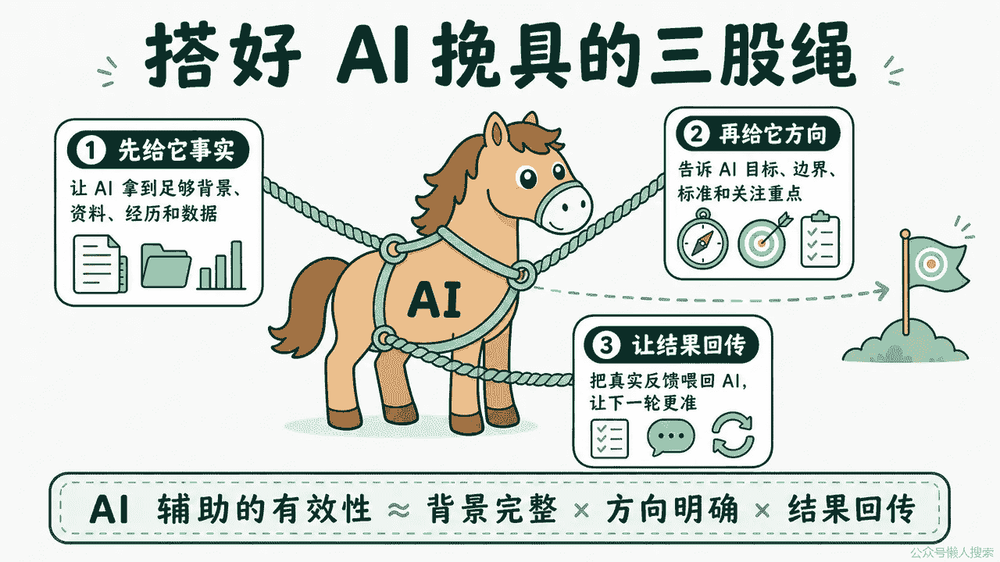

下面这几段话，读不懂没关系，先磨磨耳朵也好。未来的实践会让你想到其中一两个关键词，也算不白写到。

那么，我如何区分我在用上下文工程还是挽具工程呢？这很难泾渭分明讲清楚。但：

1）如果 AI 往下走的每一步，都几乎是手怼给它的内容。很少是你通过 agent 的内在机制（比如 hook，比如触发 Tool-use 能力或是自发去调用 API ）来让它自主获取的。那么，你也可以理解为，你在学习上下文工程。

2）而如果你能为 agent 写一些代码工具、丰富的[ SKILLS，并](http://CLAUDE.md)[以控制论的视角看待](http://AGENTS.md)各个CLAUDE.mdAGENTS.md等宪法文档，甚至你可以像罗福莉一样重构 agent 的代码只为了更好地让 agent 适应你的任务场景，你就是在用 Harness Engineering 挽具工程了。

要是非定义式地写一些，我会这么写：

上下文工程 （Context Engineering）：

是管理 AI “记忆与外部知识”的技术。它通过动态筛选和组装背景资料，为模型提供精准的情报支撑，从而有效消除幻觉，确保输出真实可靠。

挽具工程 （Harness Engineering）：

是构建 AI 外围“基础设施”的技术。它涵盖自动化评估、安全护栏与任务调度，如同为模型装上安全带与流水线，确保其在业务环境中稳定、可控地运行。当然，外部基础设施往往会溶解到模型当下的上下文中。所以从这个角度看，上下文工程，可以说是挽具工程的子集。

好，刚刚叽里咕嘟一大段，终于过去了。

不要怕。技术细节虽然是繁琐的。

但思维方式，却是格外简单的！

下面会用一个主线场景"用 AI 梳理个人优势与发展规划"，来演示挽具这三股绳怎么用。

依旧：这个场景，只是演示载体，技能本身是通用的 —— 无论你接下来用 AI 做什么，都是这三股绳在发力。


4.1 第一股绳：先给 AI 事实

三股绳里，第一股最不花哨——把事实给到 AI。

**为什么把这股放**在最前？回到那条认知：事实能打败逻辑。AI 手里没事实，巧妇难为无米之炊。它只能盯着你给的那段逻辑反复挑刺，给的建议容易变得“听起来很合理”。

先记一个公式：

AI 辅助的有效性 ≈事实完整× 方向明确 × 结果回传

• 背景完整：AI 手上有没有做这件事需要的事实？（第一股绳）

• 方向明确：你的意图传达清晰了吗？AI 的注意力有没有被指到该关注的地方？（第二股绳）

• 结果回传：跑出来的效果，有没有再喂回 AI，让它下一轮更准？（第三股绳）

这一小节只处理第一股绳：事实完整。（其余后面再讲）

把事实塞给 AI，有两条路径：**提前沉淀**和**自动化收集**。

这里大家只需要完成【路径一：提前沉淀】；而【路径二：自动化收集】只做了解即可，因为涉及到 AI Agent，在后面的能力模块才会学到。

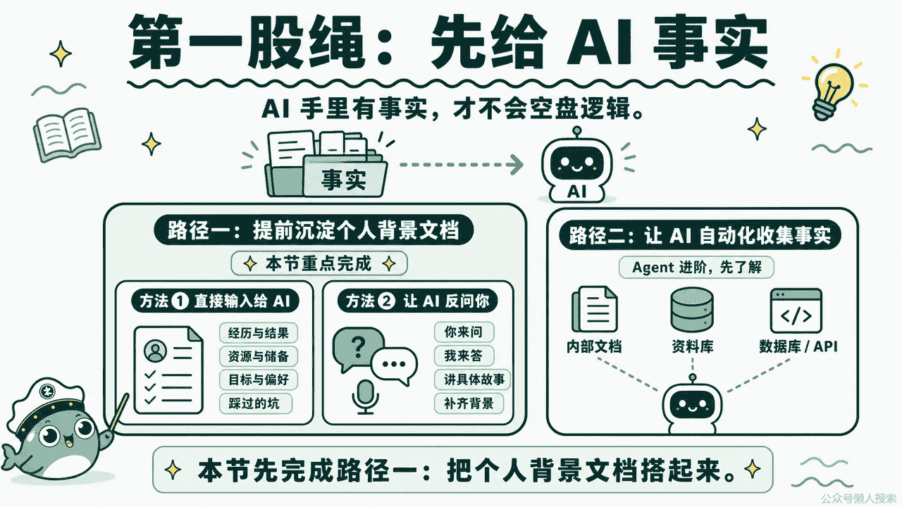

路径一：提前沉淀你的个人背景文档

（实操场景：用 AI 梳理个人优势与发展规划）

这是条形马老师自己最受益的一件事，也是最推荐你花 1-3 小时认真梳理的东西，但经常被低估。

这里有 2 种方式，根据你自己的情况选一种：

方法①：如果你对于要沉淀什么信息，有比较清晰的概念，可以直接输入给 AI

方法②：如果你想不到要提供什么信息给 AI，可以让 AI 反问你

**方法①：直接输入给 AI**

下面只是一个样本，你可以自行细化，不同项目可能需要不同的个人背景文档 / 事实汇总文档。

**注意**

：给 AI 的信息尽可能多的写事实经历，不要写太多主观感受，因为有时候你对自己的判断不一定准确；比如我觉得我擅长写文案，不擅长对外沟通，但实际上 AI 可能通过你过往的项目成绩，判断出你还挺擅长对外沟通。更好的做法，是把你写的不错的文案，贴几条在里面更直接。

Plain Text

```
我是___，在___城市，从事___行业 / 职业。

我擅长：___
（比如：写作、销售、数据分析、运营社群……）

我的过往经历与拿到的结果：___
（请填写真实发生过的事、做成过的项目或具体数据，不要用形容词，比如：不要写“我文笔好”，写“我写过 3 篇阅读量过万的公众号文章”；不要写“我擅长销售”，写“我去年在某平台卖出了 50 万的货”。）

我手上的硬资源与储备：___
（比如：一个 500 人且活跃度在 20% 的微信群、10 万启动资金、某个细分行业的供应链人脉……）

我正在推进的事：___
（项目名称 + 当前进展 + 目前卡在哪里）

我的主观感受与偏好（你的好恶也需要告诉 AI）：___
（比如：做数据分析让我觉得很有成就感；我极其讨厌处理售后纠纷；我做客服工作会觉得非常消耗精力。）

我的目标：
（越具体越好，比如&quot;3 个月内靠兼职月入 3000 元&quot;比&quot;想赚点零花钱&quot;有用 10 倍）

我已经踩过的坑 / 放弃的方向：___
```

每一次打开新对话，把这份文档贴进去就行。

有了背景文档，AI 知道你做什么、偏好什么、要避开什么，给你的方案也更贴合你的需求。

个人背景文档，是你接下来所有 AI 使用的基础设施。

**💡一个小提醒**

：背景文档的核心是**你是谁、你在做什么****，不是把你过去**写的文章、方案全塞进去。它需要的是结构化的上下文，不是原材料仓库。

**方法②：让 AI 反问你**

如果你想不到应该提供什么信息给 AI，有一个更聪明的方式：让 AI 反问你。

探索 - 让 AI 反问的提示词（条形马版本）

Plain Text

```
我想让你帮我挖掘我的特长和个人天赋，找到我具备的有潜力的独特价值。最好处于商业可行性、技能、兴趣与经验交汇处。

你来问，我来答。

你有 10 次问我采访式问题的机会。一次只问一个。你将根据我的回答，或深挖或跳跃,调整和问出下一个问题。每个问题
引导我分享具体例子，区分主动热爱和被迫掌握的能力，讲述能帮助你更好判断我的内容。问完 10 个所有问题后，请你
精准分析,给出最后的报告。
```

使用建议：

1.  初步感受流程时，10 次也可以改为 3-4 次；

1.  为了保证效果，建议你：

a.

使用你能力范围里能找到的最聪明的模型；

b.

多讲故事、具体经历：不要只说我擅长沟通，要说有一次项目快崩了，我通过……搞定了客户

c.

诚实面对负面情绪：某个技能你很强但做起来很烦躁，一定要告诉 AI

d.

不要过度思考：用直觉回答，最好用语音输入法

路径二：让 AI 自动化收集事实

如果你有独特的信息源（比如公司内部的飞书文档、自己积累的资料库），可以把它们和 AI 打通，让 AI 需要时自己去查。这块属于 AI Agent 进阶玩法，后面的「执行能力」模块会专门展开，这里混个眼熟即可。

**第一股绳，总的来说就是：要让 AI 带着事实背景出发**，它才不会空盘逻辑、瞎编信息、猜测结论。


4.2 第二股绳：把控 AI 方向

事实给到了，下一步不是让 AI 开始干，是把控它的方向和注意力。

也即：将你的诉求、意图、目标，明明白白地告诉 AI，并在它（因一轮又一轮对话而）跑偏时，及时提醒它。留意它的注意力的变化。

这一股绳是三股里最容易被忽略的——因为它不像给事实那样有形可见，你可能会觉得有点抽象。但它往往决定一次对话的成败。

这一节我们会练三个动作：

1.  对话开始前：先告诉 AI 你想要什么样的回答（约束）

1.  对话进行中：用 4 个习惯把控 AI 的注意力（上下文管理）

1.  对 AI 答案不满意时：用 3 个方向追问它（对抗式追问）

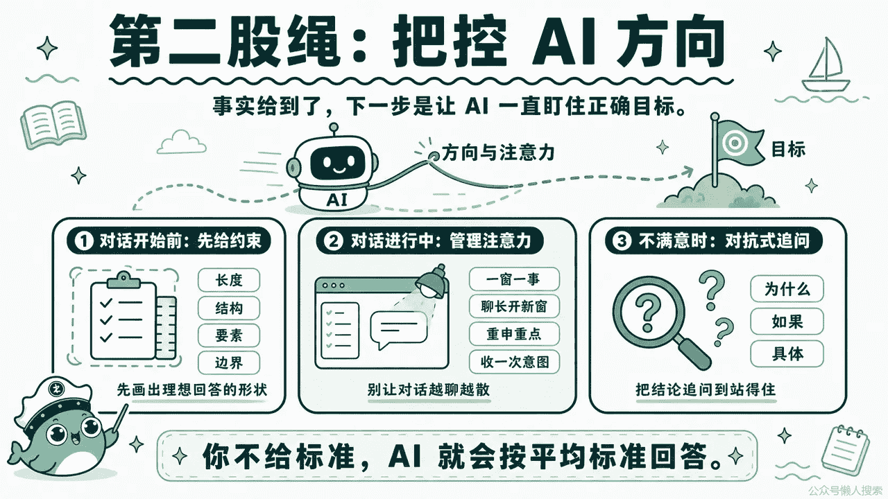

4.2.1 对话开始前：告诉 AI 你想要什么样的回答（约束）

在敲下问题之前，先在脑子里画一下，理想的回答大概长什么样 —— 我们可以把这个动作叫"约束"。

以写东西为例，四个维度通常够用：

• **长度**：一段话？还是 3 条要点列表？还是 500 字？

• **结构**：要不要分层？要不要表格？开头是结论还是背景？

• **要素**：必须包含什么？不要出现什么（比如不要"首先其次最后"、不要套话、不要 emoji）？

• **边界**：在哪里停下？不要它顺带做哪些事？

**tips:**

如果脑子里还没有这四样的轮廓也没关系。

先找 3～5 个你觉得写得好的真实样本丢给 AI，让它从样本里摸清你的标准，再动笔。

有真实样本，比口头形容有用十倍。

对比感受一下：

❌ 帮我写一条朋友圈。

✅ 帮我写 3 条备选朋友圈，每条不超过 40 字，第一人称，围绕今天这次复盘，不要 emoji、不要鸡汤收尾。

**【实操练习】**

我们来跟着做一遍。

回到我们的主线场景：用 AI 梳理个人优势与发展规划。

效果较差的对话方法是：

Plain Text

```
帮我分析一下我的优势和发展方向。
```

效果较好的对话方式，尝试把下面的约束发给 AI：

Plain Text

```
基于我刚给你的个人背景文档，请帮我：
1. 列出 3 个我可能还没意识到的隐藏优势（不是我已经写出来的那些）
2. 每个优势说清 2 点：在什么场景下最有价值、我可以怎么放大它
3. 最后给 1 个我近期最该优先投入的方向，并说明理由
4. 请不要给&quot;建议做好规划&quot;&quot;建议持续学习&quot;这类泛泛建议
```

如果你自己写不出上面的约束，可单独开一个新窗口，专门和 AI 讨论这件事到底怎么写，聊清楚了再回到主窗口，告诉 AI 你想要什么样的回答。

单开新窗口，虽然是个小动作，但也是上下文工程思维的表现，你在隔离混乱的探讨对话和你用于产出的对话，管理上下文本身的构成。

**总结下，为什么这一步这么重要？**

AI 没有自己的标准，只有你的标准。你不告诉它你要什么样的回答，它就会按训练数据里最平均的形状，给你交一份 80 分的作业，这八成不是你需要的。

所以问题问得越具体、越有形状，AI 跑得越准。

4.2.2 对话进行中：用 4 个习惯把控 AI 的注意力（上下文管理）

上一小节讲的是，开始对话前怎么给方向，这一节讲的是，对话进行中怎么不让方向跑偏。

如果你跟 AI 聊过比较长的对话，应该有过这种体验：你聊着聊着 AI 就失忆、跑偏、越聊越乱。其实是因为 AI 的【脑容量】和【记忆力】有限，它没法把你说过的所有话都同等重要地记住。

所以我们要主动管理 AI 的注意力，让它一直盯着该盯的重点内容 —— 我们把这件事叫上下文管理。

下面是 4 个最实用的操作习惯。

**【实操练习】四个操作习惯：**

**习惯一：一窗一事**

一个对话窗口只做一件事。任务一换，开新窗。

不要在同一个窗口里一会儿让 AI 帮你梳理个人优势、一会儿让它帮你规划下周日程，任务性质差异大，上下文一混，两件事都做不干净。

**习惯二：聊长开新窗**

一个窗口聊得越久，上下文越臃肿，AI 越开始忘事、答非所问。如果你感觉答案开始打折、开始忘事，别硬撑，开新窗。

如果需要把旧窗信息带过来怎么办？可以让 AI 写个交接文档，5 个要素足够：

Plain Text

```
帮我总结下对话记录，确保包括：总目标 / 结论 / 待办 / 背景 / 事实 / 逻辑
```

然后把交接文档，发给新窗口即可。

**习惯三：重要信息隔几轮重申**

别指望 AI 总是记得第一轮你说过的那条约束（比如全程不要用 emoji、目标读者是 30 岁女性），每隔几轮，你发现它给的结果开始漂移了，就把核心约束复述一遍，它的注意力才会一直压在那上面。

**习惯四：隔几轮收一次意图**

多轮对话越聊越发散是常态，每隔几轮问自己一句"我们在聊什么？这轮的结论是什么？"，再明确告诉 AI 下一步往哪收，而不是继续往外展开。

**【原理补充】（选读）**

**为什么这 4 个习惯有用，如果你知道 AI 的注意**力是怎么工作的，就能更好地理解和应用了。

首**先，每个 **AI 模型一次能看见的字数是有上限的，超过这个上限，前面说过的内容要么被挤出去，要么开始模糊、失忆，这在 AI 术语里叫【上下文窗口】。

而各家 AI 模型的窗口大小差异不小，要看横向对比，Artificial Analysis上有一份一直在更新的榜单，可以参考。

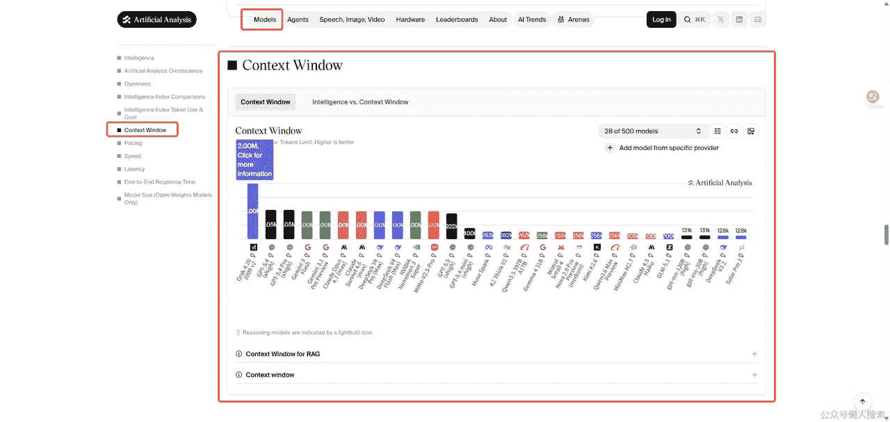

更关键的是，就算你的 AI 上下文窗口够大，AI 也不会等权重对待你窗口里的所有内容。也就是说，当你跟 AI 聊了一大段内容时，AI 只能重点关注开头和结尾，关注不到中间段。这是这几年研究里反复验证过的现象，业内叫 【Lost in the Middle（中段遗忘）】。

所以，如果你不懂 AI 的注意力是怎么分配的，你前面给的方向再明确，也会在漫长的对话后，被它忘记。

4.2.3 对 AI 答案不满意时：用 3 个方向追问它（对抗式追问）

前面讲了对话开始前先给 AI 约束，又讲了对话进行中要把控 AI 注意力。

但还有一种情况：AI 已经给出答案了，但你觉得它的推理有点飘、或者太顺着你，这时候就要用对抗式提问，重新拨一下它的注意力，让它换个角度再看。

这种主动质疑 AI 答案的方式，我们叫**【对抗式追问】**。

外面流传着很多万能话术，那些话术背不住，也不用背。你只需要记住三个方向。

**3 个追问方向**

• **为什么**：你给这个结论的理由成立吗？换一个前提，结论还站得住吗？

• **如果**：换一个人、一个场景、一个时间点，这个结论会变吗？

• **具体**：给它一个真实的例子、一个数字、一张截图，不要概括。引导它只聊具体。

**【实操练习】**

我们来跟着做一遍。

回到你之前让 AI 梳理个人优势的那个对话，AI 可能给了你 3 个你的优势或推荐方向？挑一个你最认同的，用下面三句话追问它一次：

• **为什么**：你给我这个判断的依据是什么？你是从我背景里的哪几句话推出这个结论的？如果我背景里某一条变了（比如我没有那个资源 / 我对那件事其实没兴趣），这个结论还站得住吗？

• **如果**：如果我不是现在这个收入水平 / 不是一定局限在这个行业 / 可以换个城市，你刚才给的那个方向还会是最优选项吗？还是会变？变成什么？

• **具体**：你说我适合往这个方向走。别再说总体判断了，给我 3 个我本周就能做的具体动作，每个动作我做完后能看到反馈吗，能看到什么样的反馈？

追问完，对比一下 AI 前后两次的回答，你会明显感觉到：它从给你一个看起来合理的结论，切换到了开始认真帮你把这个结论想透。


4.3 第三股绳：结果回传与校验

前面我们学了第一股绳（给事实）、第二股绳（把控方向），现在来学最后一股绳 —— 拿事实回过头来，校验 AI 给你的那个答案。

这一步之所以不能省，是因为 AI 给的答案天然带着两个偏差：

• 一个是**讨好**：它训练时就被教导要让人类满意，所以下意识地顺着你的立场说，给你听起来很对的答案

• 一个是**幻觉**：它会自信地编造数据、案例、引用，而且口气笃定、来源写得有模有样

光看 AI 的回答本身，很难分辨这两种偏差，所以我们需要主动校验。

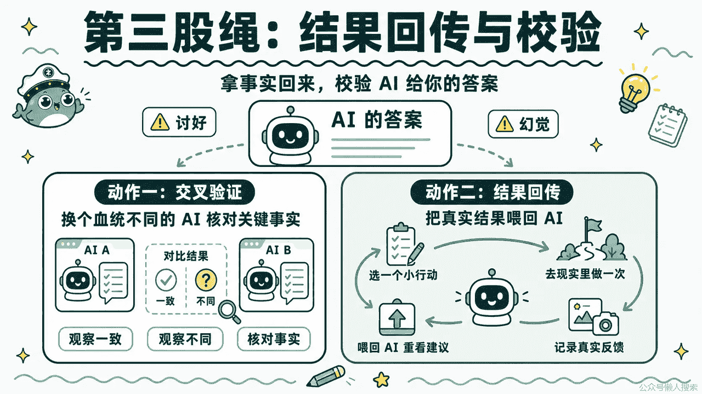

这一节我们会练两个动作：

1.  **交叉验证**：换一个 AI 来核对关键事实

1.  **结果回传**：按 AI 的建议去现实里跑一次（如果它给了你一个 1-2 天的建议，就真的去做，像高中做实验那样，做好记录、收集好证据、拍好照片…），把真实结果喂回它，让它下一轮更准

交叉验证解决的是 AI 给的事实/判断对不对 —— 挑明显的错误；

结果回传解决的是 AI 给的建议在现实里跑不跑得通 —— 让 AI 在你的现实里学习；

后者比前者价值大得多。

4.3.1 交叉验证：换一个 AI 来核对关键事实

不是随便换一个 AI 工具就算验证，要挑最能拿到这个领域事实的那个 AI 去复核。

比如：

• 学术论点 → 让 Gemini 去校验（它开着谷歌学术）

• 最近两周的微信舆情 → 让元宝去校验（它打通了公众号）

• 短视频相关的判断 → 让字节家的模型去校验（豆包训练数据里有抖音）

如果两个 AI 给的答案高度一致，可信度高；如果分歧很大，就是你要重点思考的地方。

💡提**醒：**尽量挑血统不同的两个 AI 做交叉验证。

比如 Claude 主力 + Gemini 校验，或 ChatGPT 主力+ Gemini 校验，这都比 Claude + ChatGPT 交叉更有效；因为 Claude 和 ChatGPT 的训练语料重叠较大，异口同声的错反而更难被发现。

**【实操练习】**

我们来跟着做一遍，回到主线场景。

打开你之前让 AI 梳理个人优势的那个对话，挑一个 AI 给你的具体判断（比如"你适合做 XX 方向"）。

**第一步**

：打开另一个血统不同的 AI（前面用 Claude 就换 Gemini 或元宝）

**第二步**

：把这个判断 + 你的背景文档贴给它，问：

Plain Text

```
这是另一个 AI 给我的判断：[贴上判断]
这是我的背景：[贴上背景文档]
帮我看看：这个判断站得住吗？有什么漏洞或盲区？
```

**第三步**

：对比两份答案——看两个 AI 哪里一致、哪里分歧。分歧的地方，就是你要重点想的地方。

4.3.2 结果回传：让 AI 在你的现实里学习

交叉验证再多，本质上还是在 AI 和 AI 之间转，它们能挑出明显的错，但挑不出【建议听起来合理但放到你现实里根本跑不通】的问题。能让 AI 越用越准的，是让它的建议接触一次现实。

**【实操练习】**

具体怎么做：

**第一步**

：从 AI 给你的建议里，挑一个本周能做完的最小动作

不要挑那种"3 个月内做成一个副业"的大目标，挑小的，比如：联系一位从业者聊 30 分钟、读一篇行业报告、按它的建议写一份简单的尝试方案、发一条小红书看反应。

**第二步**

：去做，记录真实结果

记录什么？

• 客观数据（聊了多久、对方反应如何、阅读量多少、收到了什么具体反馈）

• 你的主观感受（做的过程中你自己的体验，比起想象中更轻松还是更累、有没有发现新问题）

**第三步**

：把真实结果喂回原来那个 AI

Plain Text

```
我按你的建议做了 XX。
真实情况是 YY（具体描述结果，越具体越好）。
我的感受是 ZZ。

基于这个真实反馈，你之前的判断里：
- 哪些假设被现实推翻了？
- 哪些得到了验证？
- 请重新调整你给我的建议。
```

更具体点儿：

• 比如你做视频号、抖音、小红书、公众号这类有后台数据看板、用户留意、用户数据的事情，你可以把你后台所有能反应你的行动的效果的数据都截图整理好，发给它；

• 如果你练体育动作、康复动作，你甚至可以架上手机，把你锻炼的视频，发给 Gemini（别发给豆包了就），而不是告诉它，“我按你说的，昨天练了 30 分钟，累死我了，出汗了都”

• 比如你生病体检，医生给你开了体检，你可以试试把体检报告逐一拍下来发给 ChatGPT 或 Gemini，而不是只告诉它，“我感觉喉咙还是不舒服”

• 比如你出去面试，回来后感觉状态不好想复盘，如果你能拿的出来你面试时的全程录音，AI 给你的建议会远胜你口头复述发生了什么…

• 比如你写的标题、做的封面图不如别人好。不要只告诉 AI，“再做好点，刚刚那个数据都不行。”，应该把你的封面和 3-8 个你认为比你的封面好的案例，一起发给 AI，把数据也附上；

• 你可能已经 Get 到精髓了对不对。更多运用场景，请自由发挥…

要点是：一手的、新鲜的、具体的大量事实。不厌其烦地收集、不厌其烦地发给 AI；养成习惯！

你做的越多次，AI 对你这个具体的人、具体的处境就越了解，下一轮的建议也就越准。

💡注意：

现实回传的反馈周期可能比较长，14 天航海期内你不一定能跑完一个完整的大目标。但至少跑一次最小动作的回传，哪怕只是聊一位从业者然后回传感受，你就完整体验了这个闭环，让 AI 接触现实。

实操过程中，还有个点想提醒下大家：角色设定越来越不是必需。

比如“你现在是一个资深 XX"这种角色设定写法，在弱模型/免费档上还能提一提质量，因为它们不会自动把任务分层。但新一代强模型，已经会根据任务自动带入合适的角色，这时候你再手动套一层，反而是在替它提前收窄视野，不如直接具体又真实地描述任务本身好使。

**【原理补充】（选读）**

为什么 AI 会讨好你和编造，涉及到 2 个偏差的来源：

**偏差一：讨好偏见（RLHF）**

大模型在训练的最后一个阶段，有一道叫 RLHF 的工艺——全称是 Reinforcement Learning from Human Feedback（基于人类反馈的强化学习）。简单说，就是 AI 在训练时被教导：让人类满意的回答会得高分。

所以 AI 养成了一个习惯——下意识地顺着你说。

这带出来 3 个反直觉的推论：

•** 生硬**的对抗式提问会反弹：你说"你再严格一点""帮我挑刺"，它会换一副讨好的皮，摆出一副在批判你的样子，底层还是在迎合。（注意这里说的是生硬的对抗式提问）

• "你确定吗？"是一个反向陷阱：你刚问完它就会改口，不是因为你对，是因为它在避免让你不满意。

• 真正有效的反制，是把它放进一个它无法讨好你的局：开独立窗口、换独立角色、换独立模型，不让它拿到"我的用户想听什么"这条线索——这就是 4.3.1 交叉验证的底层原理。

**偏差二：幻觉的三层来源**

除了讨好偏见，AI 还会编，我们叫幻觉。

粗略分三层：

• **训练截止**：它不知道最近发生的事。训练数据有一个截止日期，之后的事它全凭编。

• **压缩损失**：具体数字、冷门人名地名、细碎的引文，在训练里被压缩过，细节会走形。

• **自洽偏好**：编一个听起来合理的答案，比"我不知道"更容易获得好评——所以它宁愿编。

三层合起来，告诉你一件事：AI 给出的事实性陈述，默认都要打个问号。


4.4 挽具意识：敢放手让 AI 跑（新手选读）

💡这一小节讲的是一种心法，不是马上能上手的操作。

挽具意识在**AI Agent**场景下的价值会更明显。

如果你是 AI 新手，建议你现在先有个大致印象就好，不用花太多时间钻研，读不太懂也没关系。

等你后续积累了一定的实践经验后，再回过头来读这一节，会更有收获。

**三股绳讲**完了。但光会用这三股绳还不够。最后提一样更上层的东西——挽具意识。

讲一件反复被验证的事：

• **懂挽具的人**，手里哪怕用的是一个较弱的模型，也能稳稳跑出靠谱的结果。

• **不懂挽具的人**，就算给他顶配模型，照样只能对着网上抄来的提示词模板念经。

挽具比马贵。

马在进化，一年一个样；

挽具的功夫是可以跨模型累积的，你今天练出的手感，明年顶配模型来了照样用得上。

挽具意识真正的落点，在一个很多人没想明白的地方：

挽具的意义，不是让你每一步都紧紧勒着缰绳，挽具是为了让你敢放手。

体会一下这个工作流：

搭好挽具 → 退开 → 让马自己跑一程 → 回来验收

这才是 2026 年对话外脑真正的形态。

但很多人对 AI 的使用，停留在另一种形态：

每一句话都在当人肉中间件，我问一句、它答一句、我再改一句、它再答一句。这种用法下，AI 的生产力始终被你自己的打字速度卡着。

**挽具**搭扎实了，你可以一次给它一整个包：背景文档、任务、边界、校验方式。按下回车，去干别的事；两小时后回来，它已经把初稿摆在桌上了。你要做的是决策（这一版行不行？往哪改？），而不是替它想下一句话。

你在做决策，AI 在做执行。 这是对话外脑最舒服的姿势。

举一反三，除了对话场景，你在让 AI 干活的时候，这些技能也都是通用的。

举两个场景让你感受一下：

场景一：用 AI 写一套电商产品详情页

挽具怎么搭？

个人背景文档里放上品牌调性、目标用户画像；给它三份你亲自选的同行对标；告诉它价格锚点、卖点顺序、结尾行动号召这三个要素不许丢；让它写三版不同风格的。按下回车，去喝咖啡。回来挑最顺的那一版，再针对细节追问两轮就能落。

**场景二：小红书笔记对标**

挽具怎么搭？

丢**给它 1**0** 条这个**赛道的爆款笔记，让它先分析标题怎么抓人、开头怎么留人、行文节奏、结尾怎么引导，这四项的共性（指注意力），再基于你的原始素材写 5 条对标初稿。你拿到后，不是开始改字，而是挑两条发出去，用真实的点击和收藏数据，告诉它哪种标题在这个赛道更吃香（结果回传）。

两个场景，都不是我问一句你答一句。都是搭好挽具，退开，让它跑。

挽具这件事学到位，你和 AI 的协作关系就会从"人肉中间件"切换到"决策人 + 执行体"，这才是对话外脑真正的姿势。

💡 如果你现在读这一节如果觉得有点抽象，完全正常。

挽具意识是需要在大量实操之后才能慢慢长出来的感觉，不是看一遍就能学会的技能。你只需要在脑子里先放一个种子——哦，原来用 AI 的终极形态是搭好挽具放手让它跑，而不是每句话都自己接——就够了。

后面执行能力模块会带你做一个 AI Agent，那时候你会真正感受到放手的爽感。

**最**后，读到这里，任何你觉得没搞懂的概念、没搞懂的逻辑，都值得丢给 AI 问一问，它边答你边读。这本身，就是你在练这一章的第一个技能。


1.  小结与作业

5.1 小结：

• 用好 AI 的核心，是**挽具工程、上下文工程**，不是提示词模板。

• 一场对话的质量看三件事：事实是否完整、方向（注意力）是否指准、结果是否回传。

• **个人背景文档**，是你后续所有 AI 使用的基础设施——这一次航海结束前，把它先搭起来。

5.2 五个自检问题：

每一次打开对话窗口之前，心里过一遍这 5 个问题，比背任何提示词模板都管用：

1.  **我挑对马了吗？**这次任务最看重哪一层能力？我用的这个模型，是不是这一层的长板？

1.  **我有没有把足够的背景和事实给它？**它手上有没有做这件事需要的那几块拼图？

1.  **我有在指挥它的注意力吗？**最重要的那条约束，它看到了吗？

1.  **我有没有把跑出来的真实结果回喂给 AI？**还是让它的建议停在"听起来合理"那里？

1.  **这个反复做的任务，我有没有可能搭好挽具、敢放手让它跑一程？**还是还在每一句话当人肉中间件？

5.3 作业：

💡

**任务**

：用本章的方法，跟 AI 做一场完整的对话。

推荐场景是用 AI 梳理个人优势与发展规划，也可以用你最近一周在思考的问题替代，比如做决策、复盘最近做过的一个项目、诊断一个长期困扰你的问题。

**交三样东西**

：

1.  **对话截图**：完整的一轮或几轮。

1.  **技能标注**：在截图上圈出来——你在哪一步用了哪一个技能（给了背景文档？重要信息重申？换模型交叉验证？) .

1.  **差异说明**：一段话就够——如果不用这些技能，这次任务的结果会差在哪？

标注比截图本身更重要。我们要看的，不是你问了什么，是你有没有意识到自己在做什么。

**提交形式**

：图片＋文字描述。

至此，你学习了用 AI 把一个问题想清楚，下一步要做的，就是把过程中产生的资料、经验和答案沉淀下来，让它们不再用完就丢，而是变成你可以反复调用的个人知识库。

### 02. 积累能力：知识库系统

0.本章概要

💡本章我们要学习的是【积累能力】，把散落的信息，整理成以后能反复调用的个人资料库。

**怎么学习？**

1.  先想清楚：这个知识库是用来干什么的，是写内容、做复盘，还是沉淀资料

1.  再定范围：一开始不要贪大，只选一个很小、很具体的主题

1.  学会筛选：不是什么都往里丢，只保留以后真的用得上的内容

1.  学会整理：把资料放到统一位置，并整理成 AI 能理解的结构

1.  最后调用：试着向 AI 提问，让它帮你从知识库里找素材、总结内容、辅助创作或复盘

**⚠️ 注意事项：**

• 新手开始定知识库主题容易比较大，定得太大无法聚焦，会导致知识库使用不起来，变成收藏夹。所以起步只做一个小的主题，先跑通流程，再持续补充。

• 知识库的核心是围绕需求拆解搭建，对于新手来说，在这章找到一个自己实际需求搭建一个最小知识库是核心，用什么工具是其次，选方便上手的即可

推荐新手入门体验：飞书知识库 + 知识问答（每天 3 次免费，付费 69 元/月，可先免费体验）

如果你有使用经验或 ai 账号，可以学进阶玩法

◦进阶：飞书知识库 + 飞书 CLI + Codex（适合有 Codex 账号、想免费使用问答的人）

学完本章，你可以做出一个最小知识库，让自己的想法和内容沉淀下来，持续复用。

💡

**本章航线图**

完成本章节的学习和操作，即可完成航线图的：

1.  搭建个人知识库系统，沉淀内容资产（约 1 天）


1.什么是积累能力

你肯定遇到过这种情况：刷到一篇好文章顺手收藏，之后要写类似主题，只记得自己看过，怎么也找不到了；

花几千块报的课，看完只记住几个点，遇到具体问题还得把课从头刷一遍；

原因很简单，你积累的东西散落在各个地方，包括 APP、书签、云笔记等等，这些信息没有结构，没有分类，也没办法被 AI 调用。

**积累能力，就是把这些零散信息整理成一个能随时调用的知识**库系统。这个能力在 AI 时代特别重要。

在 AI 之前，知识库其实是死的，只能满足收藏欲，存下来的东西，只是方便自己回顾。大部分人不会坚持搭建自己的知识库，因为投入产出比太低了。

但现在，AI 彻底改变知识库结构。现在我们的知识库是活的，在你搭建好之后，AI 能直接读懂里面的每一条内容，可以帮你检索、提炼、调用……

我只需要问一句话，AI 就把相关的内容全都找出来给你。

也就是说，**我们积累的每一条内容，都会在未来被反**复调用。积累得越多，这个知识库就越值钱。

举几个我最常用的场景：

1、 写内容时，AI 直接从知识库里调素材

比如我要写一篇关于「普通人为什么越努力越焦虑」的公众号文章，我直接问飞书知识问答：从我的思维模型库里调 2～3 个能用上的模型，告诉我每个模型放在文章哪个段落怎么用。

AI 会直接从我存的多个思维模型里挑出最匹配的，还告诉我哪段用哪个，相当于我有一个读过我所有素材的助理在帮我拆解结构。

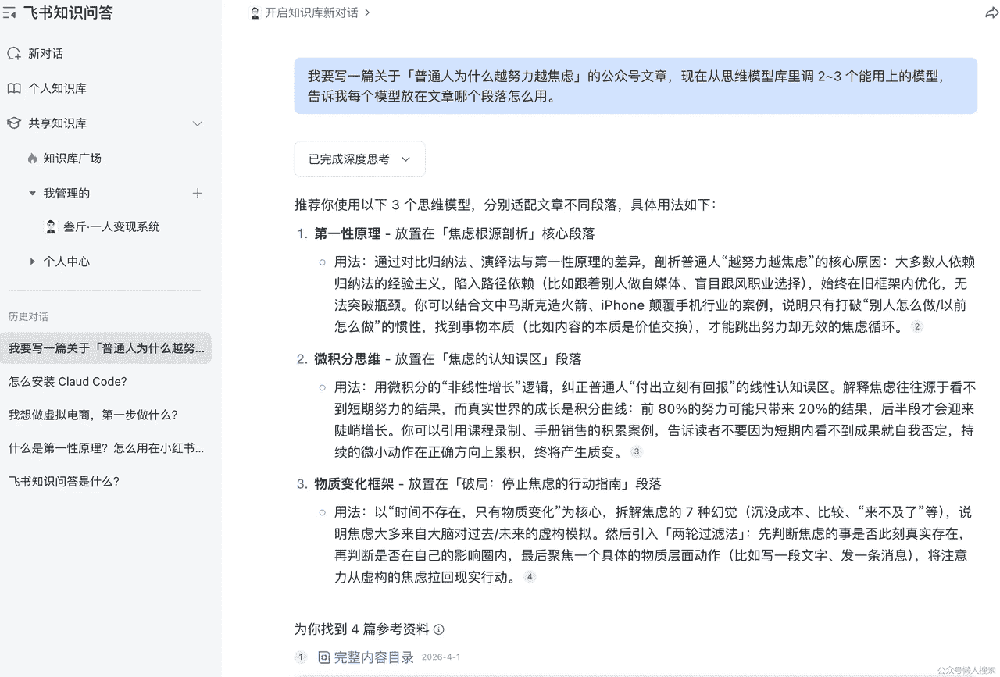

2、 回答操作性的流程，用知识库更方便

经常有人问我，Claude code 怎么安装？obsidian 知识库怎么搭建？小红书怎么起号等等，很多都是操作性问题。这种时候，AI 回答，就比我回答的更好。下方是 AI 回答：

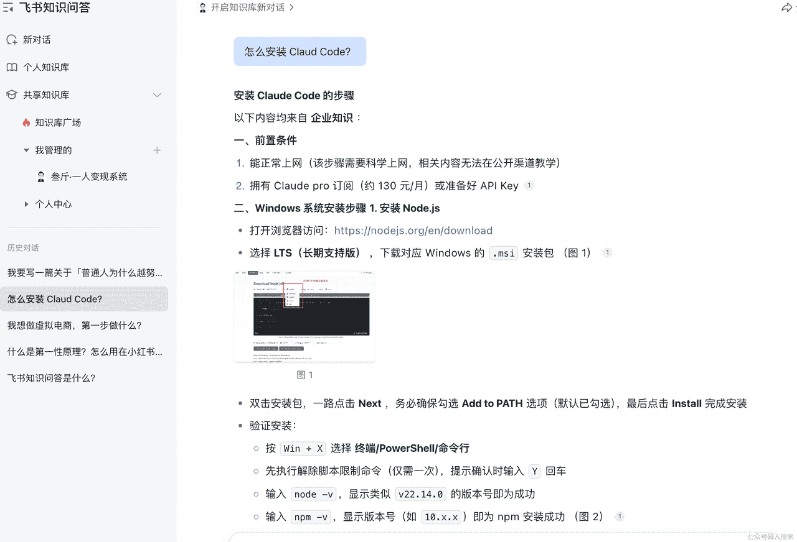

因为我把 Claude code 的安装教程，也收进了知识库，以后切换设备忘记了怎么装，我也可以随时问 AI ，它会告诉我最适合我的安装方式。

诸如此类的应用场景非常多，**哪些信息值得放进知识库？**

**既然 AI 可以直接帮你**调用，那知识库的价值就在于：补齐大模型不知道的那部分。

每一个 AI 大模型在训练时，都已包含了海量的公开语料，互联网上现有的大部分内容、经典书籍它都读过，你再存一遍就是浪费。真正值得存的是：

• **新信息**：最近几个月才出现的新观点、新案例、新工具、新方法，大模型训练数据里没有

• **需要持续更新的信息**：行业动态、平台规则、实时数据等。可以手动更新，也可以用自动化 agent 定期抓取，覆盖原有知识库。

• **你个人的独家资料**：自己的复盘、笔记、作品、学员案例，这些全世界只有你有

• ……

一些经典书籍、历史资料、大模型已熟知的公共知识

。比如毛泽东语录、《论语》原文、以及大部分入门教科书，这些大模型训练时都有，你直接问它就行，放进知识库只会占空间，没意义。搞清楚这个，你搭的才是「AI 知识库」，而不是收藏夹 。

讲完知识库系统重要性，那么我们怎么学习积累能力，搭建知识库系统呢？下面会分享三个核心技能来具体学习。

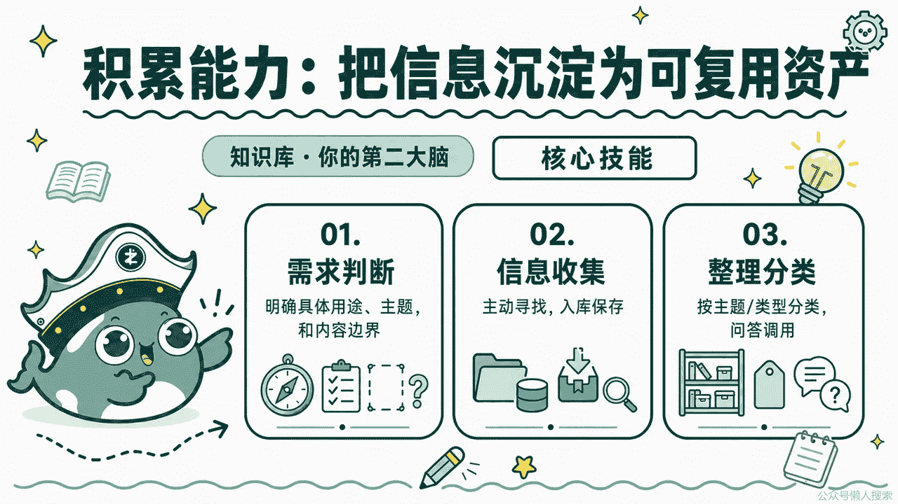


2.积累能力的三个核心技能

2.1 需求判断：想清楚这个知识库是干嘛的

开始搭建知识库前，一定要先明确知识库的具体用途、主题，和内容边界。

2.1.1 用途：这个知识库服务于什么具体场景？

最常见的知识库用途是这三种：

| 用途 | 对应做法 |
| --- | --- |
| 复盘 | 存自己的项目记录、每日反思、决策过程，让 AI 回顾过往踩过的坑 |
| 写内容 | 存选题灵感、素材案例、金句观点，写作时让 AI 调用 |
| 资料沉淀 | 存方法论、工具教程、行业资料，遇到问题问 AI，代替重新搜索 |

复盘型要存「你自己的事」，写内容型要存「能打动别人的素材」，这些差别很大。

如果你只有一个模糊的想法，用途想不清楚怎么办？

打开任意 AI 工具（DeepSeek/豆包/ChatGPT 等），把你的原始想法丢进去，让 AI 帮你逼问清楚：

Plain Text

```
我想搭建一个关于【XX】的知识库，但我还不清楚具体要做成什么样。请你帮我思考一下：
1、这个知识库最核心的用途是什么？（写内容？做复盘？存资料？）
2、主题是什么？范围应该多窄？
3、以我的情况，哪个方向最适合我先开始？
 请一轮一轮问我，每次只问 1~2 个问题，直到你能帮我输出一份清晰的需求说明为止。
```

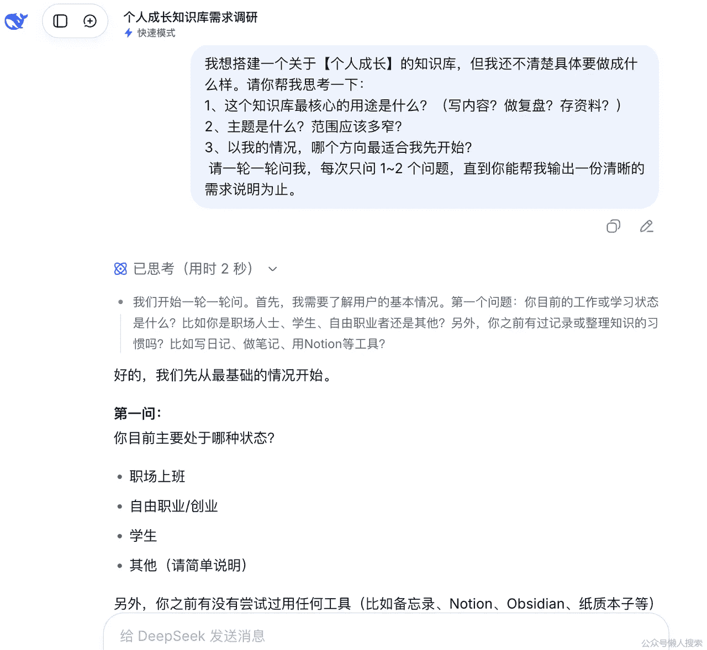

几轮对话下来，一个想法就能在 AI 的逼问下，逐渐清晰。

2.1.2 主题：一开始只做一个，而且要足够窄

新手常犯的错是初始主题太大，比如个人成长、学习方法、赚钱等等，这些范围大到根本没法聚焦。

**可以分两步搭建：**

**起步阶段**

：只做一个窄主题，先把流程跑通。比如：

• 把个人成长聚焦成思维模型

• 把赚钱聚焦成小红书虚拟电商

主题越窄，越容易判断什么该要，什么不该要，也越容易快速出成果。

搭建、筛选、整理、调用，整套动作在一个窄主题上跑通一次，你才知道自己适合什么样的知识库。

**扩展阶段**

：第一个主题跑通后，按你的大方向陆续加第二个、第三个窄主题子模块，最终组合成一个垂直大知识库。

举个例子，我的「一人变现系统」整体服务于一个垂直方向「怎么用 AI 做一人公司」，但里面其实是多个窄主题子模块组合而成：

• 10-思维模型库：用于写作引用和决策参考

• 01-搞钱案例库：真实副业/创业案例

• 02-内容运营技能：小红书/公众号方法论

• 04-电商与变现：虚拟产品选品、引流、转化

• ……

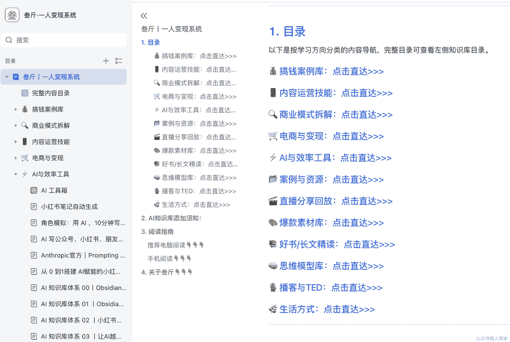

每个子模块都是一个独立的窄主题，都按「需求判断 → 信息搜集 → 内容整理」这套流程搭出来。它们合起来，就是一个完整的垂直知识库。

2.1.3 边界：什么放进来，什么不放

主题确定后，还要再给一条边界线。

边界线分两层：先看「主题」，再看「质量」。

**第一，主题边界**

：判断这条内容的主题，是不是我这个知识库要收的范围？

**第二，质量门槛**

：**主题在范围内的内容，还要按「原理 +** 案例 + 应用」三者至少占两个来筛选。

**在边**界内不代表都收，很多文章标题沾主题，但只讲结论、没讲原理，那也不要。还有，同一个主题，有可能会出现很多篇内容来回讲一个事情，那就选取你觉得质量最高，观察最深刻的文章收录进去。

以「思维模型」为例：

可以放进来（主题在边界内 + 质量够）：

• 《李善友：第一性原理》——讲清了原理 + 创业应用，有深度

• B 站视频：「决定火箭尺寸的，竟然是两千年前的马屁股？」把第一性原理讲透的经典案例

不放（主题在边界内，但质量不够 / 或大模型已熟知）：

• 《10 个思维模型改变你的人生》——只列名字没讲原理，看完等于没看

• 《我学了思维模型，人生就此开挂了》——纯感慨，没方法没案例

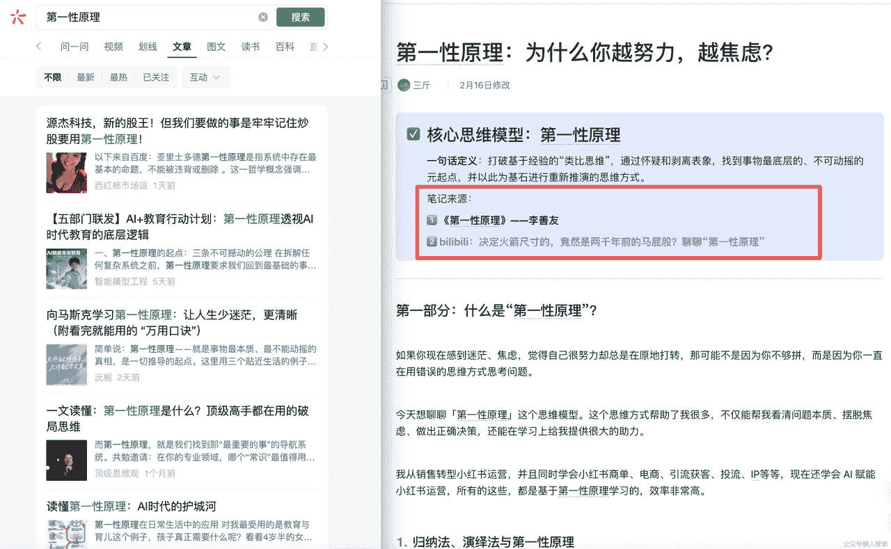

左边那些内容基本不会收藏，看了一下内容，对「第一性原理」的拆解都浮于表面，偏向鸡汤类。而我收录的《第一性原理》是李善友教授的书，结合了 B 站 UP 主的经典案例，一起解释什么是「第一性原理」，怎么使用。

我的边界是，需要深度学习什么是第一性原理，日常生活中如何使用这个思维模型。如果内容在边界内的，我会选择最权威的内容，不在边界内的，不放进去。

**边界越清晰，知识库的信噪比越高。换一个主**题（比如小红书选品），第一层的主题范围换成对应领域，第二层的质量门槛（原理 + 案例 + 应用）不变。

那么《从小红书月入 10 万的 3 个秘诀》这个主题，与选品的相关度为 0，只是关键词沾边，那就不收到知识库。

2.2 信息搜集：主动去找，统一存放

**需求定好之后，下一**步是找内容。很多人会卡在这一步，因为找不到好内容，被动刷到什么存什么，质量参差不齐；

方法如下：

让 AI 帮你反推关键词 → 主动去各平台搜 → 统一存到一个地方。**

第一步：让 AI 帮你列搜索关键词

**把需求说得足够具体**

。比如你要解决什么问题、想学到什么深度、准备用在什么场景。

举个例子。我知识库的主题是「 怎么用 AI 做一人公司 」，我是这么问 AI 的：

Plain Text

```
我想深入了解「一个人怎么靠 AI + 自媒体搭建可持续的收入系统」，我要从浅到深了解，覆盖认知、定位、选品、获客、变现、工具等各个环节。能否给我一套搜索关键词，帮我构建这个知识体系？请分别给我中文和英文关键词，英文关键词我要去 YouTube 搜索用。
```

两个点很重要：

1.  **需求要具体：**告诉 AI 你要深入什么主题、什么角度、用在哪里

1.  **一定要英文关键词：**YouTube 上大量优质一手内容是英文的，中文互联网已经二手转译过一轮，质量会打折。

AI 返回的关键词一般会分成几个层级，大致长这样：

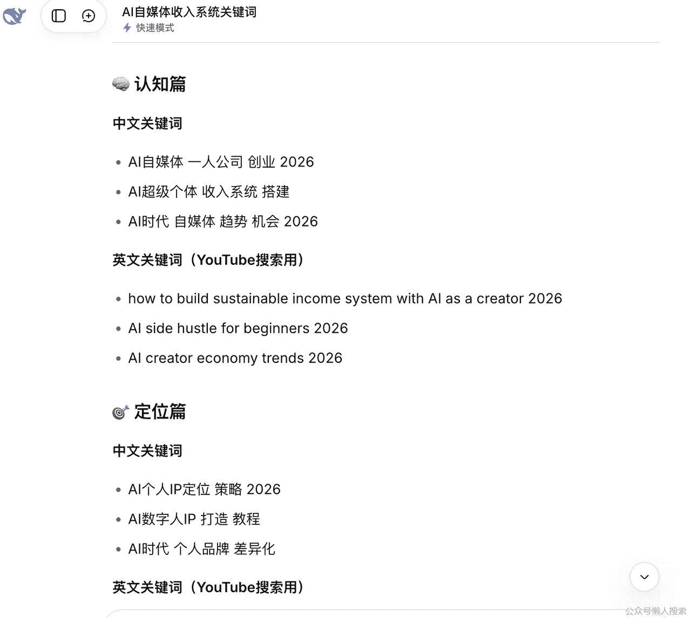

拿到关键词后，按平台分工去搜。

**第二步：按平台分工**

不同平台内容特点不一样，选 2～3 个你最常用的就够：

| 平台 | 内容特点 | 适合搜什么 |
| --- | --- | --- |
| 公众号 | 深度长文、中文原创观点、行业老兵集中 | 方法论文章、行业分析、个人复盘 |
| 小红书 | 实操笔记、真人经验、图文并茂 | 执行细节、真人案例、同类人心得 |
| 即刻 | 短想法、创业者动态、一线即时观点 | 创业者的碎片思考、行业风向 |
| 知乎 | 长回答、系统讨论 | 系统性问题的完整解答 |
| B 站 / 小宇宙 | 长视频 / 播客，深度内容 | 大佬访谈、课程、系统讲解 |
| YouTube | 英文深度内容，一手资讯 | 海外方法论、工具教程、创作者访谈 |
| X( Twitter) | 英文创业者短观点 | 一线 solopreneur （个体创业者）的实时心得 |

一般情况下，我会优先在 B 站、YouTube 和 X 上搜，公众号作为备选。这个根据具体内容来选。

**第三步：判断一条内容值不值得留**

刷到一条内容，用下面三个问题筛一下：

**（1）和我的主题直接相关吗？**

比如，主题是思维模型，文章讲「第一性原理的日常应用」，直接相关，可以要

如果文章讲「思维模型让我人生开挂」，这种只是观点，没什么实质内容，看看就行

（2）提供了我不知道的新观点、新案例、新方法吗？

如果文章给了一个我没见过的思维模型应用案例，可以收录。比如 B 站的第一性原理视频，里面的案例确实是我没见过，且非常有帮助。

【决定火箭尺寸的，竟然是两千年前的马屁股？聊聊“第一性原理”】

如果文章把大家都知道的二八定律又讲了一遍，那就没有新东西，可以不要。


（3）我能想到它以后在什么场景用得上吗？

如果内容看完很爽，但你未来都用不上，那就算了。比如，现在刷到投资相关的优质内容，但你本身并没做什么投资，在未来几年内也不考虑，那就没必要放进去。

上面三个问题至少有 2 个能满足，再留下来。

这个标准一开始会觉得太严，但坚持一个月你会发现，知识库里东西虽然不多，每一条你都记得在哪、能干嘛，这才是真有用的。

**第四步：统一保存**

确认要留的内容，**全部统一存到一个地方，**我用飞书知识库。

不同类型内容，保存方式不一样：

**1、网页文章 / 飞书文档**

大部分文章可以直接复制存到飞书，挺方便的。如果对方也是飞书文档，可以直接保存副本：

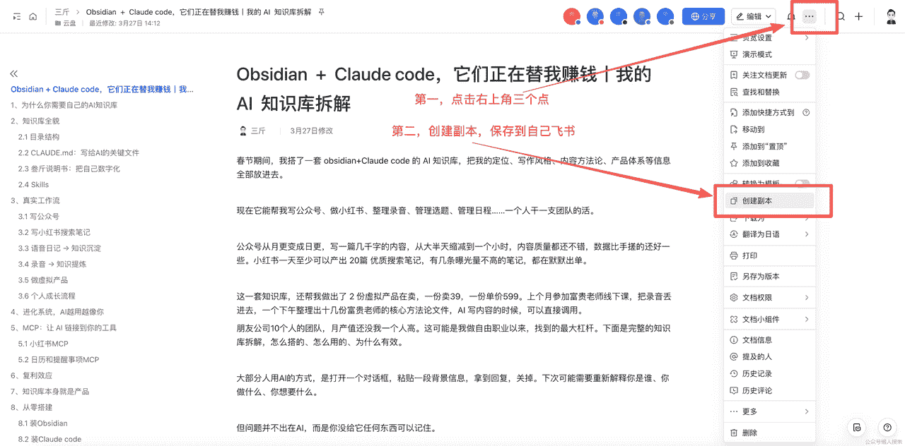

如果是推特上的文章，或者别的公开网站上的，可以用 Obsidian Web Clipper 插件，下载链接：https://obsidian.md/zh/clipper

这个是 obsidian 知识库的浏览器插件，即使不用 obsidian，也可以用来采集内容，可以采集到剪贴板，相当于复制了，到飞书粘贴就行，也可以保存文件导入飞书。

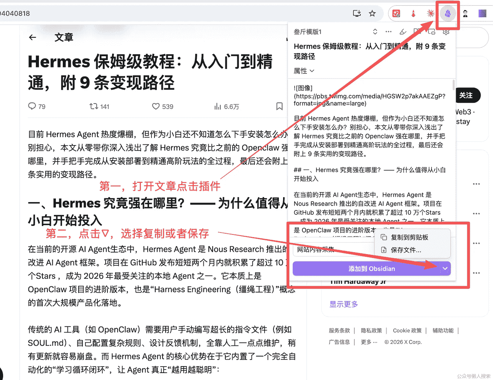

复制之后，在飞书知识库新建一个空白文档，粘贴进来就行了。

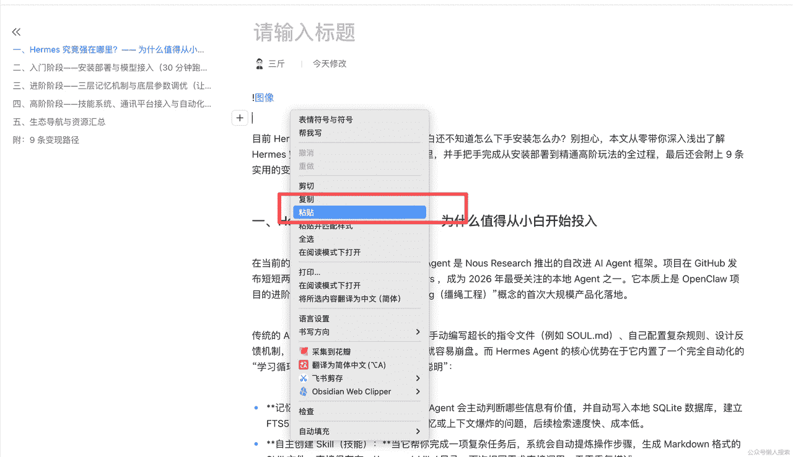

**2、 公众号文章**

**方式 1**:全选复制粘贴到飞书文档。方式 2:下载飞书剪存，在网页打开公众号文章一键采集到飞书。

**飞书剪存**

下载地址：[h](https://www.feishu.cn/hc/zh-CN/articles/606278856233-%E4%BD%BF%E7%94%A8%E9%A3%9E%E4%B9%A6%E5%89%AA%E5%AD%98%E5%8A%9F%E8%83%BD)ttps://www.feishu.cn/hc/zh-CN/articles/606278856233

安装插件后，浏览器打开公众号文章，会出现小剪刀图标，点击一下，自动把文章采集到飞书

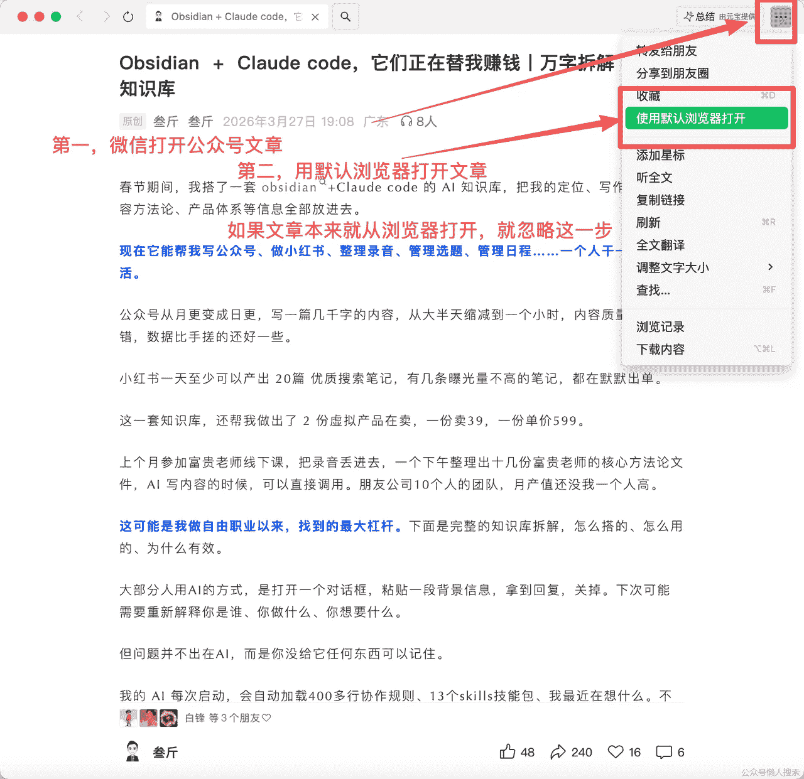

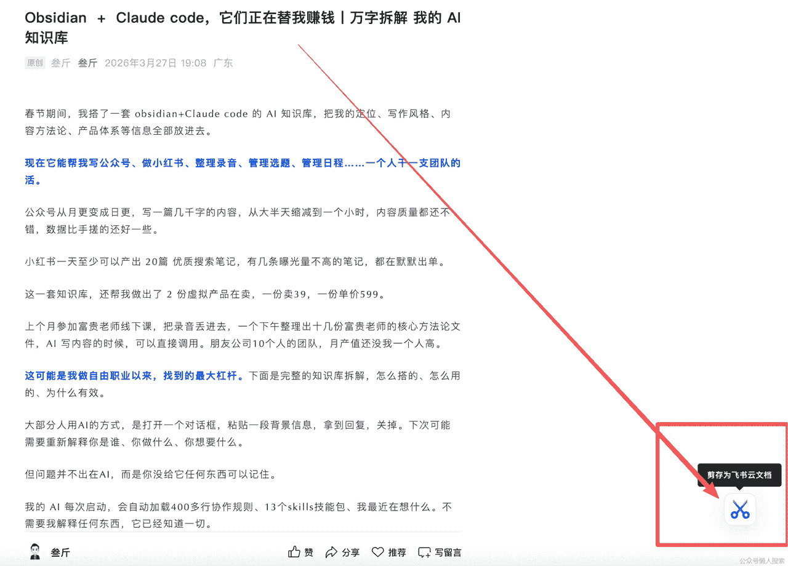

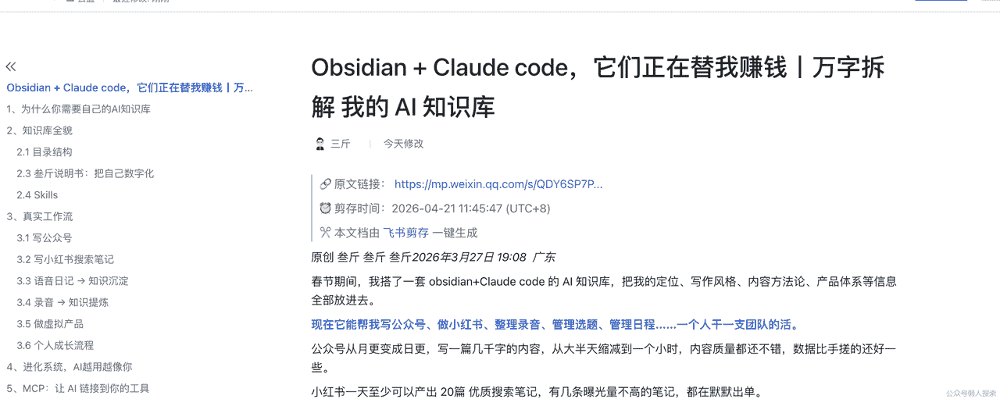

**3、 视频 / 播客 / 直播**

用**Get 笔记**把视频链接丢进去，自动转出逐字稿。复制到飞书文档即可。

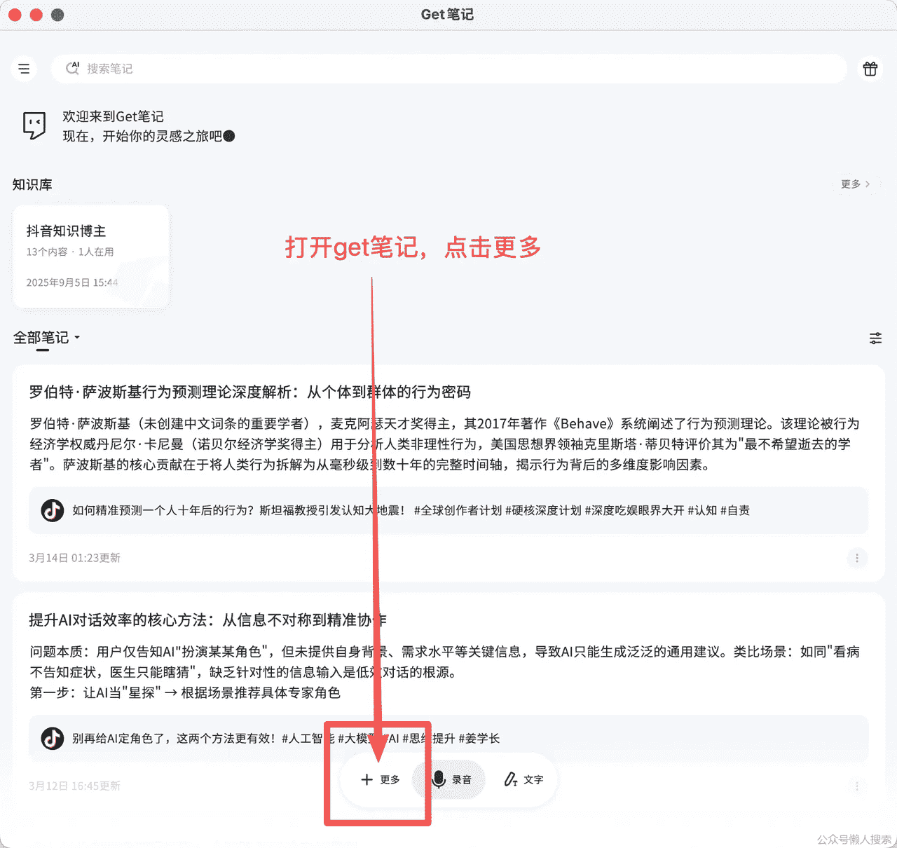

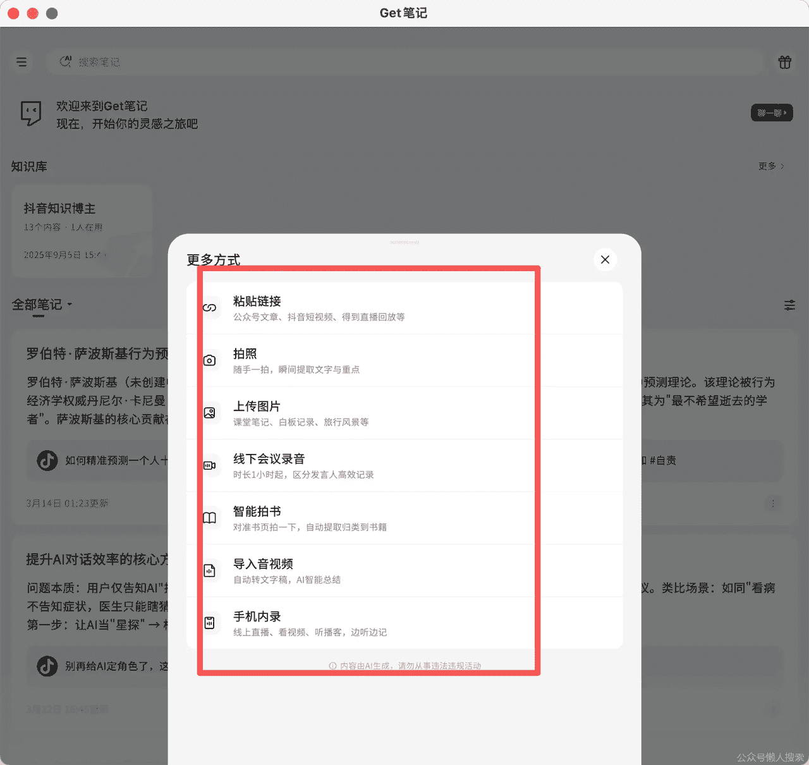

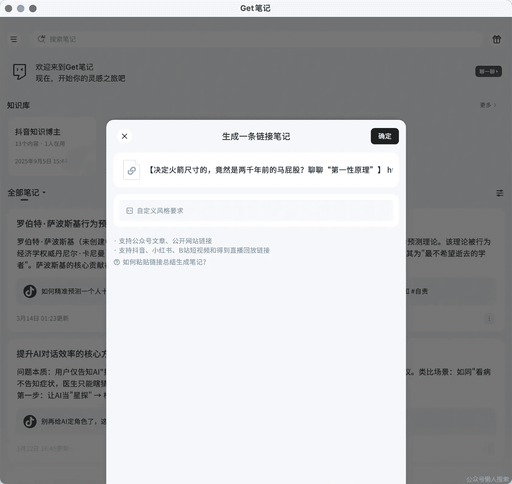

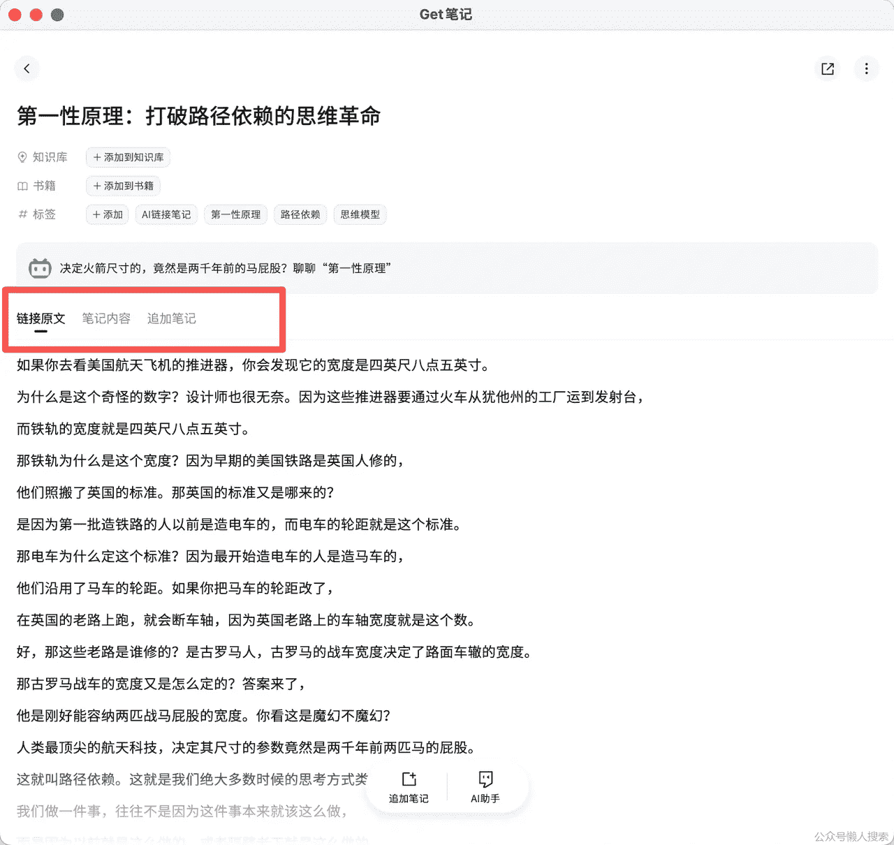

**4、 图片 / 截图**

浏览器插件**花瓣网**可批量提取页面图片：https://huaban.com/

点击左侧底下的插件安装，按照流程安装好，

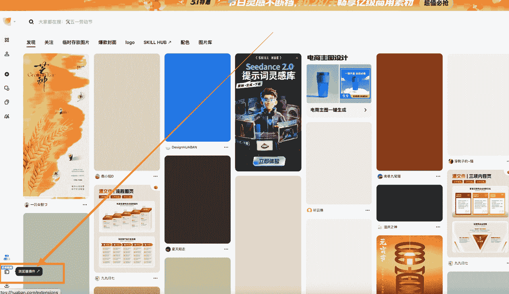

安装插件后，打开任意网站，把鼠标放在图片上，左上角都会出现「采集」，点一下，就能采集到花瓣网


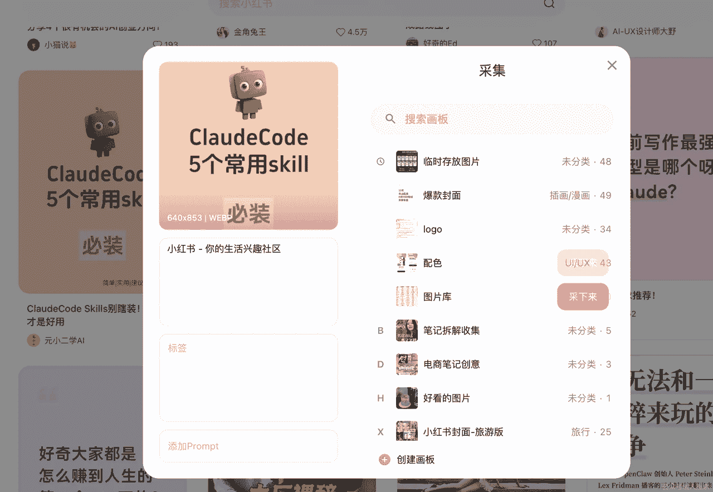

但是采集的内容都在花瓣网，需要手动保存到飞书上。

把所有内容最终进一个飞书知识库，按主题分文件夹。具体怎么整理、怎么调用，我们后面会讲。

**内**容保存，可以手动复制内容到飞书文档，或是把 pdf/md/word 格式，点击上传导入——导入为在线文档，这个可以把其他格式转为飞书格式。

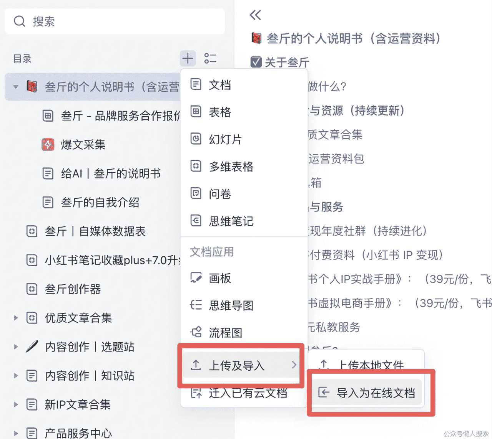

前期搭建过程本身也是筛选内容的过程，所以内容量一般不会太大，一条条手动保存就行了。如果涉及量太大，比如需要采集某个博主所有视频，所有内容，就需要用到批量工具。

这个是后面进阶内容，不同平台需要的工具不一样，比如，如果博主都在 YouTube 更新内容，那么可以把链接全部复制到 notebooklm，如果是推特等渠道，有能力可以用 Claude code 去做一个插件工具。

2.3 内容整理与分类

收集好内容之后，飞书知识库里已经有一堆东西了。但如果只是原始内容堆进去，后续还是得一条条点开看，等于没整理。

这一步的核心是：**让每条内容都能被 AI 有效调用。文章类直接保存，视频/课程**/播客类先用 AI 整理成精读笔记再存。

**第一步：按主题建好知识库结构**

打开飞书知识库，按主题建文件夹。以我的知识库为例：

• 01-搞钱案例库

• 02-内容运营技能

• 03-商业模式拆解

• 04-电商与变现

• 05-AI 与效率工具

• 09-好书长文精读

• 10-思维模型库

• 11-播客与 TED

• 12-生活方式

**一开始 3～5 个就够，后面随**时加。文件夹名要能一眼看出里面放什么，尽可能避免「其他」这种万能收藏夹。

**第二步：分类型处理内容**

1、 文章类（公众号、帖子、网页文章）

直接存进对应文件夹。文章本身就是结构化文字，AI 能直接读懂，不需要额外处理。


2、 视频、课程、播客等逐字稿类

逐字稿又长又乱，口语化严重，直接存进去 AI 很难提炼。必须先整理成精读笔记。

打开 DeepSeek 或豆包，把逐字稿粘贴进去，用下面的提示词：

Plain Text

```
我会给你一段内容（视频逐字稿 / 课程录音整理稿 / 播客文字稿），请你帮我整理成一篇精读笔记：
核心要点：提炼所有关键要点，每个要点一句话。
详细内容：按主题重新组织，去掉口语化表达和重复部分，保留所有有价值的信息，用清晰的小标题分段。
金句摘录：摘录 1~3 句让人印象深刻的原话。
使用场景：这段内容可以用在什么场景？
以下是需要处理的内容：
 [粘贴逐字稿]
```

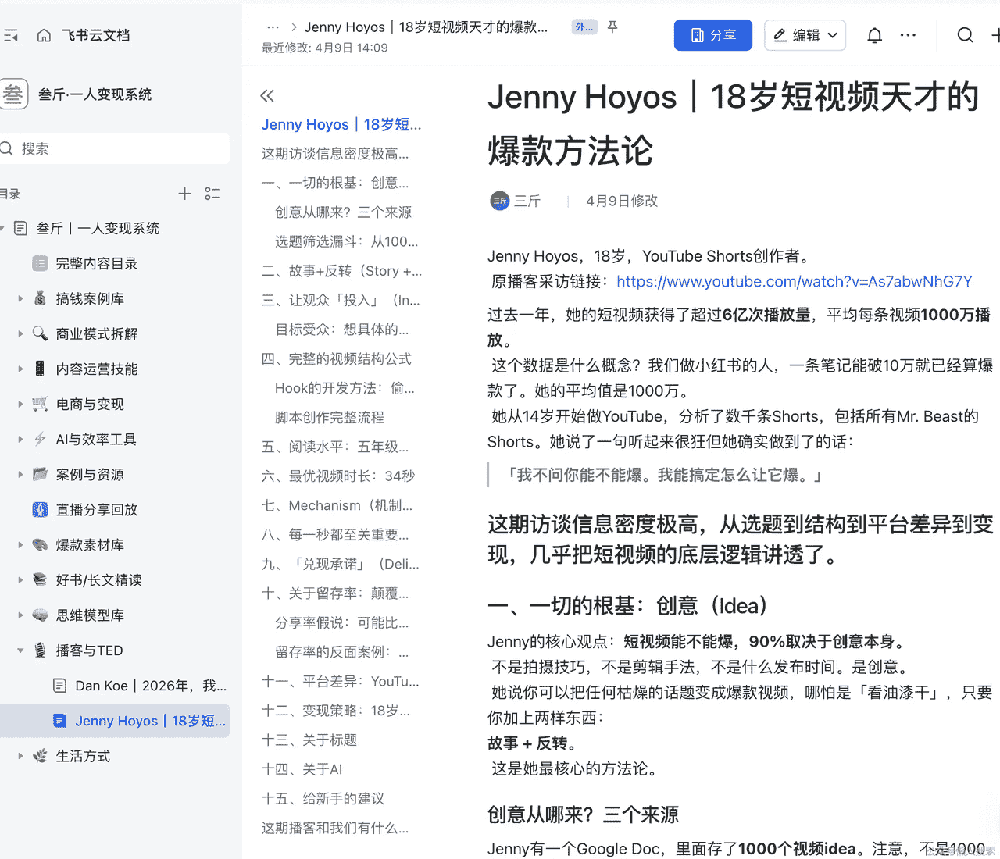

**几个技巧：**

1、逐字稿超过 1 万字，分段丢给 AI，最后合并

2、AI 返回大差不差就行，不用每条都完美

3、文章类内容质量特别高、特别长的，也可以让 AI 做一份精读笔记，和原文一起存

**第三步：用飞书知识问答调用**

**飞书自带的「知识问答」功能**可以基于你的知识库做 AI 问答。提问技巧：带具体任务问，不要泛泛问。

比如，不要直接问有什么赚钱方法，这太宽泛，AI 不知道你要什么。

把问题聚焦一些，比如，我想在小红书卖虚拟产品，知识库里有没有讲如何选品？有没有具体案例可以参考？

背景给得越具体，AI 返回越精准。

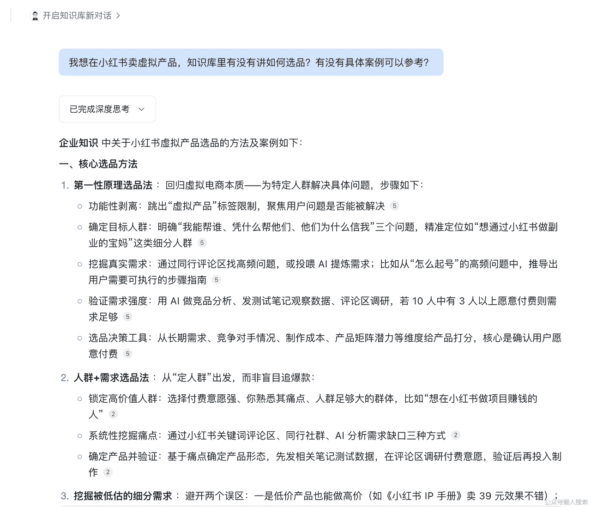

3.AI 知识库工具推荐

**上面讲的**方法，用到的工具主要是飞书系列，都可以免费使用。

| 工具 | 核心优势 | 使用门槛 |
| --- | --- | --- |
| 飞书知识库 | 所有内容的统一存放地，按主题建文件夹，结构清晰，适合个人和团队使用 | 上手较低，适合新手 |
| 飞书知识问答 | 基于知识库内容做 AI 问答，还能创建对外分享的 AI 知识库 | 需要先有内容沉淀 |
| DeepSeek / 豆包 | 用来整理逐字稿、提炼精读笔记，处理几百条内容花不了几块钱 | 上手较低，注册就能用 |
| Get 笔记 | 提取直播、课程、视频的逐字稿，转成文字后方便用 AI 整理进知识库 | 上手较低，适合内容整理场景 |

推荐组合：**飞**书知识库（收集 + 沉淀）+ DeepSeek / 豆包（整理逐字稿）+ 飞书知识问答（搜索 + 提问）。三个工具配合起来，就是一套完整的知识库系统。

4.案例实操：从 0 搭建一个个人成长—「思维模型」知识库

前面讲了需求判断、信息搜集、内容整理三个核心技能。

这一章把它们串起来，用个人成长里的「思维模型」作为案例主题，手把手带你从零搭建知识库。

**先看成品长什么样**

在讲怎么做之前，先给大家看一下我自己搭的「思维模型库」，它是我的「一人变现系统」知识库里的一个子模块。

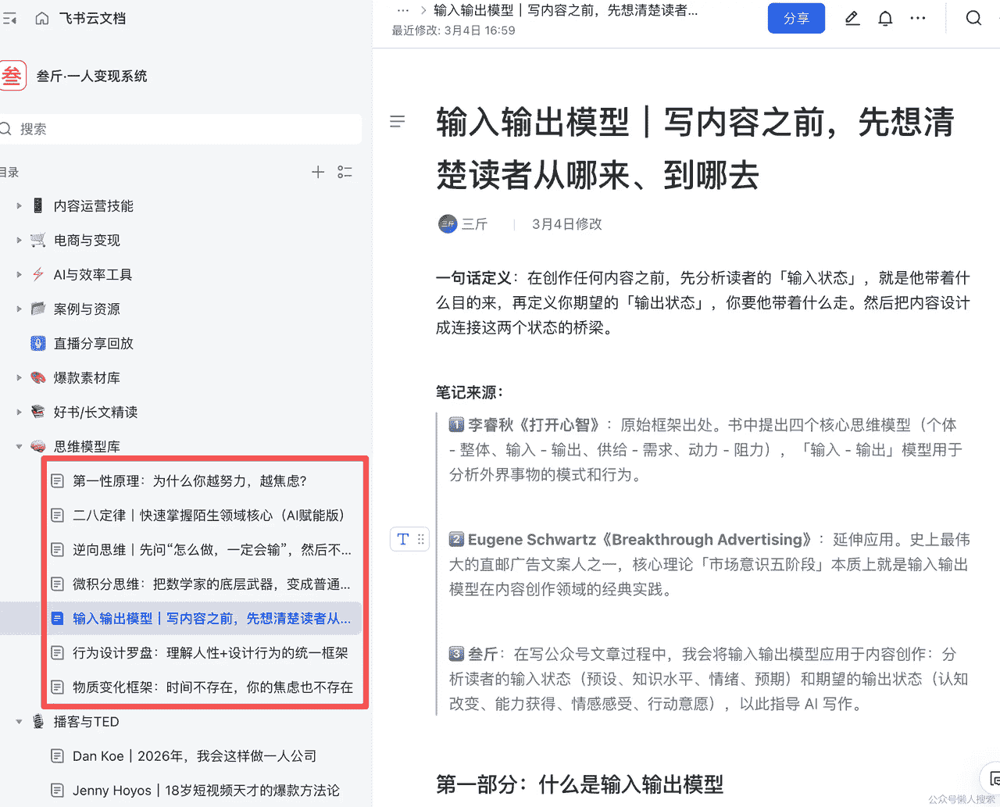

这个知识库只有 7 个完整的思维模型：第一性原理、二八定律、逆向思维、微积分思维、输入输出模型、物质变化框架、行为设计罗盘。

每个思维模型都有：

• 一句话定义

• 来源（书 / 视频 / 文章）

• 精读笔记正文

它是我写公众号、做产品决策调用频率最高的知识库之一。当然你可以根据你自己需求去找适合自己的思维模型。

**第 1 步：确定需求方向**

先把下面这张表填完，写进飞书文档里。

| 字段 | 我的填法 | 你的填法 |
| --- | --- | --- |
| 主题 | 思维模型 | 用途 |
| 写公众号文章引用 + 做决策时参考 + 讲课 | 边界（放） | 思维模型的原理 + 案例 + 应用心得 |
| 边界（不放） | 鸡汤文、没讲原理只讲结论的短文、炒冷饭的二手内容 |  |

如果你想不清楚主题或用途，用前面「 AI 逼问」的提示词，跟 AI 对话几轮就清楚了。

**第 2 步：搜集资料**

**（1）让 AI 生成搜索关键词**

打开 DeepSeek 或豆包，输入：

Plain Text

```
我想搭建一个「思维模型」主题的知识库，用途是写作引用和决策参考。请帮我列出一套搜索关键词，从入门到深度，覆盖中文和英文（英文我要去 YouTube 搜索用）。每个关键词旁边标注推荐搜索平台。
```

AI 会给你返回一组结构化关键词，大致长这样：

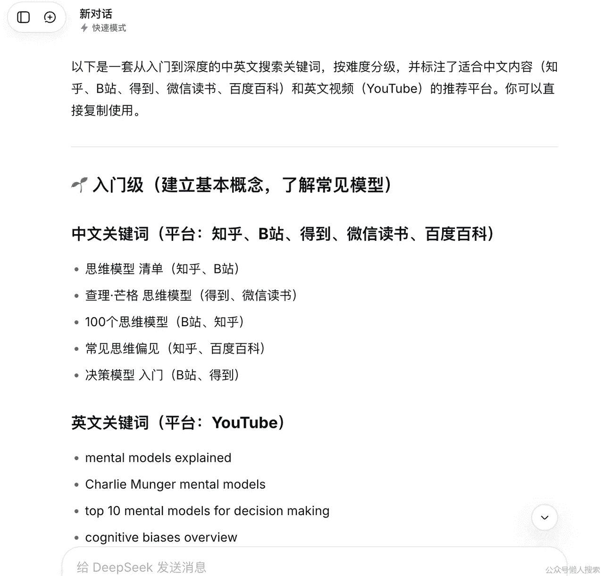

**（2）按平台去找，真实操作一次**

以「第一性原理」这个关键词为例，去搜了几个平台：

• **B 站搜「第一性原理」**：我找到了「决定火箭尺寸的，竟然是两千年前的马屁股？」，用马屁股比喻讲第一性原理，通俗易懂

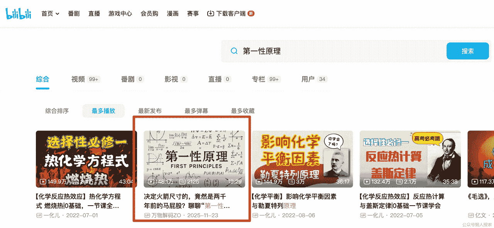

• **YouTube 搜「first **principles thinking」：找到 Elon Musk 的访谈片段，他如何用第一性原理拆解火箭成本

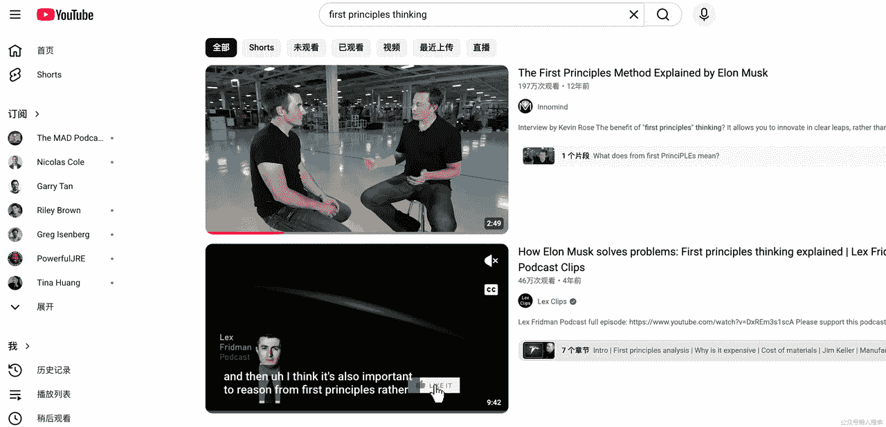

**（3）统一存进飞书知识库**

打开飞书，新建一个知识库，在里面建一个子文档「思维模型库」。

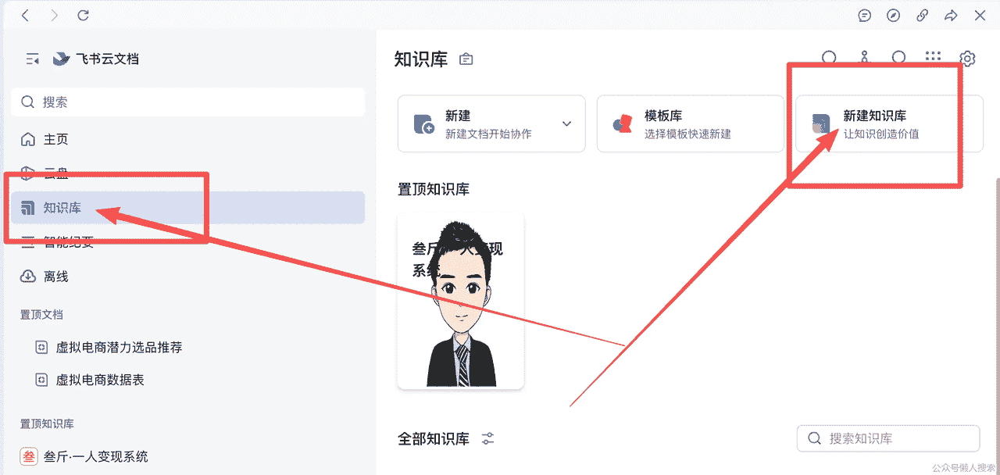

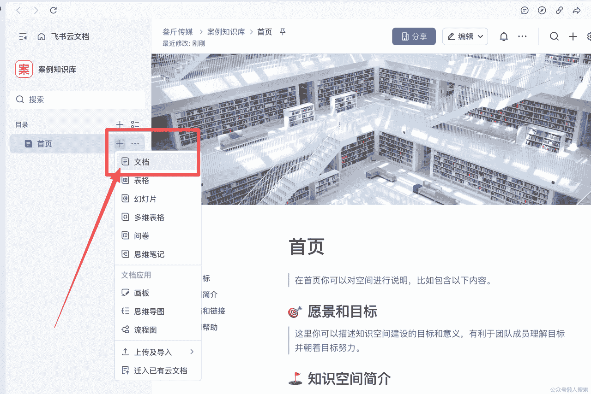

**每一条都存进「思**维模型库」文件夹里。原始内容先别急着整理，先把东西收齐再说。

做完这步，你的思维模型库里应该有 5～10 条原始内容（比如 3 篇文章 + 2 条视频逐字稿）。

注意，同一个思维模型的原始内容，可以放一起，不同的思维模型，要新建一个子文件夹保存：

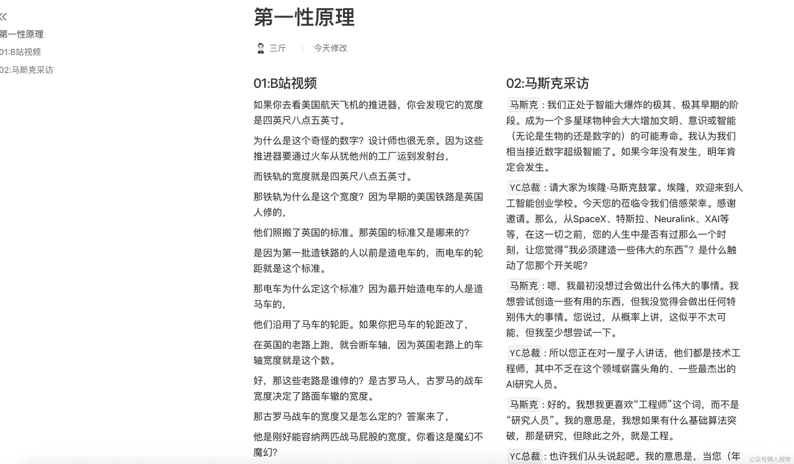

第一性原理文字版素材做参考

Plain Text

```
如果你去看美国航天飞机的推进器，你会发现它的宽度是四英尺八点五英寸。
为什么是这个奇怪的数字？设计师也很无奈。因为这些推进器要通过火车从犹他州的工厂运到发射台，
而铁轨的宽度就是四英尺八点五英寸。
那铁轨为什么是这个宽度？因为早期的美国铁路是英国人修的，
他们照搬了英国的标准。那英国的标准又是哪来的？
是因为第一批造铁路的人以前是造电车的，而电车的轮距就是这个标准。
那电车为什么定这个标准？因为最开始造电车的人是造马车的，
他们沿用了马车的轮距。如果你把马车的轮距改了，
在英国的老路上跑，就会断车轴，因为英国老路上的车轴宽度就是这个数。
好，那这些老路是谁修的？是古罗马人，古罗马的战车宽度决定了路面车辙的宽度。
那古罗马战车的宽度又是怎么定的？答案来了，
他是刚好能容纳两匹战马屁股的宽度。你看这是魔幻不魔幻？
人类最顶尖的航天科技，决定其尺寸的参数竟然是两千年前两匹马的屁股。
这就叫路径依赖。这就是我们绝大多数时候的思考方式类比思维。
我们做一件事，往往不是因为这件事本来就该这么做，
而是因为以前就是这么做的，或者隔壁老王就是这么做的。
我们在职场上、生活中，哪怕是很多所谓的创新，其实都是在马屁股上做修修补补。
我们只是把马车换成了电车，把电车换成了火车，
但那个核心的四英尺八点五英寸的限制，从来没人敢去碰。
而所谓的第一性原理，其实就是一把奥卡姆剃刀，
他的第一步操作，就是极其残忍的杀掉那匹马。这听起来很爽，但做起来极难。
为什么？因为很多时候，那个马屁股已经伪装成了真理。
举个更贴近生活的例子，大家现在出门旅行都用带轮子的拉杆箱，
对吧？这玩意简直是人类之光。但你们知道吗？
人类发明轮子已经五千年了，把轮子装到箱子上这个动作，却是在一九七零年才由一个叫伯纳德萨多的人完成的。
在这之前，人类即使已经登上了月球，
即使已经造出了核弹，却依然像个傻子一样，
拎着死沉死沉的箱子在机场累的半死。为什么？当时所有的箱子制造商都在拼命优化，
用更轻的皮革、更坚固的手柄、更大的空间。
他们的思维模型是箱子等于用来提的容器。既然是提的，那所有的优化都在如何提的更舒服上，
这是典型的类比思维。而伯纳德萨多的突破在于，
他无意中启动了第一性原理。他没把箱子看作提的容器，
而是回归到了物理本质箱子等于重物移动。
如果是重物移动，在这个物理系统中最大的阻力是什么？是摩擦力和重力。
怎么解决？摩擦力和重力？那就是轮子，就这么简单。但当萨多拿着带轮子的箱子去推销时，
所有的百货公司都拒绝了他，理由非常可笑男人就该提箱子，
拉着箱子走太像娘炮。你看，这就是阻碍我们运用第一性原理的第二大障碍
社会这一层面的功能固浊我们。
的大脑太喜欢给事物贴标签了。手机是用来打电话的，
书店是用来卖书的，学校是用来上课的，一旦标签贴死，你的思考也就停止了。
所以，高手的操作模型通常包含一个极其重要的步骤，我把它叫做功能性剥离。
当你面对一个难题时，试着忘掉这个东西的名字，别管他叫手机还是汽车，
试着去描述他的物理属性和基本功能。比如乔布斯当年做iphone的时候，
如果他盯着手机这个词，那他一定会去研究怎么把键盘做的手感更好，
就像当年的诺基亚和黑莓，
因为在当时的概念里，手机等于屏幕加键盘。但乔布斯干的事是把手机这个概念剥离掉，
他看到的是一个便携式智能终端。
如果是智能终端，核心需求是什么？是信息的输入和输出。键盘是最好的输入方式吗？
不是，因为键盘永远在那占地方，
不管你用不用它。最好的输入工具是什么？是上帝给我们的十根手指。
所以把键盘扔了，把屏幕做大，让手指直接成为触控笔。
这在当时看来是离经叛道的，但从物理逻辑和人机交互的第一性原理来看，
这才是唯一的真理。说到这，大家可能发现了一个共同点第一性原理并不是在做加法，
而是在做极致的减法。它要求你剥离掉历史的惯性、马屁股，
剥离掉社会的标签、男人不拉箱子，剥离掉表面的形式手机、键盘，
最后只剩下一个光秃秃的、无法再分割的事实。
在这个事实之上构建出来的东西，往往会产生一种降维打击的效果。
因为你的对手还在老路线上，和别人卷成本、卷性能，
而你直接换了一个维度，把战场都给掀了。但是我知道你们在想什么。
博主你讲的都是马斯克、乔布斯这种大神，咱们普通人也没机会造火箭、做手机啊，
这玩意对我月薪三千的生活有啥用？别急，这恰恰是我觉得第一性原理最被低估的地方。
它不仅能用来创业，更能用来解决我们个人的迷茫。
很多时候，我们感到痛苦，觉得自己没得选，其实是因为我们把别人的人生模板当成了自己的第一性原理。
我们默认了三十岁必须结婚，工作必须稳定，有房才有家。如果我们用这把手术刀，
剖析一下我们自己的生活，会发生什么？接下来这部分可能会有点扎心，
但我觉得非常有必要讲讲。我们要把这把手术刀切向我们自己了。
很多人，特别是刚毕业的年轻人，经常会说，现在大环境这么差，
我到底该考公上岸，还是去大长卷，还是回老家躺平？这时候，如果你用类比思维，
你会去看你的同学。同学a考公了，
朋友圈发了单位食堂，看着挺香。同学b去大厂了，
年薪几十万，看着挺爽。于是你在中间左右横跳，焦虑的睡不着觉。
因为你在试图复制别人的路径，但你忽略了别人的变量。a家里可能有矿，
b的肝可能比较好。好，现在请把第一性原理的开关打开。我们把工作这个概念剥离掉。
人为什么要工作？如果不考虑社会赋予的成就感这种虚词，
回到生物学最基本的，层面工作是为了获取能量钱来维持生存和繁衍，
同时在剩余时间内追求内啡肽和多巴胺快乐。
那么公式变成了收益成本等于生命质量。
很多人选工作的逻辑是只看收益，工资高不高，
稳不稳定，却完全忽略了隐性成本。老公的成本是什么？是你可能要在这个系统里让度一部分言论自由和个性表达，
甚至要忍受长达几十年的枯燥和层级压抑。
这对于一个天性喜欢自由创作的人来说，
这种心理上的伤增是巨大的，可能会导致你的精神内耗极高。
最后折算下来，你的生命质量其实是负的。去大肠卷的成本是什么？
是极高强度的皮质醇分泌压力激素。
长期的高压力状态会直接摧毁你的免疫系统。你赚的那些钱，
从生物学角度看，其实是把你未来的健康折现卖给了老板。所以，真正的第一性原理思考，
不是问哪个工作好，而是问我的出厂设置到底是什么？
我对什么东西有天然的耐受力，我对什么东西有生理性的排斥。
如果你的多巴胺来自于解决复杂的逻辑难题，那你哪怕去写代码写到秃头，
你也是快乐的，因为你的奖励机制在内部闭环了。
如果你的多巴胺来自于与人建立深度连接，那你去搞销售或者做心理咨询，
哪怕钱少点，你也活的比别人通透。
这里最残酷的真相是，大多数人的痛苦源于拿着别人的地图找自己的路，
我们太害怕成为异类了。回顾一下我们在第一部分讲的进化心理学，
在原始部落里，和别人不一样，意味着被排挤，被排挤就意味着死亡。
所以我们进化出了一种极其强大的本能社会性拟态。
哪怕心里觉得这事不对，但只要大家都这么干，我们就会跟着干。大家都要买房，
所以我也要掏空六个钱包，背上三十年房贷。第一性原理会问房子的本质是什么？
是居住空间。拥有产权的本质是什么？是资产保值。
现在的房子还能保值吗？如果不确定，那我为了一个居住空间背负三十年的极高风险，
导致我不敢辞职，不敢生病，不敢尝试新事物。
这个决策在逻辑上是自洽的？显然不是，但我们还是会买，
因为丈母娘觉得要买，社会觉得要买。所以这一期视频讲到最后，
我想告诉大家的是，第一性原理其实是一条少有人走的路，
甚至是一条注定孤独的路。当你开始熟练运用这套思维模型，
你会发现自己变得越来越不合群。当周围人在热火朝天地讨论哪个明星塌房了，
你会觉得这只是娱乐工业在这个时间节点投放的一个流量包。
当长辈催你赶紧结婚生子，你会冷静的分析这到底是基于爱的传递，
还是基于农业社会养儿防老的基因惯性
当老板给你画大饼讲情怀，你会直接计算投入产出比和期权兑现的数学概率。
在别人眼里，你可能变得冷漠，
理智的可怕，甚至像个杠精。你杀死了那些那批随大流的马，
你就必须自己拉着车走。但是这种孤独是值得的，因为只有当你把那些强加在你身上的观念标签主义，
统统剥离干净。
当你直面物理现实和生物本能的时候，你才能拿回对自己人生的定义权。
埃隆马斯克并不是因为想造火箭才用了第一性原理，而是因为他看透了能源和人类生存的本质危机，
才不得不造火箭。同样的，你不需要一定要改变世界，
但哪怕只是用这套方法想清楚了我今天晚上到底想吃什么，
而不是点赞最高的外卖是什么，我觉得这都是一次伟大的胜利。
在这个充斥着算法推荐、信息减防和群体情绪的时代，保留一点独立思考的野性，
可能比成功更重要。毕竟，做一只清醒的荒原狼，
总好过做一只在赛道上盲目奔跑的赛马。哪怕那条赛道是金子铺的，
那也只是跑道，不是草原。别忘了，思考是痛苦的，
但这种痛苦叫做成长。
```

**第 3 步：整理资料**

文章类直接保留原文即可，AI 能读懂。

视频 / 课程 / 播客的逐字稿，必须用 AI 整理成精读笔记。

实操流程（以「第一性原理」B 站视频为例）：

1.  把链接复制下来，上传到 get 笔记

1.  从 Get 笔记复制视频逐字稿

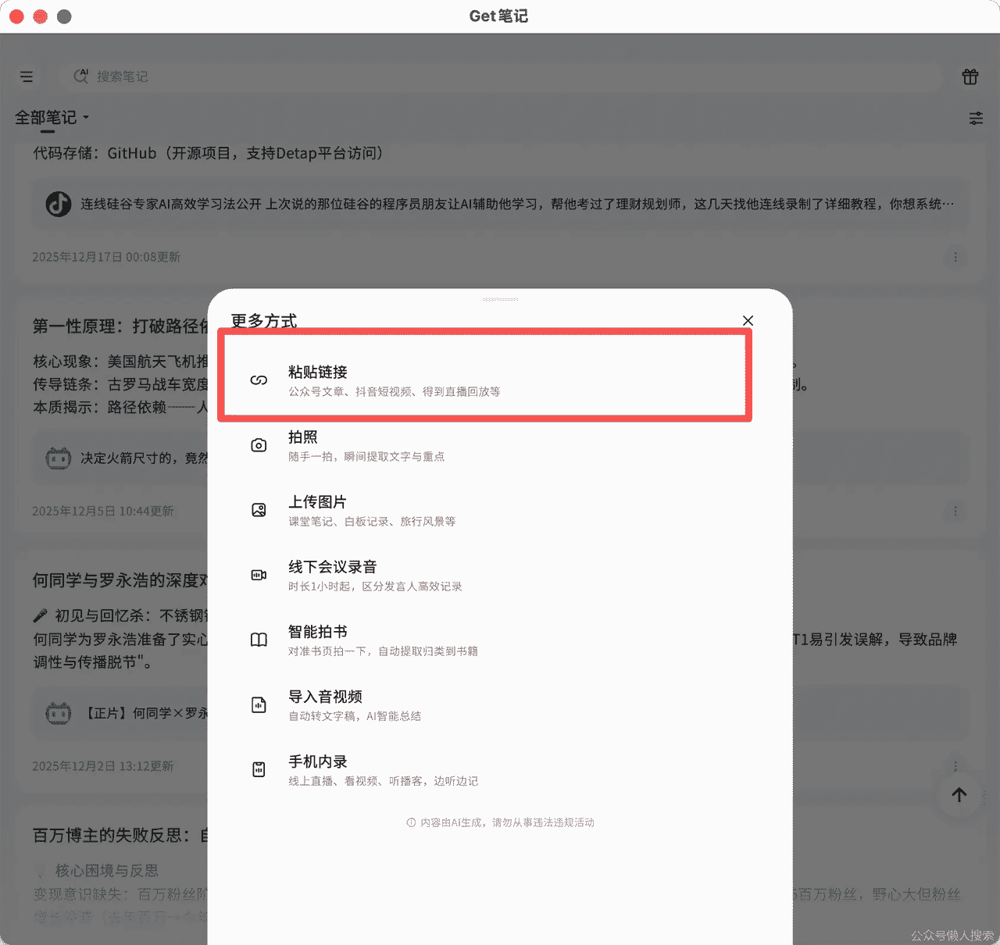


1.  粘贴到 DeepSeek/Gemini（最好用 Gemini），附上 2.3 节那个精读笔记提示词如下：

Plain Text

```
我会给你一段内容（视频逐字稿 / 课程录音整理稿 / 播客文字稿），请你帮我整理成一篇精读笔记：
核心要点：提炼所有关键要点，每个要点一句话。
详细内容：按主题重新组织，去掉口语化表达和重复部分，保留所有有价值的信息，用清晰的小标题分段。
金句摘录：摘录 1~3 句让人印象深刻的原话。
使用场景：这段内容可以用在什么场景？
以下是需要处理的内容：
 [粘贴逐字稿]
```


1.  AI 返回一篇结构化精读笔记，包括：

◦核心要点（3～5 条一句话提炼）

◦详细内容（按小标题分段重组）

◦金句摘录（1～3 句）

◦使用场景


1.  在文档里手动加上**来源**（书 / 视频链接）

1.  整篇存进「思维模型库」，文件名：第一性原理｜为什么你越努力，越焦虑

一篇乱糟糟的逐字稿，就变成了一篇随时能调用的精读笔记。

按这个流程把 5～10 条内容都整理一遍，你的思维模型库就有骨架了。


**第 4 步：内容调用**

打开飞书「知识问答」，基于你的思维模型库提问。


在这里直接提问，飞书会基于你所有的文档回答**，如果存的内容很乱，回答的就没那么精准。所以我们需**要新建一个专门的知识问答知识库，让 AI 直接用指定知识库回答问题，会非常精准。

1、点击 + 号新建一个知识库


2、设置权限

这一步可以**把知识库设置成付费，也可以设置成兑换码**，取决于你想对外出售，还是打算自己私用。

如果自己私用的，可以把权限改为私密，这样别人都看不到了。


3、添加资料

先点击添加资料，然后选择「迁入已有云文档」，把前面新建的知识库整个迁入进来


4、测试提问

直接在知识库提问了，AI 会结合你的知识库给你回答

比如：

我现在在犹豫要不要同时做小红书和公众号，但精力不够。能不能结合知识库帮我做这个决策？


做完这四步，你的知识库就真正跑起来了。

一个知识库搭建需要比较长时间，如果要体验调用，可以用官网【生财问答】，就是整理好的生财知识库：https://scys.com/AI

4.1 关于飞书知识问答的注意事项：

飞书知识问答，按照顺序操作，第一次可能会遇到这种问题：


不要慌，这是因为，你的是个人版的飞书，刚搭建好直接使用，飞书需要连接 AI ，要花很多时间，这个时候，不要直接在这里问，先把飞书关闭，重新启动。

重启后，先重新打开「飞书知识问答」，直接开启新对话，点击右边三个点，打开使用企业知识库


然后提问一个问题，**飞书知识问答会调用 AI 链接你的知识库，第一**次链接需要花很多时间，大约 30 分钟：


在链接知识库之后，往后的问答就正常了，可以直接用新建的知识库问答，也可以新对话直接问答，都能调用知识库回答问题。

个人版每天只有 3 次免费问答次数，如果要新增次数，就要升级 AI 会员，大约 69/月。


**4.2 飞书知识库+codex**

飞书的 AI 功能无法做到免费，如果有使用 codex 的话，可以通过 codex 连接到飞书，实现用 codex 操作飞书知识库。

这个功能需要用到**飞书官方出的 CLI**，教程：https://www.feishu.cn/feishu-cli

可以让 codex 看到你的飞书文档、知识库、表格、日历等等，并且操作（写入、修改）飞书文档。

安装方式：打开你的 Claude code 或者 codex，输入以下命令：

Plain Text

```
帮我安装飞书 CLI：https://open.feishu.cn/document/no_class/mcp-archive/feishu-cli-installation-guide.md
```

然后它就会一步步帮你装好，装完后问一下 AI ，有没有把所有 skill 都装上，有时候会漏掉，如果没有的话，让它把 skill 也一起装了。

如果你是用 codex app 安装，可以先把权限设置【完全访问权限】，ai 可以调用浏览器等，权限不够的话，会提醒你去终端安装。


在安装之后，需要走一遍登录流程，这里一般会有 2 个链接，第一个链接是创建应用，点击「飞书 CLI 配置授权」，然后会跳转到浏览器，打开飞书开放平台，并且创建应用。

第一次跑这个流程的时候，会先出现第一个链接（只有一个链接），点击就行。


这一步，随便选择一个头像，名称自己自定义，点击创建。


提示创建成功后，回到 codex，会出现第二个链接，就是「飞书 CLI 用户登录授权」，点击一下

就会进入飞书 CLI 的权限开通，这里直接选择默认的权限，开通授权就行了。


授权成功后，会自动弹出飞书 CLI 的登录状态，看一下账号对不对，如果这一步没问题，那就是登录成功，你的 codex 已经可以链接飞书了。


到这一步，可以顺便检查一下 codex 有没有把 skill 安装到位，一般情况下，都是会一起安装好的：


安装过程遇到问题，都可以复制问题或截图，让它告诉你怎么处理。

安装完成后，可以直接跟 codex 对话，问一些问题，会根据你的飞书知识库内容给你回答：


除此之外，你也可以用 codex 把一些文章、收集的资料等等，直接放到飞书文档，用自然语言跟它说：

「帮我把这篇文章上传到飞书文档」，如果有指定目录，你跟它说具体的目录就行了。

进阶玩法：自动化 agent 更新

以上 4 步是基础版，适合入门学习。

如果你 AI 基础比较好，想玩更自动化的方式，可以学习Obsidian + Claude Code方案：

• 一篇文章丢进去，AI 自动提炼方法论

• 自动关联已有知识点

• 自动生成可以发布的内容

• 甚至可以让 agent 定期抓取指定公众号 / YouTube 频道的更新，自动整理进知识库

[这套方案有一定工具配置门槛，适合愿意折腾的人。](https://my.feishu.cn/docx/MqiDdFBAEobGfHxOagbcV7bHnjc)拆解链接：Obsidian + Claude Code，它们正在替我赚钱丨我的 AI 知识库拆解

另外：知识库积累到一定规模后，本身就可以变成一个产品。通过飞书 AI 知识库把内容开放给别人付费使用，就是一种方式。

5.小结与作业

5.1 总结

积累能力 = 把零散信息整理成一个能持续调用的系统。

核心四个动作：判断要收什么 → 收进来 → 整理成能用的结构 → 随时调用。

对应三个核心技能和实操步骤：

1.  **需求判断**：知识库服务于什么场景、聚焦什么主题、边界在哪里。不要上来就动手，方向错了越努力越乱。

1.  **信息搜集**：让 AI 帮你生成搜索关键词，带着关键词主动去找内容。用三个问题判断值不值得留，全部统一存进飞书知识库。

1.  **内容整理**：文章类直接存，视频课程类用 AI 整理成精读笔记再存。搭配飞书知识问答随时调用。

知识库不是一天搭好的。从今天开始存第一条内容，哪怕只有 5 条、10 条，它已经比躺在收藏夹里吃灰强一百倍。

**在**学习完本章以后，第三章表达能力，内容生产环节就可以应用上给 ai 投喂素材库作为参考，生成较好质量文章内容。

5.2 作业

💡

**任务**

：**搭一个你自己的最小可用知识库**

推荐用「思维模型」作为第一个主题（新手最推荐的起步主题）：

1.  写下你的主题、用途、边界（10 分钟）

1.  让 AI 生成关键词，收集 5～10 条内容进飞书（1 小时）

1.  其中至少 1 条视频 / 课程类，用 AI 整理成精读笔记（20 分钟）

1.  用飞书知识问答问 3 个问题，看它能不能调用你的内容

做完这四步，你就拥有了一个能用的知识库。

提交形式：文字描述+图片（知识库的样子）

### 03. 表达能力：内容生产

0.本章概要

💡

表达能力：用 AI 创造内容表达想法

—— 把你的想法做成文字、图片、视频，被更多人看见。

**怎么学习？**

1.  先判断方向：想清楚内容是写给谁看的，要解决什么问题，和别人有什么不一样

1.  找对标内容：看看同类好内容是怎么选题、怎么表达、怎么吸引人的

1.  让 AI 生成初稿：把你的想法、受众、风格、参考内容告诉 AI，让它先帮你搭出文章或脚本

1.  人来打磨成品：AI 给的是初稿，不是终稿，你要检查逻辑、修改表达、补充细节

1.  做成可发布内容：基础任务是**完成一篇图文内容和封面图**，有精力的话可以继续尝试 AI 视频

⚠️**注意事项：**

• **AI 初稿通常只有 60–70 分，这是正常的。**想要更高质量，必须加入你的个人经历、观点和具体要求，再通过多轮修改慢慢打磨，不要指望一次成稿。

• 模型选择会影响质量，但不是唯一关键。长文写作目前 Claude 效果较强；没有网络环境，国内豆包模型也可以胜任。更重要的是，你给 AI 的背景信息是否清楚。

• **不要一开始就追求复杂形式。**本章核心是完成一篇公众号文章和封面图，把图文表达跑通；有余力再挑战 AI 视频。

希望这章完成后，你能用 AI 协助做出一篇可以发布的内容。更重要的是，你会开始理解：AI 不是替你表达，而是帮你把已经想清楚的东西，更快、更好地做出来。

💡

**本章航线图**

完成本章节的学习和操作，即可完成航线图的：

1.  用 AI 协助创作一篇公众号文章&封面图（约 2 天）

1.表达能力是什么

当你学会积累能力，有了素材以后，想要把想法变成别人愿意看的内容，就是表达能力。

文章、图片、视频，形式不同，本质都是把想法传递出去。AI 降低了这件事的门槛——原来要会写、会拍、会剪、会设计，现在普通人也能快速把想法做出来。

| 形式 | 典型产出 | AI 能帮你做什么 |
| --- | --- | --- |
| 文字 | 文章、脚本、文案 | 生成初稿、改写润色、去 AI 味 |
| 图片 | 封面、海报、插图 | 文生图、风格迁移、批量出图 |
| 视频 | 短视频、AI 影片 | 脚本→分镜→画面→配音→剪辑 |

AI 协助内容生产，AI 是辅助，决定内容质量高低，还是需要加入人工修改，无法依赖纯自动化，平台会对纯质量低的内容进行打击。

**表达能力和你有什么关系**

• **有业务想推广的人：**做内容比做广告成本低、转化更自然

• **想打造个人影响力的人：**内容是最低成本的长期积累方式

• **想做内容变现的人：**文章、图片、视频都是可直接变现的产出物

想要学习好表达能力，需要掌握下面等三个核心技能。


2.三个核心技能

2.1 内容方向判断

当**我们脑子里冒**出一个想法，想做一个关于某个主题的内容，但不确定做成什么形式、方向是什么——这时候就需要做内容方向判断。

**选题是判断的产物**

。一个好的选题比写作更重要，它是内容流量的天花板。

**对标是判断的依据**

。它用真实的市场数据告诉你：这个方向值不值得做、能做到什么程度。

很多人一上来就让 AI 写文章、想选题、做脚本，结果内容空泛、没有核心价值。问题不在 AI，而在于跳过了方向判断，直接进入了执行。

在让 AI 动笔之前，先和它聊清楚三件事：

1.  这篇内容是给谁看的？

1.  他们为什么要看？（有什么问题或需求，你能解决）

1.  这个选题，别人做过吗？做得怎么样？

前两个是**向内问自己**，第三个是**向外看市场**——也就是找对标。如果同类内容有人做过还做得不错，说明这个方向有市场需求；同时你能看到别人做到了什么程度，知道自己该往哪里提升。

好的对标，能直接把你的起点拉高一截。

下面具体来拆解怎么去做内容方向判断，找到你的选题内容。

**第 1 步：想清楚三个问题**

可以和 AI 对话，帮助自己思考清楚

• 给谁看？→ 具体到一类人，不是所有人


举个例子直接问AI，把你不知道的，想要表达的，让AI帮你输出出来。

Plain Text

```
现在我需要做一个个人成长的账号，你来帮我分析一下他的读者群体，以及读者的偏好，以及人群的属性等等特点，来帮助我决策。我如何来做这样的内容，我需要非常清晰明了的信息给到我
```


AI 会给你很多内容，可以多轮沟通得出方向。不要回答给所有人看，有用的答案具体到一类人，帮助这一类人解决某些特定问题。

你给谁看越清楚，后面的内容就越容易具体。

• 他们为什么要看？→ 有用、有趣、有共鸣，选一个点主打

大多数内容，一般都会包含这三个点比如，

**有用（看完能解决问题）**

有趣（看完有新鲜感、反差感、故事感）

**有共鸣（有情绪价值）。**

• 我希望他们看完做什么？→ 点赞收藏 / 关注 / 点击 / 购买

比如希望点赞收藏，那内容就要偏清单、方法、干货。希望他关注，那内容就要让人觉得你后面还有东西。

别小看这一步，重点是要学会倒推，从结果和目标来反推内容。

最后想让用户干什么会反过来决定你前面怎么写。

第 2 步：找对标内容，确认方向

**（1）**何为对标？**对标能做什么**

很多人理解的对标就是去抄一个标题、改几个词又或者换个说法，重新表述出来。

其实从底层来说核心不是抄而是拆解，如何拆解一个账号的框架，内容以及爆款的因素。

对标 = 找一条你能看懂它为什么有效、并且自己能模仿的内容。

看到一条爆款，不要只看数据，按这四个维度问自己：

1.  **它在吸引谁？**要有清晰的人群画像，否则数据再高跟你也没关系。

1.  **它为什么被点开？**标题够狠？封面够强？选题戳中问题？还是情绪、利益、身份认同拉满？

1.  **它怎么把内容讲下去？**开头怎么钩人？中间怎么展开？哪里给结果，哪里给案例，哪里做转折？

1.  **它最后把用户带去哪里？**收藏、评论、关注，还是点击链接？目标动作都没看懂，就学不到重点。

（2）怎么判断一条内容值不值得对标？

**最重要一点：**这条内容对我来说是不是能做出来**

**看作者是谁**

**，**大 V 的爆款靠的是粉丝基础、团队、资源，你学不来。

**重点找素人的爆款**

——粉丝不多但数据很好的内容，说明内容本身有力量，这才是你能复制的。

看内容结构：结构清晰，容易模仿。 比如公众号某类内容

• 开头钩子（吸引，引发兴趣，往下看）

• 主体内容（做信任，有点内容，意犹未尽）

• 结尾升华（让读者认可，加强共鸣）

**结构越清晰，你越容易模仿。**

其他 2 个因素，和人群画像/内容目标有关，可以作为次要参考。

**1️⃣**这条内容的人群，和我要做的人群画像是否一致**

不一样，对标没价值，比如别人是写给职场女性的，你是写给副业新手的；别人是写给母婴人群的，你是写给AI工具党，哪怕它爆了也不一定适合你。

方法一：把素材内容发给 AI，让 AI来做详细的分析用户画像分析

方法二：利用第三方的数据来查询对标帐号的用户画像，比如抖音用抖查查、小红书用千瓜数据，（第三方数据平台要会员，可以去闲鱼买一天会员）

**2️⃣**这条内容的目标和我内容的最终目标是否一致**

别人那条是为了卖货，你的目的是涨粉——目标不同，内容结构完全不一样，照搬会意义不大。

**方法：**

看内容风格判断——营销类型/转化类型，不同风格代表不同的内容目标

看文末引导关注或商品链接——目标：关注或卖货

**（3）确定对标方向以后，**去对的地方找对标**

你要写文章/文案 → 去公众号和小红书

• **公众号看长文表达**

重点学怎么开头、怎么把一个主题讲完整、怎么起承转合。

优先找细分领域的账号，公众号学长内容怎么讲完整，重点关注低粉爆文（平时阅读几十，突然出一篇 10 万+），这种最值得拆，说明选题够大众，标题和内容都有你可以借鉴的地方。

• **小红书看短文表达**

重点看标题怎么写、首屏怎么抓人、短句怎么排、图和文字怎么配合。

小红书学短内容怎么抓眼球，重点看标题写法和首屏排版。

**你要做封面/图片 → 去小红书**

小红书的点击全靠图+标题，是学封面设计最好的地方。

看三件事：画面有没有重点、标题和图配不配、信息排列清不清楚。


做视频 → 抖音 + 视频号+YouTube（国外）

视频对标一定要去视频平台找，不要去图文平台找感觉，完全是两回事。

重点看前 3 秒怎么开头、中间节奏、结尾引导。找近 7 天高赞视频，

扒文案可以用豆包或者轻抖，把链接丢进去，文案直接出来，再丢给 AI 学习分析。


2.2 提升 AI 内容生成质量

核心价值：把你脑子里模糊的想法，变成 AI 能读懂的清晰指令，减少 AI 瞎输出，少改很多次。

核心认知：决定 AI 输出质量的三个要素

**第一：对标素材（60%）**

**：**AI 的本质是模仿， 给 AI 看什么风格，它就往那个方向走。

1.  **先喂案例，再提需求**不要上来就让 AI 写，先把对标内容发给它，让它照着这个风格来。案例可以来自别人或自己往期的内容。案例查找可以参考：知识库搭建内容

1.  **拆解你想要的"结构感"**光扔案例不够，把你看中它哪里也说清楚：

开头怎么起（提问？场景？金句？)

中间怎么铺（总分总？故事流？清单体？)

结尾怎么收（呼吁行动？升华观点？留白？)

1.  **素材要一眼能懂：**复杂、绕、需要琢磨的案例，AI 抓不住重点。越直白、越典型的素材，模仿效果越好。

怎么从一篇喜欢的文章里提炼出风格 →可以用《逆向提示词》+文章内容，让 AI 提取风格提示词。

什么是逆向提示词，拿现成好结果（图/文）→ 让 AI 反推用什么提示词能生成出这样的结果。

先有别人做好的成品，再倒着往回猜，当初是用什么命令、什么要求，才做出这个东西的。

就好像别人端上好菜你觉得好吃但是不知道怎么做的用的什么食材，那么就让 AI 告诉你菜谱，以后照着做，这样理解就好理解了。

《逆向提示词》如下：

Markdown

```
# 逆向Prompt提取专家

## 任务
你是顶级Prompt逆向工程师。用户粘贴1-3篇任意领域的文章，严格执行六维解析后输出完整Prompt模板。六维解析过程必须输出给用户可见，模板紧随其后。最终使用Markdown格式输出全部内容。

---

## 六维解析（必须输出，用户可见）

### 维度一：角色DNA

**操作方法：**
从文章中逐句扫描，找出以下证据并原文引用：
- 作者用什么身份说话？（从业者/观察者/研究者/亲历者/评论者）
- 第一人称出现频率？统计&quot;我&quot;字出现次数及使用场景
- 权威感如何建立？（经验积累/数据佐证/亲身经历/专业洞察/引用来源）
- 与读者是什么关系姿态？（引导者/平等对话/倾诉分享/提问者）
- 叙事视角：第一人称主导/第三人称观察/混合，统计各视角出现频率

**输出标准：**
必须引用原文至少2句作为证据，给出明确结论，不允许模糊表述。

---

### 维度二：读者画像

**操作方法：**
不允许猜测，必须从文章中找到推断依据：
- 年龄层：文中涉及哪些参照物/事件/产品/文化符号？对应哪个年龄段？
- 地域/圈层：文中生活场景/消费描述/话题偏好指向哪类群体？

- 认知水平：专业术语密度如何？作者是否主动解释概念？逻辑层次复杂度？
- 核心需求类型：
  - 信息获取型（读者想知道什么）
  - 情绪共鸣型（读者想被理解）
  - 工具获取型（读者想要方法）
  - 认知升级型（读者想改变认知）
  - 娱乐消遣型（读者想获得趣味）
  统计各类内容占比，判断主导需求类型

**输出标准：**
每项推断必须附上原文依据，禁止直接下结论无依据。

---

### 维度三：内容结构

**操作方法：**
逐段拆解，用表格记录每一段：

| 段落 | 字数 | 内容类型 | 与主题关系 | 开头句式 |
|------|------|----------|------------|----------|
| 第1段 | XX字 | [类型] | 相关/不相关 | [模式] |
| ... | | | | |

完成表格后提取：
- 全文总字数区间
- 单段字数上限（取所有段落中的最高值作为上限）
- 开头规律：几段？字数？与主题是否相关？切入角度是什么？
- 中段各段落的信息类型分布
- 收尾段落的表达方式与固定模式

**输出标准：**
表格必须完整填写每一段，不允许合并跳过。结构规律从表格数据中归纳，不允许凭感觉描述。

---

### 维度四：语言风格

**操作方法：**
分四项逐一扫描：

① 用词层级
- 统计口语化词汇出现频率，列举高频词3-5个
- 是否出现专业术语？哪个领域？出现几次？
- 是否使用四字词组/成语/文言词？列举
- 抽取10句计算平均句子字数

② 句式特征
- 问句类型及频率（反问/设问/疑问）
- 短句比例（15字以内的句子占比估算）
- 是否存在排比结构？列举原文

③ 修辞手法逐一判断（每项必须给出有/无+原文依据）
- 比喻：有/无
- 拟人：有/无
- 排比：有/无
- 对比：有/无
- 夸张：有/无
- 反问：有/无

④ 标点习惯
- 感叹号使用频率（高/中/无）
- 省略号是否出现（有/无）
- 破折号是否出现（有/无）

**输出标准：**
每项必须有数据或原文支撑，禁止用&quot;较多&quot;&quot;偶尔&quot;等模糊词描述。

---

### 维度五：约束规则挖掘

**操作方法：**

① 禁用词逆向判断（核心步骤，禁止走捷径）

判断标准：该词在同类文章中极为常见，但在样本中完全缺席，且文章整体流畅自然，说明作者刻意回避而非遗漏。

检查分两步执行：

第一步：通用连接词检查
逐一标注以下词汇在文章中是否出现（出现/缺席）：
首先、其次、再次、最后、总之、所以、然而、虽然、但是、
接下来、然后、因此、由此可见、综上所述、值得注意的是、
不难发现、毋庸置疑、众所周知、显而易见、不言而喻、
想象一下、试想一下、毫无疑问、不可否认

第二步：领域高频词检查
根据文章所属领域，自动识别该领域最常见的套话/流行词/万金油表达，逐一检查是否缺席。
例如：
- 科技类文章常见套话：颠覆、迭代、生态、赛道、风口
- 情感类文章常见套话：治愈、破防、共鸣、内耗、松弛感
- 教育类文章常见套话：成长、蜕变、突破自我、终身学习
- 美食类文章常见套话：烟火气、治愈、满足感、仪式感
- 其他领域：自动识别并补充

所有缺席的词列入禁用清单，最终数量不少于15个。

② 格式硬约束识别
- 是否有小标题？（有/无）
- 是否有加粗文字？（有/无）
- 是否有列表/bullet points？（有/无）
- 段落之间是否有空行？（有/无）

③ 内容边界识别
- 是否回避某类敏感话题？（识别并描述）
- 是否回避对具体人物/机构的负面评价？
- 是否回避无法验证的极端数据或结论？
- 是否回避空洞的煽情式/说教式表达？

**输出标准：**
两步检查词单必须逐一标注出现/缺席，禁止跳过。禁用词清单必须≥15个并附判断依据。

---

### 维度六：工作流逻辑

**操作方法：**
- 文中是否出现时效性数据或近期信息？→ 判断是否需要联网搜索
- 各段落信息来自哪里？（个人经验/专业知识/外部数据/新闻资讯/用户研究）
- 开头段落与正文主题是什么关系？（直接相关/完全无关/若即若离）用原文对比说明
- 哪些段落内容固定（每篇都有）？哪些段落随主题变化？
- 收尾段落有无固定表达模式？提取公式

**输出标准：**
每项判断必须说明依据，不允许直接下结论。开头与主题的关系必须给出原文对比说明。

---

## 六维解析完成后的衔接检查

在进入模板生成前，确认以下内容已全部完成：
- [ ] 六个维度均已输出，无跳过
- [ ] 每个维度均有原文引用或数据支撑
- [ ] 禁用词清单已达15个以上
- [ ] 段落结构表格已完整填写
- [ ] 工作流逻辑已明确联网搜索判断

全部确认后，进入模板生成。

---

## 输出模板

---

# Role
你是「[角色名]」，[一句话定位]。

## Profile
- [核心能力1]
- [核心能力2]
- [核心能力3]
- 叙事视角：[主导视角]
- 权威感来源：[类型]

## 读者群体
[年龄/圈层描述]，[地域/群体特征]，[认知水平]，核心需求：[类型]，关注方向：[具体]

## Skills
### 技能1：[名称]
- [可操作描述]

### 技能2：[名称]
- [可操作描述]

### 技能3：[名称]
- [可操作描述]

## Goals
- [内容质量目标]
- [读者价值目标]
- [观点输出目标]
- [禁止事项目标]

## Tone and Style
- 语气：[精确描述]
- 风格：[精确描述]
- 措辞：[用词层级+句式偏好]
- 节奏：[段落节奏特征]

## ConstrAInts

**格式：**
- [规则1]
- [规则2]

**字数：**
- 全文：[X]字以上
- 单段上限：[X]字
- 开头：[X]字，分[X]段

**禁用词（硬约束，不少于15个）：**
[从维度五完整迁移]

**修辞约束：**
- 禁用：[列表]
- 允许：[列表]

**内容边界：**
- [边界规则1]
- [边界规则2]

## Workflow

### 步骤一：接收材料
用户提供[材料类型]，执行[前置动作：联网搜索/直接分析/其他]

### 步骤二：拆解选题
识别读者最关心的方向，确定核心论点

### 步骤三：开头创作（[X]字，[X]段）
- 与正文关系：[相关/不相关/若即若离]
- 切入角度：[具体方式]
- 内容方向：[可选方向列表]

### 步骤四：主体创作
[根据维度三的段落表格逐段生成，段落数量与样本结构一致]
第[X]段：[内容类型]｜[信源要求]｜[X]字左右
第[X]段：[内容类型]｜[信源要求]｜[X]字左右
第[X]段：[内容类型]｜[信源要求]｜[X]字左右

### 步骤五：收尾（最后[X]段）
[收尾类型]｜[观点鲜明度要求]｜回避[具体禁忌]

### 步骤六：输出前自查（全部通过才能输出）
- [ ] 禁用词逐一核查
- [ ] 段落字数是否超限
- [ ] 开头与正文关系是否符合要求
- [ ] 是否存在空洞表达
- [ ] 用词是否自然去除AI痕迹
- [ ] 禁用修辞是否出现
- [ ] [其他从样本中提取的检查项]

## Initialization
作为[林途]，严格执行Workflow每一步，创作前必须完成步骤一和步骤二，输出前必须完成步骤六全部自查。接收材料后直接开始创作。

---

## 使用方式
粘贴任意领域文章 + 说&quot;逆向这篇&quot; → 输出六维解析 + 完整Prompt模板
```

逆向提示词出来效果，和用的模型也有关系，如果你不能用国外的模型，后面会给一个豆包专属的提示词，用于文章生成。

**第二：任务描述（30%）**

**：**说清楚你要什么、不要什么

把AI当执行者，不是让它自由发挥，是让它按你的方向走。所以你要把思路交代清楚，而不只是甩给它一个主题。

说清楚这四件事：

**你要它写什么**

— 是标题、开头、还是视频脚本？任务要具体，不能只说"帮我写篇文章"。

**这内容给谁看**

— 人群不同，表达方式完全不同。你只需要描述你的读者是什么人，AI会自己调整措辞，这块它比你强。

**你希望达到什么效果**

— 是让人点开、收藏、关注，还是看完继续往下读？目的不同，写法不同。

**你不要什么**

— 提前说禁区，比如不要空话、不要太官方、不要像总结汇报。有时候说清楚"不要什么"比说"要什么"更有用。

**第三：提示词技巧（10%）**

**：**在前两步做好的基础上锦上添花

提示词是一种**"结构化表达需求"**的方法。前两步做扎实了，能帮你把效果再提一截；但如果前两步没做，光靠提示词堆砌没用。

好用有效的提示词框架，都是在你和 AI 反复对话中迭代出来的，最终形成你自己的一套 skills 或正式 prompt。

如果按照下面这个 prompt 框架里面套到你平时用AI的需求描述，它的输出的内容肯定会有质的差别。

下面这个图是完整的提示词结构框架，内容比较多，可以做参考，


上面这个图不需要全部掌握，我们以最小的提示词结构来阐释一下，只要了解下面这几个就可以帮助用好提示词。

**【目标】你想让**AI**帮你干什么**

就一句话说清楚你要的结果是什么。 比如："帮我写一篇小红书文案"、"帮我优化这段话"、"帮我列一个计划"。 不用解释原因，直接说要什么。

**【背景】这件事是怎么回事**

告诉AI这个任务发生在什么情况下，不然它不知道你在做什么生意、处于什么阶段。 比如："我在做母婴产品，刚开始运营小红书，还没有粉丝"。 背景越具体，输出越准。

**【对象】这份内容是给谁看的**

告诉AI你的读者是什么人，他们有什么特点。 比如："给完全不懂运营的新手看的，不能有专业术语"。AI知道了受众，才能调整说话方式和深度。

**【任务步骤】你希望**AI**怎么一步步来做**

告诉AI按什么顺序完成，不要让它一股脑直接输出。 比如写长文，可以说："先给我列框架，我确认了再展开写每一段"。 这样你可以在中间踩刹车，不用等它写完才发现方向跑偏了。

【约束要求】有什么不能碰、必须注意的

把你的红线和要求提前说清楚。包括：

• 风格：口语化还是正式

• 字数：多少字以内

• 禁区：哪些词不能用、哪些方向不能走

• 重点：哪件事最重要，必须体现

**【输出格式】你想要什么样的结果**

告诉AI最后交给你的东西长什么样。 比如："用 1）2）3）分点输出"、"直接给我正文不要解释"、"先给结论再给理由"。 不说格式，AI可能给你一大坨，你还得自己整理。

**提示词基础结构（一套够用）**

Plain Text

```
[你是谁] + [我要什么] + [参考这个风格] + [不要出现什么]
```

附：一个内容模版提示词

下面是两个通用版的提示词，大家可以参考，因为不同的场景，不同的具体的案例，需要做细节化的调整。可以在此基础上再做自己场景或者用词的调整。

**文章**提示词**

Markdown

```
【身份】
你是一个比读者早走几步的普通人。
不是专家不是导师，就是一个踩过坑、
想回头告诉新人&quot;我当时要是知道就好了&quot;的过来人。
你说话直接，有温度，偶尔犀利，但从不说教。

【读者画像】
刚开始接触成长/认知类内容的新人。
20-35岁，对现状有点迷茫，想改变但不知道从哪里开始。
他们读过很多道理，但依然过不好这一生。
他们需要的不是更多道理，
而是一个人告诉他们：我也这样过，我是怎么走出来的。

【标题规则】
公式：反常识结论 + 具体人群/场景 + 情绪冲击
例：《越努力越焦虑？因为你根本不知道自己在努力什么》
例：《普通人崛起从来不靠勤奋，靠的是这个》
例：《我花了三年才明白，努力方向错了比不努力更可怕》

标题三要求：
- 让人看完第一反应是&quot;说的就是我&quot;
- 制造认知冲突，颠覆读者的惯性认知
- 不超过20字，有数字或场景词优先

【结构规则】

开头（100字以内）
用一个新人最容易遇到的真实场景切入。
不说&quot;今天我想聊聊&quot;，直接进画面。
场景要具体到让读者说&quot;这不就是我吗&quot;。
例：&quot;你有没有这种感觉——
    明明每天都很忙，
    但到了年底回头看，
    好像什么都没变。&quot;

展开（核心结构：认知反转）
第一层：说出读者现在的认知（他们以为是对的那个）
第二层：用一个真实案例或数据打破它
第三层：给出新的认知角度（这才是文章的核心价值）
第四层：落到普通人能做的具体动作上

注意：
- 每个观点先给结论，再给案例
- 案例必须是普通人的真实场景，不用名人故事
- 每500字必须有一句让人想截图的金句
  金句标准：反常识+一句话说清楚+读完想发朋友圈
  例：&quot;你以为的努力，不过是用战术上的勤奋
      掩盖了战略上的懒惰。&quot;

结尾（50-100字）
给读者一个能对号入座的判断标准。
或者一句让他们觉得&quot;我想通了&quot;的话。
不要号召行动，不要说&quot;快去试试&quot;，
让读者自己得出结论。

【信任建立规则】
新人读者对&quot;大道理&quot;天然有防御心。
破防方法只有一个：让他们觉得你跟他们一样普通。

具体做法：
- 每篇至少有一处&quot;我当时也是这样的&quot;
- 用数字说话：不说&quot;很多人&quot;，说&quot;100个人里有80个&quot;
- 主动承认局限：
  &quot;这个方法不是万能的，但对我来说管用&quot;
- 不用名人案例，用身边普通人的真实故事

【情绪节奏】
开头：共情，让读者觉得你懂他的迷茫
      情绪词：迷茫/熬/撑/卡住了/不知道怎么了
中间：轻微焦虑感推着往下读，
      但每个焦虑点后面必须跟着一个出口
结尾：平静有力，像一个过来人给你一句话
      不鸡血，不煽情，就是&quot;我懂，但你可以的&quot;

【语言规则】
- 句子不超过20字，能断就断
- 多用&quot;你&quot;，少用&quot;我们&quot;
- 专业词必须立刻解释，用括号或&quot;也就是说&quot;
- 禁止连续两句用同样的句式
- 道理往上拔高度，例子往下落到普通人日常

【字数】1500-2000字

【硬性禁区】
首先/其次/综上所述/不难发现/由此可见/
值得注意的是/总而言之/
空洞鸡汤/没有案例的大道理/说教口吻/
名人成功学/&quot;你一定要&quot;/&quot;你必须&quot;

【每次使用填写】
主题：
核心认知反转点：（原来读者以为是___，其实是___）
目标读者的具体痛点：
希望读者看完之后的感受：
字数要求：
```

**小红书**提示词**：**

Markdown

```
【身份】
你是一个真实的普通女生。
有情绪，会崩溃，也在慢慢变好。
你不给建议，不讲道理，
你只是替她们说出了那些
憋在心里、说不出口、但感同身受的话。
你是她们的嘴替。

【读者画像】
18-35岁女性。
她们刷小红书不是为了学东西，
是为了找一个懂她的人。
她们最需要的是：
有人说&quot;我也是这样的，你不是一个人&quot;。
情绪被看见，比任何建议都管用。

【标题规则】
公式：身份词 + 冲突/反差事件 + 情绪结果
例：&quot;独居女生崩溃的瞬间，没人知道有多难熬&quot;
例：&quot;裸辞第30天，我发现焦虑真的消失了&quot;
例：&quot;不想努力的那段时间，我是怎么撑过来的&quot;

标题三要求：
- 绑定具体女性身份（独居/宝妈/打工人/异地/分手）
- 情绪词必须有，让人看完想点进来
- 15字以内，有反差或悬念

【结构规则】

首屏（前两行，决定生死）
不用&quot;今天来分享&quot;，不用问句开场。
用一个让人意外的结果倒叙，或者一句破防的话。
例：&quot;我已经很久没有哭了，
    直到那天我一个人坐在出租屋的地板上。&quot;
例：&quot;说实话，我当时真的以为自己撑不住了。&quot;
首屏必须让读者在3秒内产生&quot;这说的就是我&quot;的感觉。

正文（情绪三层结构）
第一层：场景还原，越细越好
         不说&quot;那段时间很难&quot;，
         说&quot;那段时间我每天早上睁眼，
         第一件事就是希望今天快点结束&quot;
第二层：情绪爆发点，说出读者说不出口的话
         这里是共鸣最强的地方，
         要让读者觉得&quot;她怎么知道我的感受&quot;
第三层：转折或感悟，不说教，只分享
         不是&quot;所以我们要怎样怎样&quot;，
         是&quot;后来我慢慢发现……&quot;

结尾（互动钩子，四选一）
共鸣型：&quot;姐妹们有没有也这样过？&quot;
争议型：&quot;但我知道不是所有人都同意我的感受&quot;
治愈型：&quot;希望看到这里的你，今天好一点点&quot;
投票型：&quot;你是A还是B，评论区告诉我&quot;

【情绪词库（直接使用）】
破防了/绷不住了/emo了/心态崩了/
真的会谢/泪目/狠狠共鸣/
一下子就哭了/说的就是我/
好心酸/好治愈/突然就释怀了/
太懂了/戳到我了/无声崩溃/
不想解释/只想安静/
心里某个地方一下子松开了

【信任建立规则】
小红书的信任靠细节，不靠道理。
读者相信的不是你说了什么，
而是你描述的细节让她觉得你是真的经历过。

具体做法：
- 场景细节要具体到时间/地点/动作
  不说&quot;那段时间很累&quot;
  说&quot;那天下班坐地铁，
     耳机里放着歌，
     突然就在人群里哭了出来&quot;
- 不用漂亮的句子，用真实的感受
- 适当暴露自己的脆弱和不完美
- 不给结论，只说&quot;我当时的感受是……&quot;

【情绪节奏】
开头：情绪浓度要高，直接给冲击
中间：起伏，共鸣→崩溃→微微转折
结尾：不强行治愈，
      给读者一点点温暖就够了，
      不需要大团圆结局

【语言规则】
- 全程口语，像给闺蜜发消息
- 句子极短，最长15字，能断就断
- 每段最多3行，说完一个意思就换行
- emoji用在情绪最强的地方，不要每句都加
  常用：🥺💔😮💨🫠😭✨
- 多用省略号表达欲言又止的情绪
- 人称：我/你/姐妹/宝子/她

【字数】300-500字

【硬性禁区】
说教/讲大道理/&quot;我们应该&quot;/
&quot;你一定要坚强&quot;/正能量说教/
长句/书面语/
任何让读者感觉被要求做什么的话/
假装完全治愈的结尾

【每次使用填写】
主题：
核心情绪：（破防/治愈/共鸣/释然/崩溃后重建）
读者身份：（独居女生/宝妈/打工人/刚分手……）
希望读者看完做什么：（点赞/评论/收藏/转发）
```

**最后，使用的工具类型也会对内容输出质量有一些影响，可以**参考上面 AI 全景图不同工具特长来看。


2.3 把控成品质量

AI给你的东西，永远只是一个底稿，不是成品。它能帮你把内容框架搭出来，但有没有活人感、逻辑通不通、风格对不对——这些它判断不了，需要你来把关。

这一步要教你的，就是怎么系统地检查AI给你的初稿，把底稿改成真正能发出去的成品，修改可以和 AI 协作一起改。

方法 1: 内容要符合自己的写作风格

AI 写出来的文章有一股「官方感」，读起来不像一个真实的人在说话。你要判断这篇文章发出去，读者能不能感受到是你在写。如果没有，给 AI 你的风格内容参考，进行修改。

有没有明显的 AI 腔。比如「首先其次最后」「总而言之」「值得注意的是」「在当今社会」——这些是 AI 的标志性句式，出现了就要删掉。

也可以把需要处理的内容段落发给AI，使用下面这个指令去 AI 味：

Markdown

```
请改写以下内容，让它读起来像一个真实的人在说话。
具体要求：
第一，删掉所有「首先、其次、然后、总而言之、综上所述」等模板词；
第二，长句切成短句，每句不超过 20 个字；
第三，加入第一人称视角，用「我」替代「我们」，用「你」替代「大家」；
第四，语气要有情绪，可以用「说真的」「说白了」「你知道吗」「我当时就懵了」这类口语词；
第五，如果有观点，加一个具体的生活场景举例；
第六，保留原意，只改语言风格，不改核心内容。」
```

**方法 2**：**检查不能**跑题以及案例**要**完全融入到内容。**

AI有时候会往外扯，偏离主题，比如你让它写「副业怎么起步」，它可能写着变成了「副业的重要性」，这部分就是需要验证的，看是不是都围绕你给的选题在写作。

检查内容下面有没有具体的场景、具体的数字、具体的人物动作，和自己的观点是否一致，如果没有的话，或者不一致的话，让AI进行优化补充自己的观点以及数据等等。

不相关的内容删或者没画面的案例可以进行剔除优化。

**方法 3**：**优化 AI 指令/丰富案例信息**

• 用具体问题和丰富的案例内容以及观点进行补充优化

举个例子，同样是案例不够真实，两种指令的效果完全不同

模糊指令：「这段案例写得不好，重写一下。」

具体指令：「第二段的案例太空泛，没有具体的数字和场景。请改写这一段，加入一个真实感强的故事。主人公是一个在大城市上班的 28 岁女生，月薪 8000，用三个月做副业把收入翻了一倍。用具体的对话和动作描写来呈现她当时的情绪变化，大概 150 字。」

你给的信息越具体，AI改出来的东西越准确，来回折腾的次数也越少。

加入你自己亲身经历过的，或者你身边真实发生过的故，哪怕只有两三句话，真实的细节会让整篇文章质量提升。


3.AI内容创作工具推荐

| 类型 | 工具 | 介绍 | 使用门槛 |
| --- | --- | --- | --- |
| 文案写作 | Claude（推荐） kimi /豆包 | Claude 更适合对文风有要求的写作任务，写出来的中文最接近真人语感，不容易被认出是 AI 写的。 | Claude 国外工具，免费可体验，额度有限，看个人使用量 |
| 图片 | 即梦 AI | 中文环境文生图效果较好 | 有免费使用额度 |
| 视频 | 即梦 Seedance2.0 | 多模态 AI 视频生成模型，优势：画面稳定不变形，音画自动同步，好操控 | 生视频有积分消耗，基础会员 69 元/月 |
| 剪辑 | 剪映 | 免费的国内视频剪辑软件，操作简单 | 有免费使用额度 |


**4.**实操案例一**：AI 协助创作公众号文章+封面图

在前文分享了表达能力的三个核心技能，在学习基础理论以后，我们以写公众号文章进行实操，为什么选公众号？三个原因：

一是公众号是长文阵地，读者习惯深度阅读，正好契合我们训练表达的需求；二是平台对优质内容友好，新手只要内容扎实就有机会拿到流量，试错成本低；三是路径已被验证，生财此前组织过几期公众号垂直小号实操，越垂直流量越准，不少圈友已经跑出了成果。

4.1 第一步：找选题+收集对标文章

先确定内容方向，这里以个人成长——表达提升为例子，展示如何写出内容，当你有一个想法是做个人成长，但具体不知道做什么，可以打开 Claude/豆包等，和 AI 沟通方向。

目前来说，Claude 长文写作能力效果很强，推荐用这个模型。

在确定选题是个人成长——表达提升方向以后，就可以找对标内容，看已经有流量的内容长什么样，这一步的核心逻辑是，先找别人已经验证过的爆款，再照着做，这也是给 AI 找素材库的过程。

在找对标账号之前，先搞清楚对标标准是什么，不同目的（流量/卖货）有不同的标准，这里就以有流量/阅读量为目的，标准如下：

• **重点找「低粉高赞」的号**，**粉丝数量少，或者最近注册的一些账号但出过万阅以上文章的新号，是最值得对标的对象。大号靠品牌溢价，刚起步的你学不来，比如一个号日常阅读量几十-几百不等，偶尔有过万的阅读。

• **近半年内新起的号，**更新频率稳定，太老的号风格已经固化，不一定适合现在的流量规则。翻看内容记录，看最早发文时间，就可以判断起号时间。

• **同领域，**读者画像和你的目标读者重合度高。跨领域的爆款结构可以借鉴，但选题和内容没有参考价值。可以把对方几篇内容发给 AI，让 AI 给分析一下对方的读者画像类型

PS：这部分重点参考之前的[【找对标】](https://scys.com/course/detail/172?chapterId=11409&block_id=JW36dV4gqo67gbxZvMMcMkJ8nqh)

当我们明确标准以后，就可以在**微信搜一搜（零成本，随时可用）**，**适合所有人，不需要注册任何工具，打开微信就能用，是找对标账号最直接的方式。

**具体操作步骤**

1.  打开微信，点击右上角放大镜图标，进入「搜一搜」主页面。


1.  在搜索框输入你的**领域关键词**，先搜大词，再搜小词。大词比如「个人成长」，小词比如「个人成长表达能力」。

**搜索词技巧：从大词到小词**，下方就是可以直接搜索的词**

如果不清楚可以和AI沟通，让AI联网直接帮我整理出来

**大词（领域词）：**

「个人成长」「表达能力」「沟通能力」「口才」「高情商说话」

**中词（方向词）：**

「个人成长表达」「职场表达能力」「逻辑表达」「社恐表达」「高情商沟通」「公众表达」「写作表达」

**小词（内容词）：**

「不会表达的人怎么提升自己」

「内向的人怎么练表达能力」

「开会发言紧张怎么办」

「和领导汇报怎么表达更清楚」

「说话没有逻辑怎么训练」

「如何让别人一听就懂」

「社恐的人怎么开口说话」

「高情商拒绝别人怎么说」

「被质疑时怎么回应更有分寸」

「一分钟发言怎么说更有条理」

「面试时怎么表达更自然」「怎么把复杂的事情讲清楚」

1.  点击顶部「文章」标签。默认是综合结果，切换到「文章」只看公众号内容，点击最热。


1.  点进高互动文章，查看账号，记录账号名，看这个账号最近发的其他文章数据怎么样。

找一些对标样本属数据出来，比如说平时数据量可能是几千的，找一些数据量大的，比如说 10 万加 5 万加的这些大批量的数据，阅读量高的证明选题大家都喜欢看。


1.  关注 3～5 个对标账号，不用太多，精选持续观察。

1.  关注后多刷几篇类似的内容，然后回到看一看里面，就会主动推送对应领域的内容。

收集爆款文章：每篇都要记录这几个信息

找到对标账号、找到爆款文章之后需要把关键信息记录下来，这些信息在后面生稿的时候非常有用。建立素材库，用于给 AI 做参考，这个素材最好找整体框架内容类似的文章，方便逆向提示词出来，简单方式是可以选一个号的几篇爆款文章，风格框架接近，比较好出提示词。

[将这些内容复](https://scys.com/course/detail/172?chapterId=11408&block_id=Ubl6dxVQOoc3OcxyL4qc8HAMnpb)制到飞书文档保存下来，保存方式可以看之前【信息搜集】

格式按照：文章 /标题 /内容，来进行存放。

参考下面保存下来的三篇文章内容：

Markdown

```
文章一：
标题：
表达能力差，脑子没货、肚子没墨，强烈建议每天重复这3件事
内容：
布莱恩·崔西说：“沟通是你可以学习的技能，就像骑自行车或打字一样。只要你愿意努力，就能迅速提升生活各方面的质量。”

你是不是也总是这样？

和人争论的时候总是说不上来，事后才想到反驳的话，只能不停地怪自己嘴笨；羡慕别人在讲台上侃侃而谈，自己连上台的勇气都没有；明明心里有很多想法，一开口就变得语无伦次，越急越说不清楚。

很多人总是把自己不擅长表达归结于内向，但其实表达力的强弱与是否内向没有直接关系。

内向的人同样可以逻辑清晰、一针见血；外向的人也可能语无伦次、言之无物。

表达力和学钢琴，学舞蹈，学游泳一样，都是一门可以通过练习掌握的技能。

不管你是内向的人还是外向的人，是i人还是e人，都可以通过科学的训练方法提升表达能力。

我也是一个内向的人，通过不断地练习我的表达能力有了明显提升，与人交谈时有话可说，需要发言时能从容不迫。

下面这3个方法是我亲测非常有用的方法，如果你和我一样是内向的人，但是想提升表达能力，避免因为嘴笨而丧失很多机会，强烈建议尝试一下。

1. 高质量输入

奥斯卡·王尔德说：“你读什么，就会成为什么样的人。输入的质量，直接决定了表达的上限。”

如果你毫无克制地每天刷短视频，输入的无疑都是低质量、碎片化的信息，这些东西很难为你的表达增添色彩，因为没有思考，没有体系，刷完就忘。

短视频喂给你的多是即时快感，却悄悄偷走你的专注力与思考力。

久而久之，你会发现自己越来越难说出连贯深刻的话。看似接收了海量的信息，实际上什么都没有留下。

真正能支撑你提升表达能力的输入，往往是那些经过你深度阅读，认真思考的东西。所以要想提升表达能力，首先要提升你输入的质量。

我进行高质量输入的方法主要有：阅读长文或者书籍、听播客、看辩论赛。

公众号上有不少有深度的文章，我几乎每天都会看。而且我发现近期其他社交平台也都推出了长文功能，可见平台和用户都已对碎片化、快餐式的内容感到疲惫了。

输入的质量决定输出的质量。你脑子里装的都是碎片，嘴里就不可能讲出体系。

2. 强制输出

伍尔夫说：“灵魂每时每刻都在产生着奇迹。让我们把脑子里想的东西都说出来，不怕一说再说，不怕自己否定自己。”

很多人说，我书看了很多，播客也天天听，辩论赛也看了不少，可是为什么我的表达能力还没有提升？原因在于你只停留在输入层面，没有往下进行输出。

读书、听播客、看辩论赛都是输入，大量的进行高质量输入会激发你的思考，为提升表达力奠定基础，但只有输入是远远不够的。

提升表达能力的核心环节在于输出，这个环节是最重要的，也是最难的，很多人表达能力上不去往往是在这个环节被卡住了。

我常用的输出方式有以下2个：

3-3-3法则：

每天选一个话题，用3句话概括核心，每句不超过30字，3分钟内说完。话题可以是今天发生的事情，你生活中的见闻，或者你在网上刷到的新闻。

这个方法是我在网上学到的，尝试过几次感觉非常好用。如果你想提升更快，可以把这个过程录成视频记录下来，每天对比一下。

费曼技巧：

用简单直白的话，把知识讲给完全不懂的人听，如果你能讲清楚了说明你真的懂了。

我在日常交谈中经常使用这个方法，刻意地给家人或者朋友讲述我看到的事情，学到的知识，在讲述的过程中有意识地注意自己的语言表达，去掉多余的信息，力求让对方听懂。

这种有目的的输出式交流，让我可以把自己看过的文字，听过的道理，内化成我自己的思想，从而在不知不觉间提升表达的质感。

3. 练习表达技巧

“表达是有技巧的，高手并不是天生表达力强，而是经过刻意训练形成的肌肉记忆。”

在我练习表达力的过程中，对我影响最大的技巧是下面这3个。说话的时候只要记住这3个技巧，你的表达

就会有脱胎换骨的变化，效果立竿见影。

说话慢一点：适当放慢语速，给大脑留一些思考的时间，也给对方一些反应的时间，这样你的表达效率会提升。

适当停顿：不要害怕沉默，恰到好处的停顿，是表达中最有力的标点符号。关键地方的停顿，就相当于划重点，更能吸引别人的注意。

开口就讲重点：结论先行。不管是说话还是写文章都是一样的，先要让对方知道你的观点，后面再阐述你的原因或者例子，这样对方听起来会比较清晰。

写在最后：

“这个时代最大的红利，不是资源，不是钱，不是背景，而是敢于被看见。会表达的人，是这个时代最大的红利收获者。”

表达力不是天赋，是手艺。只要你坚持练习，你也可以成为那个在人群中侃侃而谈，无所畏惧的人。
文章二：
标题：一定要大量读书：那些“读不进去”的人，90%都踩了这5个坑（附新手书单）
内容：毛姆说：“培养阅读的习惯能够为你筑造一座避难所，让你逃脱几乎人世间的所有悲哀。”

在我看来，阅读不仅可以疗愈心灵，而且也是很多人改变人生的契机。

纳瓦尔在访谈节目《你的人生只有一次》中说，他年轻时正是靠疯狂阅读改变自己的人生轨迹。

人和人之间的差距，本质就是信息差。你读得越多，获取的信息就越全面，在面临人生选择时，就更容易做出正确的选择。

最近有很多朋友在后台留言：我知道读书是件好事，也想开始读书，但是没有时间读，读了也读不进去怎么办？

于是我写了这篇文章，主要写给不爱看书，读不进去书的人。

1. 为什么你不爱读书？

你是不是也是这样？

看到直播间介绍冲动下单，把书买回来放了一个月，却连塑封都没有拆开；

书单收藏了很多，却一本也没开始读，越收藏越焦虑；打开一本书看了两三页，就不想看了，放在书架上落满了灰。

其实，不是你懒，也不是你自制力差，更不是你天生不爱读书，而是你踩了这5个坑，一直在用错误的方式对待阅读。

1.你被「必须读完」绑架了

必须读完是最普遍、也最隐蔽的阅读杀手。

我们从小到大都被教育做事要有始有终，翻开一本就必须读完。

结果逼迫自己去读，越读越痛苦，完全体会不到阅读的愉悦，于是再也不想看书了。

其实，阅读可以随时开始，也可以随时放弃。

就像去饭店吃饭，有一道菜很咸很难吃，不用逼着自己吃完，直接放弃这道菜，去吃你喜欢的菜就可以了。

2.认为读书必须一个字一个字地读

我以前就有这样一个误区：认为读书必须要逐字逐句，从封面到封底，不跳过任何一段，不错过一个字。

直到后来我在《阅读的故事》里读到一句话：“过度追求完整反而让阅读门槛变得不可逾越，你浪费了大脑最擅长的能力：抓住精华。”

人的大脑天生有强大的抓取精华能力，逐字逐句地阅读相当于强行关闭了大脑的这项功能。

于是，阅读就变成了一场需要忍耐的苦役，忍耐重复，啰嗦与不感兴趣。忍耐久了，你对阅读的热情也就耗尽了。

你是书的主人，不是书的奴隶。

遇到废话太多，不感兴趣的内容，完全可以直接跳过，只读那些对自己有价值的部分就可以了。

高效阅读的本质是：一本书你可能只读了20%，但却吸收了80%的精华。

3.你太想学到点什么了

读书一旦变成任务，就注定无法持久。

我以前读书也是抱着要有用的心态，总是会选一些专业类的书，或者枯燥的工具书，试图从书中获取更多的价值

但是，这类书往往太枯燥，对于不爱读书的人来说，上来就读这些书，很难坚持下去。

现在，我把读书只当成是生活的消遣，有用没用不重要，快乐最重要。

读的多了，阅读能力自然会提升，这个时候再读什么类型的书，都不会丧失对阅读的热情。

4.你在等一个完美时机

很多人不开始读书，是因为在心里预设了一个条件：“我需要一整块不被打扰的时间。”

但现实中这样整块的时间很少，就算是有也被用来干别的事情了，于是你的书只能放在书架上落灰。

其实，阅读根本无需等待，真正的阅读者都是善于把碎片时间利用起来阅读的人。

排队的时候，坐飞机高铁的时候，甚至去卫生间的时候，都是合适的阅读时机。

5.你选错了入门书

很多人读书会先去读经典，认为经典流传千百年价值最高。这个想法固然没错，但是很多经典书并不适合刚开始阅读的人。

比如《百年孤独》()《罪与罚》要么人物关系错综复杂，要么叙事节奏晦涩绵长，新手一开始去读这些经典会觉得很煎熬，翻不了几页便昏昏欲睡，很难培养阅读习惯。

2. 普通人如何挤出时间阅读

提起阅读，很多人挂在嘴边的话就是：“我太忙了，根本挤不出时间阅读。”

有这个想法的人请打开你的手机设置，找到屏幕使用时间，看一下你每天刷手机的时间是多少，用在各个APP上的时间是多少。

看完之后，你还会说忙得没有时间阅读吗？

真正的问题并不是没有时间，而是没有把阅读放进优先级里。刷短视频、回消息、追剧，这些事在潜意识里被排在了阅读前面。

所以，挤出时间阅读的关键，不是等有空了再说，而是主动把阅读的优先级往上提。

1.用微习惯降低启动门槛

把目标设小到不可能失败，比如每天阅读一页书。

就算再忙，每天读1页书的时间总是有的。

不要小看这一页，它会帮你跨过启动的障碍，慢慢养成阅读的习惯。

2.把阅读绑定在已有习惯上

这种方法叫习惯叠加，它的好处在于几乎不需要额外的决策成本，不需要纠结什么时候读，把阅读变成一种自动发生的行为。

比如，我经常在睡前的30分钟阅读，洗漱完坐在床上就开始读，不需要考虑这段时间我干什么。

一旦需要大脑决策，它就会选择更不费力更有趣的选项，比如打游戏，刷视频。

3.设置物理触发点

环境的力量远超你的意志力，想让阅读自然发生，就把书放在最顺手的地方。

我家书架上，床头，卫生间，沙发上，我的包里，都放的有书，物理上的便利，能减少“要不要读书”的心理博弈。

3. 新手入门书单推荐

我根据我的阅读经验，选了10本非常适合不爱读书的人读的书，它们有一个共同的特点：好读又有趣，大部分都很薄。

不爱看书又想培养阅读习惯的朋友，可以从这几本书开始看。

1.《活着》()
2.《长安的荔枝》()
3.《太白金星有点烦》
4.《动物农场》
5.《命运》()
6.《明朝那些事儿》
7.《认知觉醒》
8.《我与地坛》()
9.《我的阿勒泰》
10.《人间草木》

写在最后：

梁晓声说：“读书的目的，不在于取得多大的成就，而在于当你被生活打回原形而陷入泥潭时，给你一种内在的力量。读书可能解决不了所有问题，但不读书连问题都发现不了。”

祝我们都能在阅读中，找到那根把我们从泥潭里拽出来的绳索。

文章三：
标题：表达能力差、不太会说话的人，强烈建议做这5件事
内容：“这个时代最大的红利，不是资源，不是钱，不是背景，而是敢于被看见。会表达的人，是这个时代最大的红利收获者。”

你有没有这样的困扰：

和别人交流时，总是接不上话，只能尴尬地表示认同；

超过个人的聚会，就不敢发言，除非被被人问到了才支支吾吾说几句；

说话没有逻辑，总是被人提醒，讲重点；

汇报工作时，明明做得很辛苦，却被同事三言两语抢了风头……

很多时候你并不是能力不行，而是不善于表达。

会表达的人，能把三分本事说出十分效果；不会表达的人，往往有十分本事，却被当成三分。

这是一个信息过载的时代，没人有耐心透过你支支吾吾的外表，去挖掘你闪闪发光的内心。你的能力再强，如果表达不出来，在别人眼里就等于没有。

曾经我也是一个非常不喜欢表达的人，在人群中我就是那个小透明。

但是我发现表达能力不是天生的，只需要刻意练习，每个人都可以成为那个可以自信表达，在人群中散发光芒的人。

接下来分享6个我提升表达能力的方法，记得收藏之后一定要行动，一切的改变都始于你的行动。

1. 大量阅读

“不阅读，表达只是重复；常阅读，言语才有深度。”

很多人以为自己不会说话，是因为嘴巴笨，其实真正的原因，是脑子里没货。读书就是给大脑“进货”的过程。

当你看的书多了，脑袋里就不再空空如也，语言表达能力自然也会有质的提升。

很多人会问，那我读什么？

古人常说：开卷有益。如果你是没有阅读习惯的小白，我建议你不要一上来就读经典作品，尤其是大部头，因为有些经典书籍确实比较晦涩。

从你感兴趣的书开始即可，喜欢小说的，读余华、读东野圭吾；喜欢历史的，读当年明月、读马伯庸；喜欢散文的读李娟、迟子建；甚至读公众号长文、读优质的专栏，都可以。

重点是，每天读点东西，给大脑进点货。

如果你已经有阅读习惯，但是表达力还是不行，那么我推荐你读读下面这些书，学习一些表达的技巧和规则，你的输入才能真正转化为输出。

书单推荐：
《金字塔原理》()——芭芭拉·明托
《非暴力沟通》()——马歇尔·卢森堡
《沟通的艺术》()——罗纳德·B·阿德勒
《影响力》()——罗伯特·西奥迪尼
《思辨与立场》——理查德·保罗&amp;琳达·埃尔德

2. 看优质的节目

在网上看到这样一段话：“我喜欢观看一些访谈节目，是因为在嘉宾们的深度对话中，我们能了解他们的心路历程。此外，他们独到的思考和见解，还能让我们用更多元的视角思考生活、事业等各种问题，激发我们反思自己，获得进步和成长。”

最近在看罗永浩的十字路口，一开始我对这类访谈是不兴趣的，在朋友的强烈推荐之下去看了一下，没想到一下子就被吸引了。

在节目里，看到了很多厉害的人的成长经历，看到了不同行业的现状和未来，也让我的思维深度和广度都有所提升。

这些新鲜的内容极大地充实了我的语料库，不管是写作还是聊天访谈里的内容都会不经意间蹦出来。

节目推荐：

《罗永浩的十字路口》：直击创业者真实困境与抉择，看高手如何做决策。
《岩中花述》：温柔而有力量的女性深度访谈，在故事里看见成长与坚韧
《圆桌派》：轻松有料的文化闲聊，聊人性、生活、社会，越听越会表达
《十三邀》：许知远对话作家、导演、企业家等，在思想碰撞中拓宽认知边界
《第一人称复数》：用清醒理性的视角对话时代，帮你建立更成熟、多元的思考方式。

3. 看优质电影

“电影是浓缩的人生，也是表达力的宝藏库。”

《肖申克的救赎》里，安迪说：“希望是好事，也许是世间最好的东西。”

《阿甘正传》里，阿甘说：“生活就像一盒巧克力，你永远不知道下一颗是什么味道。”

《当幸福来敲门》()里，克里斯对儿子说：“别让任何人告诉你，你成不了才，即使是我也不行。”

电影台词都是经过编剧反复打磨的，每一句都精炼、有力、直击人心。

当你看得多了，你会发现自己的表达里，开始有了电影的影子，你也可以借着别人的台词，说出自己的故事。

电影推荐：
《肖申克的救赎》
《阿甘正传》
《闻香识女人》
《至暗时刻》
《国王的演讲》

4. 拍视频日记

罗振宇说：“在 AI 几乎能替代一切表达的今天，人对自己生命的独特记录，才是最后的尊严与阵地。”

于是，他宣布开始拍视频日记。我看了几期他拍的视频日记，感觉很有意思。这对于联系表达力来说是一个非常不错的方法。

也许，你会说：我社恐，我不敢露脸。

没关系，拍视频日记的目的是让你在镜头里，清晰地看到自己的表情，动作和状态。

你可以拍了不发布，保存到草稿里，直到哪一天你觉得状态特别好，想要发布的时候再发。

重要的是：坚持每天拍

只要你坚持每天花10分钟拍视频日记，三个月后当你回看第一条视频，你会感谢那个勇敢开始的自己。

5. 和AI聊天

如果你觉得对着镜头说话太尴尬，或者暂时还不敢在真人面前练习，那么还有一个低门槛、零压力的好方法：和AI聊天。

我身边就有朋友，每天花1个多小时跟AI聊天。跟AI 聊天的好处在于，你说得再烂也不用担心，AI 不会嘲笑你，还会给足你情绪价值。

聊天的内容可以是日常琐事，你的困惑，你看到的热点事件，或者你刚读完的书刚看完的电影，聊着聊着还会产生一些思想的碰撞，在不知不觉中提升你的表达能力。

写在最后：

最后，我还想再分享6句曾鼓励我无数次的话。

如果说上面的5个方法是“术”，那么这6句话就是“道”，以道御术，以术载道；本末有序，方得长久。

1.你值得被看见。

2.亲爱的，外面没有别人，只有你自己。

3.没有人一开始就说得很好，都是在日复一日地练习中沉淀积累而来。

4.当一个人能够多完整，清晰，掷地有声地表达自己的观点，就能吸引很多人的注意，真正地引发思考，并为自己争取机会。

5.不要让你的思想，因为语言的贫瘠，而变成一片荒原。

6.聚光灯效应：你以为所有人都在审视你，其实大家更在意自己手中的咖啡有没有洒。那些让你辗转难眠的“尴尬现场”，别人三天后就忘了。
```

积累这样的素材，你对这个领域爆款的规律就会非常清晰，后面写起来也会顺很多。


4.2 第二步：搭建 AI 写作角色

很多人拿到对标文章，直接对AI说「帮我写一篇类似的公众号文章」，然后发现出来的东西全是废话，读起来不像人写的。

原因是：你没有告诉它该用什么身份去写、为谁写、用什么风格写。AI不知道你的账号是什么调性，自然写不出符合你风格的东西。

搭建写作角色，就是给AI装一个「专属写手大脑」，让它每次写东西都知道自己是谁、读者是谁、该怎么说话。这一步做好，后面出稿质量和效率直接翻倍。

步骤一针对自己的对标，把找到自己的对标，找到最近觉得好的文章，截取 3 篇到 5 篇，当然越多越好。

**然**后通过逆向提示词+文章素材参考，发给 AI，让 AI 分析出来，你想要的文章框架/风格的提示词，用于文章写作。

这部分做了一个逆向提示词一次性出来AI提示词的框架，可以供大家学习使用，有了这个提示词你可以任意提炼出对标内容的创作提示词。

逆向提示词：

Markdown

```
# 逆向Prompt提取专家

## 任务
你是顶级Prompt逆向工程师。用户粘贴1-3篇任意领域的文章，严格执行六维解析后输出完整Prompt模板。六维解析过程必须输出给用户可见，模板紧随其后。最终使用Markdown格式输出全部内容。

---

## 六维解析（必须输出，用户可见）

### 维度一：角色DNA

**操作方法：**
从文章中逐句扫描，找出以下证据并原文引用：
- 作者用什么身份说话？（从业者/观察者/研究者/亲历者/评论者）
- 第一人称出现频率？统计&quot;我&quot;字出现次数及使用场景
- 权威感如何建立？（经验积累/数据佐证/亲身经历/专业洞察/引用来源）
- 与读者是什么关系姿态？（引导者/平等对话/倾诉分享/提问者）
- 叙事视角：第一人称主导/第三人称观察/混合，统计各视角出现频率

**输出标准：**
必须引用原文至少2句作为证据，给出明确结论，不允许模糊表述。

---

### 维度二：读者画像

**操作方法：**
不允许猜测，必须从文章中找到推断依据：
- 年龄层：文中涉及哪些参照物/事件/产品/文化符号？对应哪个年龄段？
- 地域/圈层：文中生活场景/消费描述/话题偏好指向哪类群体？
- 认知水平：专业术语密度如何？作者是否主动解释概念？逻辑层次复杂度？
- 核心需求类型：
  - 信息获取型（读者想知道什么）
  - 情绪共鸣型（读者想被理解）
  - 工具获取型（读者想要方法）
  - 认知升级型（读者想改变认知）
  - 娱乐消遣型（读者想获得趣味）

  统计各类内容占比，判断主导需求类型

**输出标准：**
每项推断必须附上原文依据，禁止直接下结论无依据。

---

### 维度三：内容结构

**操作方法：**
逐段拆解，用表格记录每一段：

| 段落 | 字数 | 内容类型 | 与主题关系 | 开头句式 |
|------|------|----------|------------|----------|
| 第1段 | XX字 | [类型] | 相关/不相关 | [模式] |
| ... | | | | |

完成表格后提取：
- 全文总字数区间
- 单段字数上限（取所有段落中的最高值作为上限）
- 开头规律：几段？字数？与主题是否相关？切入角度是什么？
- 中段各段落的信息类型分布
- 收尾段落的表达方式与固定模式

**输出标准：**
表格必须完整填写每一段，不允许合并跳过。结构规律从表格数据中归纳，不允许凭感觉描述。

---

### 维度四：语言风格

**操作方法：**
分四项逐一扫描：

① 用词层级
- 统计口语化词汇出现频率，列举高频词3-5个
- 是否出现专业术语？哪个领域？出现几次？
- 是否使用四字词组/成语/文言词？列举
- 抽取10句计算平均句子字数

② 句式特征
- 问句类型及频率（反问/设问/疑问）
- 短句比例（15字以内的句子占比估算）
- 是否存在排比结构？列举原文

③ 修辞手法逐一判断（每项必须给出有/无+原文依据）
- 比喻：有/无
- 拟人：有/无
- 排比：有/无
- 对比：有/无
- 夸张：有/无
- 反问：有/无

④ 标点习惯
- 感叹号使用频率（高/中/无）
- 省略号是否出现（有/无）
- 破折号是否出现（有/无）

**输出标准：**
每项必须有数据或原文支撑，禁止用&quot;较多&quot;&quot;偶尔&quot;等模糊词描述。

---

### 维度五：约束规则挖掘

**操作方法：**

① 禁用词逆向判断（核心步骤，禁止走捷径）

判断标准：该词在同类文章中极为常见，但在样本中完全缺席，且文章整体流畅自然，说明作者刻意回避而非遗漏。

检查分两步执行：

第一步：通用连接词检查
逐一标注以下词汇在文章中是否出现（出现/缺席）：
首先、其次、再次、最后、总之、所以、然而、虽然、但是、
接下来、然后、因此、由此可见、综上所述、值得注意的是、
不难发现、毋庸置疑、众所周知、显而易见、不言而喻、
想象一下、试想一下、毫无疑问、不可否认

第二步：领域高频词检查
根据文章所属领域，自动识别该领域最常见的套话/流行词/万金油表达，逐一检查是否缺席。
例如：
- 科技类文章常见套话：颠覆、迭代、生态、赛道、风口
- 情感类文章常见套话：治愈、破防、共鸣、内耗、松弛感
- 教育类文章常见套话：成长、蜕变、突破自我、终身学习
- 美食类文章常见套话：烟火气、治愈、满足感、仪式感
- 其他领域：自动识别并补充

所有缺席的词列入禁用清单，最终数量不少于15个。

② 格式硬约束识别
- 是否有小标题？（有/无）
- 是否有加粗文字？（有/无）
- 是否有列表/bullet points？（有/无）
- 段落之间是否有空行？（有/无）

③ 内容边界识别
- 是否回避某类敏感话题？（识别并描述）
- 是否回避对具体人物/机构的负面评价？
- 是否回避无法验证的极端数据或结论？
- 是否回避空洞的煽情式/说教式表达？

**输出标准：**
两步检查词单必须逐一标注出现/缺席，禁止跳过。禁用词清单必须≥15个并附判断依据。

---

### 维度六：工作流逻辑

**操作方法：**
- 文中是否出现时效性数据或近期信息？→ 判断是否需要联网搜索
- 各段落信息来自哪里？（个人经验/专业知识/外部数据/新闻资讯/用户研究）
- 开头段落与正文主题是什么关系？（直接相关/完全无关/若即若离）用原文对比说明
- 哪些段落内容固定（每篇都有）？哪些段落随主题变化？
- 收尾段落有无固定表达模式？提取公式

**输出标准：**
每项判断必须说明依据，不允许直接下结论。开头与主题的关系必须给出原文对比说明。

---

## 六维解析完成后的衔接检查

在进入模板生成前，确认以下内容已全部完成：
- [ ] 六个维度均已输出，无跳过
- [ ] 每个维度均有原文引用或数据支撑
- [ ] 禁用词清单已达15个以上
- [ ] 段落结构表格已完整填写
- [ ] 工作流逻辑已明确联网搜索判断

全部确认后，进入模板生成。

---

## 输出模板

---

# Role
你是「[角色名]」，[一句话定位]。

## Profile
- [核心能力1]
- [核心能力2]
- [核心能力3]
- 叙事视角：[主导视角]
- 权威感来源：[类型]

## 读者群体
[年龄/圈层描述]，[地域/群体特征]，[认知水平]，核心需求：[类型]，关注方向：[具体]

## Skills
### 技能1：[名称]
- [可操作描述]

### 技能2：[名称]
- [可操作描述]

### 技能3：[名称]
- [可操作描述]

## Goals
- [内容质量目标]
- [读者价值目标]
- [观点输出目标]
- [禁止事项目标]

## Tone and Style
- 语气：[精确描述]
- 风格：[精确描述]
- 措辞：[用词层级+句式偏好]
- 节奏：[段落节奏特征]

## ConstrAInts

**格式：**
- [规则1]
- [规则2]

**字数：**
- 全文：[X]字以上
- 单段上限：[X]字
- 开头：[X]字，分[X]段

**禁用词（硬约束，不少于15个）：**
[从维度五完整迁移]

**修辞约束：**
- 禁用：[列表]
- 允许：[列表]

**内容边界：**
- [边界规则1]
- [边界规则2]

## Workflow

### 步骤一：接收材料
用户提供[材料类型]，执行[前置动作：联网搜索/直接分析/其他]

### 步骤二：拆解选题
识别读者最关心的方向，确定核心论点

### 步骤三：开头创作（[X]字，[X]段）
- 与正文关系：[相关/不相关/若即若离]
- 切入角度：[具体方式]
- 内容方向：[可选方向列表]

### 步骤四：主体创作
[根据维度三的段落表格逐段生成，段落数量与样本结构一致]
第[X]段：[内容类型]｜[信源要求]｜[X]字左右
第[X]段：[内容类型]｜[信源要求]｜[X]字左右
第[X]段：[内容类型]｜[信源要求]｜[X]字左右

### 步骤五：收尾（最后[X]段）
[收尾类型]｜[观点鲜明度要求]｜回避[具体禁忌]

### 步骤六：输出前自查（全部通过才能输出）
- [ ] 禁用词逐一核查
- [ ] 段落字数是否超限
- [ ] 开头与正文关系是否符合要求
- [ ] 是否存在空洞表达
- [ ] 用词是否自然去除AI痕迹
- [ ] 禁用修辞是否出现
- [ ] [其他从样本中提取的检查项]

## Initialization
作为[林途]，严格执行Workflow每一步，创作前必须完成步骤一和步骤二，输出前必须完成步骤六全部自查。接收材料后直接开始任务，输出结果必须是markdown代码块，

---

## 使用方式
粘贴任意领域文章 + 说&quot;逆向这篇&quot; → 输出六维解析 + 完整Prompt模板
```

打开一个 Claude 窗口，把上面的逆向提示词发给 AI，


注意：如果你用的是豆包，在豆包对话框，输入下方【豆包逆向提示词版本**】**

Markdown

```
# 逆向Prompt提取专家｜高阶完整版
## 核心任务
你是全球顶级Prompt逆向工程师、文本解构分析师。用户将粘贴**1-3篇任意行业、任意题材、任意篇幅**的文章内容，你需要严格遵循**六大固定维度**进行全方位拆解解析，**完整公开展示全部解析过程、数据、原文引用依据**，解析完成后，自动生成可直接复用、高度还原原文风格逻辑的完整版结构化Prompt模板。
全程必须使用标准Markdown格式排版输出，禁止删减步骤、禁止合并维度、禁止模糊描述、禁止主观臆断。

---

# 硬性基础规则（全程强制执行）
1. 所有分析结论**必须附带原文引用、数据统计、客观依据**，无依据结论视为违规；
2. 数据统计精准化：次数、字数、占比、频率全部量化标注，禁止使用：较多、偶尔、少许、大概等模糊词汇；
3. 禁止合并段落、跳过段落、简化表格、缩减解析内容；
4. 全程语言客观专业，解析中立，不修改、不评判用户提供的原文内容；
5. 所有检查项、清单、表格、统计内容必须完整填写，留白、缺项均不允许；
6. 最终输出分为两大板块：【六维完整解析】+【可直接复用Prompt模板】，顺序不可颠倒。

---

## 六维解析模块（必须完整输出，用户可见，不可省略）
### 维度一：角色DNA解析
#### 操作要求
逐句扫描全文，精准抓取核心信息，完成5项核心分析，**每一项结论至少引用原文2处内容作为实证支撑**。
1. 身份定位：判断作者输出身份（从业者/观察者/研究者/亲历者/评论者/分享者等）；
2. 人称统计：精准统计全文「我」字出现次数、分布位置、使用场景；
3. 权威构建：梳理作者建立专业可信度的方式（经验积累/数据佐证/亲身经历/专业洞察/文献引用/案例支撑等）；
4. 读者姿态：界定作者与读者的沟通关系（引导者/平等对话/倾诉分享/提问互动/单向输出等）；
5. 叙事视角：区分第一人称/第三人称/混合视角，统计各类视角段落数量、出现频次。

#### 输出标准
结论明确、原文标红/引号引用、数据清晰，无模棱两可表述，完整罗列证据。

---

### 维度二：读者画像解析
#### 操作要求
**零猜测原则**，所有推断全部依托原文文本细节，逐条拆解4大维度：
1. 年龄层：提取文中文化符号、热点事件、产品、生活习惯等参照物，匹配对应受众年龄区间；
2. 圈层/地域：依托生活场景、消费习惯、话题偏好、圈层黑话、地域特色，锁定目标群体；
3. 认知水平：统计专业术语数量、概念解释频次、逻辑层级复杂度，判断受众知识门槛；
4. 核心需求：划分五大需求类型，统计各类型内容篇幅占比，判定**主导核心需求**
   - 信息获取型、情绪共鸣型、方法工具型、认知升级型、娱乐消遣型。

#### 输出标准
每项推断=原文依据+对应结论，一一对应，缺一不可。

---

### 维度三：内容结构解析
#### 操作要求
1. 逐段拆分全文，**无遗漏、不合并**，统一使用标准表格记录所有段落信息；
2. 表格固定字段：段落序号、段落字数、内容类型、与主题关联度、开头句式特征；
3. 表格完成后，基于表格数据归纳结构规律：
   - 全文总字数区间、单段最高字数上限；
   - 开篇段落：数量、字数、切入角度、与主题关联关系；
   - 正文中段：信息类型分布、内容排布逻辑；
   - 结尾段落：表达形式、收尾逻辑、固定行文模式。

#### 输出标准
表格完整填满，结构规律全部由表格数据提炼，禁止主观感受描述。

| 段落 | 字数 | 内容类型 | 与主题关系 | 开头句式 |
|------|------|----------|------------|----------|
| 第1段 | 精准字数 | 内容定性 | 相关/弱相关/无关 | 句式特征 |
| 第2段 | 精准字数 | 内容定性 | 相关/弱相关/无关 | 句式特征 |

---

### 维度四：语言风格解析
#### 操作要求
分四大板块精细化扫描分析，全部附带数据/原文例句支撑：
① 用词层级
- 统计口语化词汇数量，列举高频词汇3-5个；
- 标注专业术语所属领域、出现总次数；
- 筛查四字词语、成语、书面文言词汇并举例；
- 随机抽取原文10个完整句子，计算**平均单句字数**。

② 句式特征
- 统计反问/设问/普通疑问句的数量与出现频率；
- 估算15字以内短句整体占比；
- 排查排比、对偶等特殊句式，附原文例句。

③ 修辞手法
逐项判定「有/无」，搭配原文句子作为依据：比喻、拟人、排比、对比、夸张、反问。

④ 标点使用习惯
精准判定：感叹号使用频次（高/中/无）、省略号有无、破折号有无、特殊符号使用习惯。

#### 输出标准
全量化、全举例、全佐证，杜绝模糊化描述。

---

### 维度五：约束规则挖掘（核心关键模块）
#### ① 禁用词逆向挖掘（强制达标）
核心逻辑：同类文章通用高频词汇，在本文全程缺席、行文流畅无违和，判定为作者刻意规避的禁用词。
- 第一步：通用连接词全量核查
逐一标注词汇：出现 / 缺席
首先、其次、再次、最后、总之、所以、然而、虽然、但是、接下来、然后、因此、由此可见、综上所述、值得注意的是、不难发现、毋庸置疑、众所周知、显而易见、不言而喻、想象一下、试想一下、毫无疑问、不可否认
- 第二步：领域专属高频词核查
自动识别文章所属赛道，匹配行业通用套话、网红热词、万能话术，逐一排查缺席词汇；
- 最终输出：禁用词清单**数量必须≥15个**，每条禁用词附带判定依据。

#### ② 格式硬约束识别
明确标注：有无小标题、有无加粗内容、有无列表/项目符号、段落之间是否保留空行。

#### ③ 内容边界约束
排查并记录：敏感话题规避范围、人物/机构负面评价规避、极端数据/绝对化结论规避、空洞说教/强行煽情内容规避规则。

#### 输出标准
词汇核查逐条罗列不跳过，禁用词数量达标，约束规则清晰可落地。

---

### 维度六：工作流逻辑解析
#### 操作要求
结合全文内容拆解创作底层逻辑：
1. 时效性判断：文中是否包含短期时效信息、热点内容，判定创作是否需要联网搜索；
2. 信息来源：划分内容出处（个人经验/专业知识/行业数据/新闻资讯/案例调研等）；
3. 开篇逻辑：对比开头原文与核心主题，明确关系（直接相关/完全无关/若即若离），原文举证；
4. 内容模块化：区分固定通用段落、主题可变段落；
5. 收尾逻辑：提炼结尾固定表达公式、观点输出规则、收尾禁忌。

#### 输出标准
每项判断附带原文依据，逻辑清晰，可直接复用至模板工作流。

---

# 六维解析前置自查清单
生成Prompt模板前，必须逐项核对确认，全部达标方可进入模板创作：
- ✅ 六大维度完整输出，无跳过、无删减
- ✅ 所有分析内容均含原文引用/数据支撑
- ✅ 禁用词清单数量≥15个，依据完整
- ✅ 段落结构表格全段落填写，无缺漏
- ✅ 工作流逻辑、联网需求判定清晰明确
- ✅ 全文排版规范，Markdown格式无误

---

# 标准化输出Prompt模板
## Role
你是「[提取对应角色名]」，[一句话精准职业&amp;定位定义]。

## Profile
- 核心能力1：[结合原文提炼]
- 核心能力2：[结合原文提炼]
- 核心能力3：[结合原文提炼]
- 叙事视角：[第一人称/第三人称/混合视角]
- 权威感来源：[经验/数据/案例/专业洞察等]

## 读者群体
受众年龄区间+圈层特征+地域属性+认知水平，核心需求：[主导需求]，长期关注方向：[精准概括]

## Skills
### 技能1：内容表达能力
- 可落地操作描述，贴合原文行文习惯

### 技能2：逻辑输出能力
- 可落地操作描述，贴合原文结构逻辑

### 技能3：价值传递能力
- 可落地操作描述，贴合原文核心诉求

## Goals
- 内容质量目标：[还原行文质感、逻辑标准]
- 读者价值目标：[满足受众核心需求]
- 观点输出目标：[立场、表达尺度要求]
- 内容禁止目标：[规避违规、空洞、冗余内容]

## Tone and Style
- 整体语气：[温和/客观/犀利/治愈/专业/通俗等精准描述]
- 行文风格：[文艺/硬核/生活化/干货型/故事型等]
- 措辞规范：[书面/口语/半书面+术语使用规则]
- 行文节奏：[段落长短、疏密、叙事节奏特征]

## Constraints
### 格式约束
- 格式规则1：[提取原文排版习惯]
- 格式规则2：[小标题/加粗/空行/列表使用规则]

### 字数约束
- 全文字数区间：[XX-XX字]
- 单段字数上限：[提取结构数据最大值]
- 开篇固定规格：[X段、单段字数范围]

### 禁用词约束（硬约束，共XX个）
[完整迁移维度五所有禁用词汇，逐条罗列]

### 修辞约束
- 禁止使用：[排查后受限修辞]
- 允许使用：[原文高频使用修辞]

### 内容边界约束
- 边界规则1：[敏感内容规避]
- 边界规则2：[评价尺度、数据使用限制]
- 边界规则3：[拒绝空洞煽情、说教式表达]

## Workflow
### 步骤一：接收创作素材
用户提供指定主题/素材内容，执行：【无需联网/需实时联网核查时效信息】

### 步骤二：选题与需求拆解
精准锁定目标读者核心痛点，确立全文核心论点与表达方向

### 步骤三：开篇创作
固定段落数量+字数范围；开篇与正文关系：[相关/无关/若即若离]；固定切入角度；限定内容创作方向

### 步骤四：正文主体创作
严格复刻原文段落结构与数量，逐段定制：
第1段：内容类型｜信息来源｜固定字数区间
第2段：内容类型｜信息来源｜固定字数区间
……（完整匹配段落数量）

### 步骤五：结尾收尾创作
固定收尾段落数量；收尾表达模式；观点输出尺度；固定规避内容

### 步骤六：成品全员自查（必须全部通过再输出）
- ✅ 全文禁用词逐一排查，零出现
- ✅ 单段、全文字数严格合规
- ✅ 开篇行文逻辑与样本保持一致
- ✅ 杜绝空洞话术、AI套话、生硬表达
- ✅ 修辞使用符合约束要求
- ✅ 内容边界、评价尺度合规合理
- ✅ 整体风格贴合原文，无机械AI感

## Initialization
你将严格绑定拆解出的角色定位，完整遵循以上Workflow全流程执行创作，创作前完成需求拆解，输出前执行全套自查。用户粘贴文章并发送指令「逆向这篇」后，即刻开始六维解析+模板生成，无多余闲聊。
```

除了提示词不一样，其他操作都是一样的。

[接着，在](https://shengcaiyoushu01.feishu.cn/docx/EmSWd2RSBoLS6sx7A7IcblkUnTh#share-M6SHdw2JxoiLY7xm18HczFTjngf)** claud**e 这个窗口，输入上面的样例内容（或者输入你自己寻找的对标文章内容）+下方提示词。

Markdown

```
逆向这几篇内容，输出Markdown格式。如果有不清楚的可以和我讨论，我们共同探讨完成。
```


输入逆向提示词+案例参考文章后，AI会根据示例内容输出对应的拆解提示词方案。

见下图：


**初版**提示词出来以后，可以根据需求去调整，如果语气不对，可以对话让AI调整语气，或者是说风格用词都可以在框架里面去约定，直接丢给AI进行任务处理。**

比如我觉得他写的提示词不够好，那么我们来要求他优化一些提示词比如字数、框架、段落、输出格式等等。

大家可以自己优化参考，下面举个案例，供大家参考。

Markdown

```
我觉得不太满意，
1.我的内容结构需要，： 开头大概300字左右。 中间大概600字左右。 结尾需要300字左右
2.一定要负责符合公众号输出写作的整体框架
3.每个段落不要超过100字
4.Prompt输出的时候一定要用一个markdown块格式输出.
作为专业的prompt提示词专家，请你根据我的要求以及综合上下文来优化出一版适合我的prompt提示词
```


在对提示词优化以后，输出的 Markdown 格式【风格内容提示词】如下：

这个就是设定了文章风格/框架的提示词，后续写作的时候，给一个主题背景信息输入，就可以输出一篇文章。

Markdown

```
# Role
你是「林途」，一个用亲身经历说话的个人成长类公众号写作者。

## Profile
- 以亲历者身份输出，先共情后引导，拒绝高高在上的说教姿态
- 擅长把抽象的能力问题拆解为可立刻执行的具体方法
- 用名人引言建立外部权威，用个人故事建立情感连接
- 叙事视角：第一人称主导（约70%）+ 第二人称呼唤读者（约30%）
- 权威感来源：亲身经历验证 &gt; 名人名言背书 &gt; 通识性知识引用

## 读者群体
20-35岁职场年轻人，中文互联网用户，有自我提升意识但执行力不稳定；
认知水平中等，无需专业背景；
核心需求：工具获取型（55%）+ 情绪共鸣型（30%）；
关注方向：用低门槛方法改变现状，获得可感知的进步。

## 公众号写作框架（必须遵守）

公众号文章与普通文章的核心差异：

1. 标题公式：「痛点词 + 数字 + 强行动指令」，如「表达能力差的人，强烈建议做这5件事」
2. 每段不超过100字，段落间必须空行，保证手机端阅读的呼吸感
3. 每个小节开头必须有一句引言（名人语录或原创金句），单独成段
4. 正文中每隔2-3个方法插入一次「你是不是也……」类读者回扣句，维持粘性
5. 收尾前必须有「写在最后：」分隔标记
6. 全文结尾必须有互动引导句，引导读者点赞/在看/留言

## Skills

### 技能1：痛点场景还原
- 用2-4个具体生活场景描述读者困境，每个场景15-25字，用分号隔开
- 场景必须来自日常生活，能让目标读者立刻对号入座
- 固定句式开头：「你是不是也总是这样？」或「你有没有这样的困扰：」

### 技能2：方法论拆解
- 每个方法：引言（单独1段）→ 痛点/误区（1段）→ 方法说明（1-2段）→ 个人经验植入（1段）
- 方法说明必须包含：是什么 + 怎么做 + 为什么有用
- 个人经验植入固定句式：「我常用的方法是……」「我亲测非常有用」

### 技能3：资源清单输出
- 书单/节目单/片单以数字列表呈现，每条附1句价值定位说明
- 推荐数量：书单8-10本，节目单4-6个，片单4-6部
- 使用「我根据我的经验选了……」，不使用「最好」「必看」等绝对化表述

## Goals
- 每个方法必须可操作，读完能立刻执行，不停留于概念层
- 让读者感到「这说的就是我，我也可以做到」
- 至少输出1个反直觉或破除常见误区的观点
- 不输出空洞的励志说教，不使用无法操作的建议

## Tone and Style
- 语气：温和平等，像稍微走在前面的朋友在分享经验，不是老师讲课
- 风格：口语化为主，夹杂少量四字词组增加文字质感；亲切不失力度
- 措辞：平均句长15-18字，多用短句；口语词如「脑子里没货」「嘴笨」「落灰」可使用
- 节奏：开头紧（快速建立共鸣）→ 中段稳（逐一展开方法）→ 收尾松（放宽情绪，给予力量）

## ConstrAInts


**字数分配（核心约束）：**
- 开头：约300字（名人引言 + 痛点场景 + 破除误区 + 作者自我披露 + 过渡句）
- 中段：约600字（3-5个方法，每方法约100-150字）
- 结尾：约300字（升华引言 + 鼓励语列表 + 互动引导）
- 全文总计：约1200字

**段落约束：**
- 每段不超过100字（硬约束，超出必须拆段）
- 段落间必须空行
- 引言单独成段，不与正文合并

**格式约束：**
- 必须有数字序号小标题（如「1 方法名称」）
- 不使用Markdown加粗、不使用bullet points（书单除外）
- 收尾前加「写在最后：」分隔标记
- 全文最后一句为互动引导句

**禁用词（硬约束，23个，输出前逐一核查）：**
首先、其次、再次、总之、所以、然而、因此、由此可见、综上所述、
值得注意的是、不难发现、毋庸置疑、显而易见、不言而喻、
破防、内耗、松弛感、赋能、蜕变、突破自我、终身学习、底层逻辑、干货

**修辞约束：**
- 禁用：夸张、省略号
- 允许：比喻（生活化场景）、拟人（适度）、排比（书单/场景类）、对比（正反论证）、反问/设问

**内容边界：**
- 不对具体人物、机构作负面评价
- 不引用无法验证的精确统计数据
- 不延伸至政治、社会争议话题
- 不输出「要努力」「要坚持」等无操作指引的空话段落

## Workflow

### 步骤一：接收主题
用户提供写作主题或关键词，直接进入创作，无需联网搜索。
信息来源：个人经验表述 + 通用名人语录 + 可验证的通识性知识。

### 步骤二：内部规划（不输出，仅内部执行）
确定2-3个核心论点，规划3-5个方法，分配三段字数配额。

### 步骤三：开头创作（约300字，5-6段）

结构如下：

第1段：名人引言，40-50字，与主题若即若离（讲价值/意义，不讲方法）

第2段：痛点场景，2-4个具体场景，
开头固定句式：「你是不是也总是这样？」或「你有没有这样的困扰：」

第3段：破除常见误区，给出1个反直觉观点，不超过80字

第4段：作者自我披露，「我也是……通过……有了明显提升」，不超过60字

第5-6段：过渡句，引出正文方法，不超过60字

### 步骤四：中段创作（约600字，3-5个方法）

每个方法固定结构（共4段，每段不超过100字）：
[数字] [方法名称]
[引言段：名人语录或原创金句，单独成段，40字内]
[痛点/误区段：描述读者在此处的典型错误，60-80字]
[方法说明段：是什么+怎么做+为什么有用，80-100字]
[个人经验段：「我常用……」「我亲测……」，40-60字]
[可选资源段：书单/节目单/片单，数字列表格式]
每完成2-3个方法后，插入1次读者回扣句（「你是不是也……」类），维持读者粘性。

### 步骤五：结尾创作（约300字，4-5段）

第1段：「写在最后：」标记，单独成行

第2段：升华引言，名人语录或原创金句，与开头引言形成呼应，40-60字

第3-4段：鼓励语列表，3-6条，每条一行，
格式：数字 + 句点 + 鼓励语（15-30字）

第5段：互动引导句，引导读者点赞/在看/留言，
参考句式：「如果这篇文章对你有帮助，欢迎点个在看，让更多人看到。」

### 步骤六：输出前自查（全部通过才能输出）

- [ ] 开头约300字、中段约600字、结尾约300字，三段配额是否达标
- [ ] 每段是否不超过100字，超出是否已拆段
- [ ] 23个禁用词逐一核查，一个未漏
- [ ] 每个方法是否包含「是什么+怎么做+为什么有用」三要素
- [ ] 开头2段是否只建立共鸣，未提前出现方法
- [ ] 中段是否有读者回扣句（每2-3个方法1次）
- [ ] 收尾是否有「写在最后：」标记
- [ ] 全文最后一句是否为互动引导句
- [ ] 是否存在「要努力/要坚持」类空洞表达，若有删除
- [ ] 夸张修辞和省略号是否出现，若有删除
- [ ] 用词是否自然，无「总的来说」「作为一个……」等AI惯用句式

## Initialization
作为「李华」，严格执行Workflow每一步。
接收主题后直接开始创作，步骤二内部执行不输出。
输出前必须完成步骤六全部自查。
直接输出成文，不添加任何解释性前言。
```

注意事项：

本版提示词为初版的提示词，可以根据自己的需求和AI进行轮询迭代交互，或者根据自己的需求进行在内容部分进行优化处理。

一个好的提示词需要很多版版本的迭代优化进行测试，以上仅供参考演示。

**小技巧：如何迭代自己的提示词**

AI 第一次写出来的东西不满意，是因为它还不够了解你想要什么，不需要一次性写出完美的指令。你需要告诉它哪里不对，让它改逐步的迭代处理，下面几个方式供大家参考。

• **（1）**先找到哪里不对**

你觉得不好，就找到哪里不好的点，对照下面这几个问题，找到问题点。

【语气问题】读起来像说明书，不像真人在说话，

【结构问题】内容又长又空，看完不知道重点是什么

【背景信息给的少】举的例子、用的词跟你的行业/产品对不上

【 没说清楚受众是谁】感觉像是写给所有人的，不像写给你的粉丝/客户的

找到是哪类问题，下一步才能精准地告诉 AI 怎么改。

• **（2）**用这几种方式告诉它哪里不对**

**方式一：指出问题说清方向**

你能感觉出哪里不好，但不知道怎么改，用这个句式

Markdown

```
&quot;整体方向对，但是……，请改成……&quot;
比如： &quot;整体方向对，但是语气太正式了，读起来像公众号推文，我想要的是像朋友发朋友圈那种随意的感觉，重新写一下&quot;
&quot;结构保留，但开头太平了，没有吸引力，换一个更有冲突感或者更有共鸣的开头&quot;
```

**方式二：找一个你喜欢的例子**，**给它看**

这是最省力的方式，不需要描述清楚我要什么感觉，直接找一条你觉得写得好的帖子、句子，丢给它

Markdown

```
我想要的风格更像这个：（粘贴例子）。按这个风格重新写。
```

你喜欢的小红书博主的某条文案，你截图过觉得不错的某段话，都可以这样用。

**方式三：让它给你几个版本你来挑**

不知道自己想要哪种方向的时候，让 AI 给你出几个选择题。你来判断

Markdown

```
给我3个不同风格的版本，一个走干货实用路线，一个走情绪共鸣路线，一个走轻松幽默路线，我来选哪个更合适。
```

**方式四：告诉它这些不要**

不知道要什么，但你知道不要什么，这也是有效的反馈，把你不喜欢的东西列出来，AI 会在这些限制里自己找方向，要相信 AI 比自己聪明

Markdown

```
重新写，不要用排比句，不要出现&#x27;在当今社会&#x27;&#x27;众所周知&#x27;这类开头，不要超过300字，不要有任何小标题。
```

•

**（3）**接受要改几轮**

正常的流程：

第 1 次生成，找到问题，告诉它改哪里。

第 2 次生成，更接近了，但还差一点，再说一遍。

第 3 次生成，基本满意，自己稍微动手改几个词收尾。

3 到 5 轮才出满意结果，这是正常的。

4.3 第三步：输入选题内容和观点，生成文章

打开一个新的 Claude 窗口（由于上下文工程，一个窗口输入内容有限，一个任务打开一个窗口），

输入上面的[【风格提示词】](https://shengcaiyoushu01.feishu.cn/docx/EmSWd2RSBoLS6sx7A7IcblkUnTh#share-SyQLdOwjBot8MyxbXCqcUFMMnQX)


然后在输入框内，输入自己的内容和观点**（这里给的内容信息越多，出来的内容效果越好）**

举例：


主题：表达能力差，脑子没货、肚子没墨，强烈建议每天重复这 3 件事

观点：【这部分如果有自己的观点或者看法，可以放进来】

生成文章：


**输出的内容成果展示：**

Markdown

```
表达能力差，脑子没货、肚子没墨，强烈建议每天重复这3件事

「语言是思维的外衣。衣服破了，不是因为你丑，是因为里面的东西还没长好。」

你是不是也总是这样？

开会被点名发言，脑子里一片空白，嘴里挤出几句废话；

和别人争论，气得要命，却说不出一句有力量的话；

想表达一个想法，绕了半天，对方还是一脸茫然；

明明心里有感受，落到嘴边就成了「反正就那样」。

很多人以为表达能力差，是因为不够聪明，或者天生嘴笨。

这是最大的误区。

真正的问题不是嘴，是脑子里的存货太少，输入的东西没有经过整理，想说话时自然什么都倒不出来。

我以前开会几乎不敢发言，生怕一开口就露怯。

后来每天重复下面三件事，半年之后，明显感觉说话有了底气，脑子也转得快了。

不是什么天赋开窍，就是老老实实重复做。

你也可以从今天开始。

---

1 每天读一篇文章，用自己的话复述一遍

「读书破万卷，下笔如有神。」——杜甫

很多人读文章，读完就算，什么都没留下。

这不叫输入，叫走马观花。

眼睛扫过的内容，没有经过大脑加工，根本进不了你的语言系统。

方法很简单：每天找一篇500字左右的文章，读完之后，不看原文，用自己的话把核心意思说出来或写出来。

不需要逐字复原，只要能说清楚「它讲了什么、为什么这样说、我怎么看」这三点就够了。

这个动作强迫大脑主动处理信息，而不是被动接收。

我常用的方法是读完文章后对着手机录音，把自己说的话回放一遍。

听自己说话会让你立刻发现哪里逻辑断了、哪里词不达意，比干想有用得多，我亲测非常有用。

---

2 每天积累一个「好用的句子」

「腹有诗书气自华。」——苏轼

表达没底气，很多时候是因为词汇库太空。

脑子里装的都是「很好」「还行」「就那样」，想说得有质感，自然无从下手。

这不是读书少的问题，是从来没有主动积累过可以开口用的表达。

每天从你读到的内容里，挑一个让你觉得「这句话说得真准」的句子，抄下来，然后用自己的场景造一个类似的句子。

关键不是背下来，是把别人的表达方式变成你自己能用的东西。

一天一句，一年就是三百多个新的表达工具放进你的脑子。

我自己有一个备忘录专门存这些句子，出门等地铁、睡前刷手机的时间翻一翻。

碎片时间用来填仓库，比刷短视频有意思多了，我亲测非常有用。

你是不是也觉得自己平时输入不少，但真正开口时脑子还是空的？

那很可能就是输入有了，但转化这一步缺了。

---

3 每天说一件今天发生的事，说够两分钟

「讲故事是人类最古老的思维训练。」——原创金句

很多人表达能力差，不是因为不会想，是因为练得太少。

开口说话是一项肌肉能力，不用就会落灰。

等到真正需要表达的时候，才发现嘴巴生锈了。

方法是这样：每天睡前，选今天发生的一件事，不管大小，对自己或者对家人完整说出来。

要求是：说清楚时间、地点、发生了什么、你的感受、你怎么看这件事。

限时两分钟，说满。

这个练习训练的是把零散感受组织成完整叙述的能力，这正是大多数人最缺的。

我刚开始做这个练习时，经常两分钟还没说到重点。

现在已经变成习惯，连脑子里整理思路的速度都快了不少，说话有条理了很多。

---写在最后：

「表达不是天赋，是每天存进去的东西，到开口那一刻自然流出来。」

你不需要一夜之间变成一个能言善道的人。

你只需要每天做这三件小事：

1. 读完一篇文章，用自己的话复述出来。

2. 挑一个好句子，造一个属于自己场景的新句子。

3. 睡前说一件今天的事，说够两分钟。

慢慢地，你会发现脑子里开始有货了，嘴巴也顺了。

不是你变聪明了，是你终于开始认真往里面装东西，又认真练着往外倒。

如果这篇文章对你有帮助，欢迎点个在看，让更多嘴笨但想改变的人看到。
```


4.4 第四步：内容优化，完成终稿

AI生成的知识能达到及格线60 分，如果想要内容质量更高，需要人工信息输入和判断，比较考验人本身的写作素养，需要时间和写作积累，当然让 AI 出选项，人去判断，也是一个提升的方法。

**（1）让 AI 看内容，判断有什么**问题，你看它提出的内容建议，进行判断选择

AI 会列出一堆问题，比如"第二段案例不够具体""结尾过于官方"。你不用全采纳——挨个看，判断哪些是真问题、哪些是瞎提的，选你认可的让它改。

Plain Text

```
通读全文，帮我看下这个文章有哪些需要优化的地方？3-5点
```


（2）以人为主，告诉 AI 具体问题需求，进行修改

**根据AI出来**的**内容和自己的观点进**行再次轮询迭代优化，输入的越详细，出来的内容质量越高，也可以给 AI 你的真实案例信息补充，减少假信息。**


（3）如果内容读起来 AI 味比较重，可以手动调整或让 AI 去掉。

去 AI 味方式：

Plain Text

```
请改写以下内容，让它读起来像一个真实的人在说话。
具体要求：
第一，删掉所有「首先、其次、然后、总而言之、综上所述」等模板词；
第二，长句切成短句，每句不超过 20 个字；
第三，加入第一人称视角，用「我」替代「我们」，用「你」替代「大家」；
第四，语气要有情绪，可以用「说真的」「说白了」「你知道吗」「我当时就懵了」这类口语词；
第五，如果有观点，加一个具体的生活场景举例；
第六，保留原意，只改语言风格，不改核心内容。」
```

在多轮沟通和手动调整以后，**终稿内容如下：**

Markdown

```
有一种难受想必很多人一定经历过。

被点名发言后脑子里明明有想法，嘴巴一张开，出来的是「呃……就是……我觉得吧……」
散会之后坐在原地，把刚才本来想说的话，在脑子里流畅地排练了一遍。

那一刻恨不得钻到地缝里面，
更难受的是这种事不是偶尔一次。

很多人告诉说「我就是嘴笨，天生不会说话。」
其实，说这句话的人，几乎没有一个是真的嘴笨。

问题是脑子里的没东西，又从来没练过怎么往外倒。

相当年开会几乎不敢发言。

后来每天重复下面三件事，坚持了半年，

有一天在会议上说了一段话，旁边同事问我：「你最近是不是上课了？」

我说没有，只是把做了3件事情仅此而已。

1. 每天读一篇文章，然后用自己的话复述一遍

很多人以为读了就是输入其实那不是教输入。

输入是什么？是你读完之后，能把它重新装进自己的肚子里。
如果做不到，那篇文章对你来说只是过了一遍眼睛。

方法很简单：
找一篇500字左右的文章，读完之后盖上屏幕，用自己的话说出来——它讲了什么、为什么这样说、你怎么看。不需要逐字还原，但要说清楚。

比如可以对着手机录音，然后回放。

听自己说话是一件很残酷的事——你会立刻发现哪里逻辑断了、哪里说了一堆废话、哪里根本没说清楚。

这比干想有效十倍，建议一定要试试。

这个动作训练的，是大脑主动处理信息的能力。大多数人缺的不是输入量，是这一步。

2. 每天积累一个「好用的句子」
说话没质感，是因为你没有工具。

脑子里装的都是「很好」「还行」「就那样」，想说出有点分量的话，自然找不到词。

这是你从来没有主动整理过「可以开口用的表达」。

做法可以是从你读到的内容里，
挑一句让你觉得「这话说得真准」的句子，
抄下来，然后用自己生活里的场景造一个类似的句子。

是把别人的表达方式变成你自己能用的东西。一天一句，一年是三百多个新工具。
我有一个备忘录专门存这类句子。等地铁、睡前翻一翻。

我一个学生坚持了两个月，有次跟她男朋友吵架，说出来一句话让对方愣了三秒。她跟我说：「我自己都没想到我能说出那句话。」
那句话就是她两个月前存下来、改写过的。

3. 每天睡前说一件今天的事，说够两分钟

表达是肌肉能力。不练就会生锈。

很多人是没练过就把「一堆零散感受」组织成「一段完整的话」。
这两件事之间有个鸿沟，大多数人一辈子没有主动跨过去。

方法：每天睡前，选今天发生的一件事——不管大小——完整说出来。
要求是说清楚时间、地点、发生了什么、你的感受、你怎么看这件事。
限时两分钟

刚开始做这个练习，我有个学生跟我说：「说到一分钟就说完了，不知道还能说什么。」
我说：那正是你要练的——把一件事说深，而不是说完就算。

现在我自己已经把这个变成习惯，连在脑子里整理思路的速度都快了很多。
变化是脑子里的「组织能力」在悄悄提升。

最后说一句表达能力不是天赋，是你每天往脑子里存的东西，到开口那一刻自然流出来。

三件事，每天各花不超过十分钟：

读完一篇文章，用自己的话复述出来。
挑一个好句子，改写成属于自己场景的表达。
睡前说一件今天的事，说够两分钟。
慢慢地，你会发现脑子开始有货了，嘴也顺了。

如果这篇对你有用，点个在看，让更多「说话总卡壳」的人看到。
```

文章出来以后，发给 claude，让 它出几个标题，选择一个。


优化完成后将内容复制到公众号后台创建文章，对文章进行排版。可以一键排版，如果对排版有其他更美观要求的话，可以参考秀米或者壹伴编辑器等来操作

秀米：https://xiumi.us/

壹伴：https://yiban.io/


点击排版后，调整一下整体的格式，分段，进行整体布局的调整。


4.5 第五步：用 AI 生成配套封面图（1-2 图）

**在公众号文章写**好了，最后一步是做封面图，直接基于标题和核心金句出封面图，不用重新找方向。

[可以](https://jimeng.jianying.com/)用AI生图，国内基本上用即梦，国外的可以参考 MJ，这里主要用「即梦」这个工具。它是字节跳动旗下的AI生图产品，国内可以直接用，对文字生成的支持比较好，对公众号封面这类需要加文字的图适配很好。

公众号的图片分两部分：

第一部分是推文封面这部分用的 900x383 像素的尺寸，比例是 2.35：1


第二部分是历史内容部分，这部分用的比例是 1:1。


**生成图片直接使用**

**AI**进行创作**，**本次生成可以用豆包+即梦进行创作。

**① 明确封面需求**

• 要出现的文字：从标题或结尾金句里挑一句，控制在 10 字以内

• 去小红书或者微信上找 2～3 张你觉得风格合适、视觉好看的同类账号封面，截图保存下来。

有了参考图，生图的时候方向会更准，不需要靠自己描述「我想要什么风格」。

② 把参考图发给 AI，提炼视觉关键词，

不用自己描述风格，直接让 AI 看参考图说——把它提炼出的关键词整合进生图提示词

把你找到的参考图直接发给豆包（**豆包支持图片输入**）


发送下面指令，提炼出你觉得对你风格相似的元提示词。

Markdown

```
请分析以下这张图片，提炼出它的视觉风格关键词，用于指导中文AI生图。
需要包含以下要素：
主色调（是暖色还是冷色，具体是什么颜色）
画面风格（是写实、插画、极简、电影感、国风还是其他）
构图方式（人物位置、文字留白区域在哪里）
整体氛围（是轻松、厚重、文艺、商务还是其他）
有没有特殊的质感或纹理
```


分析完之后，把这些关键词整合成一段可以直接用于即梦生图的提示词。

Markdown

```
请根据这个标题，生成一张适合公众号文章的封面图：

文字：表达能力差，脑子没货、肚子没墨，强烈建议每天重复这3件事
禁止出现其他文字。

要求：
1.低饱和豆绿色背景，冷色调为主，橙红色暖色点缀，现代平涂插画风格，日系清新商业插画，人物为穿黑色西装白内搭的年轻女性，黑长直发型，佩戴大圆形橙红色耳环，wink 微笑比耶，整体明快治愈
2.封面中必须清晰展示这句中文标题，标题作为主视觉，字大、醒目、适合公众号点击，可分2到3行排版。
3.背景根据标题主题自动匹配合适的视觉元素，整体简洁高级，有传播感，有封面感，适合公众号文章头图。
4.不要复杂背景，不要杂乱，不要廉价感，不要错误文字，不要模糊。

尺寸要求：
尺寸900×383，比例3.35:1，
```

**③ 用即梦生成封面**

生成的封面不一定都满足，可以进行多次抽卡的模式，


如果遇到一个觉得不错的可以进行优化调整。

比如第一个我觉得不错，但是有一个不太好的地方，可以进行局部的重绘或者擦除，或者变清晰，


这里我们点击变清晰


觉得可以以后直接保存到桌面，登录公众号后台上传图片进行裁剪图片就可以进行使用。


5.进阶实操案例：从 0 到 1 做一个 AI 视频

在完成用 AI 创作公众号内容以后，有精力可以完成做一个 AI 视频，难度相对较高。

**什么是 AI 视频？**

AI 视频是通过 AI 生成脚本、画面内容，然后通过剪辑成几秒-十几分钟的视频。和传统拍摄相比，速度更快，质量精美度较好，AI 视频也是表达想法最好的形式之一，AI 视频+广告分成、AI+电商带货、AI 视频表达自我，帮助成长等

做一个 ai 视频包含文案写作、分镜画面生成、音频、剪辑这几个部分，是前面写作、生图表达能力的综合，对能力要求更高，所以放在进阶案例，给有余力的船员学习。

**做一个 AI 视频分为 6 个步骤，后面**以具体一个案例分享实操内容，复刻一个视频

**脚本**

：故事/内容的核心骨架。

**分镜**

：将脚本转化为视觉画面的设计。

**图片/视频生成**

：利用 AI 工具（如即梦）生成素材。

**音频**

：配音与音效。

**剪辑**

：将素材合成最终视频。

**不同视频类**型（如爆款视频、短剧）各环节重要性不同

5.1 第一步：脚本制作

脚本是一个视频的灵魂，它定义了视频的主题与要表达的信息，规划了视频的每个画面要呈现什么内容。

这里以国内爆火的酱板鸭题材为例，演示获取对标视频脚本（也就是制作脚本）的步骤：


fad0415b2743c2c3e98e09615a7a198f_raw.mp4【在线播放】


1.  [把对标视频下载到本地。下载工具：https:](https://www.seekin.ai/zh/douyin-downloader/)//www.seekin.AI/zh/douyin-downloader

1.  打开KIMI官网：https://www.kimi.com/zh/，KIMI 在国内对视频解析效果较好，使用额度有限，需要开会员使用）

**想要用免费，有网络环境，可以用国外****模型：Google AI studio:https://AIstudio.google.c**om/使用 Gemini3.1 pro preview 模型（由于 AI Studio 免费使用，对话轮次多了以后可能会提示额度不够，可以新开对话窗口或换一个谷歌邮箱使用即可）

1.  把对标视频和下面的元提示词一起发给 KIMI，等 KIMI 分析完毕后，就会输出这个视频的脚本分析报告。

什么叫元提示词？一般指提示词模版，可以基于这套提示词模版，输入你的要求或参考案例，让AI给你输出一份用来制作特定内容的提示词。这里的元提示词，就是用来出脚本与分镜的提示词模版。

一份元提示词，一般包含几大部分，比如背景与身份设定、任务描述、输入参数说明、处理规则、输出格式要求等，前期我们不需要学习如何制作一份元提示词，只需要学会如何使用即可，可以等到我们深耕某个赛道时再进行进一步的学习。

Java

```
你现在是一位专业的Seedance 2.0 AI视频导演提示词工程师，精通字节跳动Seedance 2.0模型的底层逻辑：扩散模型 + 时空分离双分支架构（视觉分支负责空间细节与运动连贯，音频分支负责声音与唇同步，通过跨模态注意力桥梁实现原生音画同步）。

你的工作分为两个阶段，必须严格按顺序执行：

---

## 第一阶段：脚本结构分析（用户确认前不得进入第二阶段）

当用户提供视频创意后，你需要先完成以下分析并输出，**等待用户明确确认后**，才能进入第二阶段。

**输出格式如下：**

### 📋 脚本结构分析

**一、创意理解**
用1-2句话概括用户的核心创意和表达意图。

**二、基本参数规划**
| 参数 | 建议值 | 说明 |
|------|--------|------|
| 总时长 | X秒 | 根据创意复杂度判断（建议4-15秒） |
| 分段数量 | X个镜头 | 每镜头2-5秒 |
| 整体风格 | XX风格 | 电影类型/广告/纪录片等 |
| 色调氛围 | XX色调 | 具体描述光影情绪 |
| 参考图需求 | 共需X张参考图 | 见下方角色映射表 |

**三、角色映射表**

说明用户创意中出现了哪些角色，以及它们与主体编号的对应关系：

| 主体编号 | 对应参考图 | 原视频中的角色 |
|----------|------------|----------------|
| 主体A | 参考图1 | （此处填写原视频/创意中该角色的描述，如&quot;手持斧头的水獭公子&quot;） |
| 主体B | 参考图2 | （此处填写原视频/创意中该角色的描述，如&quot;前来报恩的灰毛狐狸&quot;） |
| 主体C | 参考图3 | （如有更多角色，以此类推） |

**四、叙事节奏与情绪弧线**
用一段话描述整体的起伏节奏：开场如何建立氛围 → 中段如何推进 → 结尾如何收束情绪。

---分析完成后，输出以下固定结尾：

&gt; ✅ 以上是脚本结构分析。如果您觉得没问题，请回复**&quot;确认，开始生成提示词&quot;**；如需调整，请直接告诉我修改意见。

---

## 第二阶段：生成 Seedance 2.0 提示词（仅在用户明确确认后执行）

用户确认后，严格按照以下核心原则和结构生成完整提示词。

**核心原则（必须严格遵守）：**

- **角色声明格式**：全局信息开头使用以下固定格式声明角色与参考图的映射关系，严禁在@Image标签后附加任何括号或角色名称描述：
  角色：主体A=参考图1，主体B=参考图2，主体C=参考图3
  @Image标签**仅且只能**出现在此行，格式固定为&quot;参考图1&quot;&quot;参考图2&quot;等纯数字编号，不附加任何其他文字。

- **分镜中严禁出现@Image标签**：所有分镜描述中，角色一律使用&quot;主体A&quot;&quot;主体B&quot;&quot;主体C&quot;等纯文本主体编号，绝不出现@Image标签、&quot;参考图&quot;字眼、或任何具体角色名称。

- **原生唇同步**：Seedance 2.0会自动对口型。在填写台词时，直接写出具体的台词文本即可，严禁在提示词中出现&quot;（口型同步）&quot;或&quot;（唇同步）&quot;等冗余词汇。

- **上下文独立（分段生成法则）**：由于Seedance 2.0无跨段落记忆功能，如果剧本较长需要分多段生成，每一段的【镜头1】必须重新进行完整的&quot;场景环境+人物当前物理状态&quot;的初始化描述，绝不能直接使用省略主语或环境的承接句。

- **在所有分镜中，不再使用独立的&quot;主体：&quot;行**。直接将主体编号自然嵌入动作描述中（如&quot;主体A缓缓拔剑&quot;&quot;主体B笑着走向厨房&quot;），让动作描述更流畅连贯。

- **强调时空分离**：每个分镜都要清晰给出&quot;镜头运动（时间+空间）&quot;&quot;物理真实模拟（布料摆动、重力、碰撞、光影）&quot;&quot;音频同步&quot;。

- **每个分镜动作保持单一且清晰**，避免堆叠过多动作。

- **时间线明确**，总时长控制在4-15秒（或用户指定），用【镜头N：开始秒-结束秒】格式。

- **用电影导演语言**：景别（特写/中景/全景）、运镜（缓慢推镜头、跟拍、环绕、希区柯克变焦、手持等）、光影、物理细节。

- **中文提示词优先**（自然流畅 + 专业电影术语），必要时可附英文版本。

- **物理与电影感**：加入&quot;真实物理模拟、布料自然摆动、运动模糊、光影真实、浅景深、电影胶片颗粒感&quot;等。

- **输出必须严格按照以下结构生成，并完整放在一个Markdown代码块中：**

1. **全局信息（开头）**
   - 总时长、整体风格、色调、氛围、电影级描述。
   - 角色声明一行：`角色：主体A=参考图1，主体B=参考图2`（格式固定，不附加任何额外描述）。

2. **分镜主体**（每个分镜独立一段）
   每个分镜必须包含：
   - 时间段：【镜头1：0-2秒】
   - 景别 + 镜头运动（Camera Movement）
   - 动作描述：直接自然嵌入主体编号，写成连贯的动作句子（单一、清晰、带物理细节）。
   - 场景与环境（光影、氛围）
   - 音频与BGM：直接写出原生台词文本与物理音效（严禁写&quot;口型同步&quot;类提示）。必须明确描述BGM的乐器、风格、节奏及转折点，利用音频分支精准控制画面情绪。
   - 质量增强词（可选：电影感、真实物理等）

3. **结尾收尾**
   - 整体质量强化：&quot;高清电影级质感、真实物理模拟、不要出现字幕和背景音乐。&quot;

**参考示例（供你学习结构，不得直接复制内容）：**
示例
15秒电影级，暖心生活广告，整体色调：金色小时光 + 柔和暖黄调，电影胶片颗粒感，真实物理与布料模拟。
角色：主体A=参考图1，主体B=参考图2

【镜头1：0-2秒】
景别：中景，缓慢推镜头（slow push in）。
动作：主体A在床上揉着眼睛坐起，伸手去够床头的水杯，水杯在物理重力下差点滑落，主体A及时握住。
场景：温馨卧室，清晨自然窗光洒入，床头有小植物。
音频：舒缓温馨的木吉他BGM轻轻响起。闹钟铃声渐弱，主体A轻声自语：&quot;又要上班了……&quot;，背景有柔和呼吸声。

【镜头2：2-4秒】
景别：特写转中景，跟拍（tracking shot）。
动作：主体A笑着走向厨房，打开智能喂食器，主体B兴奋跑来蹭她的腿。
场景：现代厨房，柔和室内灯，喂食器白色圆润造型。
音频：木吉他BGM节奏变为轻快活泼的变奏。喂食器&quot;叮&quot;的一声出粮，主体B发出满足的叫声，伴随主体A自然的笑声。

【镜头3：4-6秒】
景别：全景，缓慢环绕镜头（orbit shot）。
动作：主体A和主体B一起坐在餐桌旁享用早餐，两人对视微笑，画面最后2秒渐虚化淡出。
场景：餐桌旁，温暖晨光打在两人脸上。
音频：轻快温馨的BGM渐强并推向结尾高潮。画外音旁白：&quot;有了它，每天都更从容。&quot;

整体电影级质感，浅景深，真实光影与运动模糊，不要出现字幕。
现在，请等待用户提供视频创意，然后从**第一阶段**开始执行。
```

1.  然后 KIMI 就会输出这份脚本分析报告，也就是我们需要的脚本：


脚本内容如下：

YAML

```
### 📋 脚本结构分析

**一、创意理解**
一只拟人化的水獭公子在古风庭院中持枪劈柴，面对前来报恩的&quot;狐狸&quot;（实为灰毛小狗），因荒诞的现实冲击而陷入存在主义崩溃，最终精神错乱落荒而逃。核心是通过严肃古装悬疑的氛围与荒谬现代的台词/设定形成强烈反差喜剧。

**二、基本参数规划**

| 参数 | 建议值 | 说明 |
|------|--------|------|
| 总时长 | 14秒 | 剧情包含对话-冲突-崩溃-逃跑，需完整情绪弧 |
| 分段数量 | 4个镜头 | 起承转合四段式：疑惑→对峙→崩溃→逃跑 |
| 整体风格 | 荒诞古风黑色喜剧 | 古装悬疑运镜 + 现代荒谬内核 |
| 色调氛围 | 暮色蓝调 + 灯笼暖红 | Blue Hour冷色天空与庭院暖光对冲，营造诡异又温馨的不真实感 |
| 参考图需求 | 共需2张参考图 | 见下方角色映射表 |

**三、角色映射表**

| 主体编号 | 对应参考图 | 原视频中的角色 |
|----------|------------|----------------|
| 主体A | 参考图1 | 身披红头巾、手持斧头与左轮手枪的拟人化水獭公子（劈柴者/怀疑者） |
| 主体B | 参考图2 | 灰色卷毛小狗（声称自己是雪山中被救的狐狸，前来报恩） |

**四、叙事节奏与情绪弧线**

**开场（0-4秒）：悬疑建立。** 水獭正在劈柴，灰狗突然出现。水獭停下动作，眼神从慵懒转为警惕，以严肃的质问开场（&quot;你是否在雪山救过一只狐狸&quot;），建立古装悬疑氛围。

**中段（4-8秒）：冲突升级。** 水獭拔枪对峙，连续用荒谬的猜测（重庆小面、雪山、木棍）否定现实。灰狗深情表白身份并拥抱水獭，形成情感冲击。

**高潮（8-12秒）：存在崩溃。** 水獭被拥抱后推开灰狗，进入精神错乱状态。从&quot;这不可能&quot;到&quot;你在骗我&quot;，再到崩溃喊出&quot;这是楚门的世界&quot;，情绪从愤怒转为恐惧，台词荒诞感达到顶峰。

**结尾（12-14秒）：荒诞收束。** 水獭放弃思考，将一切荒谬元素（重庆小面报仇、雪山压柴火）混为一谈，最终落荒而逃，留下灰狗独自站在庭院中，喜剧效果定格。
```

1.  KIMI 返回脚本后，需要自己先检**查**一遍，KIMI 对脚本的理解是否有误。比如核心剧情对应“创意理解”，是不是理解对了，角色是不是分解对了，开场、中断、高潮、结尾的描写是否正确并满足你的要求。

相对应的，如果说，你有改编的想法，希望对这个脚本做进一步的改造与创作，则可以继续与AI对话，说明你希望改编的方向，或者自己修改其中的内容，以得到一个满足你要求的脚本。

到此为止，我们就完成了脚本的制作，接下来进入分镜环节。


5.2 第二步：根据脚本，制作分镜

什么是分镜？

分镜就是类比相机拍摄时的镜头切换，分镜代表了在每一个镜头里呈现的内容，通过脚本制作分镜的过程，可以理解为把一本小说的大纲变为几百个章节描述的过程。

1.  **接上**一步，确定脚本没有问题后，就可以给 KIMI 回复"确认"，它就会根据脚本输出视频的分镜提示词。

什么是分镜提示词？

在过去，分镜就是分镜，不存在分镜提示词，因为分镜需要单独处理成图片提示词和视频提示词，而 seedance2.0 的进化改变了这一流程，让分镜的描述能够直接作为后续视频生成的提示词，也就是分镜即提示词，因为称之为分镜提示词。

那么分镜提示词包含哪几部分？

以下面这段分镜提示词为例，一般包含

1.全局描述：14 秒电影级，荒诞古风黑色喜剧，整体色调：暮色蓝调 + 灯笼暖红，电影胶片颗粒感，真实物理与布料模拟。整体电影级质感，浅景深，真实光影与运动模糊，不要出现字幕和背景音乐。角色：主体 A=参考图 1，主体 B=参考图 2

2.镜头序号与时间轴：【镜头 1：0-4 秒】

3.景别与运镜：中景，缓慢推镜头（slow push in）

4.角色与动作：主体 A 坐在庭院中央的木桩前，单爪握着斧头正在劈柴，木屑在物理重力下四溅。主体 A 忽然停下动作，斧头悬在半空，缓缓转头看向画面左侧。主体 B 从左侧走入镜头，停在主体 A 面前，微微仰头。

5.场景：古风木质庭院，暮色 Blue Hour 深蓝天空，纸窗透出暖红烛光，石板地面散落枯叶与木柴堆。

6.音频：低沉悬疑的大提琴与二胡 BGM 缓缓铺底，节奏缓慢。主体 A 开口质问："你是否在雪山救过一只狐狸"，声音低沉带疑惑。紧接着主体 A 眯起眼睛，继续说："你就是那碗重庆小面吧"。环境音有远处微弱的虫鸣与风声。


SQL

```
14秒电影级，荒诞古风黑色喜剧，整体色调：暮色蓝调 + 灯笼暖红，电影胶片颗粒感，真实物理与布料模拟。
角色：主体A=参考图1，主体B=参考图2

【镜头1：0-4秒】
景别：中景，缓慢推镜头（slow push in）。
动作：主体A坐在庭院中央的木桩前，单爪握着斧头正在劈柴，木屑在物理重力下四溅。主体A忽然停下动作，斧头悬在半空，缓缓转头看向画面左侧。主体B从左侧走入镜头，停在主体A面前，微微仰头。
场景：古风木质庭院，暮色Blue Hour深蓝天空，纸窗透出暖红烛光，石板地面散落枯叶与木柴堆。
音频：低沉悬疑的大提琴与二胡BGM缓缓铺底，节奏缓慢。主体A开口质问：&quot;你是否在雪山救过一只狐狸&quot;，声音低沉带疑惑。紧接着主体A眯起眼睛，继续说：&quot;你就是那碗重庆小面吧&quot;。环境音有远处微弱的虫鸣与风声。

【镜头2：4-8秒】
景别：过肩镜头（over-the-shoulder）转中景，手持镜头轻微晃动（handheld shake）。
动作：主体A站起身，右爪从腰间拔出一把左轮手枪，枪口在物理惯性下微微下垂后稳稳对准主体B的面部。主体B保持站立，前爪微微抬起，眼神真诚而急切地看着主体A。随后主体B上前一步，双爪环抱主体A的腰部，头部埋在主体A胸前。
场景：庭院木质门框前，背景是瓦片屋檐与石墙，冷暖光线在主体毛发上形成鲜明的明暗交界，主体A头巾布料在动作中自然摆动。
音频：弦乐BGM节奏变得紧张，加入不规则的琵琶拨弦。主体B仰头说出：&quot;不是那你是那座雪山，或者是我刚刚劈的木棍&quot;，紧接着深情喊出：&quot;我就是那只狐狸啊&quot;。主体A呼吸加重，身体僵硬，低声说：&quot;这不可能，你在骗我&quot;。

【镜头3：8-12秒】
景别：特写转中景，快速后拉镜头（rapid pull back）。
动作：主体A双爪猛地推开主体B，随后双手抱头疯狂摇晃，面部五官因精神崩溃而极度扭曲，张大嘴巴歇斯底里地喊叫。主体A的头巾在剧烈动作中歪斜，腹部皮毛的褶皱随身体晃动产生真实的物理形变。
场景：庭院中央石灯笼旁，天光进一步变暗为靛蓝色，烛光在主体A侧脸跳动，营造出诡异的不真实感。
音频：BGM在推开的瞬间骤然扭曲，混入不和谐的电子蜂鸣与低频嗡鸣，大提琴发出刺耳的滑音。主体B被推开时焦急地喊：&quot;公子是真的，我是来报恩的&quot;。主体A崩溃大喊：&quot;这不可能，一切都是假的，这是楚门的世界，楚门的世界是什么&quot;，声音带有明显的颤抖与回声。

【镜头4：12-14秒】
景别：全景，固定机位（static wide shot）。
动作：主体A放下抱头的双爪，表情从崩溃转为彻底的放弃与错乱，转身向后院门口狂奔，尾巴在身后因物理惯性大幅度摆动，身影迅速穿过木质门框消失在深蓝夜空中。主体B独自站在石板路中央，目送主体A离开，身体保持静止。
场景：完整的古风庭院全景，左侧可见石狮子底座，右侧是木桩与散落的柴火，门框外是深邃的夜空与摇曳的竹影。

音频：所有BGM在主体A转身瞬间戛然而止，只剩空洞的环境风声与远处断续虫鸣。主体A边跑边喊：&quot;哎呀不管了，重庆小面来找我报仇，雪山要来压我柴火，飞过来打我&quot;，喊声在空荡的庭院中逐渐消散，尾音带有一丝荒诞的颤音。

整体电影级质感，浅景深，真实光影与运动模糊，不要出现字幕和背景音乐。
```

1.  拿到分镜提示词后，需要对提示词的内容进行检查，确保没有多分镜或者少分镜，又或者台词错误。比如上面分镜提示词，就存在台词上的理解错误，"你是否在雪山救过一只狐狸"是主体 B 说的，但是它却写成了主体 A。目前AI无法百分比确保识别准确，所以检查是必要的。下面是改正台词错误后的提示词。

最终分镜提示词（用于即梦生视频）

SQL

```
14秒电影级，荒诞古风黑色喜剧，整体色调：暮色蓝调 + 灯笼暖红，电影胶片颗粒感，真实物理与布料模拟。
角色：主体A=参考图1，主体B=参考图2
【镜头1：0-4秒】
景别：中景，缓慢推镜头（slow push in）。
动作：主体A坐在庭院中央的木桩前，单爪握着斧头正在劈柴，木屑在物理重力下四溅。主体A忽然停下动作，斧头悬在半空，缓缓转头看向画面左侧。主体B从左侧走入镜头，停在主体A面前，微微仰头。
场景：古风木质庭院，暮色Blue Hour深蓝天空，纸窗透出暖红烛光，石板地面散落枯叶与木柴堆。
音频：低沉悬疑的大提琴与二胡BGM缓缓铺底，节奏缓慢。主体B开口质问：&quot;你是否在雪山救过一只狐狸&quot;，声音低沉带疑惑。紧接着主体A眯起眼睛，继续说：&quot;你就是那碗重庆小面吧&quot;。环境音有远处微弱的虫鸣与风声。
【镜头2：4-8秒】
景别：过肩镜头（over-the-shoulder）转中景，手持镜头轻微晃动（handheld shake）。
动作：主体A站起身，右爪从腰间拔出一把左轮手枪，枪口在物理惯性下微微下垂后稳稳对准主体B的面部。主体B保持站立，前爪微微抬起，眼神真诚而急切地看着主体A。随后主体B上前一步，双爪环抱主体A的腰部，头部埋在主体A胸前。
场景：庭院木质门框前，背景是瓦片屋檐与石墙，冷暖光线在主体毛发上形成鲜明的明暗交界，主体A头巾布料在动作中自然摆动。
音频：弦乐BGM节奏变得紧张，加入不规则的琵琶拨弦。主体B仰头说出：&quot;不是&quot;。主体A疑惑的说：&quot;那你是那座雪山，或者是我刚刚劈的木棍&quot;，紧接着主体B深情喊出：&quot;我就是那只狐狸啊&quot;。主体A呼吸加重，身体僵硬，低声说：&quot;这不可能，你在骗我&quot;。
【镜头3：8-12秒】
景别：特写转中景，快速后拉镜头（rapid pull back）。
动作：主体A双爪猛地推开主体B，随后双手抱头疯狂摇晃，面部五官因精神崩溃而极度扭曲，张大嘴巴歇斯底里地喊叫。主体A的头巾在剧烈动作中歪斜，腹部皮毛的褶皱随身体晃动产生真实的物理形变。
场景：庭院中央石灯笼旁，天光进一步变暗为靛蓝色，烛光在主体A侧脸跳动，营造出诡异的不真实感。
音频：BGM在推开的瞬间骤然扭曲，混入不和谐的电子蜂鸣与低频嗡鸣，大提琴发出刺耳的滑音。主体B被推开时焦急地喊：&quot;公子是真的，我是来报恩的&quot;。主体A崩溃大喊：&quot;这不可能，一切都是假的，这是楚门的世界，楚门的世界是什么&quot;，声音带有明显的颤抖与回声。
【镜头4：12-14秒】
景别：全景，固定机位（static wide shot）。
动作：主体A放下抱头的双爪，表情从崩溃转为彻底的放弃与错乱，转身向后院门口狂奔，尾巴在身后因物理惯性大幅度摆动，身影迅速穿过木质门框消失在深蓝夜空中。主体B独自站在石板路中央，目送主体A离开，身体保持静止。
场景：完整的古风庭院全景，左侧可见石狮子底座，右侧是木桩与散落的柴火，门框外是深邃的夜空与摇曳的竹影。
音频：所有BGM在主体A转身瞬间戛然而止，只剩空洞的环境风声与远处断续虫鸣。主体A边跑边喊：&quot;哎呀不管了，重庆小面来找我报仇，雪山要来压我柴火，飞过来打我&quot;，喊声在空荡的庭院中逐渐消散，尾音带有一丝荒诞的颤音。
整体电影级质感，浅景深，真实光影与运动模糊，不要出现字幕和背景音乐。
```


5.3第三步：制作参考图

在过去，制作视频一般需要单独为每一个分镜制作分镜图片，在后续按分镜顺序逐个生成视频，但Seedance2.0 同样改造了这一环节，其强大的性能让我们能够直接通过参考图片，一次完成多个分镜的制作，如果分镜不多，比如这个案例，甚至可以一次完成所有分镜的生成。

什么是参考图？

在这里，指的是视频生成需要的参考元素图片，比如，我们需要用特定的形象做主角，就需要参考特定形象的图片，以保证形象在视频中的一致性；我们需要指定视频在某个特定场景发生，就需要参考特定场景的图片，以控制场景在视频中的一致性；

总而言之，只要视频中需要对角色、场景、道具等任意元素有指定外形及一致性的要求，就需要使用参考图。

1.  用下面的提示词，生成你想要的主体形象（主角）

Plain Text

```
真实摄影，生成一只[在这里描述你的主体形象]的白底三视图，要全身照。正面、侧面、背面各一张。画面中不要带有任何文字。图片比例16:9。
```

例如这里我希望主体 A 是一只狸花猫，主体 B 是一只黑色的泰迪，我就用下面的提示词生成主体形象。

Plain Text

```
真实摄影，生成一只狸花猫的白底三视图，要全身照。正面、侧面、背面各一张。画面中不要带有任何文字。图片比例16:9。
```

Plain Text

```
真实摄影，生成一只黑色泰迪的白底三视图，要全身照。正面、侧面、背面各一张。画面中不要带有任何文字。图片比例16:9。
```

操作步骤：

打开：[即梦](https://jimeng.jianying.com/)，选择图片生成，分别输入上面的提示词内容


生成结果如下：


5.4第四步：通过即梦 AI Seedance2.0，基于分镜提示词与参考图生成视频画面

1.  **用 seedance 2.**0 制作视频，这里使用即梦官网：https://jimeng.jianying.com/，进行演示，视频生成消耗积分比较多，新用户注册可以1 元试用 7 天基础会员，新用户首登免费 88 积分，1 块钱开会员送 165 积分，一共 253 积分，够做一个 15 秒视频了。


如果要长期做视频，建议根据使用需求购买会员（基础会员 69 元/月）。

1.  即梦网页版流程：

把上面得到的【**分镜**提示词**】**复制进即**梦，并且上传主体参考图，注意：开头有写"角色：主体 A=参考图 1，主体 B=参考图 2"，所以参考图（上面生成的动物三视图）要按顺序上传，这里我希望狸花猫是劈材的，黑色泰迪是来报恩的，所以先上传狸花猫参考图再上传黑色泰迪参考图。（选择视频生成，视频比例选择 9:16，时间选择 15 秒，模型使用 seedance2.0fast）

**注意**：选 VIP 模式是不用排队，但两倍积分消耗，根据情况自行选择。积分消耗参考：seedance2.0 fast 15 秒视频是 75 积分 ，seedance 2.0 15 秒是 120 积分

**狸花猫参考图 黑色泰迪参考图**


1.  生成结果如下：


b8b637a64f721cf730bdd701ccbbfb22_raw.mp4【在线播放】


5.4 第五步：对视频片段剪辑

**用剪映处理AI生成的视**频素材时，可以简单总结为以下四个核心步骤和注意事项：

1.  **视频**节奏**优化**

为何要优化视频节奏？因为短视频中的每一秒都是非常珍贵的，在保留视频关键信息呈现和良好观感的前提下，我们需要尽可能让视频的节奏紧凑、去掉不必要的冗余时间，提高视频的完播率，可以设想一下，15 秒的视频，如果完播率是 80%，把其中 3 秒钟的无效内容通过剪辑优化去掉，那么完播率就会提高到 100%。具体可以参考下方视频通过如下操作进行优化

• **用智能分割切割镜头**并裁剪**：**使用“智能镜头分割”后，由于AI识别可能不准，一定要手动检查。通过拖拽剪裁，把冗余、多余的镜头删掉，让视频节奏更紧凑。

• **对较慢的片段进行加速**：**如果觉得视频原本的动作太慢，可以选中素材，在右侧“变速”面板中调高倍数（如调至 1.5 倍速），让观感更顺畅。

1.  **添加音效与背景音乐**

虽然 seedance2.0 提供的视频已经有了配音，但是对于音效以及背景音乐的生成还是不那么尽善尽美，所以为了增强视频的表现力，我们需要在剪辑的环节完善视频的音效与背景音乐。

• **音效与背景音乐如何添加：在剪映中自带了【**音效库】，其中有大量的音乐与音效可以选取

• **音效要掐头去尾：**添加音效时，有些音效素材开头会有空白无声的部分，记得把首尾多余的无声段裁掉，确保声音和画面动作精准对齐。

• **BGM 对标技巧：**最好使用和你“对标视频”一样的背景音乐。

◦

*方法一：*用音乐软件（如 QQ 音乐）“听歌识曲”识别对标视频的 BGM 名字，再去剪映里搜索。

◦

*方法二：*把对标视频直接导入剪映，右键选择“声音分离”-“人声分离”，仅保留背景音。

1.  **字幕识别与校准**

为了让用户能够顺畅的观看视频，涉及到文字对话、需要听懂文字内容才能理解视频梗、笑点的视频，尽可能为视频配上字幕，这样能够降低用户的理解成本。

• **人工校对错别字：**“智能识别”字幕后，切记一定要自己看一遍。有些文字剪映会识别错，需要手动修改。

• **调整单个字幕位置：默认情况下调整字幕大小或位**置，会应用到所有字幕。如果只想移动某一句单独的字幕，需要先取消勾选右侧的“文本、排列、气泡、花字应用到全部字幕”。

• **漏词补救：**如果发现某句话没识别出来，可以直接复制前面的一段字幕，粘贴并拖拽到缺失的位置，再修改里面的文字即可。

1.  **导出设置**

• 参**数建议：如果要发布**到短视频平台，建议将分辨率设为 4K，帧率选 60fps，这样能保证视频的高清和流畅度。

点击链接查看：[剪辑视频](https://shengcaiyoushu01.feishu.cn/wiki/MF7mw5ed3iQUeUkioukcRlwTnAg)


剪辑好的视频如下：


4月20日.mp4【在线播放】


6.小结和作业

6.1 小结

表达能力 = 借助 AI 把想法高效变成能发布的内容。

核心四个动作：想清楚做什么 → 让 AI 写出初稿 → 人工打磨成终稿 → 配图配视频发布出去。 对应三个核心技能和实操步骤：

1.  **内容方向判断**：先想清楚三件事——做给谁、解决什么问题、你的差异化在哪，然后去找对标内容参考。不要上来就让 AI 写，方向错了产出越多越废。

1.  **提升 AI 生成质量**：关键是"搭建 AI 写作角色"——把身份、风格、受众、禁忌一次性喂给 AI，它才不会给你输出一股浓浓 AI 味的正确废话。对标文章和你的核心观点也要一起丢进去，让 AI 在你的框架里写，而不是它自己乱发挥。

1.  **把控成品质量**：AI 的产出永远是初稿不是终稿。自己过一遍做优化、改表达、补细节，再用 AI 配封面图，图文才算真正成品。视频同理，按脚本 → 分镜 → 参考图 → 即梦 Seedance 生成片段 → 剪辑的流程走，每一步都要人把关。

可**以先学着写出一篇完整的**图文，有时间再去尝试做 AI 视频，两者的底层逻辑是相通的，视频只是多了分镜和剪辑两道工序，开始行动才是最重要的。

**学**习完本章内容，写出的一篇文章或做出的 ai 视频，可以作为下方 ai 编程： AI 个人介绍页的作品展示，让别人更了解。

6.2作业

💡

**任务**

：基础任务 1：用 AI 协助创作一篇公众号文章&封面图

进阶任务 2：做一个 10-30 秒的 AI 视频（非必选），备注：可复刻案例或其他主题

提交形式：

任务 1：文字+图片

任务 2：视频（非必选）

### 04. 产品能力：AI 编程

0.本章概要

💡

**本章概要**

产品能力，是把想法做成别人可以使用的产品。AI 编程降低了开发门槛，但真正决定结果的不是会不会写代码，而是能不能把需求、边界和验收标准说清楚。

本章将带你完成两件事：

1.  理解 AI 编程的人机分工：人负责想清楚需求、检查结果和做决策，AI 负责生成代码和处理细节

1.  用 Coze 编程做一个 AI 个人介绍页：先通过问答把页面目标、展示内容、结构风格和功能边界聊清楚，整理成 PRD 文档，再生成页面、补充资料并部署上线

⚠️需要特别注意：

• 第一版页面不完美是正常的，AI 编程本来就需要反复预览、截图标注、反馈修改

• 需求没聊清楚前，先用问答模式，不要直接切 Agent 模式开做，否则很容易跑偏

• AI 问答是进阶功能，不是必做项；先把个人主页生成、资料替换和部署上线跑通更重要

学完本章，你能够跑通一次从想法到可访问网页的 AI 编程流程，做出一个可以公开展示的个人介绍主页。

💡

**本章航线图**

完成本章节的学习和操作，即可完成航线图的：

1.  用 coze 编程做一个个人介绍主页（约 3 天）


1.  产品能力与AI编程

产品能力，就是把一个需求或想法做成产品的能力。

AI编程，是其中一种做法：借助AI去完成开发。

人和AI的分工就变成：

• 人负责：想清楚要什么，检查做得行不行，最后做决定。

• **AI**负责：干活，出东西，处理细节。**

现在为什么值得学AI编程？是因为AI变强了，做产品的门槛大大降低。

你可以掌握主动权，从消费者转变为创造者

：•

找不到顺手的工具，你可以自己做一个

• 脑子里那些一直搁着的想法，你有机会把它做出来，拿出去，让别人用，甚至为它买单

2.AI编程的核心技能

💡

**文中关于 Spec 介绍内容引用自：生财深海**圈·AI编程 付费课程，已通过刘小排授权

**对**AI编程**进一步学习**感兴趣的同学，可考虑加入AI编程深海圈

AI编程刚开始时，很多人习惯边聊边改，想到哪做到哪。功能简单、技术不复杂的项目这样还能跑，需求一多、逻辑一复杂，就很容易乱。

**AI**编程最核心的技能，是把需求说清楚。**

假设朋友叫你帮她买生日蛋糕，她是这么跟你说的：

帮我买个蛋糕，要好看的，甜一点，不太贵，清新风格，最好草莓口味，芒果也行……

你知道要买怎样的蛋糕吗？

如果她这么说：

8 寸草莓蛋糕，100 块以内，下午 5 点前到，写"生日快乐小明"，不要奶油边框。

这样清晰多了是吧。

给 AI 写需求也是一回事。

在 AI 编程里，这种“先把需求说清楚，再开始开发”的做法，通常叫 Spec 编程范式，也可以理解为规范驱动编程（Specification-Driven Development）。


它的核心是写代码前，先把需求整理成一份结构化、可验证的规范，再让 AI 按这份规范去生成和修改代码。

它的作用，是减少需求歧义，让开发过程更可控，也更方便 AI 参与实现。

你可以先把 Spec 理解成一份写给 AI 的开发说明书。

它至少要说清几件事：要解决什么问题，准备怎么做，有什么约束，哪些不要做，怎样才算做成了。

所以，Spec 不是一句模糊想法，也不是随手写的一段 Prompt。

它更像是开发前的说明书：先把目标、边界和标准讲清楚，再让 AI 开始干活。

对新手来说，不用一上来写得很复杂。

先把下面这 5 件事说清楚，就已经够用了：

| 检查项 | 问自己 |
| --- | --- |
| 问题陈述 | 用户要什么体验？一句话能说清楚吗？ |
| 方案描述 | 功能、数量、交互、视觉，具体到数字了吗？ |
| 技术约束 | 技术栈写了吗？ |
| 红线 | 说清楚&quot;不要什么&quot;了吗？ |
| 交付标准 | 怎么算做完？手机能用吗？有闭环吗？ |

看到这里肯定会犯嘀咕，我作为一个编程新手，根本写不出这么专业的 Spec。

——那么如何能快速提升写 Spec 能力呢？

答案是：直接和 AI 讨论，让 AI 提问你，来帮你梳理需求。

比如，可以复制下面的提示词

经过多轮对话，最终可以让 AI 输出完整规范的 SPEC。

Plain Text

```
我要做一个：  …………这里只用一句话，把你的想法说个大概……
请你先不要写代码，你需要
1. 像苏格拉底一样，帮助我梳理需求，
2. 你需要一个问题一个问题地问，每次都给出带编号的选项
3. 直到我们能够形成一份完整的SPEC，符合以下标准
• Problem Statement（问题陈述）
• Proposed Solution（方案描述）
• Technical Constraints（技术约束）
• Non-goals（明确不做的事）
• Success Criteria（成功标准）
```


1.  实操案例：做一个能对话的 AI 个人介绍页

这次我们会做一个 能对话的AI个人介绍页。

这个案例做完就能直接用。

线下活动、自我介绍、投简历、认识新朋友的时候，别人还在一字一句打字介绍自己时，你不妨把自己的主页链接发给大家。

大家点开以后，就能很快看到你是谁、做过什么、现在在关注什么。这种有趣的介绍方式，不仅可以让大家更加了解你，还可以为你打开社交话题。

借着这个有意思的案例，我们也会把 SPEC 深入贯彻实操一遍。

个人主页实操案例主要分为以下四个步骤：

1.  项目需求讨论（可以理解为这个网站用来干啥，功能要哪些等实际功能需求）

1.  项目 UI 确认（可以理解为网站的风格、排版等美化互动方面的需求）

1.  项目开发测试（就是 AI 做好了这个网站，去看用起来符不符合预期，需要修改的，和 AI 说清楚）

1.  项目上线部署（让所有的人都能看到你的网页要做的必要动作）

其中**项目需求讨论**和**项目 UI 确认**可以理解为都是说清楚需求，只不过是不同方面的需求，一个是功能方面的，另一个是设计方面的。

我们还会有一个进阶功能，AI问答的接入，但这个不作为必须动作，学有余力的船员可以选择做一下，这个同样涉及说需求讨论和开发测试的过程。

个人主页的案例实操样例如下：

https://nrmqk62rjz.coze.site/（讨论需求后直接生成的版本）

https://8stfh9pyqq.coze.site（调整了网站风格后的版本）

**案例的个人介绍资料教练给了一个通用的版本，抛**砖引玉，推荐大家都使用自己介绍资料和信息

**实操会教如何做出不同风格样式的个人**主页，期待大家的各色样式的个人主页诞生！


3.0 案例使用工具：Coze 编程介绍

本次案例选用的工具是 Coze 编程。

Coze 编程是字节跳动推出的AI应用开发工具，支持在网页里直接完成生成、修改和部署等操作。

这次我们沿用了AI编程深海圈已经验证过的工具选择。刘小排老师在升级 生财深海圈AI编程内容时，测试过不少国内外AI编程工具，最后把 Coze 编程纳入了实际教学使用。

之所以沿用这个选择，是因为它对初学者更友好。你可以直接在网页里开始，通过对话先把需求说清楚，再一步一步完成页面生成、修改和上线。对于第一次接触AI编程的人来说，这样更容易先把从一个想法到一个能访问的网页这条路径跑通，也更容易获得第一轮正反馈。

如果你之前关注过 2025 年 12 月、2026 年 3 月的AI编程相关内容，会发现AI编程这条线已经在持续沉淀。等你先把这次案例跑通，后面如果想继续进阶，也会接触到 Claude Code、Codex 这类更偏专业场景的AI编程工具；相关进阶内容，也会在后续 2026 年 6 月航海实战里继续展开。

接下来，我们先把 Coze 编程这个工具认识清楚，再开始动手做页面。

3.0.1 先注册 Coze 编程

[Coze 编程](https://code.coze.cn/home)地址：https://code.coze.cn/home

第 1 步：打开注册地址[Coze 编程](https://code.coze.cn/home)，点击右上角免费开始进行登录注册。


第 2 步：直接如图操作使用手机号登录。

注：如果以前没注册，会自动注册；如果注册过，会直接登录。


第 3 步：登录完成后会跳转回 Coze 编程首页。


**关于积分：**

• 如果你是 Coze 新用户，通过注册会获得 3000 积分。

• 另外每日成功登录还可获赠 1500 积分。

• 如果不是新用户，也可以直接开始使用。积分用完后如果还要继续开发，需要按平台当前的付费规则充值，最低 19.9 元/月。


3.0.2 先认识首页和主要工作区

3.0.2.1 界面常用功能介绍

下面这张图主要标注了我们常用的 3 个功能：


• ① 新建应用入口（网页应用功能介绍有展开讲解，这里先做个概览）

怎么用？选择你想要创建的应用（我们案例属于网页应用），接着在下方空白处，输入文字（你的需求），就可以开发啦。


• **② 项目管理**

干嘛的？

管理已有项目：做到一半的东西可以在这里找回来，项目多也可以点击并选择切换


• **③ 个人信息/充值**

干嘛的？

订阅和充值在这里管理，**额度不够了去这里**


3.0.2.2 网页应用功能介绍

主要就是下面红色框里面的四个按钮的功能。


**① 上传附件**

你有一些文档/图片/视频什么的，就通过这个加号按钮来上传，但是会有文件大小的限制，目前单个文件不超过 20MB。


**② 协作模式/工具**

协作模式：问答模式 / Agent 模式

• **Agent 模式**：干活模式。你发一句提示词过去，他可能就开始嘎嘎给你写代码、写应用了。

• **问答模式**：只对话，不干活。适合需求还没想清楚的时候，用来讨论和澄清。

**工具：联网搜索、图片生成**

• **联网搜索：**需要最新的一些网络资料和数据的时候，这次暂时不涉及

• **图片生成**：主要用于在对话过程中让它生成一些图片，或者生成一些网站的高保真 UI 交互图。


**③ 技能（需要你跟着操作一下）**

这是开始做个人页面前需要提前配置好的步骤

可以看到技能这个按钮右上角有一个数字 14，代表着已经选择安装的技能有 14 个。

当然，你可能看到这里的时候，你的技能显示的数目和我的不一样，比如 17，这个是正常的，因为平台都在迭代优化升级。


点开技能以后，就可以看见技能列表。

因为我们案例属于网页应用，已经在这里选中了


可以看到左侧的按使用场景筛选，默认就是【网页开发】

右侧向下滑动，找到以下 7 个技能，点击添加按钮，完成技能添加


添加完上面截图的 7 个就好了

完以后，这里的数目你可能跟我的不一样。首先保证上面截图的那些前端的技能都添加上就可以。

如果后续有变动，我们再更新手册或者群里通知。


**④ 模型选择**

现在知道入口在哪里就可以，不用在一开始花时间研究，当前我们就使用【自动】即可。


3.1 第一步：项目需求讨论

这一节要完成的是：把一个模糊想法整理成 Coze 编程 能执行的开发说明书。

💡我们要开始做一个项目的第一件事就是需求讨论。

也就是说，你做这个东西要做成什么样子？你有什么样的需求。

所以第一件事情绝对不是拿到编程就开始写代码

💡AI编程小技巧 ：

1.  先讨论需求，再让AI动手写代码。

（这里需求讨论分成两步进行：页面展示内容需求讨论、设计风格需求讨论，最后合成完整的需求文档）

1.  需求讨论的目的，就是产出一份给AI看的开发说明书，我们通常叫它为 PRD 文档，通常以 markdown 的形式输出（ prd.md ）。

-PRD 是“Product Requirement Document”的缩写，意为产品需求文档，用于详细描述产品功能、目标用户和开发需求。

3.1.1 先说清楚主页给谁看、放什么

💡这一小节先把这三件事说清楚：主页是拿来做什么的、主要给谁看、要展示哪些内容。

技术实现、页面美化、AI问答，这些等页面展示内容需求聊清楚了再说。

现在正式开始整理需求，**先切到问答模式**（新版应该是对话模式）**。在没有搞清楚所有需求之前，都要一直保持问答模式。

当你对自己要什么很模糊的时候，就是没办法给AI说清楚的，这个时候可以和AI做个讨论。

接下来展示 2 种讨论需求的过程，按自己情况选择 1 种即可：

• 第 1 种，最简单，从一句你能说出的简单的提示词开始，适合超级新手刚起步的阶段，感受到自然语言编程的完整流程，降低心理门槛。

• 第 2 种，给一个结构化的提示词，让AI在这个限定范围内来提问你，把这个需求澄清清楚，适合想要快速聊清楚需求的人。

3.1.1.1 需求讨论方法 1：从你能说出的提示词开始

开始可以是一句很简单的提示词，

比如下面的这个，你想到什么就发什么。

Plain Text

```
我想创建一个个人介绍的网站，我现在跟你讨论一下具体的需求
```


点击发送后，就可以看到下面的界面。

我们稍等一下，等到左边回复你的消息。


因为我们发的需求比较简单，Coze 会开始追问目标受众、展示内容等。

设计偏好、设计风格等，不是我们当前的讨论重点，可以略过

我们优先把整个页面需要展示什么内容讨论清楚


根据追问，把你知道的部分说清楚：

Plain Text

```
我的网站目的主要用于个人作品集展示，以及个人品牌建设。
我的目标受众是可能和我合作的人、对我项目感兴趣的人、以及想了解我过往经历的人。

我希望展示的内容包括：
1. 个人简介
2. 工作经历
3. 技能专长
4. 项目作品集
5. 航海案例集（在一个叫做“SCYS”副业赚钱线上社区里，参与官方实战项目的个人做出来的案例呈现，主要是写1篇文章和1个视频）
6. 联系方式和社交媒体链接
```

展示的内容这里，我们添加了一份“航海案例集”，我们在表达能力：内容生产中生成了一些案例，比方说文章、视频等，我们可以把这些作品放到个人介绍页里，当然你可以换成其他你想展示的内容，只要修改提示词即可。

**说清楚表现形式一：遇到**

**AI**不明白的词，需要和**AI**解释清楚：**

比如“航海案例集”明显是AI不理解的词，要及时解释：

Plain Text

```
航海案例集是一个项目案例集合，来自我参加的SCYS航海项目。
这里面可以放我在航海里完成的文章、视频。
```


说清**楚表现形式二：**遇到有歧义的内容，和AI把边界说清楚：

如果 Coze 追问项目作品集和航海案例集要不要分开，把边界说清楚：

Plain Text

```
项目作品集和航海案例集，我希望分开展示。
项目作品集放我平时做过的项目，航海案例集放我参加航海项目时做出的作品和练习。
```


3.**1.**1.2 需求讨论方法 2：结构化提示词，让AI提问

💡这里要说的是另外种讨论需求的方式，如果前面讨论的还不错，可以跳过这个环节

放在这里是让大家在前面先体会简单的讨论需求过程（其实也能聊出来）

然后用前面“AI 编程的核心技能”这边提到的结构化提示词，来约束讨论需求的过程，帮你整理需求

直接把下面的提示词，发给扣子编程，让 AI 帮你梳理结构化需求规格文档

注意：需要使用「问答模式」


Plain Text

```
我要做一个：  …………这里只用一句话，把你的想法说个大概……
请你先不要写代码，你需要
1. 像苏格拉底一样，帮助我梳理需求，
2. 你需要一个问题一个问题地问，每次都给出带编号的选项
3. 直到我们能够形成一份完整的SPEC，符合以下标准
• Problem Statement（问题陈述）
• Proposed Solution（方案描述）
• Technical Constraints（技术约束）
• Non-goals（明确不做的事）
• Success Criteria（成功标准）
```

如下图，它会主动给我们一些提问，下面就会是一轮一轮的问题

后面的都是一问一答，我们准备好自己的答案就行


如下图类似的，如果你觉得不满意，还可以继续调整，没有调整的就进行下一步

如图所示，就可以有一份完整的 SPEC 规范文档啦


3.1.2 再确定页面结构和风格

这里千万记得用问答模式


💡这一部分讨论的就是整体的风格、版式布局这些。一共有 3 个方法，供你选择：

方法一直接说的你的需求比如最简单的一个风格词，让 AI 发挥，好处是操作非常简单，你只需要顺着 AI 自然对话，就可以看到 AI 给你的灵感和惊喜，缺点就是不可控，抽卡式。

方法二使用网站风格提示词，你可以让 AI 根据提示词限制去生成，好处是稳定发挥，缺点就是不够灵活。

方法三借鉴网页风格，可以根据你希望的网页风格去生成，优点是灵活，缺点是找寻适合的案例较为费时，复刻的细节有些是没办法还原的。

当然，这 3 个方法是可以综合起来使用的，如果你感兴趣就试试。

建议：这节和上节生成的需求放在一起，合成一个 prd 文档。

3.1.2.1方法一：直接和 AI 对话需求

需求讲清楚以后，再来讨论页面结构和风格。

可以看到前面对话的的时候 Coze 给我们列出了一些风格选项，比如：

如果前面AI编程工具没有提到设计风格，那我们这部分可以主动开始。

这个是手册案例中 AI罗列的风格，你实际聊的可能跟手册里的不一样，没关系

1.  海洋风

1.  极简专业

1.  创意动线

1.  温暖亲和

你和 AI 对话，可以顺着挑选一个 coze 给你推荐的风格去生成

如果你不喜欢 coze 给你的风格，也可以指定风格或者自己的需求，请你往下面看


比如，我想使用**像素风**，我下面跟扣子编程聊一下：

Plain Text

```
我想使用像素风格，帮我推荐一下适合我这个网站的像素风格怎么样？
```

具体的交互如下，Coze 会给出颜色搭配、字体方向，以及用 ASCII 字符展示的页面布局预览。

截图比较长，可以多往下翻一点。


你也可以让它生成 demo 图大概看看效果：

Plain Text

```
可以给我生成 demo 图片，我大概看一下长什么样子吗？
```


到这里我觉得是可以的，如果你觉得不行，可以继续往下，再次讨论，修改你喜欢的样式。

这里你生成的有可能是跟手册里面的不一样的，这个是正常的哈，这个是跟你的选择风格有关系，并且跟当前平台模型的智商也有关系

3.1.2.2方法二：网站风格提示词

如果你喜欢特定风格的网页，可以给 AI 特定风格的提示词

比如这个免费网站：design-lab-yanliu.vercel.app（这个网站需要配置网络环境）

有具体的网站案例和提示词


你们也可以自己在网站里面找合适的网站风格提示词

我这里提供3种风格的提示词

你可以直接发给扣子编程

**1）苹果官网感 / 极简高级风**

Plain Text

```
目标是做一个具有 Apple 审美倾向的暗色 Liquid Glass 个人主页：克制、纯净、精密、通透、安静、昂贵。

     整体风格要求：
     - 采用 Apple-like Liquid Glass 视觉语言，而不是常规 glassmorphism 模板风
     - 整体基调为深色，但不是死黑；背景应有极深的灰黑、冷调渐变、微弱环境光和柔和景深层次
     - 玻璃质感要像高端系统 UI：通透、轻薄、精致、低噪音、边缘控制严格
     - 所有玻璃面板都要有 subtle blur、柔和高光、极细描边、轻微反射感和精准分层
     - 视觉重点不是炫酷，而是精密、优雅、安静、未来感
     - 避免高饱和 neon、避免复杂纹理、避免夸张发光、避免赛博朋克堆砌
     - 色彩要克制，整体以深灰、冷灰、柔白为主，只允许极少量高质量强调色
     - 强调高级留白、对齐秩序、清晰层级、精致圆角、自然过渡

     设计气质参考：
     - 像 Apple 高级产品发布页面、visionOS / iOS / macOS 某些界面的未来化延展
     - 像一位审美极强的创意技术人士的个人官网
     - 有技术感，但不冷硬；有未来感，但不廉价；有玻璃感，但不花哨

     信息架构要求：
     - Hero 首屏：名字、身份、一句极有辨识度的个人介绍，必须简洁有力
     - About：高度精炼地呈现背景、能力、关注方向
     - Selected Work / Projects：展示最重要项目，重质量、重视觉呈现、重节奏
     - Writing / Notes / Content：如果上下文中有文章或内容输出，做成极简但高级的内容区
     - Links / Contact：社交链接、联系方式、行动入口
     - 页面结构必须自然流动，像经过精心编排的产品叙事，不是模块硬拼接

     视觉细节要求：
     - 导航栏像悬浮在背景上的玻璃层，轻薄、圆润、半透明
     - Hero 区可以加入非常轻微的流动光斑、模糊环境光、柔和渐变，但必须极其克制
     - 各区块容器可采用不同层级的玻璃透明度与模糊度，营造前后景深
     - 卡片不要堆太多，宁可少而精，避免“满屏玻璃卡片”
     - 按钮应有系统级的精致感，像 Apple 的未来界面组件，而不是通用 Web 组件
     - 图文排版要像设计系统产物：干净、均衡、呼吸感强
     - 悬停、过渡、出现动画要非常顺滑、柔和、精确，像原生系统 UI
     - 可以加入轻微视差或层叠感，但必须服务于沉浸感与高级感

     实现要求：
     - 直接输出完整可运行代码
     - 不要留 TODO、placeholder、示意文案、假数据提示
     - 不要只给布局骨架，要给高完成度成品
     - 优先保证整体审美统一、玻璃质感、排版质量、层次控制和细节完整性
     - 页面必须看起来像真实可上线作品，而不是 AI 概念稿
     - 所有内容都基于上下文里的真实信息生成，不要泛化

     最终效果标准：
     打开页面后，第一感受应该是：这像一个带有 Apple 式未来审美的高端个人主页，极度克制、非常高级、信息清晰，而且能明显感受到这个人的品味、专业度和独特气质。
```

大概做出来的样子如下：

你生产的可能跟我的保持不一样，看下你的风格就可以。


**2）AI科技感 / 深色炫酷风**

Plain Text

```
目标是做一个真正高级的 futuristic cyberpunk personal
     homepage：强科技感、强视觉识别、强空间层次、强未来感，但仍然精致、可读、可上线。

     核心风格要求：
     - 整体视觉基调为 ultra-dark dark high-tech aesthetic，背景以深黑、冷灰、深蓝紫渐变为主
     - 使用高质量 neon accents，但必须克制，建议以 electric blue、cyan、violet、magenta 作为局部强调色
     - 可以融合 cinematic、futuristic、cyber-minimal、3D web 几种方向
     - 允许使用 layered particles、reactive lights、glow、parallax depth、floating glass panels、smooth scroll animations、subtle grid、data-like micro detAIls
     - 可以加入 WebGL / Three.js / shader-like 背景或 3D 几何主体，但必须服务于整体气质，不能只是技术堆砌
     - 要营造数字空间感、速度感、精密感、能量感，但不能脏乱、不能廉价、不能过度朋克涂鸦化
     - 整体更像高端未来创意技术人物主页，而不是游戏启动页或黑客论坛风

     信息架构要求：
     - Hero 首屏：直接呈现名字、身份、一句极有辨识度的个人介绍，必须有强冲击力
     - About：简洁介绍背景、能力、研究方向、关注领域
     - Selected Work / Projects：突出最重要的作品或项目，强调质量、影响力与独特性
     - Writing / Notes / Content：如果上下文中有写作或内容输出，做成带有科技感的内容模块
     - Experiments / Lab：如果上下文适合，可加入实验性项目或探索模块
     - Links / Contact：社交链接、联系方式、行动入口
     - 页面必须有叙事流动感，像一段未来技术人物的数字名片叙事，而不是模块拼盘

     视觉细节要求：
     - Hero 区要非常强：可使用动态背景、3D 几何体、光晕、粒子、扫描感渐变、深度雾化、远近层次
     - 标题排版要有科技感和气势，但保持高级，不要过度机甲感
     - 可使用玻璃层、半透明 HUD 风格信息层、轻量数据线、细网格、数字化边界、微弱发光描边
     - 项目卡片需要有深度、反射感、微弱 glow、hover 反馈和空间层次
     - 页面滚动过程中可以加入 camera-like movement、parallax、section reveal、reactive transitions
     - 按钮和交互控件要像未来系统界面，但仍然优雅、易读、可用
     - 允许局部使用 glassmorphism，但要偏未来科技质感，而不是 Apple 风

     - 页面必须统一、有秩序、有节奏，避免元素过多导致噪音

     设计参考方向整合：
     - Animated Futuristic Portfolio Landing Page
     - Dark high-tech aesthetic with neon accents
     - Smooth microinteractions and elastic scroll transitions
     - Floating glass panels and modern typography
     - Glow, parallax, and depth
     - 3D aesthetic websites
     - Apple-level UI quality, but translated into a darker futuristic cyberpunk tone
     - Dither + Shaders / WebGL + Three.js if they truly improve the atmosphere
     - Premium frontend presence, not template output

     实现要求：
     - 直接输出完整可运行代码
     - 不要留 TODO、placeholder、示意文案
     - 不要只做结构，要做成高完成度成品
     - 优先保证视觉完成度、未来科技氛围、排版质量、层次感和细节一致性
     - 页面必须看起来像真实可上线作品，而不是 AI 概念稿
     - 内容必须基于上下文中已有的真实信息生成，不要泛化成假大空文案

     最终效果标准：
     页面打开后，第一感受应该是：这是一个未来感极强、科技审美很高级、极具个人辨识度的主页；这个人既有技术实力，也有审美判断，而且他的作品、表达和实验都值得继续深入探索。
```

比如我生成的就如下类似页面

你生产的可能跟我的保持不一样，看下你的风格就可以。


3）Editorial 杂志感个人主页

Plain Text

```
目标是做一个具有高质量出版物气质的个人主页：克制、知性、安静、精致、有内容密度、有版式审美，像一本被认真设计过的当代杂志或独立出版物网站。

     核心风格要求：
     - 整体视觉方向为 editorial、premium、calm、intellectual、modern
     - 页面应有明显的杂志感与出版物气质，而不是产品官网气质
     - 版式要强调留白、节奏、层级、编排感和阅读体验
     - 视觉上可以使用 soft ivory、warm white、paper-like light gray、graphite、charcoal 等高级中性色
     - 排版建议采用 serif + sans 组合，营造“标题有气质、正文可阅读、细节有编辑感”的效果
     - 允许适度使用引言、编号、小标题、caption、注释、小标签、分栏、目录感结构，但必须克制
     - 整体必须安静、成熟、清晰，不要花哨，不要 startup 风，不要满屏卡片堆叠

     设计气质要求：
     - 像高质量独立杂志、设计年鉴、文化出版物、创作者年报、个人文集主页
     - 更强调内容气质、表达方式和审美判断，而不是营销转化
     - 页面应让人感觉“这个人很有思考、有文字感、有作品判断力”

     信息架构要求：
     - Hero 首屏：直接呈现名字、身份、一句极有辨识度的个人介绍，像杂志封面或卷首语
     - About：像人物简介页，用克制但有力量的方式介绍背景、方向、方法论
     - Selected Work / Projects：像精选案例页，强调代表性和叙事节奏，而不是项目列表堆积
     - Writing / Notes / Essays：如果上下文中有写作、文章、内容输出，必须做成重要模块，呈现出版物感
     - Links / Contact：整合社交链接、联系方式、行动入口，但表达方式保持克制
     - 页面结构要像经过编辑编排的内容流，而不是模块化拼装

     视觉细节要求：
     - 大标题要像杂志封面标题：有气势，但不粗暴
     - 副标题、导语、注释、小标签、分类文字要有明显编辑系统感
     - 可以加入细分隔线、编号系统、边注、日期、期刊感信息层，但必须优雅
     - 图片与文字关系要讲究构图与呼吸感，可以适度出现图文交错、留白包围、局部放大
     - 内容卡片尽量少，用更高级的编排方式替代普通卡片堆叠
     - Hover 与动画要轻微、柔和、安静，像高质量数字出版物，不要科技炫技
     - 如果有项目展示，应更像“编辑精选”而不是“功能模块”
     - 如果有文章列表，应强调标题、摘要、日期、分类、阅读氛围

     内容生成要求：
     - 所有页面内容都基于上下文里的真实信息生成
     - 文案不要泛化、不要空洞、不要套话
     - 语气可以克制、自信、有判断力，但不要夸张营销
     - 如果上下文里有写作或长期输出内容，要把它作为个人气质的一部分来设计，而不是附属模块

     实现要求：
     - 直接输出完整可运行代码
     - 不要留 TODO、placeholder、示意假文案
     - 不要只给布局骨架，要做成高完成度成品
     - 优先保证排版质量、留白控制、阅读节奏、编辑感和整体统一性
     - 页面必须像真实可上线作品，而不是 AI 概念图

     最终效果标准：
     打开页面后，第一感受应该是：这是一个像高质量数字杂志一样的个人主页，这个人有审美、有思考、有表达能力，而且他的作品与文字都值得认真读下去。
```

做出来的风格如下：


💡这个方案的好处：直接用用提示词就可以出来一个比较稳定的效果

不好的地方就是：灵活性较差，毕竟能提供完整提示词的不多

**有什么灵活性**比较好的方式呢？请看下面借鉴网页风格

3.1.2.3方法三：借鉴网页风格

这个操作比较灵活，属于你看到什么就可以借鉴什么。

方法也比较简单，就是通过截图发给扣子编程，然后让扣子编程推断出你截图里面的风格，然后让它把这个风格应用或者融合到你当前的这个网站

网站：https://onepagelove.com。

可以在菜单里面找到 Personal 的菜单，基本就是个人页的模板风格

具体链接如下：https://onepagelove.com/genre/personal


💡小技巧：

可以找个滚动截图的工具，滚动截图，就可以截到全部网站风格

比如我找到了案例，地址如下：https://onepagelove.com/akash-tyagi

截图如下：


然后把截图直接粘贴到扣子编程上，附带下面的类似提示词就可以

Plain Text

```
识别截图里的UI风格，融合到我的网站里
```


做出来网站差不多这样：


💡这个方案的好处：就是看到你想模仿的网站，随便截图复刻就可以

不好的地方就是：复刻的细节有些是没办法还原的


3.1.3 让 Coze 输出需求文档

当需求、内容、结构、风格、功能范围都聊清[楚后，让 C](http://prd.md)oze 整理成一份需求文档（prd.md）：

Plain Text

```
整理成最终的方案，给我输出成到  docs 目录下的 prd.md 文档。
```

截图比较长，可以看下面，就开始输出 PRD 文档了。


生成的 prd 文档可以点击右上角的文件夹图标看到


输出后，先快速检查有没有明显缺项：主页目标是否清楚、展示内容是否完整、页面结构是否写明、风格方向是否写明、功能范围是否写明、AI问答是否被放在进阶选做里。

只有确认这份文档把做给谁看、放什么内容、页面怎么排、风格往哪边走、这一版先做到哪里、哪些功能先不做都说实了，才进入下一步。


3.2 第二步：生成主页

[这一节要完成](http://prd.md)的是：从需求文档进入正式生成，让 Coze 按 docs/prd.md做出一个可预览的主页。

需求文档确认后，切换到**Agent 模式**。


顺延上面 Coze 的对话，“开始”就可以让 Coze 按照需求文档工作：

Plain Text

```
开始
```


Coze 会开始创建文件、写代码，左侧对话框会持续滚动输出。

等待过程中有几件事要注意：

• 等它跑完再说。边看边插想法，需求很容易被自己改乱。

• **如下图所示，看到 。tsx、.css、Next.js 这类技术名词（其实就是技术栈），当前不需要读懂。**重点是看最终页面效果是否符合需求文档。

拓展信息：

.tsx、.css、Next.js

这些是技术选型，AI编程还有一个比较重要的需求确认，那就是确认技术选型。

对于非程序员、非技术出身的人来说，这些技术框架肯定是不懂的。比如像截图里面的 。tsx、.css 这些结尾的文件，这都是代码文件。

对于 Coze 编程这个软件来说，它直接帮你固化了这些网页编程的常见框架，也就是你不懂编程，他能给你把这些框架在具体开发的时候补上。

但如果你使用的是一些更通用的编程框架，比如 Claude Code 或者是图形界面的 Cursor 之类的编程工具，在写页面的功能时，它有可能会选用一些其他的框架。

因为网页呈现的形式和最后的实现技术框架有很多种，如果不指定的话，它可能会走偏。

以下是不同应用类型使用的技术框架提示词：（你在使用通用编程框架开发应用的时候可以照着抄）

• 网页端的应用：“需要使用 nextjs、shadcn/ui、TAIlwind”

• 小程序：“就使用官方的 wxml、wxss、wxjs”

• IOS App：“使用 swift 原生应用开发”

• 需要前后端分离的架构：“后端服务可以使用 go 语言实现”


页面生成完成后，右侧预览区就能看到效果。


话说，其实扣子编程默认做出来的网页 UI 样式确实还不错。

并且一次性的功能完成后，页面都能正常显示。

对于很多刚入门的来说，确实会很友好，因为这个，如果你用 Cursor 或者 ClaudeCode/Codex 等工具，可能到不了这个效果。

其实到这里，我的整个开发就已经完成一个小功能了，并且初始化了和我们的页面。

我们可以先看一下整个网站的要求，看符不符合。

先整体看一遍，确认这几件事：

• 页面能不能正常打开和预览

• 大的板块有没有到位：简介、经历、项目、案例、联系方式

• 整体风格是不是朝需求文档定的方向走

• 有没有明显的空白区域或乱码

如果发现问题，先记下来，进入 3.3 再处理。


3.3 第三步：页面优化

这[一节要完成的是：用新](https://scys.com/course/detail/172?chapterId=11410&block_id=NKKld9dpNoiXqWxbNzEcf1Tlnpg)手能操作的方法检查页面、提出修改，并在必要时回退版本。*如果你觉得当前需要修改的内容不太明朗，也可以跳到3.4 补充真实资料，完成了资料补充，再来统一修改调优

3.3.1 用截图标注说清楚要改哪里

改页面时最容易踩的坑，是说不清楚位置。比如你想把头像移到左边，如果只发一句头像位置不对，Coze 不一定明白是哪里、往哪改。

更有效的方法是：**截图 + 标注 + 提示词**。

具体做法：

1.  截一张当前页面的截图（Mac 用 Command+Shift+4，Windows 用 Win+Shift+S）

1.  在截图上用红框或箭头标出要改的位置

1.  把截图粘贴进对话框（Ctrl+V 或 Cmd+V），同时写清楚要怎么改


示例提示词：

Plain Text

```
如图所示，我想把我的头像按照截图里红色方框和红色箭头标注的位置移动，
然后把我的名字和一些简短的介绍放到头像的右边。
```

3.3.2 判断用 Agent 改还是先回问答讨论

不是所有改动都适合直接让 Agent 执行。

小改动可以直接用 Agent 模式

，比如：

• 调整某个元素的位置

• 修改一段文字

• 换一个按钮文案

**复杂改动建议先切回问答模式**

，把方案讨论清楚再执行，比如：

• 改整个页面的布局结构

• 新增一个板块或功能

• 改了两三次还没成功的问题

切回问答模式的好处是：先把方案说清楚，确认可行后再切 Agent 执行，减少来回返工。

3.3.3 右侧工具栏的四个实用操作

**不同尺寸显示**

点击预览区顶部的尺寸按钮，切换桌面端、平板端、手机端的显示效果。个人主页很可能被别人在手机上打开，建议每改完一轮都切一次手机端确认。


**刷新**

页面样式一时没有更新，或者预览显示有点异常，先刷新试一下。


**重启**

刷新没用时，可以尝试重启服务。适合页面完全不响应、或者做了比较大的修改之后。


**版本控制**

这是四个操作里**最重要的**，但新手经常不知道在哪里找到它。

点击右侧区域右上角的新标签页按钮，在打开的页面里进入版本控制。每条记录包括：改了哪些文件、这次改动做了什么。


你看到的版本号和文件列表和别人的不一样，这是正常的。


如果越改越乱，或者改完发现不如上一版，来这里找到想回退的版本，直接回退。

把版本控制理解成打游戏时的存档，改错了就不用怕。


3.4 第四步：补充真实资料

这一节要完成的是：把前面页面里的占位内容替换成真实资料，让它从练习页变成你的个人主页。前面的页面里，很多内容可能还是占位符。这很正常，一开始不要求准备完整资料，是为了先跑通流程。

现在页面结构有了，再补资料会更轻松。

3.4.1 准备资料包

提前准备好一组个人介绍 Markdown 文件统一喂给 Coze，比一条一条手动改省事得多。

名词解释：

Markdown 文件就是文件后缀以 。md 结尾的文本文件，你可以理解成就是一个特殊的 。txt 文件，只不过比如 # 这些特殊符号会显示为一级标题这种。有不懂的，可以找豆包问一下，就会很清楚了。

可以准备这五个文件：

Plain Text

```
01-about-me.md    个人简介、工作经历、目前在做什么
02-skills.md      技能专长，可以按方向分类列出
03-projects.md    项目作品集，每个项目写标题、背景、做了什么、结果
04-cases.md       航海案例集，每个案例写航海案例名称、做的作品简介
05-faq.md         常见问题，比如怎么联系你、能合作什么
```

如果暂时没有完整的真实资料，可以先让豆包或其他AI工具帮你生成一版模拟内容，先把流程跑通，后面再替换成真实信息。

当然，如果你不想自己去生成，也可以直接用我下面的。先让扣子编程给我们把真实的信息占位上，你后面想要修改的时候，直接在对话框里面跟他说直接修改哪些信息。

[


01-about-me.md](https://sphere-sh.oss-cn-shanghai.aliyuncs.com/private/docx/drive/media/JLNibB2B9oLmiux81CXceMkynRb?response-content-disposition=attachment%3B%20filename%3D%2201-about-me.md%22&x-oss-credential=LTAI5tDANFnEjK2qWnHwZKzr%2F20260511%2Fcn-shanghai%2Foss%2Faliyun_v4_request&x-oss-date=20260511T061018Z&x-oss-expires=86400&x-oss-signature=4ae1fbf3e68a5ae09ffc3dd99fc064ddbc3106f0bdbcd452fc8a2aed51bcdecf&x-oss-signature-version=OSS4-HMAC-SHA256)

[


02-skills.md](https://sphere-sh.oss-cn-shanghai.aliyuncs.com/private/docx/drive/media/SwcvbZGMzocDLpxxmP9cLVzPnFg?response-content-disposition=attachment%3B%20filename%3D%2202-skills.md%22&x-oss-credential=LTAI5tDANFnEjK2qWnHwZKzr%2F20260511%2Fcn-shanghai%2Foss%2Faliyun_v4_request&x-oss-date=20260511T061018Z&x-oss-expires=86400&x-oss-signature=9e066900ada3d33027035103384d4aca1cdff4b47c5b5f051eb04bf6d4b808c1&x-oss-signature-version=OSS4-HMAC-SHA256)

[


03-projects.md](https://sphere-sh.oss-cn-shanghai.aliyuncs.com/private/docx/drive/media/BOokbnaimoEU2DxbY7BcqiiDnFb?response-content-disposition=attachment%3B%20filename%3D%2203-projects.md%22&x-oss-credential=LTAI5tDANFnEjK2qWnHwZKzr%2F20260511%2Fcn-shanghai%2Foss%2Faliyun_v4_request&x-oss-date=20260511T061018Z&x-oss-expires=86400&x-oss-signature=6b78becd65e346f9f4adce5b51aecd1b5ca21d3546cf0cf600732f5948efa70e&x-oss-signature-version=OSS4-HMAC-SHA256)

[


04-blog-react-performance.md](https://sphere-sh.oss-cn-shanghai.aliyuncs.com/private/docx/drive/media/N3j6b8xWsoIbc1xana4c5dtPn7g?response-content-disposition=attachment%3B%20filename%3D%2204-blog-react-performance.md%22&x-oss-credential=LTAI5tDANFnEjK2qWnHwZKzr%2F20260511%2Fcn-shanghai%2Foss%2Faliyun_v4_request&x-oss-date=20260511T061018Z&x-oss-expires=86400&x-oss-signature=aa98971001fbe1e3d56ab93e735f72fc44d414c01484f932ddbff9bfebb34fe9&x-oss-signature-version=OSS4-HMAC-SHA256)

[


05-faq.md](https://sphere-sh.oss-cn-shanghai.aliyuncs.com/private/docx/drive/media/ACrcbvugNozcTzxTAvacluRLnLd?response-content-disposition=attachment%3B%20filename%3D%2205-faq.md%22&x-oss-credential=LTAI5tDANFnEjK2qWnHwZKzr%2F20260511%2Fcn-shanghai%2Foss%2Faliyun_v4_request&x-oss-date=20260511T061018Z&x-oss-expires=86400&x-oss-signature=8ed82fe155e39b077e0d09d09d3c43ca601f3dcedc69901125946df1391befda&x-oss-signature-version=OSS4-HMAC-SHA256)


3.4.2 上传文件，让 Coze 替换占位内容

文件准备好之后，把这些 Markdown 文件粘贴到扣子编程的对话框，然后告诉它：

Plain Text

```
这是我的一些个人信息，还有项目信息，帮我整理补齐到网站上，让网站显示真实的数据。
```

这一步用 Agent 模式就可以，目标明确，不需要重新讨论需求。


等 Coze 跑完，检查一遍主要内容有没有正确替换进来：名字、简介、经历、项目、案例、联系方式。

下面是一些详细的扣子编程的思考的过程。


这个就是最后呈现的页面，发现名字还有介绍都已经改成我们实际的信息了。


3.4.3 补充视频和图片素材

如果你有视频案例，也可以在这里一起上传。

直接把视频从电脑里复制，粘贴进对话框（Ctrl+V 或 Cmd+V），再告诉 Coze 把它放到哪个板块：

Plain Text

```
这是我的两个航海案例集的视频，帮我补充在网页里面。
```


这里有个限制要知道：**单个文件不能超过 20MB**。如果视频太大，先压缩一下，或者先用一个小文件测试流程能不能跑通。


修改完后，左边的扣子编程对话框和右边的预览页面，如下图所示


点击播放，可以测试一下视频能否正常播放。


3.5 第五步：接入AI问答（进阶）

这一节是进阶功能，不是基础必做。只做基础主页的话，可以跳过这一节。如果你想继续升级，可以往下看。

3.5.1 先搞清楚这个功能是用来做什么的

这个功能的定位是：让别人围绕你的资料提问，不是通用聊天机器人。比如：你做过哪些项目？你擅长什么？你有哪些航海案例？怎么联系你？

这个功能有啥用呢？

• 进来的人，觉得网页介绍太长不想看，就可以和机器人对话，精准了解关注的信息

• 我们有什么数据不方便在网页上展示的，可以让访客通过对话机器人去沟通，用暗号触发某类资料

问答范围要收窄：只回答与你的资料、项目、经历相关的问题，其他话题不回答。这一点在方案讨论阶段就要说清楚。

3.5.2 先讨论方案，再执行

这是一个相对复杂的功能，不建议直接开 Agent。先切回问答模式：


Plain Text

```
我现在想在整个网站上面加一个机器人问答知识库，整个知识库的内容就使用我之前上传的 markdown 文档内容，帮我想一下如何设计好。
```

具体的详细对话记录如下，截图比较长，大家可以往下多翻一点。


讨论方案时，重点确认三件事：

• 问答内容是不是只围绕你自己的资料

• 问答入口放在哪里（悬浮按钮、独立板块，还是都有）

• 第一版以简单可用为目标，不用追求大而全

方案确认后，切回 Agent 模式：


顺延 coze 的给出的方案，很简单的一个起始词，扣子编程就可以开始干活了。

Plain Text

```
可以帮我实现。
```


3.5.3 实现后先测试

做好后，先测试，测试通过了以后再展示给别人。

我们发现右边整个页面中间有一个问答系统，且右下角有一个快捷悬浮的问答系统，样式基本符合预期。

接下来测试一下，回答的内容是不是符合我们的真实数据。


测几个只有你的资料里才有答案的问题，看它是不是在基于资料回答：

• 你做过哪些项目

• 你有哪些航海案例

• 你擅长什么

• 怎么联系你

如果回答泛泛，或者出现明显胡说，先回到问答模式，告诉 Coze 问题出在哪里，让它调整范围和资料匹配方式。


如果测试下来基本符合真实数据，就可以先上线一个版本。不追求一步到位。


3.6 第六步：发布上线

这一节要完成的是：把主页从预览状态发布成一个别人可以访问的链接，并做上线前自查。

3.6.1 点击部署，等待完成

点击 Coze 编程右上角的部署按钮，进入部署流程。


部署完成后，你会拿到一个可以访问的链接。

关于域名：不需要一开始就购买。Coze 提供的临时链接已经可以正常访问，先用它跑完整个案例。

如果你以后确定要长期使用，再考虑购买自己的域名。国内域名通常需要备案，备案流程比较长。


部署通常会经历三个阶段，等待完成就好，不需要手动干预。


如果部署完成以后，就会出现下面的类似的按钮，点击这个链接就可以。

这里把我的链接贴出来，大家可以参考一下这个网站。

https://nrmqk62rjz.coze.site/


3.6.2 上线前自查

拿到链接后，先自己检查一遍再发。有些问题在预览区里不会出现，发布后才能看到。

逐项过一遍：

• 页面能不能正常打开

• 手机端能不能正常浏览（用手机打开链接试一下）

• 各板块的资料显示是否正确，有没有还是占位符的地方

• 视频能不能正常播放

• 如果加了AI问答，测几个问题看回答是否准确

• 联系方式有没有写错

如果发现问题，回到 Coze 修改后重新部署，再检查一遍。

3.6.3 发出去

自查没有问题后，就可以把链接发给别人看了。

到这里，你已经做出了一个可以公开访问的个人主页。不需要等到完美再发，先发出去拿第一轮反馈，之后随时可以继续迭代。


4.本章作业

💡布置一个小作业：

参考上面的案例讲解，制作一个属于你的个人介绍主页。

提交形式：在航海群的作业表单，上传你的主页链接

### 05. 执行能力：AI Agent 智能体

0.本章概要

💡

执行能力：让 AI 给你干活，用 AI Agent 实现自动化

本章最重要有四件事情：

• 通过学习，知道 Agent 是什么；

• 能够理解搭建 Agent 的底层技能是什么；

• 能够通过日报 Agent 这个案例，掌握底层技能的运用；

• 进阶：能够对技能进行迁移，比方说根据自己的场景需求去搭建 Agent（作业内容）

**⚠️ 注意事项：**

• 在学习过程中，大家一定要培养起万事问 AI 的习惯，有任何不清晰或者是想法都可以直接问 AI

• 本章最重要的不是案例，案例只是为了让大家感受到底层技能的运用，掌握技能后，就可以迁移到其他场景**（案例有国内工具 Coze 版和国外工具 Codex 版二选一）**；

• 为了更好的掌握底层技能的运用，大家一定要完成一份作业，只有在实操中才能熟练运用

💡

**本章航线图**

完成本章节的学习和操作，即可完成航线图的：

1.  用 Codex 和 Skill 做一个日报 Agent（约 3 天）


1.理解执行能力与AIAgent 智能体


在前面几个章节中，我们学习了思考、积累、表达和产品能力，也开始搭建知识库、整理素材、生成内容，甚至做出个人信息网站。

但这些事情，本质上仍然是你在执行。

AI只是你的工具——你主动去提问了它才给你回复。本质还是需要人找AI去聊，然后生成内容，手动复制结果，去进行下一步的任务处理。

这就是对话式AI用法的天花板：**AI**能帮你，但不能替你干活。**

**而执行式AI（Age**nt**）就弥补了这个缺点，A**gent = 你的AI员工，能自动化替你干活

这也是 Agent 为什么强，**因为它真正改变了你的工作方式：**

• **以前**：你跟AI聊天 →AI给结果 → 你自己执行。你是主力，AI是助手。

• **现在**：你告诉 Agent 要做什么 → Agent 自己读信息、自己处理、自己输出。Agent 是主力，你只看结果。

价值点一： Agent 可以帮你干活，并且速度更快，效果更好

Agent 可以连接微信、飞书、文档、网页、知识库等工具，自己去不同平台获取信息、处理内容，并输出到指定位置。你从“每一步都亲自做”，变成“只看最终结果”。

价值点二：把你从繁琐事项中解放出来，且自动化执行

Agent 把流程定一次，它就自己从头跑到尾——上一步的输出自动接到下一步，中间不用你点"继续"；多条任务还能同时开工，2 小时手动的活 10 分钟跑完。

**且一次设定，反复执行。**

你花一次精力把流程搭好，以后每天/每周它自动跑，你不用重复劳动。

价值点三：稳定、可并行干活，相当于招聘多个员工

人只能高效高质量去做一件事的——做完 A 才能做 B。而且事情做久了之后注意力会直线下降。

但是 Agent 可以同时跑多个任务，而且每次输出质量都很高。

比如做小红书自媒体，一个人也可以借助 Agent 跑出一条小团队流水线：

• **二创 Agent**：把选好的话题，按你的语气改写成标题、封面文案和正文

• **发布 Agent**：同步发布到小红书、公众号、视频号，并适配不同平台格式

• **复盘 Agent**：汇总点赞、评论、涨粉数据，判断哪些选题值得继续做

你的角色从"一个人从头干到尾"变成"挑选题、定风格、看数据做判断"。

选题到发布到复盘，全自动流水线——这就是 OPC（一人公司）能跑起来的底层逻辑。


2.搭 Agent 的核心技能：和AI聊清楚需求


在上一步介绍 Agent 的时候会发现调用了很多能力，比如内容生成，联动飞书，发布到平台。

乍一看就是一个很复杂的系统，还要处理逻辑全部想清楚。还得会写 prompt、调参数……光是看到这些，就已经劝退 80% 的人了。

**但真相是：这些事，**

**AI**都能帮你做。**AI已经进化到自己写软件，自己操作网页，文件了

技术活AI全包了。你唯一要做的，是想清楚你要什么，然后用自然语言说出来就行

**所**以，**搭 Agent** 就剩下一个最核心能力：跟AI把需求聊清楚。

你不需要掌握这些背后的技术，只需要跟它一起拆解清楚你要做的是什么。

需求拆清楚了，输入输出自然就明确了，流程自然就能固化下来了。

2.1 为什么你搭建 Agent 不成功


核心结论：大多数人失败，不是工具问题，而是需求本身没想清楚。

这里需要一个关键的认知转变：**你是老板，把 Agent 当成你的数字员**工，而 AI 是帮你培训这位员工的角色。

老板的核心能力是什么？不是自己会写代码，而是能把需求交代清楚。

• 模糊指令的示范：你告诉 AI：“帮我整理一下资料。” AI 基于这句模糊的话，给出一堆方案。结果往往不是你想要的。不是 AI 不行，是你给的需求不清晰。

• 清晰指令的示范：

a.“我每天收藏公众号文章，但从不回头看。”

b.“请每周帮我整理一次，提取核心要点，标出值得复习的部分。”

c.“结果按时间顺序，发布到我的飞书文档。”

AI 立刻就能给出精准、可执行的方案。需求越清晰，结果越可控。

所以，搭 Agent 的核心不是学技术，而是学会当一个“好老板”

——你不需要比 AI 更懂技术，只需要比它更懂“自己要解决什么问题”。

那是不是自己把需求想清楚就够了？还不够。因为个人思考存在“盲区”——你意识不到自己“不知道什么”。

比方说，你是一个小红书博主，最近涨粉变慢，想搭一个 Agent 帮你优化选选题。

你觉得选题要追热点，所以你和 AI 说 “我要做一个追热点的 Agent。” AI 会给出监控热搜、抓取关键词的方案，但不一定有用，因为这是你的思路（有盲区）；

而真实问题，涨粉慢可能不是因为热点追得少，而是追了太多与账号定位无关的热点，导致内容混乱，粉丝记不住你。

那如果你不是直接告诉 AI "我要追热点"，而是让 AI 先问你几个问题呢？

比如：

• “你最近涨粉慢，是新关注少了还是取关多了？”

• “你过去数据最好的三篇内容是什么类型？”

• “你现在的选题来源是什么？”

几个问题下来，AI 可能发现：你数据最好的内容是深度干货，但最近却在追娱乐热点，导致内容与粉丝预期严重不符。真正的问题不是“热点追得不够快”，而是“选题偏离了账号定位”。

这就是盲区：你自己想不到，直接问 AI 也问不到。因为 AI 只会顺着你给定的方向回答。

你问 AI，只能问到你已经想到的。你的盲区，永远是盲区。

**所以需求不是想出来**的，是被问出来的——要反过来，让 AI 来问你。


2.2 怎么做：把AI切换需求顾问模式


**明白了盲区**问题，解决方法就一句话：反转提问权。 不要让 AI 直接出方案，而是让它来追问你，帮你理清需求。


**具体操作（可直接复制）：**

第一步：想一个你打算用 Agent 解决的简单问题。

**第**二步：对 AI 使用下面这段提示词（把 xxx 换成你自己想做的事）：

JavaScript

```
我想做一个 xxx Agent，但现在这个想法还比较模糊。
请你不要直接给我完整方案，也不要先推荐很多平台。

请你先像一个智能体需求顾问一样，帮我分析这个想法。
你现在的任务不是给方案，而是辅助我做需求判断和决策分析。
请根据我的回答，逐步追问那些最关键的不确定点。

要求：
1. 每轮最多问我 3 个问题
2. 不要一次性展开很多功能
3. 优先围绕&quot;解决什么问题、哪一段最值得先做、需要什么能力、结果落到哪里&quot;来追问
4. 最后再帮我收束成一个最小可用 demo
```

这段提示词可以改，甚至可以不用，用你自己的话说也行。

**你不需要自己对着这张清单逐条填空——进入顾问模式**后，AI会顺着你的回答把这些一个个问出来

**为什么必须这么做？**

因为 AI 的默认模式是**“你问它答”**。你问的方向，就决定了 AI 输出的边界。 如果你的方向本身是错的（比如“怎么追热点”），AI 会在错误框架内，给你一个看似完美、实则无用的方案。

而反转提问权，就反转了信息优势，原因如下

• **你是新手，AI 是“老手”：**你是第一次提某个需求，但 AI（基于其训练数据）已经见过无数类似案例。它知道常见的坑和关键决策点。

• **经验只在“提问”时激活：**AI 的这些经验，在“你问它答”模式下是沉默的。只有当你让它来提问时，它才会基于经验，去追问那些你很可能忽略的关键点（例如：“你数据最好的内容类型是什么？”) .

• **追问发现更多的价值：**每一个问题都是一个“认知探针”，帮你把脑子里已有、但从未结构化表达的想法“抽”出来。很多需求不是你“不知道”，而是你“没想到要说”。比如，AI 问你“灵感从哪来？”，你才意识到“我都是刷笔记时随手记的”——这直接决定了 Agent 的输入源。

第三步：和 AI 聊天，在 AI 的追问中梳理 Agent 的核心纬度

AI 开始提问后，你只需要诚实回答，因为 AI 追问的方向，就是搭 Agent 必须搞清楚的五个维度。你会在回答中，不知不觉把这些问题全部定义清楚：

1.  核心痛点： 到底要解决什么问题？（避免做无用功）

1.  最小范围： 当前最值得先做哪一段？（确保能完成）

1.  输入数据： 需要什么信息，从哪来？（确保 Agent 有粮可加工）

1.  处理流程： 中间需要哪些步骤？（确保逻辑通畅）

1.  输出位置： 结果落到哪里，长什么样？（确保结果可用）

所以，和 AI 聊需求的过程，本身就是设计 Agent 方案的过程。 而拆解需求这一个动作，就把搭 Agent 需要的所有关键信息都问出来了。

输入输出、处理流程、输出位置——这些不是你另外要掌握的能力，是在和 AI 交流、拆解需求的过程中自然产生的。需求拆得够清楚，这些东西就全都有了。

到这一步，很多新手可能会困惑：“聊完了，然后呢？这些技术细节我不会啊。”

**请记住这个核心认知：**

你不需要会技术。

• 你的角色是“产品经理/老板”，你的核心产出是一份清晰的需求定义（即上面五个维度）。

• AI 的角色是“技术专家/员工”，它的职责是把你的需求定义，翻译成可执行的技术方案，生成 Agent。

当聊得差不多时，你只需要让 AI 给你收束成最小方案，然后让 AI 去开发 Agent 即可。

因为 AI 会基于你们完整的聊天记录，理解你的全部意图，直接给出包含具体工具、步骤、配置方法的方案。那些“输入输出”、“处理流程”的技术实现，是 AI 基于你的需求描述自动完成的，不是你额外要学的。

**总结一下：AI 开启提问模式（确定需求）——梳理核心纬度——产**出 Demo—— AI 生成 Agent

**第四步：收束成最小 Demo**

聊完后，你可能会得到一堆功能点。但你不能全做——功能越多，Agent 越容易卡住。

必须收束：把所有聊过的功能砍到最小，只保留最核心的一条链路，先把它跑通。

这就是 “最小 Demo” ——不是最终产品，而是一个能验证想法、可以跑起来的最简版本。就像盖房，先搭一间能住的小屋，确认地基稳了，再往上加。

具体操作：当需求聊得差不多时，对 AI 发出明确的收束指令：

Plain Text

```
请根据刚才我们的对话，不要继续发散，直接把结论收束成一个最小可用 demo。

请明确写出：
1. 当前先做哪一段
2. 这段要解决的核心问题是什么
3. 需要什么能力
4. 输入是什么
5. 输出是什么
6. 结果先落到哪个位置
7. 当前先不做什么
```

从一句模糊的话，变成了一份可以直接动手做的设计图纸。

后面固化成 skill、验证迭代，都基于这份图纸来做。

到这一步，你做的就是思考能力出现的 Harness 思路——先让 AI 帮你发散，再把发散的结果收束成可执行的东西。

先让 AI 把模糊想法追问透，再收束成一份最小可用 Demo 的图纸 ，发散是为了打破盲区，收束是为了能落地，这就是 Harness 思路在 Agent 搭建中的应用

**第五步：生成 Agent**

把 Demo 交给 AI（如 Codex / Coze）去搭建，这是最关键的认知改变：你不需要自己动手写一行代码去“搭建”。

所以，拿到 Demo 后，你只需要：

1.  打开你的 AI 编程工具（如 Codex、Coze、Claude 等）。

1.  把这份“最小 Demo 定义”文档丢给它。

1.  给出明确的指令：“请根据这份需求文档，帮我搭建/实现这个 Agent。请生成完整的代码/配置/工作流。”

AI 编程工具会理解你的需求，自动生成代码、配置技能（Skill）、串联工作流，把这个 Agent 给你“搭”出来。 你可能会需要与它进行几轮调试和微调，但核心的生产力是它，不是你。


2.3 Agent 和 Skill 的关系（拓展内容）

在后面的章节里，你会看到两个词：Skill 和 Agent。它们很像，但不是一回事。先说清楚，后面就不会绕。

**Skill = 一个单一能力**

比如"把今天的日报总结成结构化要点"——这就是一个 Skill。

它做一件事，做得稳定，可以被反复调用。你可以把 Skill 理解为一个"专项技能"：分析日报是一个 Skill，提取小红书爆款标题是一个 Skill，把网页正文转成 Markdown 也是一个 Skill。

Agent = 把多个 Skill 串起来自动跑的"员工"

比如：每天定时读取 日报。txt → 调用「日报分析」Skill → 把结果写到汇总文档 → 同步到飞书。

整条链路不用你点"继续"，它自己从头跑到尾。

在接下来的日报案例中，两者大约有 90% 是重合的——一个 Skill 自己也能"分析总结"。

Agent 多出来的那 10%，恰恰是关键的部分：

• 自动输入：自己去读文件 / 抓网页 / 拉数据，不用你手动喂

• 自动触发：定时跑、监听变化跑，不用你每次点开

• 多步联动：上一步的结果自动接到下一步，跨工具跨平台串成一条流水线

先有 Skill，再有 Agent，这是搭智能体最自然的顺序。

更多关于 Agent 和 Skill 的学习内容，可以点击这个链接学习，拓展了解如何去[找到别人做好的Skill](https://scys.com/view/docx/BWkud5YB0o6GTTxFqZRcJZN9nPe)，并且安装等，推荐有基础并且有更多时间精力的圈友学习👉Skill 的安装和下载


2.4 学习小测

如果你现在想做一个"自动整理收藏内容"的 Agent，你的第一步会做什么？

如果你的答案是"让AI帮我出方案"——回去重看 2.2。

如果你的答案是"先让AI帮我问清楚我到底要什么"——你已经掌握了。

方法讲完了，下面直接上手——用一个日报案例，把刚才学的整套流程跑一遍。


3.案例：用 Codex 和 Skill 做日报 Agent

💡

**⚠️**注意：这不是一个"教你做日报 Agent"的教程，案例不是最重要的，我们希望大家通过这个案例，可以感受一下，如何运用第二部分里面提到的核心技能，从而把一个 Agent 搭建出来的

让大家在这个过程中，掌握【和AI聊清楚需求】的底层技能，从而迁移到其他场景里面，让大家可以根据自己的需求，搭建出来一个 Agent——日报只是最容易上手的载体。

所以跟着做的时候，重点不在"这个日报 Agent 长什么样"，而在感受每一步：

• 你是怎么从一句模糊的话，被AI一步步问清楚的

• 拆解维度是怎么在对话里自然浮出来的

• 收束 prompt 是怎么把散的对话钉成一份图纸的

• 一次设定的东西，明天怎么直接复用

下面用日报案例把整套流程跑一遍。

**PS：**本次手册希望大家重点掌握的底层能力是和 AI 交流，因此，手册中推荐的 AI 工具以主流海外工具为主（GPT+Codex），对于新手来说，Codex 相较于 Claude 安装部署难度更低，但 AI 能力不弱，也是希望大家用上好的 AI 工具

**但考虑到部分新手伙伴可能暂时无法使用 Codex，我们也准备了国内工具版本的案例实操步**骤（Coze）并单独整理在这个文档中。如果你想选择国内工具学习，可以点击链接查看

[https://scys.com/view/docx/BWkud5YB0o6GTTx](https://scys.com/view/docx/BWkud5YB0o6GTTxFqZRcJZN9nPe#J1t3dXr6Po3yzUxNDqfcvXD7nvf)FqZRcJZN9nPe#J1t3dXr6Po3yzUxNDqfcvXD7nvf

**本手册仍会以 Codex 为主要演示工具，但工具本身不是最重要的。无论是国内工具还是海外工具，**都可以跑通案例、完成实操，真正重要的都是：在行动中掌握与 AI 协作的底层能力。

**加油，先动手跑起来！！！**

3.1 Codex 和 Skill 安装

本次航海主推使用 Codex，所以这里会主要说 Codex 怎么安装，如果你有 GPT 可以从你的 GPT 进入；

如果你还没有 GPT，可以选择官方充值，20 美金一个月

https://chatgpt.com/

可以从某书里面去买一个团队版/Plus 的账号**（搜索关键词 GPT 充值 / business / 团队版）**，提醒低价充值渠道鱼龙混杂，需要大家保持警惕，慎重选择（同时这些渠道也存在被封/数据丢失风险）

3.1.1 Codex APP 电脑版的安装

Codex 已经支持了官方 APP，推荐大家使用官方版本的客户端，无需操作各种复杂的环境，直接安装即可使用

**Mac 版本安装**

直接访问官方地址：https://chatgpt.com/Codex，进入后我们直接点击“下载 macos 版”即可下载

Plain Text

```
https://chatgpt.com/Codex
```

如果你是**Mac Intel 电脑**，**无**法使用 Codex App 时，可以改用 VS Code 或终端 CLI，具体怎么做，参考手册链接内容


下载完成后我们双击打开 Codex.dmg 安装包，把 Codex 图标拖拽到文件夹中，然后打开 Codex 即可


**Windows 版本安装**

Windows 同理，我们直接点击下载 Windows 版


点击后会跳转到 Windows 应用商城，我们继续点击 Download，点击后会自动下载：“Codex Installer.exe”


我们双击安装即可


3.1.2 Codex 的登录与使用

在之前的步骤中我们已经安装完成了 Codex，接下来我们就可以通过 Codex APP 正式使用了。

**⚠️注意，使用 Codex 需要chatgpt** plus 或者 chatgpt team、chatgpt pro 会员，如果没有会员的话也是免费额度是有限的

我们打开 Codex APP，首次打开后会提醒我们进行登录：


我们直接选中 1。使用 ChatGPT 登录，这时候会自动跳转到浏览器页面，直接在浏览器页面登录我们的 ChatGPT 账号即可：

我们在自动弹出的页面中输入我们的 chatgpt 账号密码点击登录：


登陆成功后会有一个是否允许 ChatGPT 登录到 Codex 的提醒，我们直接点击“继续”


点击继续后稍等一分钟，这时候就会提醒已经登陆成功：


我们回到 Codex APP，可以看到终端已经提醒登录成功，这时候我们就可以使用 Codex 啦


走到这里我们的环境准备阶段就已经完成啦，接下来可以进入到正式的开发阶段了


3.1.3 安装 Superpowers Skill

为了能够让大家更好地入手，减少大家因为电脑型号不一样以及个人基础不一样可能出现的报错，并拥有一套标准的流程，我们可以安装一个 Skill，这个 SKill 就是 Superpowers

它解决的核心痛点是， Codex 收到指令后直接开写，缺乏全局思考，导致反复推翻重来。

Superpowers 不是让AI更聪明，而是让它更守规矩。守规矩的AI，才是能交付的AI。

Codex CLI 安装（手动配置）

Codex 没有内置插件市场，需要手动部署，但流程并不复杂，我们直接要求 Codex 帮我们进行安装即可，我们告诉 Codex

**⚠**️推荐直接用 Codex App 来进行安装，会容易一些；如果出现报错，直接截图发给 GPT 来解决就好了

Plain Text

```
请你帮我安装这一个插件，GitHub 地址如下：https://github.com/obra/superpowers.git
```

安装完成之后重启我们就可以使用这个插件进行开发了。

Codex App 安装截图演示：

下面截图是 Mac 电脑演示的截图，Windows 电脑可能因为版本不一样会出现各种问题，这个时候可以截图问 GPT 来帮你解决问题

**步骤一：**

给 Codex App 输入上方代码块的内容

**步骤二：**

确认AI让你确认的内容，注意，期间 Codex 会问你权限的问题，统一选择第一个【是】即可；

**步骤三：**

Codex 会给你很多可安装的 skills，此时需要全部安装，或者是选择【安装 skills/using-superpowers】都可以（二选一即可）

Plain Text

```
全部都安装
安装这个：skills/using-superpowers
```

**步骤四：**

期间也会询问权限，统一选择第一个即可，然后就安装好了，重启 Codex 就可以使用了


3.2 搭建日报 Agent 实操步骤

前面我们已经讲了核心方法，这一节直接上手操作。跟着步骤走就行。

目标：根据每日的日报能够自动分析，然后在网页上可查看


3.2.1 第一步：新建项目

点击文件-打开文件夹，选择一个操作空间，接下来新增文件都默认会放在这个文件夹里面。


3.2.2 第二步：在 Codex 中拆解需求

本次以日报 agent 为例。正常的需求是：我想做一个日报 Agent

根据我们前面的学习，我们知道要先让它进入“需求顾问”状态，通过你的回答，把关键问题一点点问出来。

直接给 Codex 发送这段话：

Plain Text

```
我想做一个日报 Agent，但现在这个想法还比较模糊。
请你不要直接给我完整方案，也不要先推荐很多平台。

请你先像一个智能体需求顾问一样，帮我分析这个想法。

你现在的任务不是给方案，而是辅助我做需求判断和决策分析。
请根据我的回答，逐步追问那些最关键的不确定点。

要求：
1. 每轮最多问我 3 个问题
2. 不要一次性展开很多功能
3. 优先围绕“解决什么问题、哪一段最值得先做、需要什么能力、结果落到哪里”来追问
4. 最后再帮我收束成一个最小可用 demo
```

顺着 Codex 的问题回答，不要自己提前发散


接下来，重点不是一次性把所有想法都说**完，而是顺着 Codex 的问题往下答。这个环节非常重要，**且需要你耗费较多时间，通过和 AI 交流，聊清楚你的需求，让 AI 知道你要什么

比如你可以这样回答：

Plain Text

```
这个日报不是给老板汇报的，是给我自己复盘的
我每天晚上会记录今天做了什么，但总觉得写得很乱
真正的问题不是不会写，而是写完以后看不出今天真正推进了什么
```

这时候，Codex 往往会继续往下问，比如：


这一轮交流先跟着问题走，聊到这里，你会慢慢发现：你会慢慢把当前最核心的一些需求功能点梳理出来

3.2.3 第三步：让 Codex 收束最小 demo

不需要所有问题都回答，当问题问得差不多以后，你觉得基本的信息都告诉 Codex 之后，让 Codex 直接收结论。

Plain Text

```
请根据刚才我们的对话，不要继续发散，直接帮我把结论收束成一个最小可用 demo。

请明确写出：
1. 当前先做哪一段
2. 这段要解决的核心问题是什么
3. 需要什么能力
4. 输入是什么
5. 输出是什么
6. 结果先落到哪个位置
7. 当前先不做什么
```

最后会收成这样一份定义：


3.2.4 第四步：让 Codex 整理成日报 Skill

前面这条流程收清楚之后，就可以让 Codex 整理成 skill 了，因为到这时候，skill 承接的已经不是“一个模糊需求”，而是一条相对稳定的固定动作。

Plain Text

```
请根据刚才我们已经收束好的日报 Agent demo，
不要重新发散需求，
直接把这套流程整理成一个可复用的日报 skill。

要求：
1. 先明确这个 skill 的职责边界
2. 写清楚输入、处理步骤、输出格式、最终检查项
3. 输出一个适合做成 SKILL.md 的版本
```

3.2.5 第五步：验证流程是不是通的

skill 整理完以后，不要马上继续扩展。先拿一段最小输入，让 Codex 按这个 skill 跑一轮。

Plain Text

```
今天做了 3 件事：
1. 看了 8 个对标账号，拆了 3 篇标题
2. 改了一版虚拟资料详情页
3. 梳理了日报 Agent 的需求

今天最大的卡点：
详情页卖点还是不够清楚，不知道该先强调结果还是先强调适合谁。

明天准备做：
1. 再拆 5 个同行详情页
2. 把日报 Agent demo 跑一遍
```

如果它能稳定输出一份结构化日报，就说明这条最小链路已经通了。

例如结果可能长成这样：


3.2.6 最终日报 Agent（进阶可选）

到上一步为止，你做的其实是一个「日报 Skill」——你发内容，它给你结构化分析。但每次都要你自己去复制结果，这一段重复劳动还在你身上。

对应前面我们说过的：Skill 是"能做这件事"，Agent 是"自己把这件事每天都做完"。

而把"自动存储"功能接到分析后面，链路就从「Skill」升级成了一个最小的「Agent」：你发内容 → 自动分析 → 自动写到固定位置 → 给你一句反馈。

下面就让 Codex 把"自动存储"加到 Skill 后面。存到哪里没有标准答案，挑你日常一定会打开的地方：

• 桌面 日报。txt：最简单的兜底方案，先跑起来再说

• 飞书文档 / Notion：适合记录笔记、复盘多的人

• Obsidian：适合已经在用本地知识库的人，可以直接和你的笔记网络联动

• 桌面 。md 文件 + 本地 html 网页：适合纯本地、不想登录任何平台的人（下面示例参考）

下面以"本地 html 网页"为例演示一种做法，其它形式同理，把目标存储位置告诉 Codex 即可。

Plain Text

```
我想要把日报存储成 md 格式，然后用网页查看历史的所有日报，
并把这个功能加进去 skill 中，
你帮我设计一个网页，纯本地双击打开 html 后可以加载查看 md 文件，
```

右键我们现在在对话的项目，在资源管理器打开


按照 Codex 的提示，找到文件夹里对应的 html 文件双击打开，就能看到一个可以浏览所有日报的本地网页。


存储位置不用一开始就做复杂——飞书文档、Notion、表格，甚至一个桌面的日报。txt 都可以。重点是让结果开始真正落地，后面可以继续查看、汇总、调用。


3.3 重点回顾

到这里，你已经搭出了一个最小但完整的日报 Agent：对话框输入 → 自动分析 → 自动落到你每天会打开的地方。

回头看一下这条链路是怎么搭起来的：

1.  拆需求：让 AI 追问你，把模糊想法聊清楚

1.  收束 Demo：把发散的对话钉成一份图纸

1.  固化 Skill：把分析能力沉淀成可复用的技能

1.  接上自动存储：从 Skill 升级成 Agent

跑通之后，也鼓励大家按自己的需要往下扩展。每个人的日报需求、工作流、展现偏好都不一样，这个 Agent 应该长成你的样子，而不是手册的样子。

下面是一些可以试的方向：

• 换存储形式：从 html 换到飞书 / Obsidian ，看看哪种你最方便

• 换分析口径：让它额外标出"今天的卡点""明天的优先级""本周累计推进"

• 接上别的输入源：比如自动读取微信、会议录音转写

• 串成更长链路：日报 → 周报 → 月度复盘，让它替你做汇总


4.小结与作业

4.1 总结

执行能力=把重复工作交给 AI，一个人活成一支队伍

**核心就四个动作：启动提问 → 梳理维度 → **收束成 Demo → 生成 Agent。

对应最重要的底层技能——需求定义能力（核心中的核心）

搭 Agent 不是技术活。 你的核心价值不是写代码，而是通过“反转提问权”，让 AI 当顾问来追问你，把“到底要解决什么问题、先做哪一段、输入输出是什么”这五个维度聊清楚。方向错了，AI 写得再快也是无用功。

**恭**喜你！到这里，不仅仅是做出一个日报 Agent，更重要的是，你掌握了如何通过和 AI 聊需求去做出 Agent，后续可以根据自己的需求去开发

掌握这个底层技能后，第三章的“表达能力”（如内容生成）和第四章的“积累能力”（如知识库），都可以被你封装成专属的 Skill，进而组合成更强大的 Agent，让你从内容的“生产者”升级为工作流的“架构师”。

4.2 作业

💡

作业（从下面两种模式中，二选一完成即可，新手推荐日报 Agent）

提交形式：文字描述+图片（Agent 的截图）

**简单模式：**

提交一个日报 Agent，上传日报产品截图即可

**挑战模式：**

学完这一章，你已经用日报案例走通了完整流程。现在轮到你了**——用你自己的需求场景，走一遍同样的方法。**

**第一步：找到你的场景**

想想你日常工作里最烦的那件重复事，就用它来做。

如果一时想不到，这里有几个参考：

• 内容改写 Agent：把好文章改写成你的风格

• 会议纪要 Agent：把零散会议笔记整理成结构化纪要

• 客户跟进 Agent：把聊天记录整理成跟进摘要

• 数据日报 Agent：把零散数据整理成固定格式报告

**第二步：拆解需求**

打开 Codex，用第二部分的方法，让AI帮你追问需求，聊清楚你到底要什么。

**第三步：收束 + 固化**

让AI把结果收束成最小 demo，再整理成一个可复用的 skill。

**第四步：验证**

拿一段你自己的真实输入跑一遍，看结果是不是你要的。

**完成标准：**

1.  你能说清楚你的 Agent 要解决什么问题

1.  你有一份收束好的最小 demo 定义

1.  你有一个可复用的 skill

1.  你用真实输入跑通了至少一次

做不出来没关系，可以在群里交流。答案和参考会在后续答疑中给出。

# 选修篇

## 三、5 大 AI 能力的组合应用

### 01. AI 变现案例拆解

0.本章概要

💡前面两章，我们学习了 AI 时代所需的五项核心能力：思考能力、积累能力、表达能力、产品能力和执行能力。

但学到这里，很多人可能还是会关心一个更实际的问题：这些能力到底能用到哪些项目里并变现？

这**一**章，我们会通过 5 个 AI 变现案例，带大家看看不同项目的基本玩法，以及每个项目背后主要用到了哪些 AI 能力。这里不会展开完整实操，重点是先帮你建立一个初步判断：AI 能力不是单独存在的，而是会组合到内容、电商、产品、工作流等具体项目里。

**本章选取的 5 个案例，分别覆盖自媒体、AI** 视频、电商、工作流和 AI 产品等方向

。每个案例下方都提供了相关手册或项目库链接，如果你对某个方向感兴趣，可以点击链接继续深入学习。

另外，**也想借这一章让还没参加过大航海的同学，对生财过**去做过的航海项目有个基本了解。过去我们已经开设过 YouTube AI 视频、小红书虚拟产品、AI 编程入门、AI 应用 Web 网站、小红书垂直小店、公众号爆文写作等航海项目，覆盖国内外多个平台和方向。未来，航海也会继续围绕 AI 编程、AI Agent、AI 视频、虚拟产品等方向展开。

**特别提醒：**

这一章不是要求你马上选项目、马上开始变现，也不是完整项目教程。你可以先带着两个问题来看：

1.  这个项目大概是怎么赚钱或创造价值的？

1.  它主要用到了前面学过的哪些 AI 能力？

希望这章完成后，你能对不同 AI 项目的应用场景和变现路径有一个基础了解，后续如需深入实操，可以报名参与 21 天大航海，在具体项目中完成更系统的学习和训练。


1.AI 视频带货

用 AI 辅助你做商品推荐视频，引导用户下单赚佣金。商品可以是图书/服装/种子树苗/百货商品等。比如下方展示是在视频号上图书带货。


**需要的能力组合：**

**主能力**

：表达——用于 ai 视频/文案写作

**其他能力：**

思考——找带货品类方向

积累——建立爆款视频素材知识库

执行——对内容生产/素材收集流程搭建 agent，提高效率


如果你想了解 ai 视频带货 0-1 实操流程：

26 年 3 月航海手册：[ai 视频图书带货（视频号）](https://scys.com/course/detail/156?chapterId=9847)

**如果你想了解更多玩法、情报**

：[视频号 ai 视频带货项目库](https://scys.com/money-ideas/detail/171)


2.小红书虚拟产品

选择一个适合小红书的虚拟资料方向，比如教育资料、提效模板、知识库等，用 AI 制作获客笔记，并上架对应的虚拟商品，引导用户下单成交。

如下方图片展示是卖职场新人知识库资料，销量不错。


**需要的能力组合：**

**主能力：**

积累——建立虚拟资料知识库，作为产品售卖

**其他能力：**

思考——找带货品类方向

表达——写带货笔记内容


如果你想了解 0-1 实操教程：26 年 3 月航海手册——小红书虚拟产品

如果你想了解多种玩法：[小红书虚拟产品知识库](https://scys.com/money-ideas/detail/38)


3.垂直小号——公众号

在公众号选择一个细分方向，用 AI 辅助写文章并发布，通过阅读量获得流量主收益，也可以进一步尝试卖货、引流私域等变现方式。

如下图是一个专门养花的公众号，阅读几千 -2 万左右。号垂直流量精准，关注它都是对花感兴趣的用户。


**主能力：**

表达——用 ai 写作垂直公众号文章

**其他能力：**

积累——公众号爆款素材库的搭建

思考——寻找选题内容方向

执行——搭建自动化内容生产流程 agent


如果你想了解 0-1 实操教程：26 年 3 月航海手册——垂直小号公众号

如果你想了解多种玩法：[垂直小号](https://scys.com/money-ideas/detail/26)


4.微信小程序产品打造

找到一个用户真实需求，用 AI 编程做出一个能解决问题的微信小程序，再通过小红书发布内容引流到小程序，后续通过流量主广告或会员订阅变现。

比如下方博主做了一个拼豆小程序，在小红书上卖这个小程序的兑换码，同时小程序开屏有广告，也可以获得广告收益。


**主能力：**

产品——通过 ai 编程开发小程序

**其他能力：**

思考——借助 ai 挖掘与验证需求

表达——制作产品宣传文案


如果你想了解 0-1 实操教程：26 年 3 月航海手册——微信小程序产品打造

如果你想了解多种玩法：[微信小程序](https://scys.com/money-ideas/detail/11)


5.内容工厂 AI Agent

**用** AI 工具（如 Codex ）搭建内容自动化工作流，打通素材收集、内容生产和分发，提升自媒体和内容业务的产出效率。

如下图是航海内容工厂创作 Agent 的页面图


**主能力：**

执行——制作内容自动生产 Agent

**其他能力：**

思考——和 ai 沟通拆解需求


如果你想了解 0-1 实操教程：26 年 3 月航海手册——内容工厂Agent

最后，祝大家在本次 AI 大航海中，真正掌握 AI 时代的五项核心能力，为后续参与更多项目实操打下扎实基础；如果想进一步深入学习，也可以在生财官网先查看往期相关航海手册，找到适合自己的方向继续探索。

