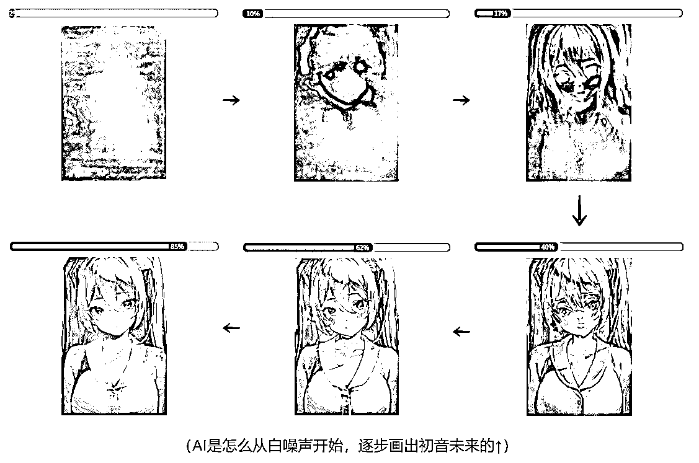

# 1.1 AI绘画的四次跃迁

回望AI绘画的成长轨迹，大致可以梳理出四次关键跃迁。

起步阶段是GAN时期。当时的主流做法是同时训练两个模型：一个负责“造伪”，一个负责“辨真”，双方不断对抗，直到生成端能做出真假难辨的画面，才算训练成功。但GAN有一个绕不开的“鞍点问题”，会让训练中的数据加工变得棘手；数据越复杂、越多元，难度就越高。模型稳定性不足，自然也很难支撑起成熟的商业模式。

转折点出现在2020年。论文《Denoising Diffusion Probabilistic Models》开辟了另一条图像生成路径：成品质量显著优于GAN，还避开了GAN的缺陷，使这项技术迈过了实用化门槛。后来不少模型以“XX Diffusion”命名，原因也在这里。Diffusion的思路并不复杂：先给一张画面持续加噪，直到整幅图化为纯白噪声，并记录这一过程；再反向学习，让AI从白噪声出发，一点点去噪、复原清晰，最终生成图像。AI学习的不是一幅画，而是海量画作。

不过，新路径出现，并不意味着爆发的条件已经齐备。此后DALL-E系列、MidJourney等模型相继登场，效果相当亮眼。MidJourney创作的《太空歌剧院》曾在美国科罗拉多州博览会的艺术比赛中夺得第一名，引发媒体争相转载，在指数工具里也冲出一个很高的“异常值”。但这些模型要么完全闭源，要么只开放API，热度来得快、退得也快，最终没有真正破圈，主要停留在新闻报道和少量技术尝鲜者之间。

加速发生在2022年8月。Stable Diffusion选择开源，为AI绘画的爆发补上了倒数第二块拼图。它的生成效果不逊于DALL-E系列、MidJourney等商业模型，又有良好的开源社区支持；更重要的是，在大模型家族里它相对小巧，个人设备也能完成推理。

真正的引爆点在2022年10月。基于Stable Diffusion、专精二次元风格的NovelAI模型在发布当天被黑客泄露，事件迅速点燃AI绘画，影响远超多数人的预期。原本长期默默无闻的新技术，几乎一瞬间被推进公众讨论的中心。

时至今日，AI绘画已在全球形成较好的开源生态，越来越多人把它用于各行各业，包装、插画设计、AI模特、产品定制、美甲设计等领域都衍生出不少实用新玩法。也期待更多人与我们一起，在新领域碰撞出新的火花。

