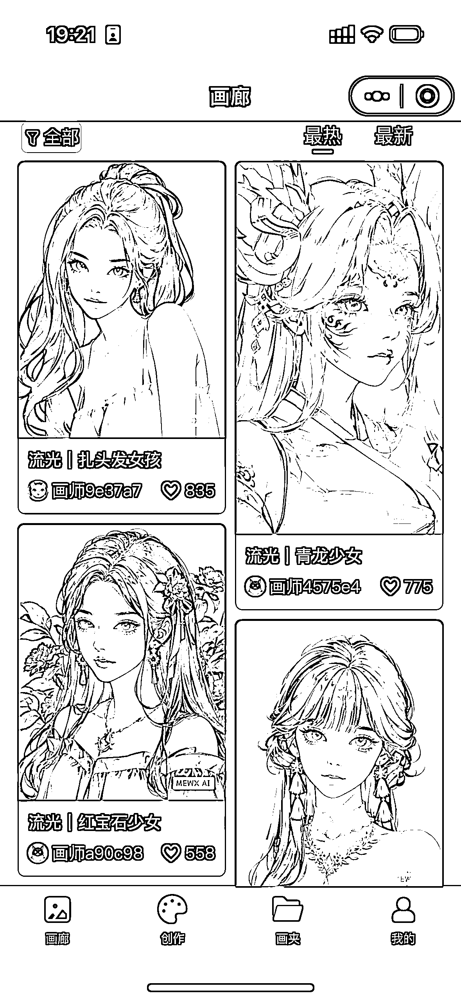
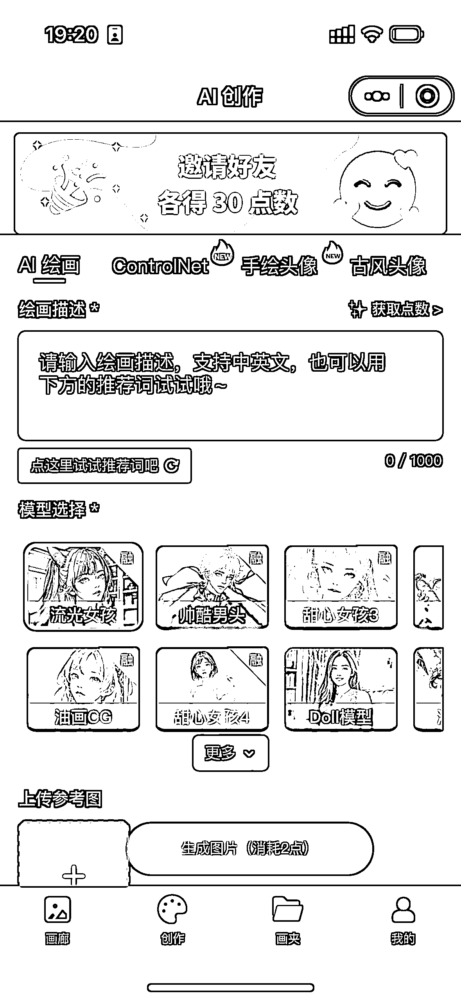
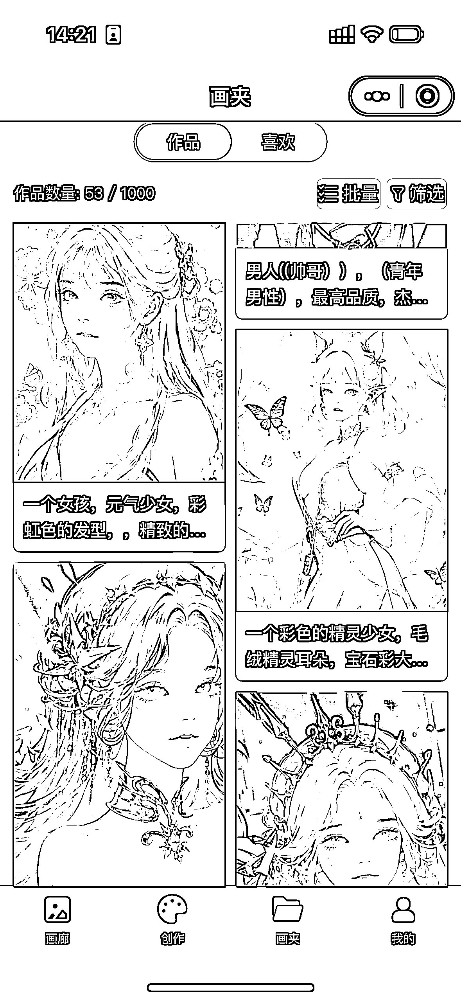
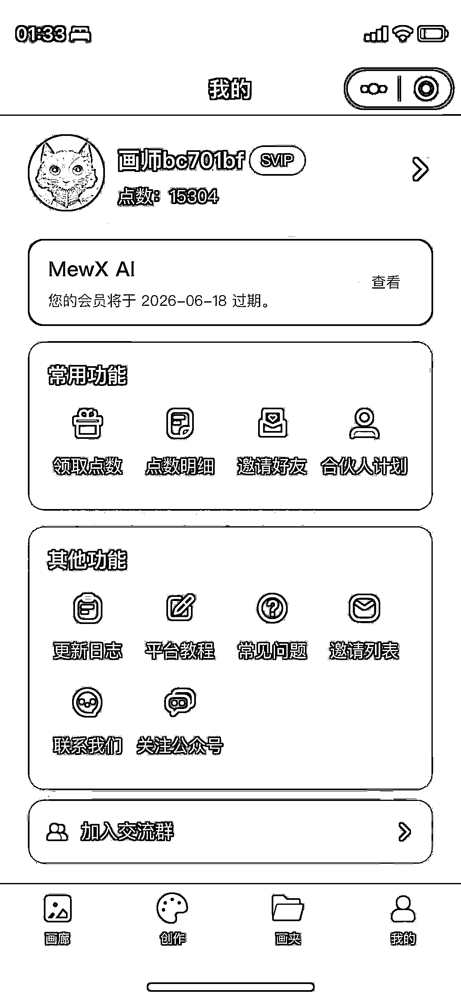
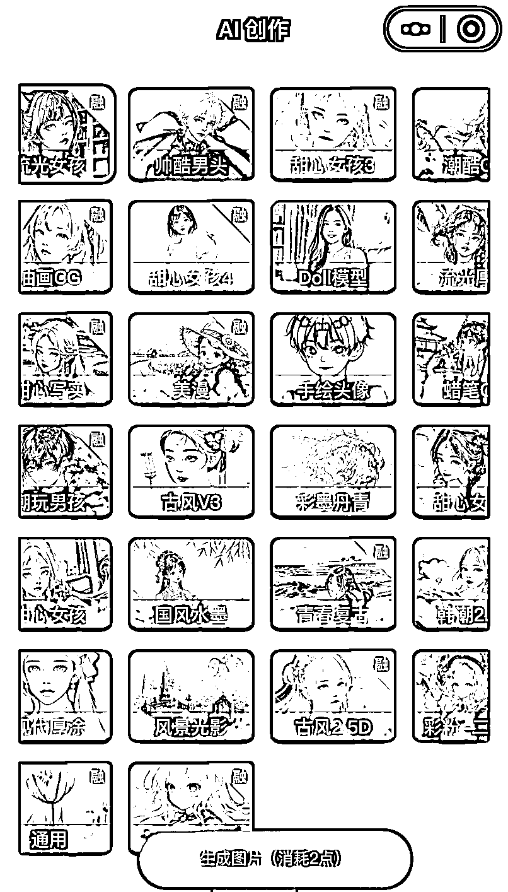

# 2.2 四个页面看懂 MEWX AI

MEWX AI 小程序的主要入口其实就四个：画廊、创作、画夹，以及“我的”。

画廊中陈列的是经过挑选的优质作品。写提示词卡壳时，不妨进去看看其他用户的构思和用词方法；刚上手的人也能挑中意的图，一键套用同款生成。

画廊页面

创作区是出图主阵地。这里既能用简短文字描述来生成画面，也能把照片一键变成多种漫画风格，还能调用 ContrlNet 等进阶工具。

创作页面

画夹相当于你的个人作品库，做过的图都能在这里重新找到。除非你自己主动投稿，否则作品默认仅自己可见，不会出现在公共画廊。

画夹页面

“我的”页面则集中了账号相关资料，以及一些附加功能。

我的页面

实际出图时，最常用的是【创作页面】。不过，决定最终效果的除了输入的关键词或参考图，还有另一个关键变量——模型。

在图片生成中，模型的影响几乎最大：相同提示词换一个模型，结果可能大相径庭。概括地说，一个模型往往对应某种画风和表现方式，因此根据词意挑对模型十分必要。

目前 MEWX AI 提供多种模型可选，其中古风 V3、流光女孩等颇受欢迎、使用较多。各模型具体风格，看封面图就能直观感受：

