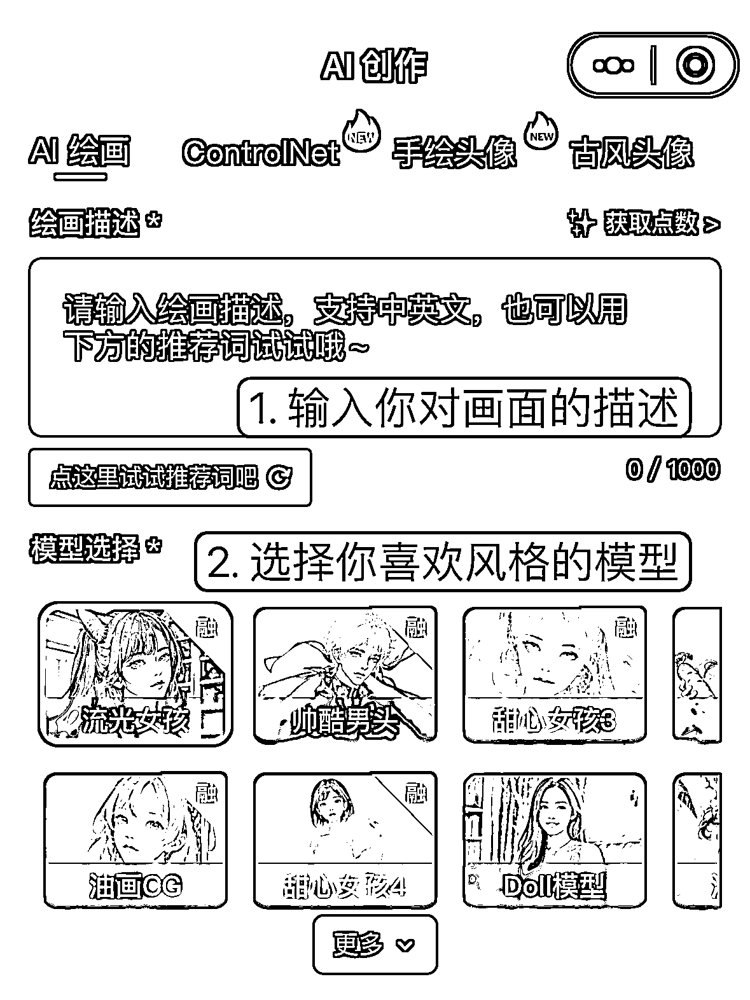
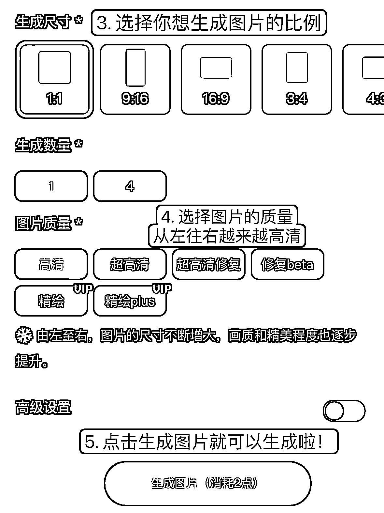
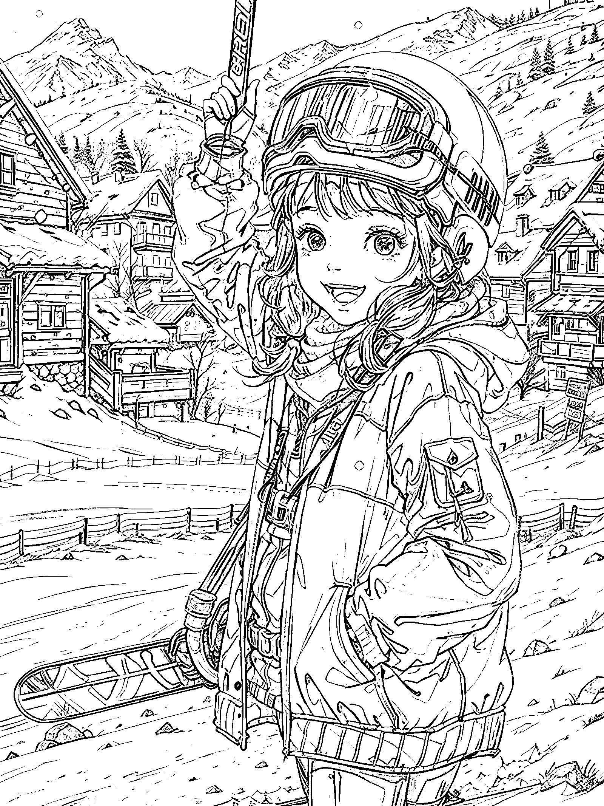

# 2.3.1 纯文字出图：把需求讲给 AI 听

想让 AI 按你的想法作画，最直接的方式就是“文生图”：把画面需求用文字讲清楚，让它据此产出图像。输入内容很灵活，词语、短语组合都行；中文、英文或中英混写都支持。

操作可以按这五步走：

1. 在【绘画描述】里写画面内容。暂时没灵感，就看看输入框下方给出的推荐词；想做出更鲜明的个人风格，可以点👉【六、学习描述词】，了解关键词怎么搭配。
2. 挑一个合眼缘的模型风格，常见大类有流光、国风、二次元、真人、通用。
3. 设定要生成的图片比例和数量。
4. 选择图片质量；清晰度越高，消耗的点数也会越多。
5. 点击生成图片。

整个流程里，【绘画描述】最关键，它直接决定画面会出现什么元素。不过，别把一堆词和短语胡乱堆进去，AI 可能读不懂你的意思。

背后的逻辑不复杂：你先用文字交代图片特征，AI 解析这些词组、短语，再据此绘制作品。

举个例子：

关键词：滑雪场上，一个笑得很开心的小女孩

从结果能看出，AI 会围绕你的描述词作画。描述得越清楚、越具体，成图通常越贴近预期；而你没写到的部分，AI 可能会自行补全。

• MEWX AI 关键词小技巧 •

• 可以补充修饰词来提升成图质量，比如 Masterpiece、best quality、8k 等。

• 想强调某个词，可以给它套圆括号来加权重：一层括号约为 1.1 倍权重；也可以直接写成（word:1.6），把这个词的权重提到 1.6 倍。

• 如果只想要单人画面，却总出现多人，可以在关键词前加上 solo 或独奏。

