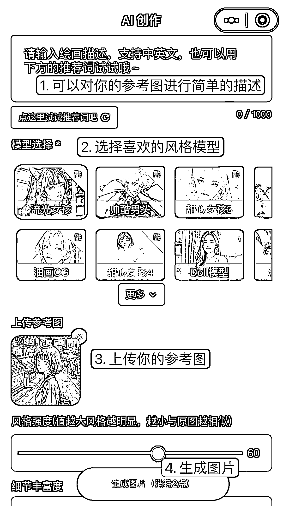

# 2.3.2 用参考图，让AI照着画

想让AI按你的想法出图，不一定要只靠文字。把一张图交给它作为参照，也就是常说的“图生图”，它便能依据你指定的风格，创作出相近的作品。

操作顺序如下：
1. 在【绘画描述】里填写画面需求；
2. 挑选中意的风格模型；
3. 上传参考图；
4. 调节风格强度，通常保持在30～80之间效果较稳；
5. 点击生成图片。

这种玩法中，参考图是成图的基础，它可以是一张实拍照片，也可以是一幅草图。AI会把你的参考图、文字描述以及所选模型风格放在一起综合处理，最终完成画面。

上传后要留意下方出现的“风格强度”。数值调得越低，结果越贴近原图；数值调得越高，画面越偏向第二步选定的风格。

真人漫改头像也是同一套逻辑：先把风格强度压低，让人物保留更多真人感；随后再按需要切换不同的模型风格。

