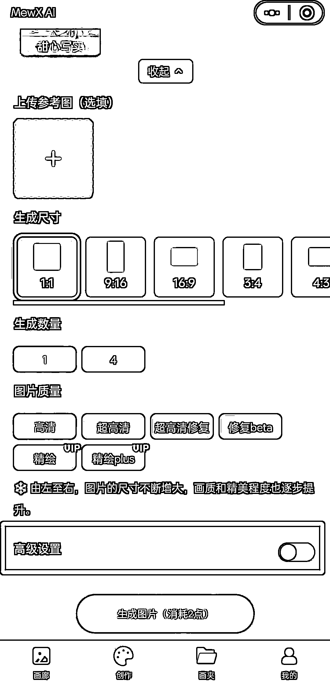
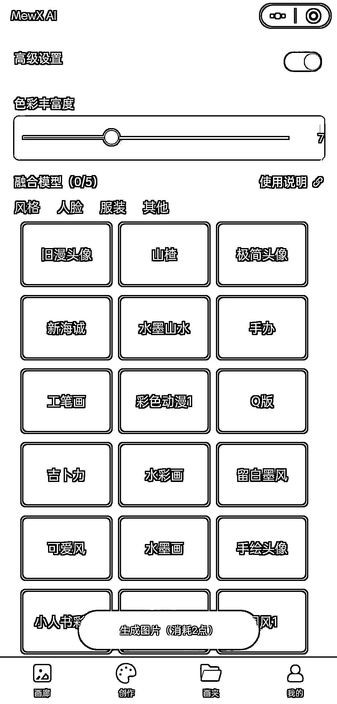
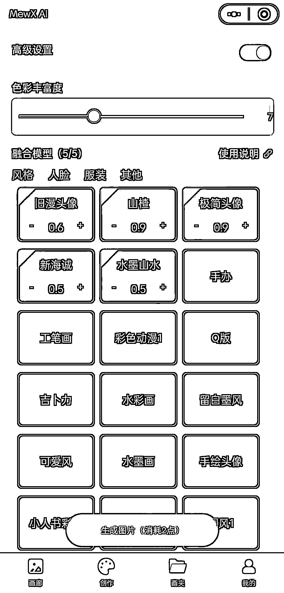
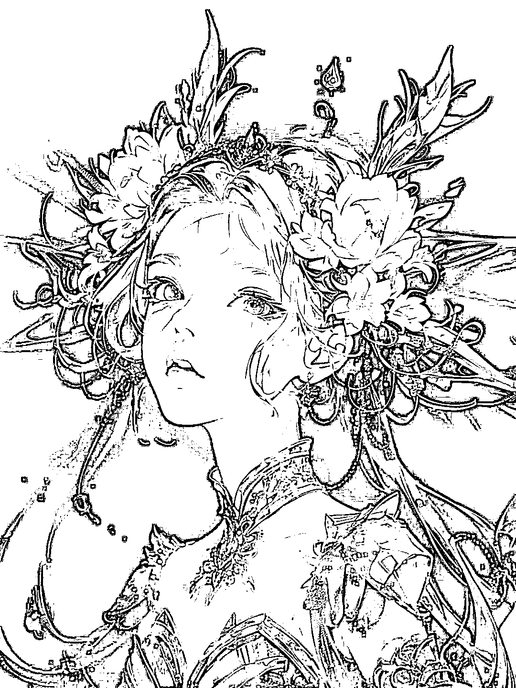
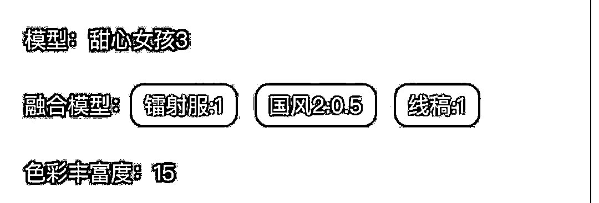
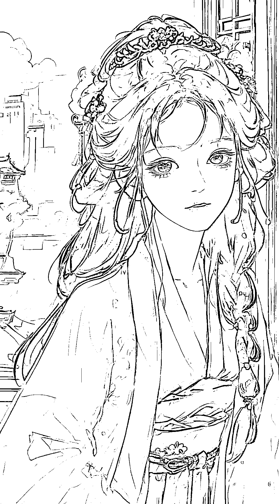
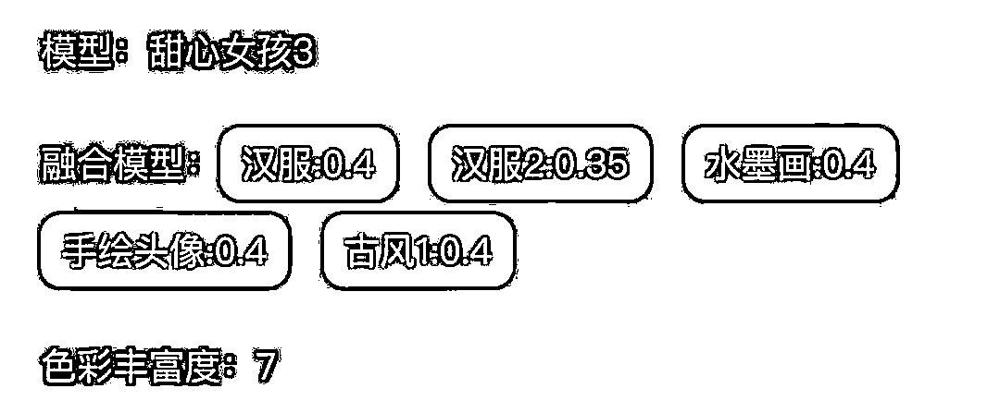
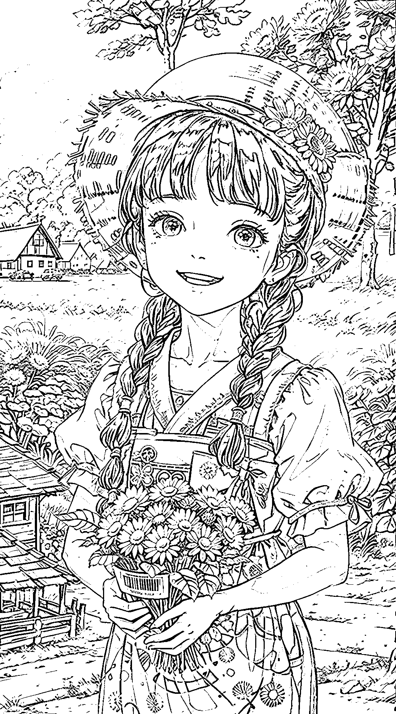
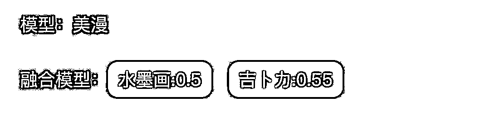

# 2.3.4 LoRA 融合：叠出专属画风

LoRA 就是常说的融合模型，全称是 Low-Rank Adaptation of Large Language Models。它属于体积较小的绘画模型。基础模型一次只能选一个大模型来作画，而 LoRA 可以在已选大模型的基础上再叠加一个或多个，把不同画风和人物特征混合到一起。

在 MEWX AI 创作页面，按常规流程绘图后，页面底部会出现【高级设置】。点开它，就能看到与融合相关的选项：

在这里，你可以挑选想用的融合模型，并调节各自的比例。目前 MEWX AI 已上线 34 款不同的融合模型，每种风格的比例都能自由调整，范围为 0 到 2。单次创作最多支持叠加 5 个模型；建议把比例设在 0.2 至 1 之间。比例越高，画面中对应风格的强度就越明显：

不同模型搭配不同比例，常常能碰撞出意想不到的效果。大家可以多试几组，探索自己喜欢的风格，例如：

注意事项：具体比例怎么调很重要。可以先从较低比例的融合模型开始尝试，再逐步微调；有时候叠加太多或比例拉得太高，并不会让结果更好，反而可能造成崩图。若效果不理想，不妨多调试几次，慢慢打磨出自己最满意的风格。

MEWX AI 里还有不少有趣玩法，比如线稿上色、人脸修复、服装设计等，这里就不多展开了，留给大家自己探索～

