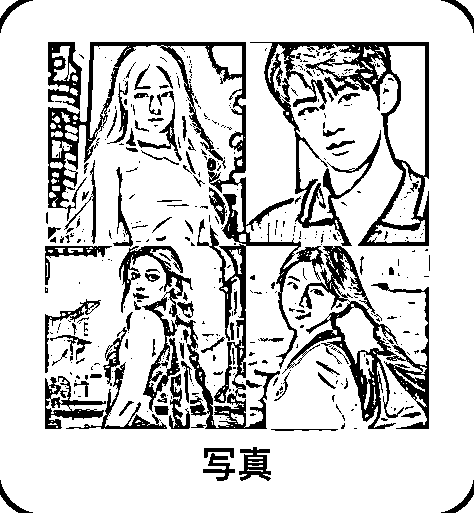
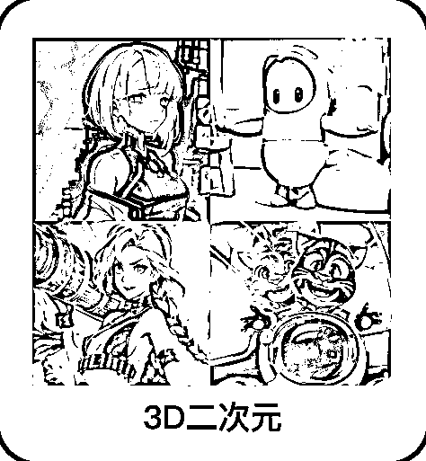
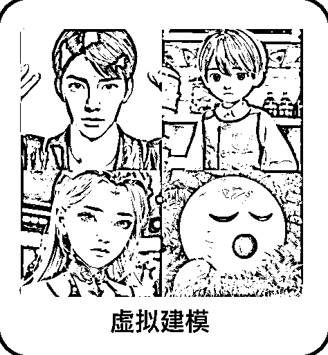
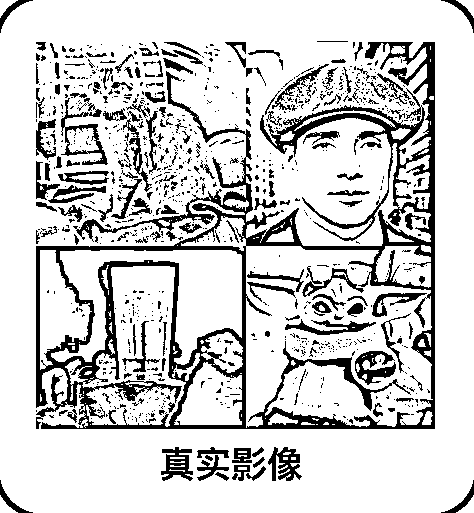
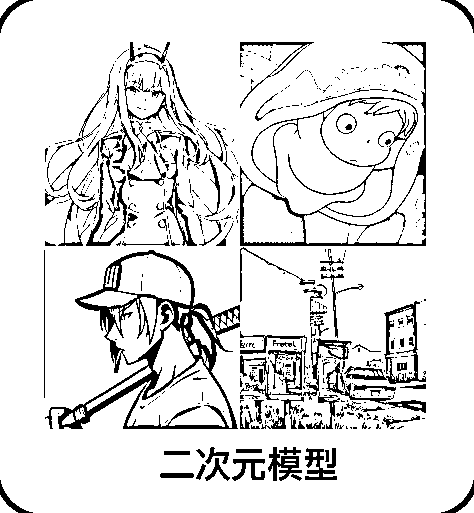

# 3.1.1.1 基础模型：选型指南

做文生图或定制模型时，基础模型就是最底层的大模型；选型最好从实际用途出发。Vega 这几款底模分别适合什么？可对照下面的场景来挑：

- **写真**：适合亚洲面孔、真人摄影、coser 造型，以及少年感和少女感风格。

- **3D 二次元**：适合更立体的动画角色、游戏角色与游戏道具。

- **虚拟建模**：适合虚拟人建模，也适合有光泽感的场景和物件。

- **真实影像**：适合包装设计、工业设计、电影角色和宠物题材。

- **二次元**：适合平面风格的二次元角色与动画场景。
