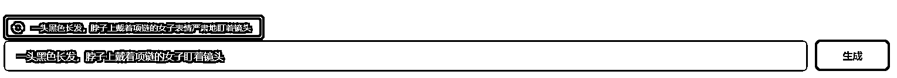
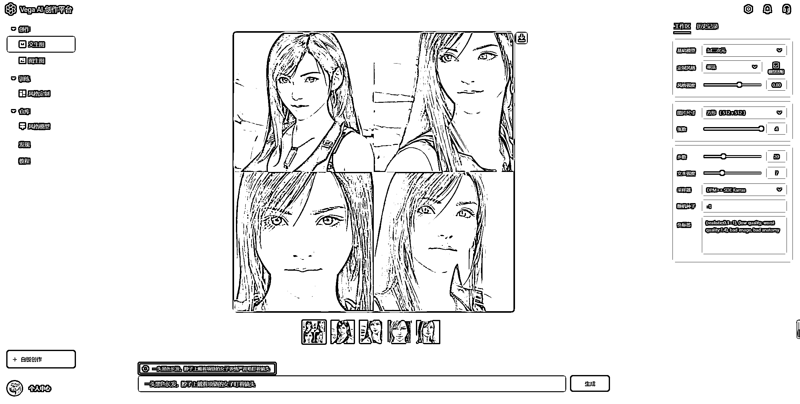

# 3.1.1.4 提示词上手

输入框里会附带一条参考描述，比如“镜头前，一位表情认真、留着黑色长发并戴着项链的女性”。在这段提示左侧有个刷新图标，点一下就能换一批推荐文案。

想直接使用的话，点击这段文字，它就会填入输入框。随后围绕描述中的核心对象继续扩写——如果示例写的是女性，就以她为对象添细节、补关键词，把画面逐步描述清楚，最终生成你想要的图片。

当然，推荐内容只是参考。你完全可以不套系统模板，按自己的想法撰写描述词，同样能生成目标图片。

若想让作品更有个人风格，可以👉【六、学习描述词】，了解关键词如何搭配组合。