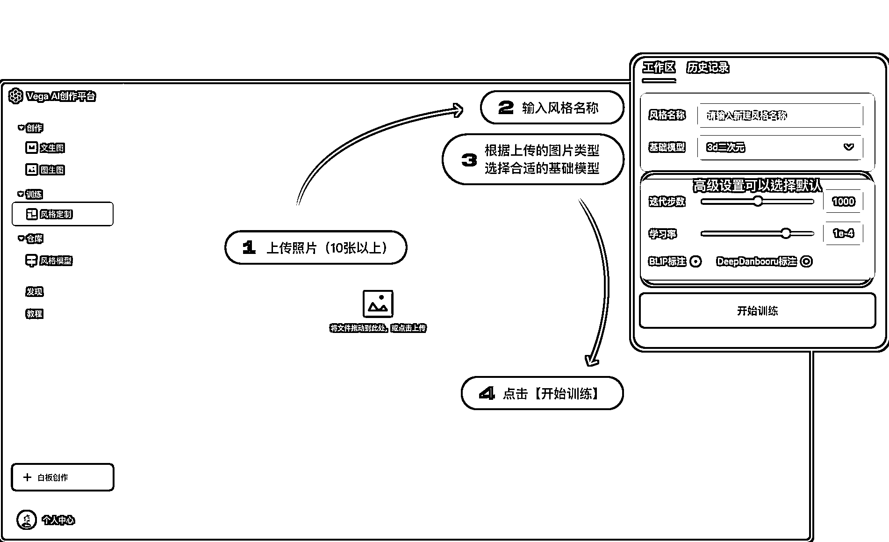
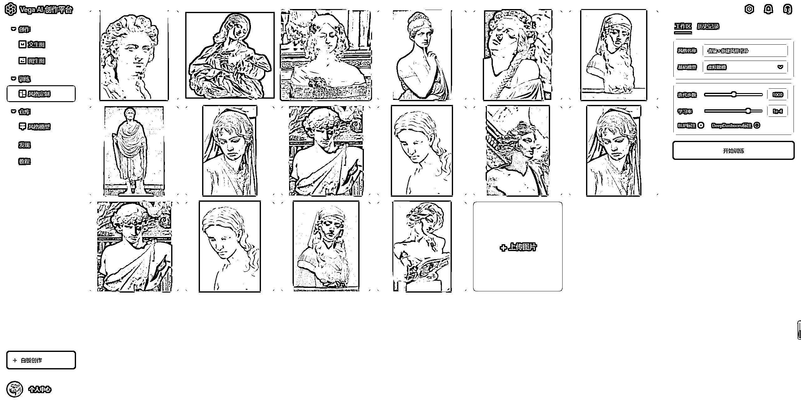
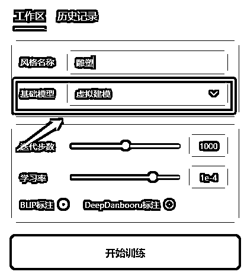
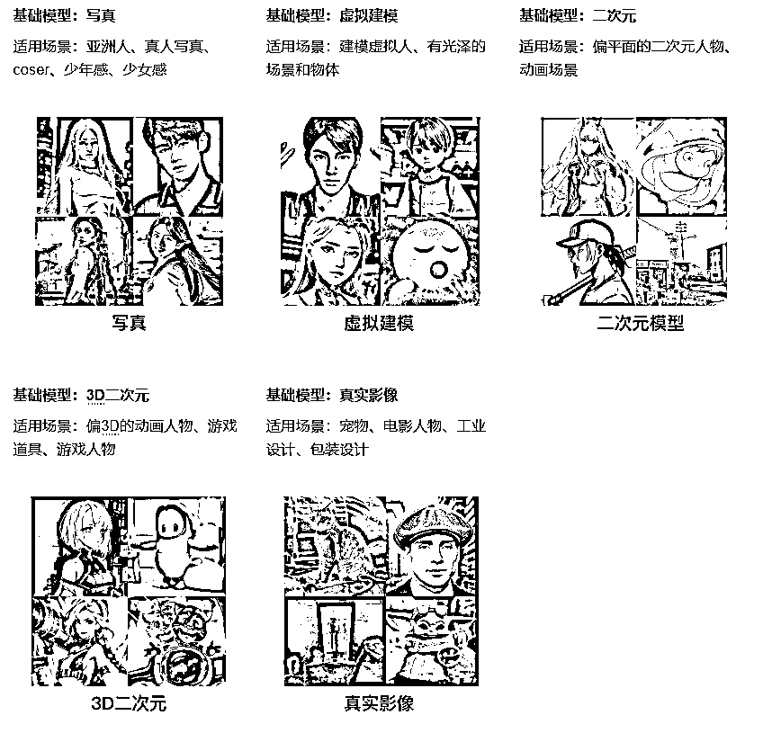
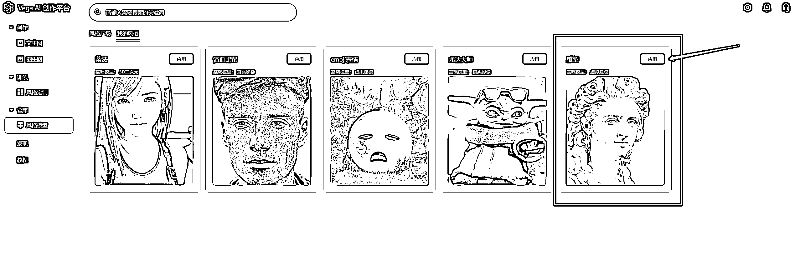
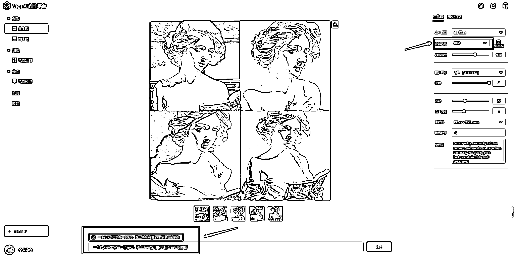

# 3.1.3 风格定制：练出你的专属画风

想让作品拥有独一无二的风格印记？做法其实很直接：自己挑出10张以上同类型图片，在线训练一个只属于你的风格模型。素材图越清晰、张数越充足，最终效果通常越理想。

第一步：准备素材图片

- 图片类型：尽量统一，例如同一人物、同一种画风、同一物件、同一纹理、同一材质或同一姿势等。
- 图片数量：控制在10到100张之间，数量越多越有利。
- 图片大小：分辨率建议不低于512×512像素。
- 图片内容：主体尽量保持一致，同时避免主体元素在画面中过小。

第二步：导入图片

从左侧菜单进入【训练】—>【风格定制】，点击“上传照片”，也可以直接用鼠标把图片拖拽进去。

第三步：设置训练参数（这一步非常关键！！！）

- 「风格名称」：给即将训练的“定制风格”模型起一个名字。
- 「基础模型」：务必认真选择（很重要！！！）。

不同基础模型训练出来的结果差别不小，挑选时多留心。具体推荐可参考【3.1.1.1 基础模型】。

- 高级设置：一般保持默认参数即可。

第四步：启动训练

点击「开始训练」，耐心等待约15分钟。等待期间可以切到其他页面继续操作，训练完成后会有弹窗提醒。

第五步：调用风格模型

1）进入「风格定制」—>“我的模型”，就能看到刚训练好的模型，点击“去应用”。

2）打开「文生图」，选中训练好的风格，输入文案即可开始创作。

