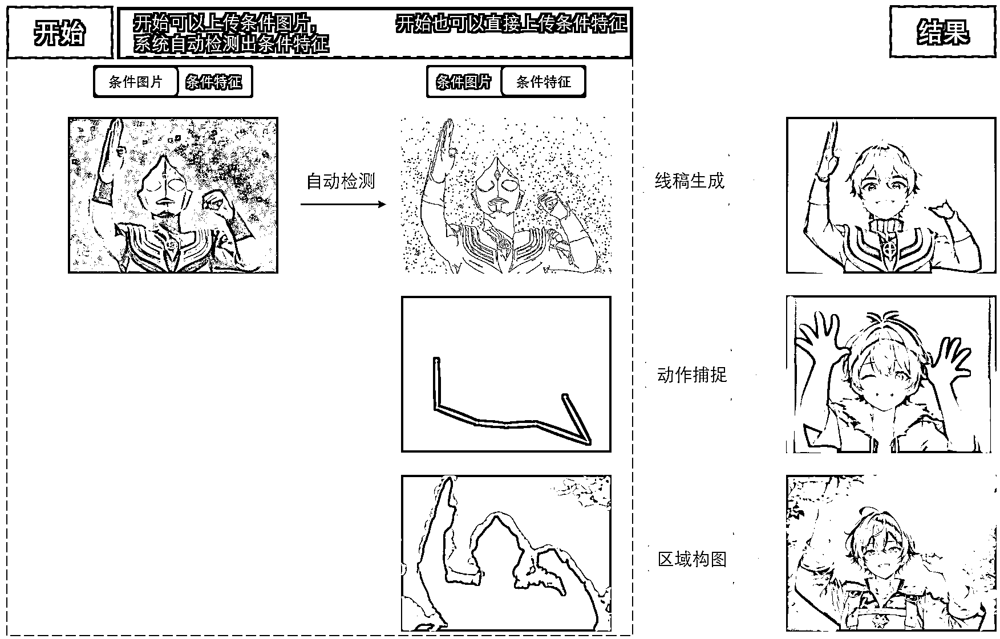

# 3.1.4 玩法四：按条件生成画面

条件生图的核心，是为图片生成过程设定可用的约束条件。就条件控制来说，共有三种实现方式：线稿生成、动作捕捉、区域构图。至于条件输入，则有两类：一是条件图片，普通图像就能满足；二是条件特征，也就是线稿、姿态图或色块图。

两种输入的实际差别在于处理路径：选择“条件图片”时，系统会先分析你上传的图片，自动抽取相应的条件特征，再用这些特征参与生成；选择“条件特征”时，系统不需要额外分析，直接把你上传的线稿、姿态图或色块图作为生成输入。

我们用一个“线稿生成”的例子来说明。先在右侧配置面板中，把“条件控制”设置为“线稿生成”。如果这时选择“条件图片”，那么上传普通图片后，系统会自动提取它的线稿，并以此线稿为参照生成新的画面；你也能在条件特征区域中看到这张自动生成的线稿。如果选择“条件特征”，则要自己提供线稿、姿态图或色块图，系统拿到后直接依据这些特征完成生图。

下面我们来详细拆解条件生图的三种方式。