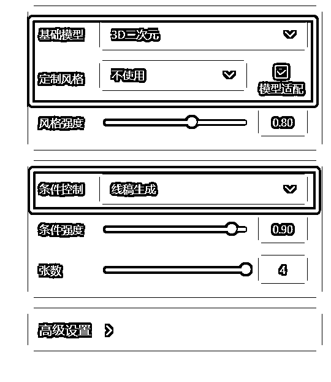
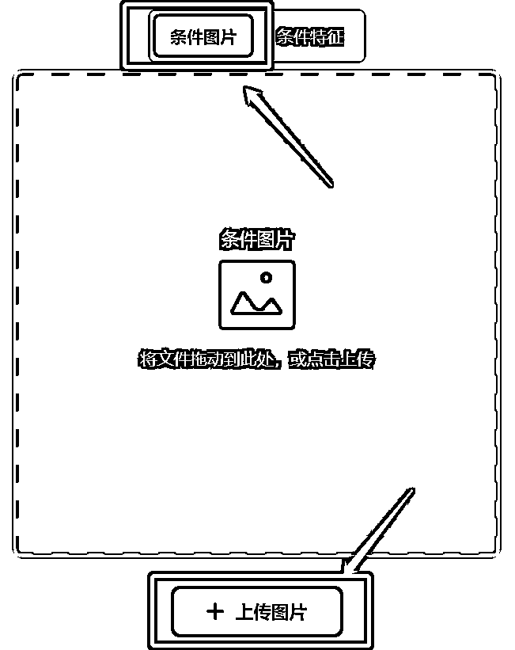
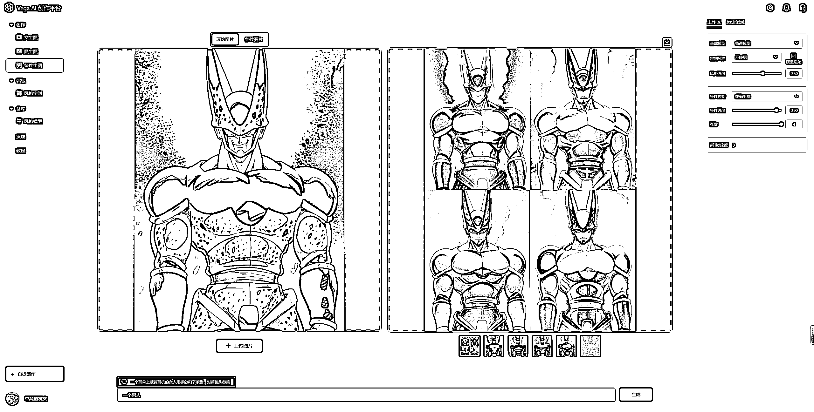
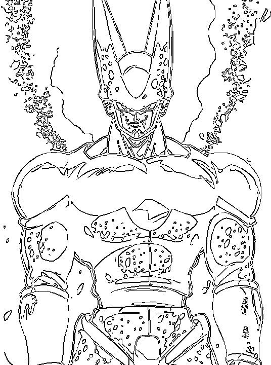

# 3.1.4.1 四步生成线稿新图

想用一张参考图，快速得到风格接近的线稿新图？跟着下面这套流程走就行。

首先，在右侧的设置面板里点选「线稿生成」，再选好要用的模型和风格。

接着，在画布区域选择「条件图片」，上传一张准备参考的图片。

然后，填写文本描述词；如果一时没有思路，也可以从推荐词中挑一个合适的。

最后，点击生成按钮，稍等几秒，一张与原图线稿相似的新图就会生成出来。

点开「条件特征」，就能看到原图对应的线稿；你还可以在这个线稿的基础上继续生成：

另外补充一点：如果手头已经有线稿，第二步也可以直接在画布区域点击「条件特征」并上传线稿（参考上图 👆），这样就能直接用线稿生成新图。