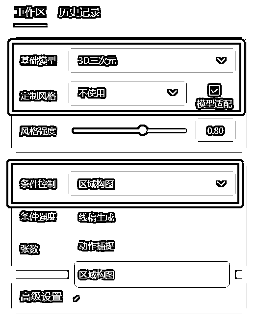
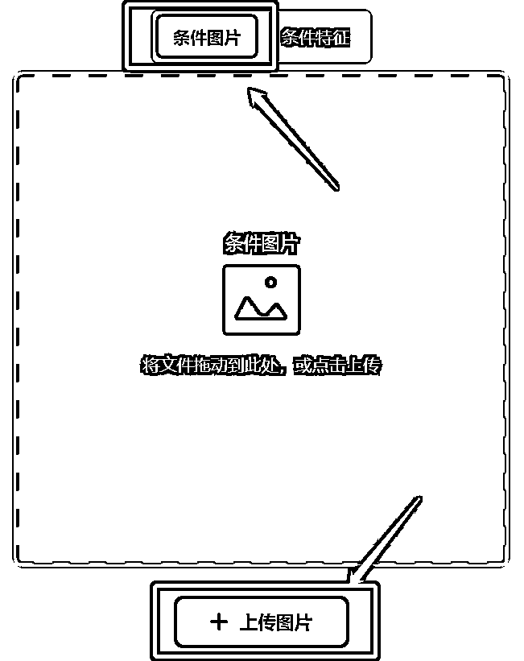
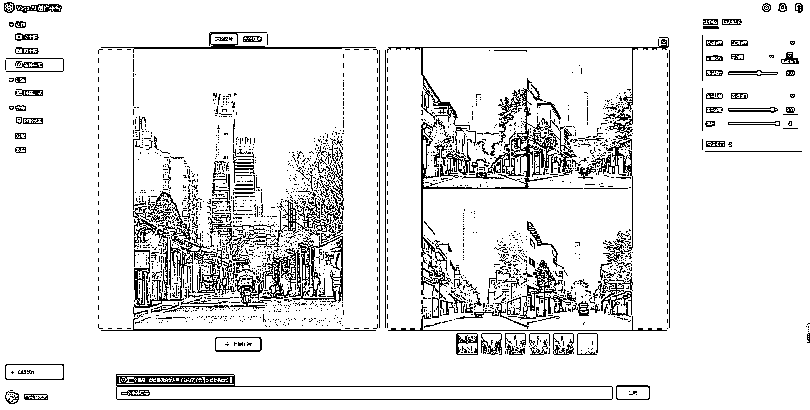
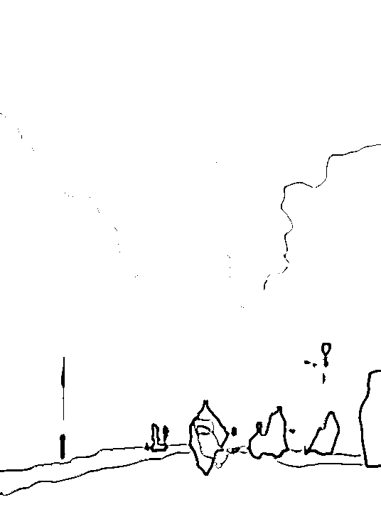
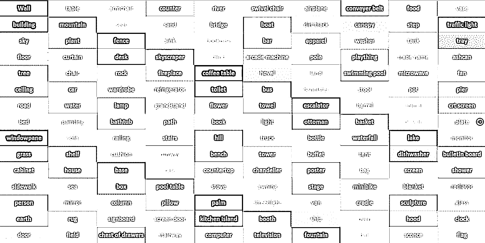

# 3.1.4.3 构图复刻，四步搞定

想把一张图的构图“搬”到新作品里？用「区域构图」就能轻松实现，操作只有四步：

第一步，去右侧设置区点开「区域构图」，然后挑好模型与风格 👇

第二步，在画布区选择「条件图片」，把参考图上传上去 👇

第三步，填写文本描述词；如果一时没灵感，也可以直接选用推荐词。

第四步，按下生成按钮，等上几秒钟，一张构图布局与原图相近的新图就出来了：

另外，在「条件特征」里能清楚看到系统从原图提取出的区域构图。想继续创作的话，完全可以沿用这份构图去生成更多图片：

