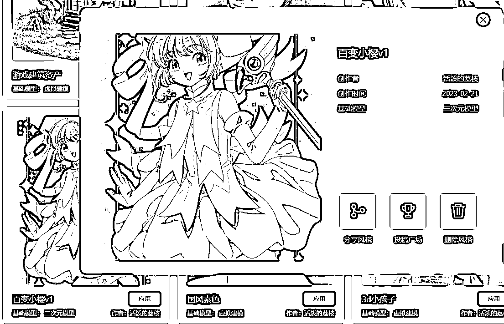
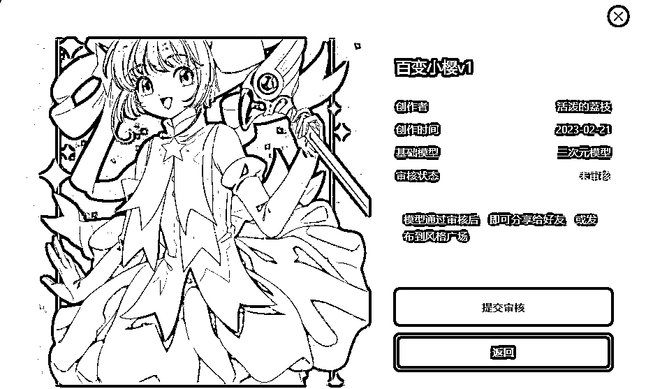
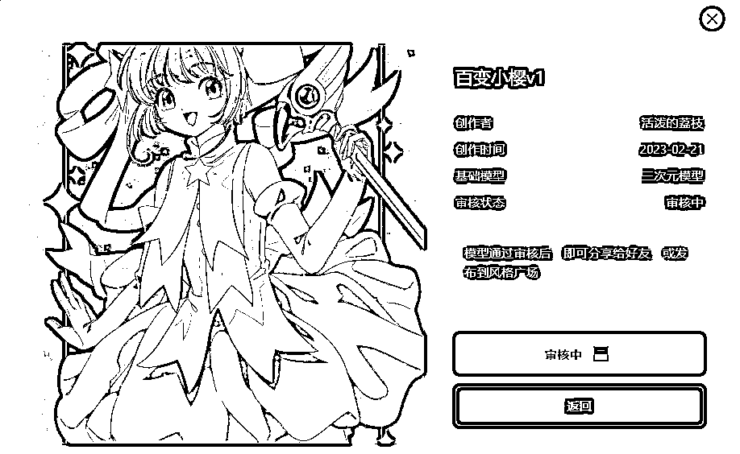
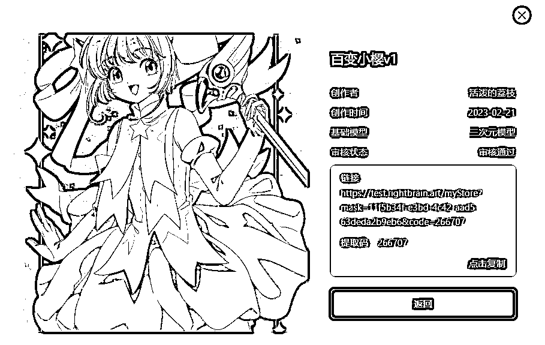
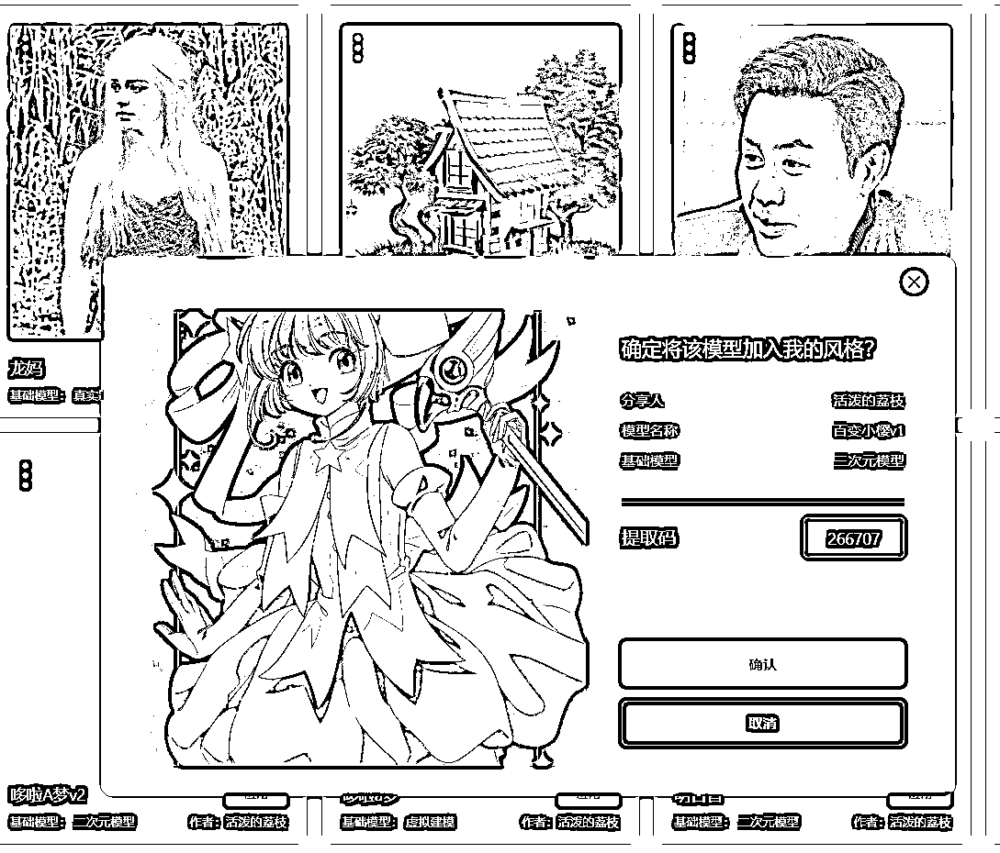

# 3.2.2 分享你的风格模型

Vega 现在向用户开放了两项实用的能力：你可以把自己训练好的风格模型分享给好友，也可以将其投稿到风格广场。需要特别留意的是，为了保护个人隐私和肖像权，涉及特定真人的风格目前不支持分享与投稿。

分享功能的核心很简单：选定一个风格，系统会生成对应的链接和提取码，对方凭借这两项信息就能获取该风格模型。具体的操作流程如下：

- 进入“我的风格”界面，点击想要分享的风格进入详情页，然后在页面中选择“分享风格”。

- 如果该模型尚未通过官方审核，分享前需要先提交官方审核。

- 提交后耐心等待审核结果，结果会实时同步到界面右上角的系统通知中。

- 审核通过后，再次点击“分享风格”，系统会为你生成专属的分享链接和提取码。

- 他人通过链接访问页面，并输入正确的提取码，即可将分享的模型保存到自己的“我的风格”中。

