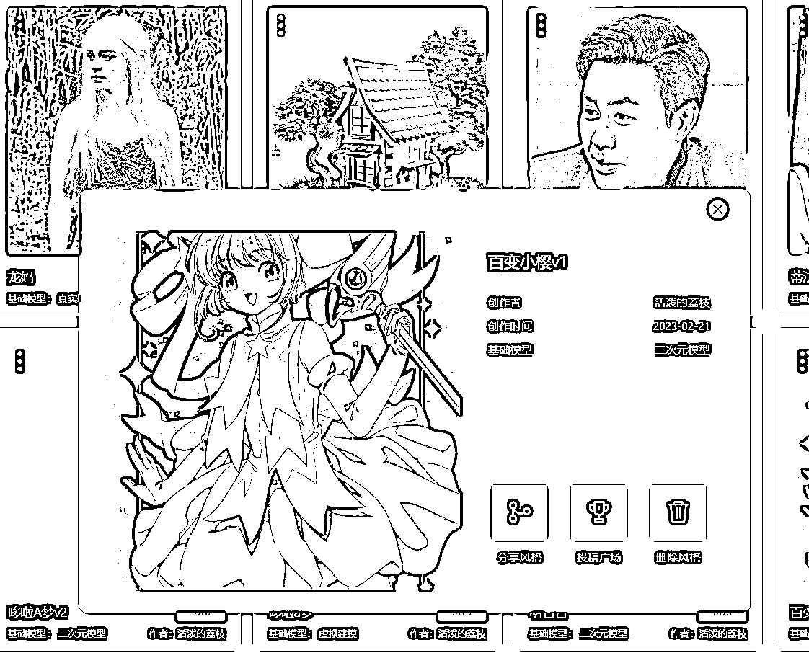
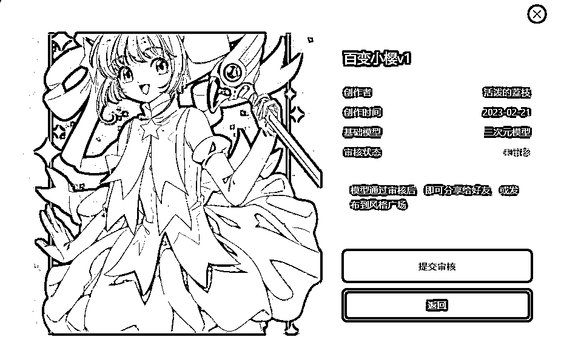
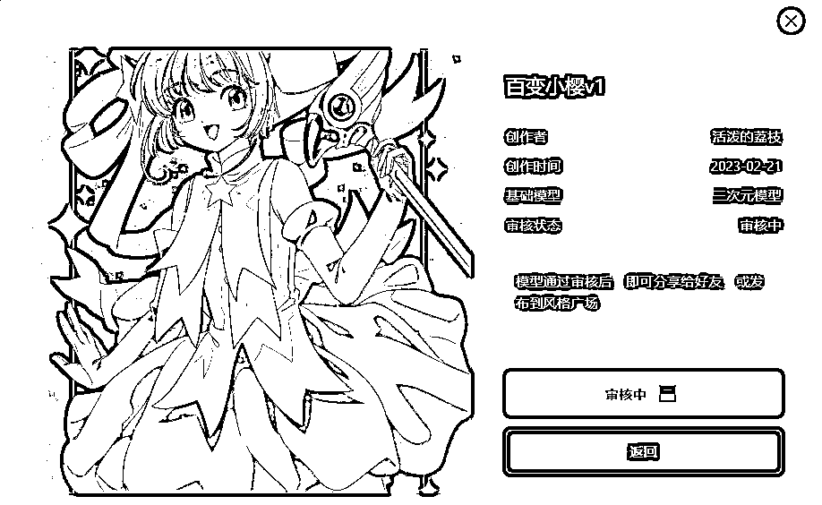
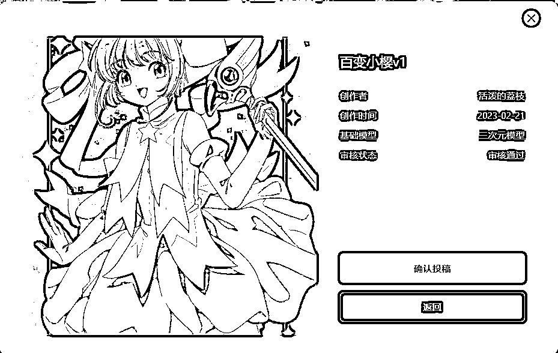

# 3.2.3 让风格模型上广场

想让自己的风格模型被更多人看见？投稿广场就是分享入口，支持创作者把自行训练好的风格模型发布到风格广场。

操作很简单：先在“我的风格”里找到准备分享的模型，点进它的详情页，再选择“投稿广场”。

若该模型还没通过审核，分享之前必须先提交官方审核申请。

提交后耐心等待即可，审核结果会第一时间同步到界面右上角的系统通知。

审核通过后，就能正式投稿到风格广场进行展示。

