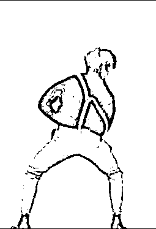
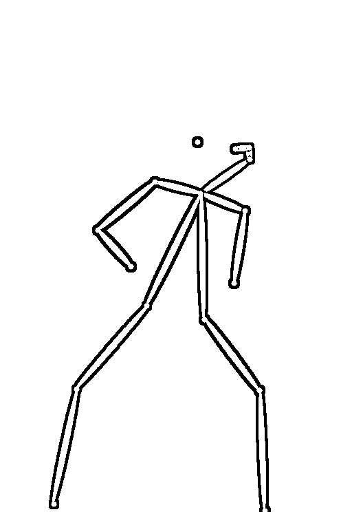
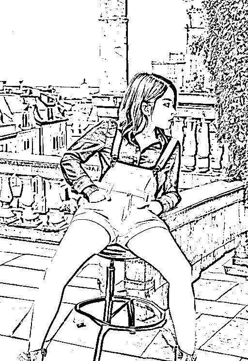

# 5.1.1 插件生态很能打

Stable Diffusion 的插件生态相当能打，玩法层出不穷。

拿 ControlNet 来说，它能从画面中提取物体边缘、人体姿态骨架、景深信息，并完成语义分割；人物的动作、手势等细节都能被它精准拿捏。配合重绘功能，你只想改哪块就改哪块，其余区域保持原样。

还有 Mov2Mov，能把一段视频迁移成另一种画风的视频；Tagger 则像个反向解析器，随手丢一张图给它，就能较准确地倒推出图上大部分关键词。

