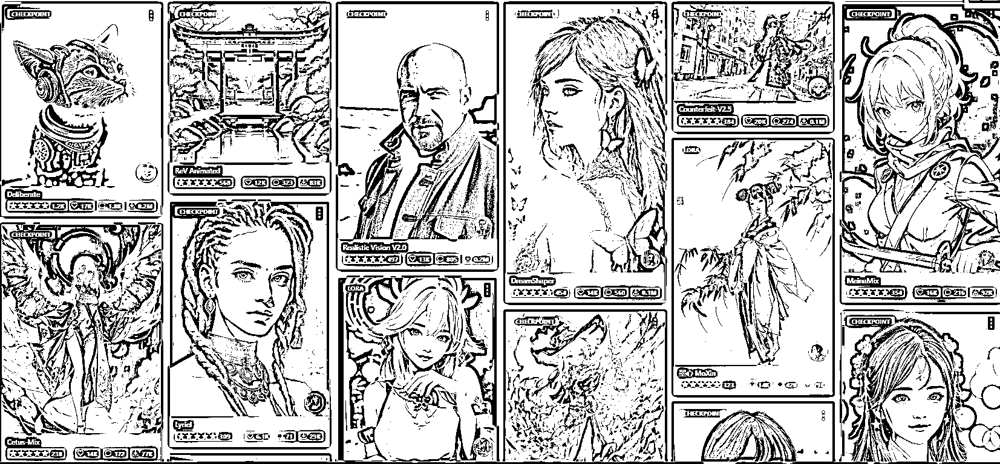
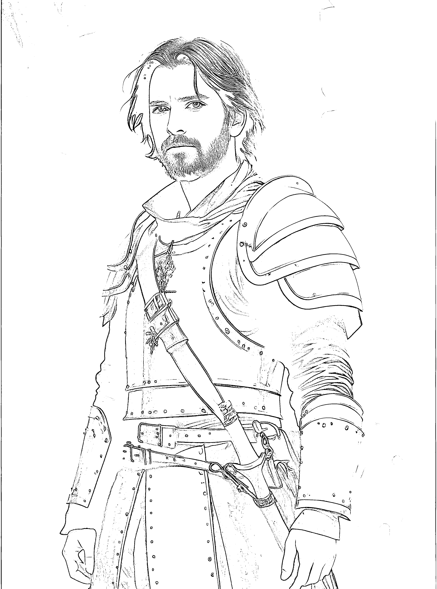
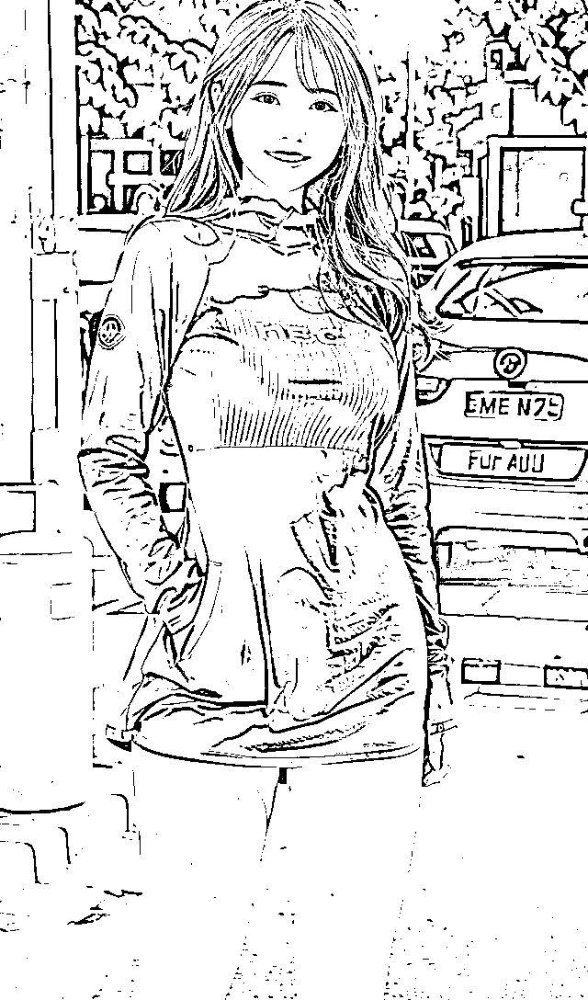

# 5.1.2 海量模型任选，也能亲手训练

现成模型到底有多少？不同风格、版本和尺寸全部算上，数量早已突破五位数。先挑两张圈内常被拿来当样板的封面，给大家直观感受一下：

左图这套提示词走的是“中世纪铠甲＋CG 壁纸＋油画质感”路线：正向部分堆叠了画师风格、平台热度、细节与光影要求；负向部分则把画框、卡通、3D、畸形肢体、模糊、低质解剖等常见问题逐项排除，末尾还附有种子、步数、采样器和 CFG 参数。右图换成写实人像思路，长发、蓝裙、全身、笑脸和涂鸦背景是主要元素，正向强调高清、面部细节与光照，负向重点压制低清、黑白、皮肤瑕疵和手指异常，同样带有种子、步数、采样器与 CFG 值。

