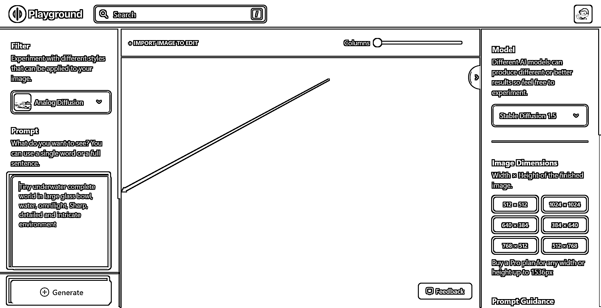
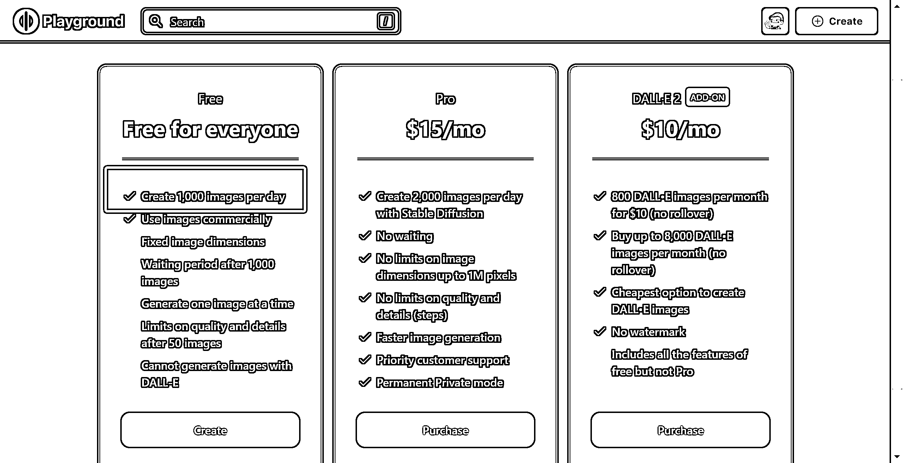

# 5.2.2 先在 Playground 跑通出图

入口在这里：`playgroundai.com/create`

界面如下：

最省事的出图方式只有两步：在红色方框内键入英文提示词，然后点一下 Generate，图像就会生成。

这个平台目前给每位用户每天 1000 张图的生成额度，足以让你把各类按钮和参数都试个遍。具体功能这里就不逐项展开，放心大胆去试就好。

动手试的过程，也是你亲自体验的过程；不妨把过程记录下来，整理成日志，未来可能变成能帮到别人的攻略。这件事只赚不亏。

