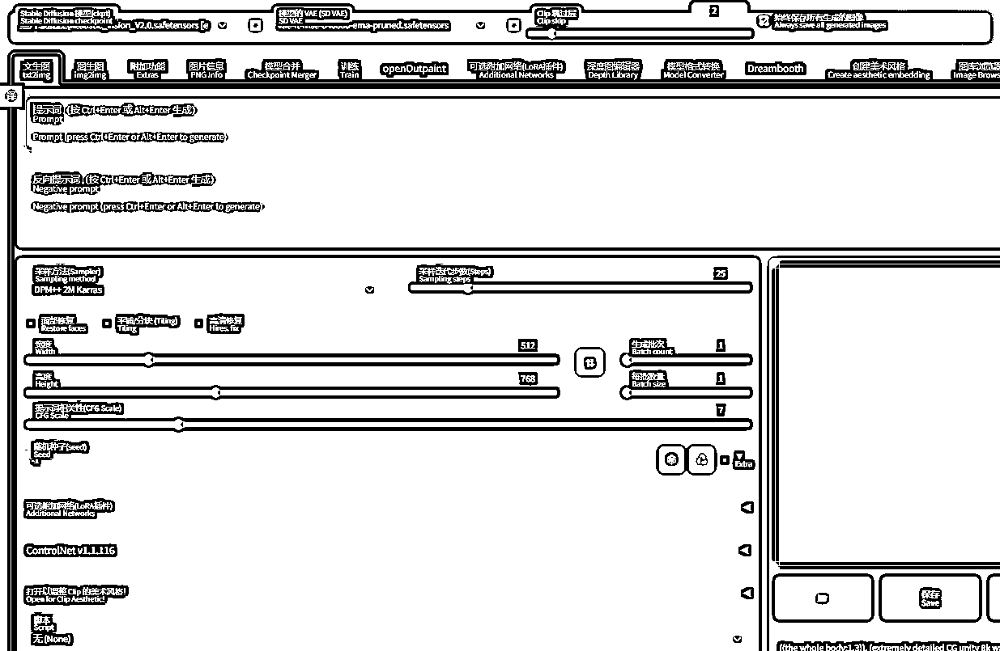
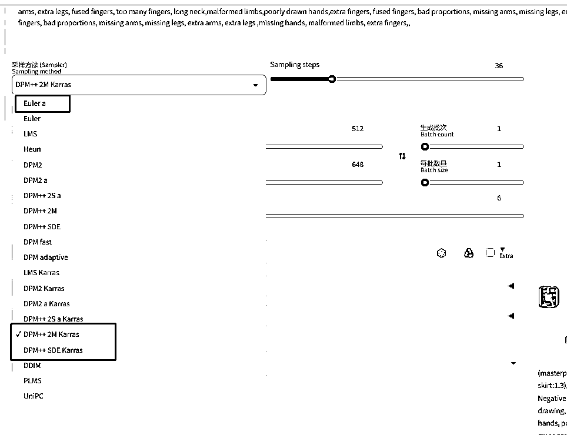
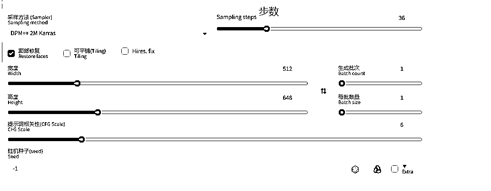
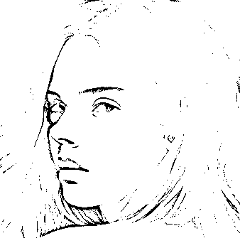
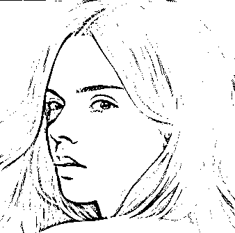
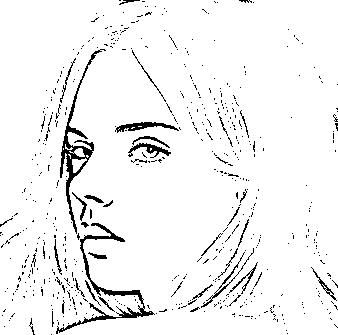
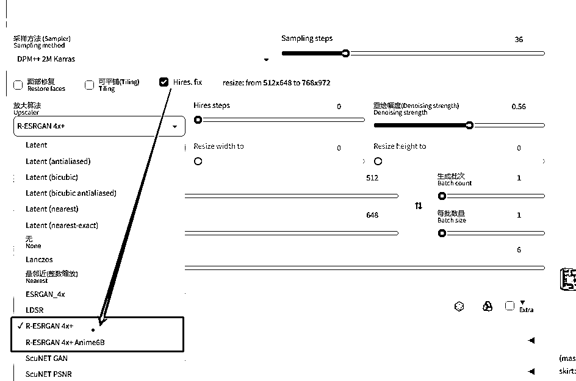
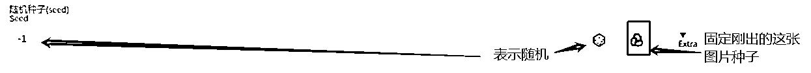

# 5.4.3 参数面板速通指南

本节把文生图界面上的各个控件逐一讲透，先看下图这个页面：

•采样方法

刚上手时，优先考虑下面这三种采样方法。DPM++ 2M 的整体表现更稳；Karras 是在它基础上进一步完善的版本；Euler a 则常常会带来一些意外的小惊喜：

•其他控件

① 迭代步数 Step

可以把迭代步数理解成画师在一张纸上落笔的次数。建议设在 20—36 之间，通常效果就不错，不要调得过高。

如果你已经理解一点原理，那么它对应的是去噪次数：去噪越多，画面往往越清晰、细节越丰富，但生成耗时也会随之增加；所以不宜过大，去噪过度同样不理想。

② 面部修复

这个选项主要用来修复人脸。真人、3D 类图片可以勾选，二次元与风景图则不要勾。右侧两个选项只是采用了不同算法：

原来的效果：

GFPGAN：

CodeFormer：

③ 高清修复

如果觉得出图不够清晰、画面偏模糊，可以勾选高清修复来生成大图。显存较小的话建议先别开，否则容易生成失败。

•算法推荐：二次元选 R-ESRGAN 4x+ Anime6B，真人选 R-ESRGAN 4x+。

•重绘幅度表示在原来图片上的改动程度，0.5—0.73 都比较合适。

•高清修复与面部修复不能一起启用，这一点请务必记住，重复三遍也不为过：二者别同时勾选、别一起开、别叠加使用。

④ 宽度高度

这里控制的是生成图片的宽高。想要大图，不要靠直接拉大宽高，否则容易生成出奇奇怪怪、甚至吓人的画面。

因为 AI 按描述词预想的画布只有 A4 纸大小，你给它一张 A3 纸，多出来的区域只能重复已有内容，所以遇到多头多手的情况时，请回头调整宽高。

•常用尺寸有 512*512、768*768、512*768 等。

•想要大图，可以改用高清修复。

⑤ 提示词相关性（CFG）

它表示你输入的提示词对画面的影响程度。数值越小，AI 自由发挥的空间越大；数值越大，AI 发挥空间越小，画面可能出现锐化、线条不佳的情况。

⑥ 种子 Seed

可以把它看成生成每张画所用纸张的编号。-1 表示随机抽取一张纸和一支笔，所以即便描述词相同，不同种子生成的图片也会有些差异。

如果你对某张图很满意，想在此基础上微调或修改，请固定种子：点一下骰子右侧由绿色箭头围成的圆圈，就能锁定当前图片的种子。

理论上，在同一台电脑上，只要参数完全一致（如 Step、CFG、Seed、prompts），生成的图片应当完全相同。

⑦ 生成批次和数量

批次：指每次生成图片的组数，不同批次之间的图变化会相对大一些；

数量：指一次出几张图，因为属于同一批，变化会相对小一些。不过显存不太够的话，还是建议每次只生成 1 张。

