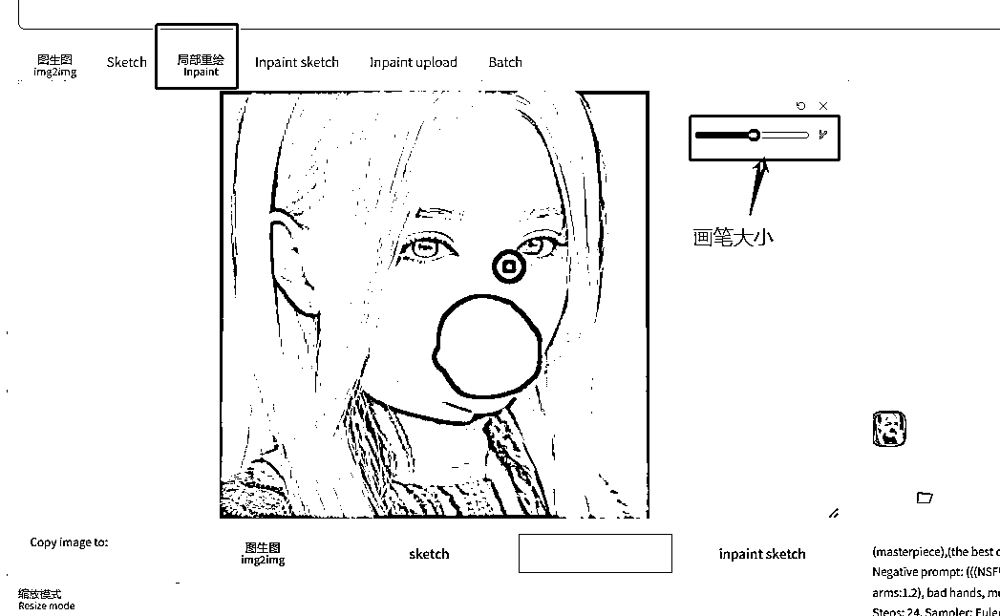
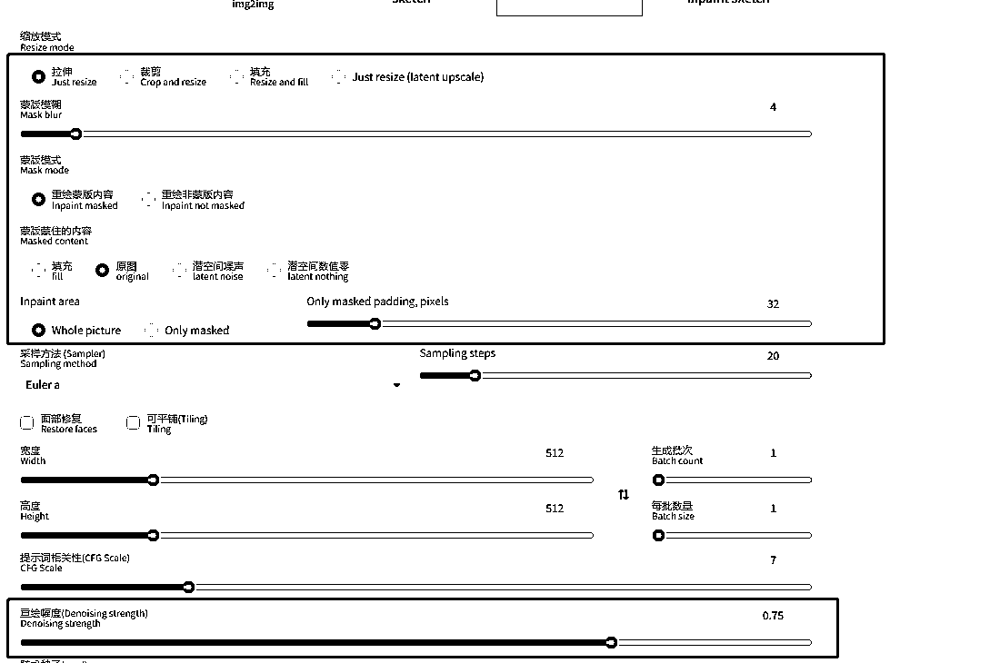
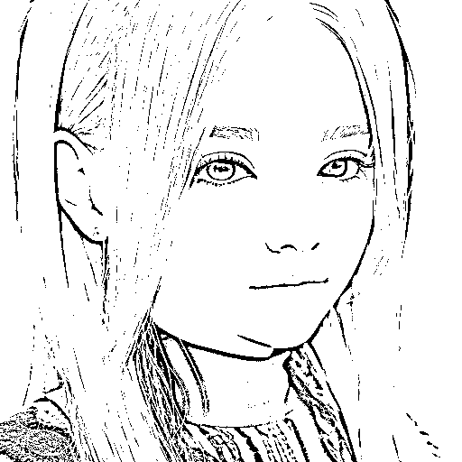
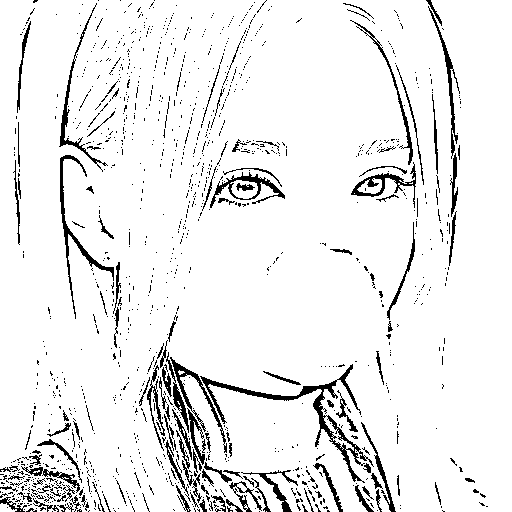
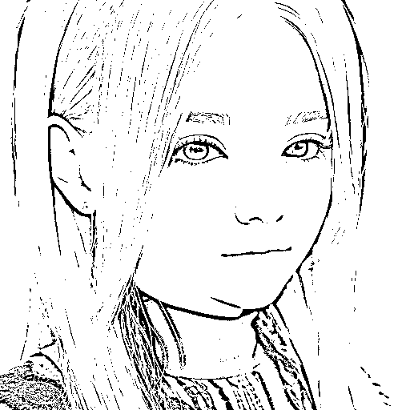
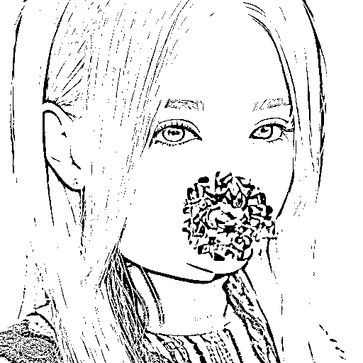
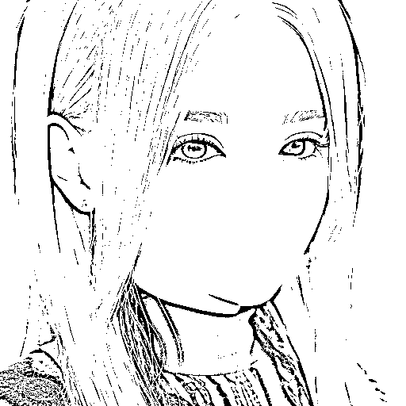

# 5.5.3.1 局部重绘：只改想改的地方

想给图片做局部调整，又不想牵动整张画面？下面把局部重绘里的关键选项逐项拆开讲清楚。

1）只修改图片中的某一块区域

- 拉伸：参考图与目标宽高不一致时，参考图会被直接拉成目标尺寸，画面内容随之被挤压变形。
- 剪裁：以图片中心为基准，把超出目标尺寸的多余部分直接切掉。
- 填充：当生成图尺寸大于参考图时，多出来的区域由 AI 自动补全内容，做风景图时尤其常用。

2）蒙版模糊

相当于 PS 或美图类软件中的边缘羽化：数值越小，边缘越锐利；数值越大，边界越模糊，直到接近原图。

3）蒙版模式

- 重绘蒙版内容：仅重新生成被蒙版遮住的区域，其他位置保持不变。
- 重绘非蒙版内容：被蒙住的部分保留原样，未被蒙住的区域重新绘制。

4）蒙版遮住的内容怎么处理

- 填充：预处理时先把蒙住区域的内容打散，再重新组合并填回蒙版位置。
- 原图：预处理时参照原图进行修改。
- 潜空间噪声：预处理时用噪声铺满蒙版区域，再通过去噪得到图像。
- 潜空间数值零：可以理解为把该区域重置回混沌状态，然后再生成画面。

把这些选项组合好，局部重绘就能更精准地只动你想动的地方。

原始图

填充

原图

潜空间噪声

潜空间数值零