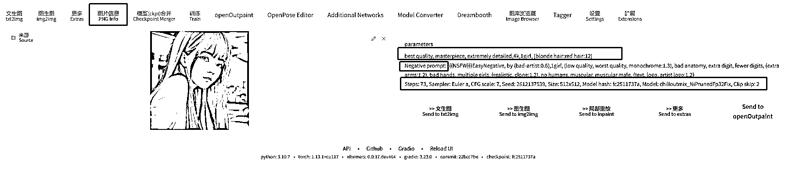

# 5.6.1 图片信息

如果看到一张很喜欢的图片，又确定它是用 Stable Diffusion 直接生成的，那么借助“图片信息”功能，就能把它背后的关键参数一一找回来。

具体操作很简单：

先把图片放到上方指定区域（直接拖拽进去也可以），右侧就会立刻显示出这张图对应的信息数据。

第一行展示的是正向提示词，如果描述词较多，可能会分成好几行。当看到第二行出现“Negative prompt”时，就说明正向部分已经结束了；

第二行的“Negative prompt”对应的是负向提示词，也就是不希望出现的内容；

第三行则是一连串参数，包括步数、采样器、所采用的模型、随机种子、图片尺寸等信息；

第四行的方框里列出了【>>文生图 >>图生图 >>局部重绘】等选项，点击任何一个，就能把上方解析出的完整图片信息一键带入对应的功能模块中。