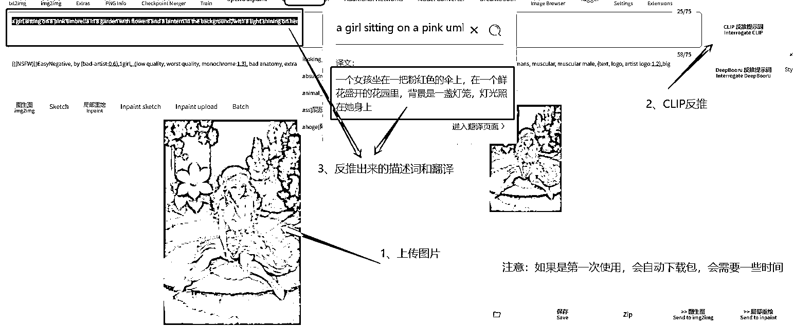
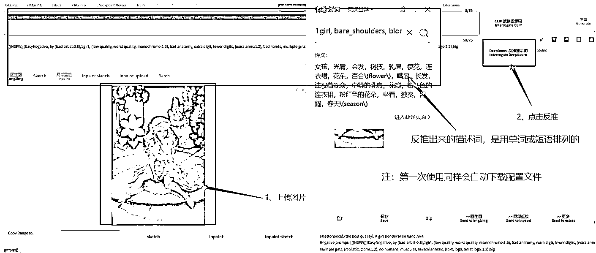

# 5.6.2 图片不是原图？用 tag 反推

有朋友会问：如果手里这张图并非 SD 直接生成的原图，还能不能识别画面内容？可以。借助 tag 反推功能，就能从图片中提取对应信息。

CLIP 反推走的是自然语言路线，得到的结果更像日常描述，由完整句子串联起来。比如：

A girl with long hair wore a pale yellow dress

DeepBooru 反推提示词则偏向关键词式，输出的是单词或短词组。例如：

1girl，long hair，a pale yellow dress

两种方式只是表达颗粒度不同，都能帮你把图片内容转成可用的描述。