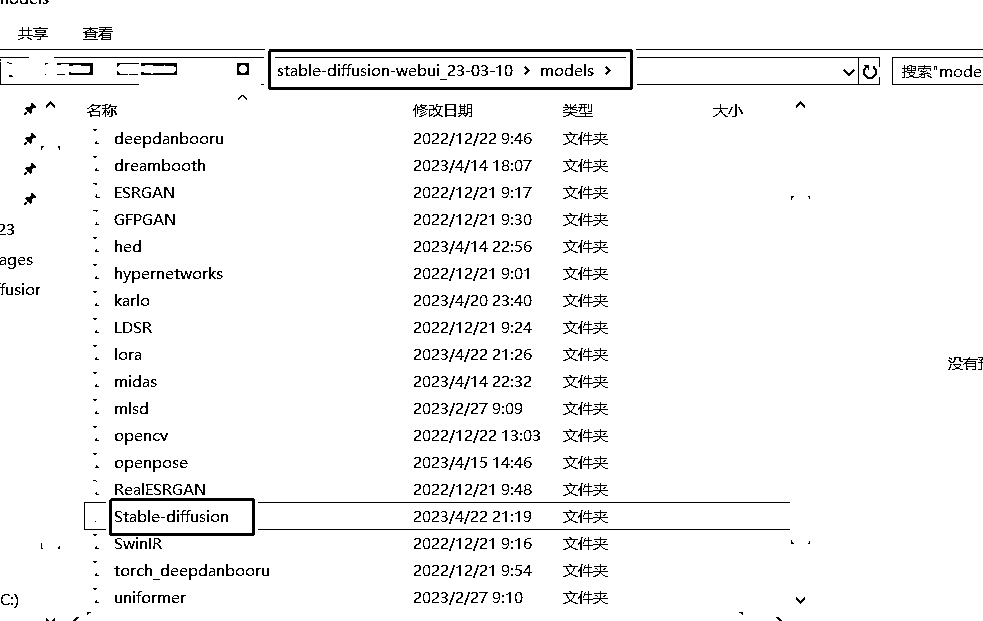
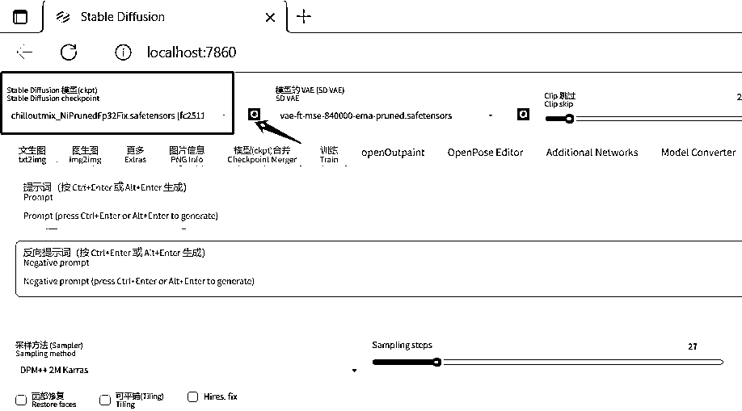

# 5.7.1.2 底模/大模型

大模型，也叫底模，可以说是一切的起点——你的图片长什么样，整体风格如何，都由它说了算。简单粗暴地讲，核心就一个字：大。

动辄几个 GB 起步，常见的体积有 2G、4G、7G 不等。目前主流文件格式是 .ckpt 和 .safetensors 两种。

存放路径也很固定：跑到你自己的 Stable Diffusion 项目目录下，找到 `models\Stable-diffusion` 文件夹，把它丢进去就完成了。

接下来怎么用？打开绘图界面，先点一下那个刷新按钮，然后在下拉框（就是红色框框那里）里选中你刚放进去的大模型名字，就可以开工了。

