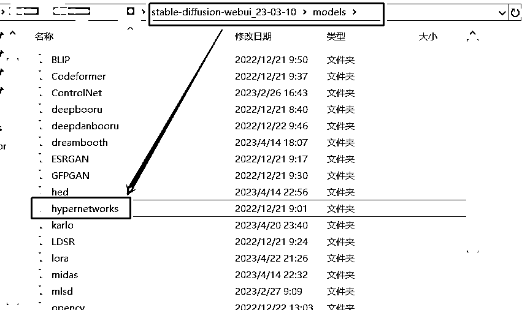

# 5.7.1.5 超网络 Hypernetwork

Hypernetwork 的模型文件大多以 .pt 格式保存，体积通常在几十兆到几百兆之间浮动。不过它支持的自定义参数极为丰富，因此也有不少夸张的版本能直接冲到 GB 级别。

•存放路径：将文件放入 Stable Diffusion 根目录下的 models\hypernetwork 文件夹即可生效。

•调用方式：和 Embedding 的操作流程保持一致，只需在对应选项里切换到 Hypernetwork 即可。