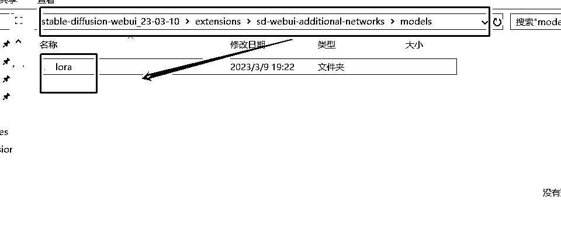
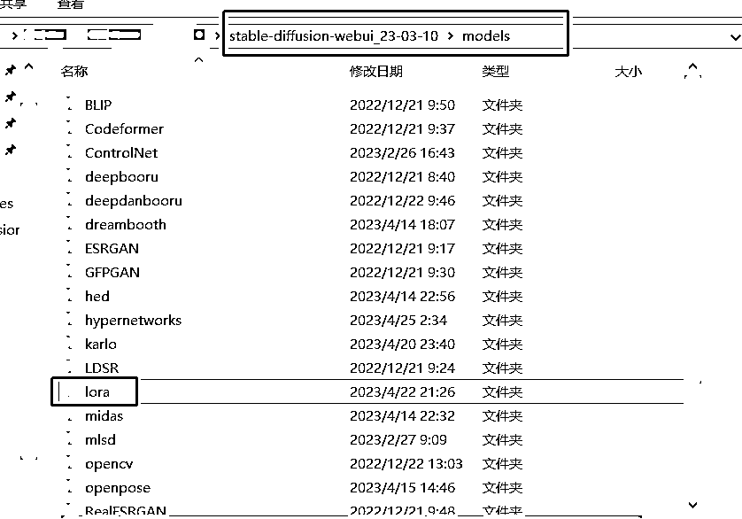
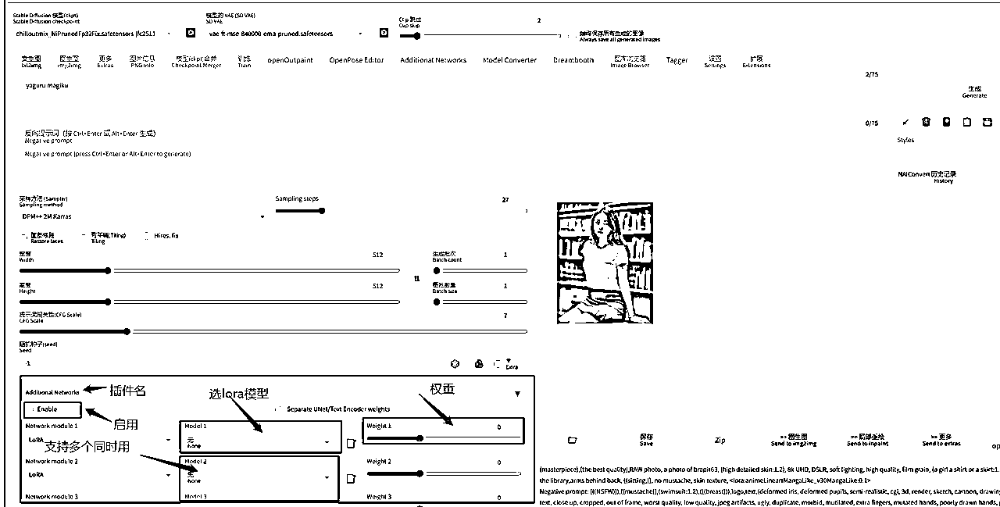
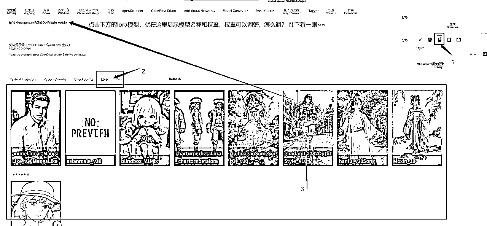

# 5.7.1.6 LoRA 小模型：新手先看这几点

刚接触 LoRA 的话，可以把它看作大模型体系里的一个专用小模型：它通常只围绕某类画风、某个角色、某件物品或某种风景做训练。获取途径主要有两种：从 C 站下载，或自己训练（圈内俗称“炼丹”）。训练细节这里先不展开，新手不用焦虑，先用别人训练好的模型上手就行。

格式与体积方面，常见后缀是 .ckpt 和 .safetensors；体积大多在 8MB 到 144.14MB 之间，也有个别文件会落在该范围之外。

存放路径上，LoRA 与普通小模型并不相同：它存在两处可放的位置。借助插件使用时（需要先安装该插件），文件放到这里： 插件方案的文件路径示意。若使用 WebUI 自带功能，则与前述小模型放法相同，位置见： WebUI 内置路径示意。

调用时同样分两条路：插件方案可看  插件调用示意；WebUI 内置方案可看  内置调用示意。

