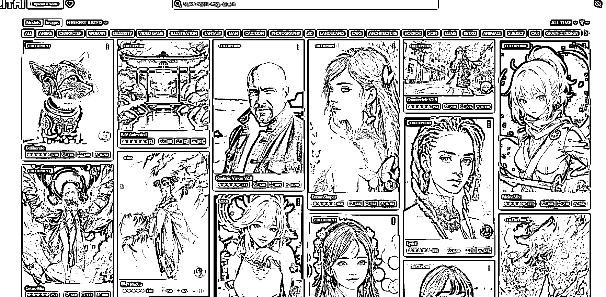
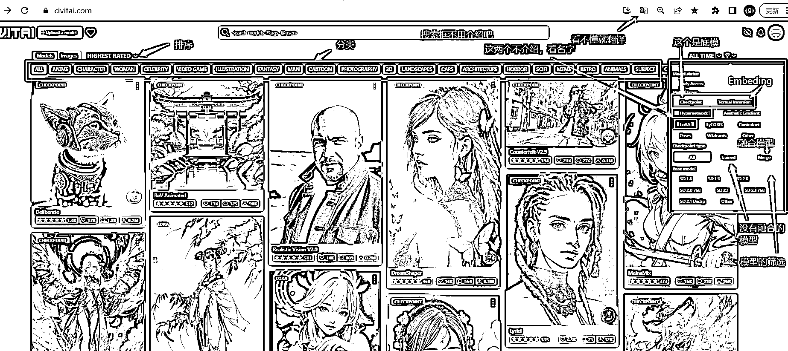
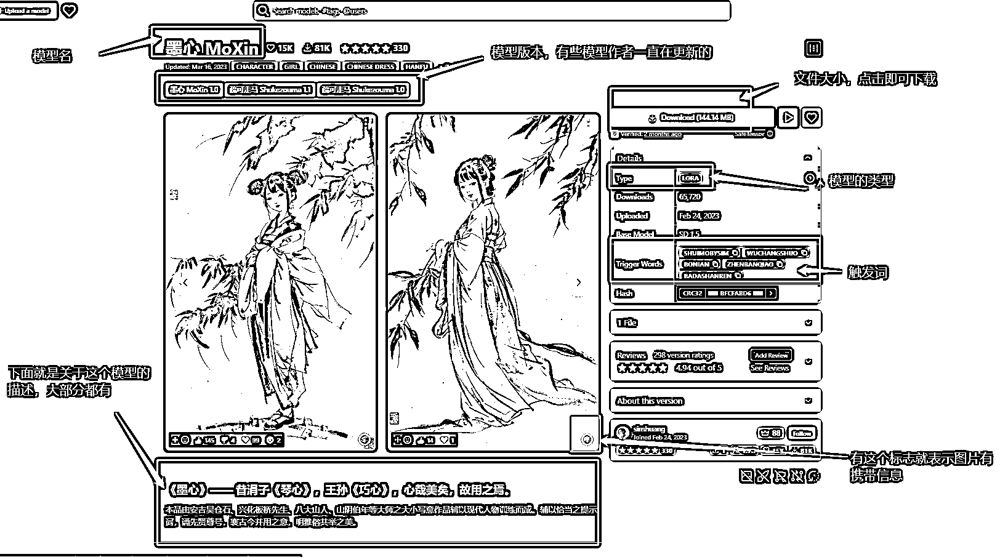
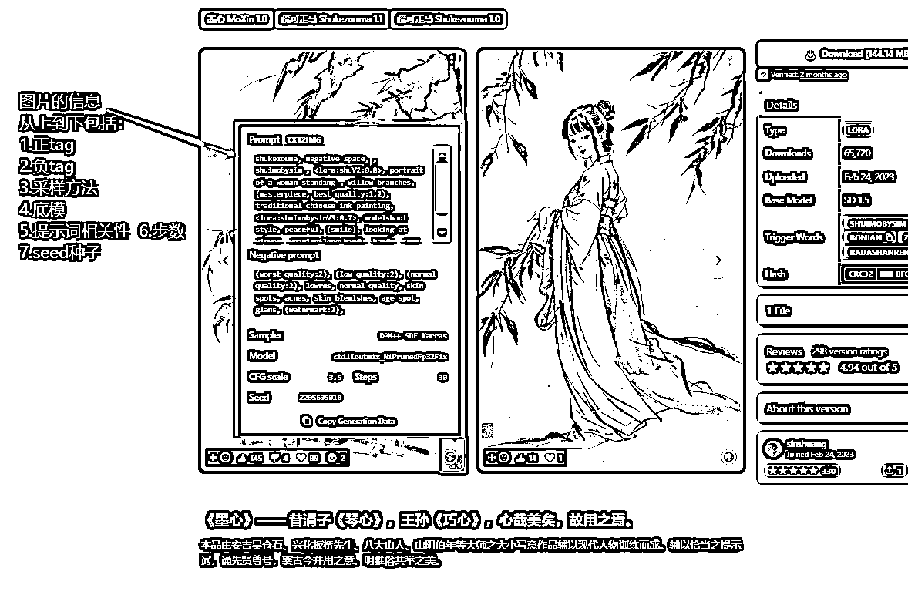
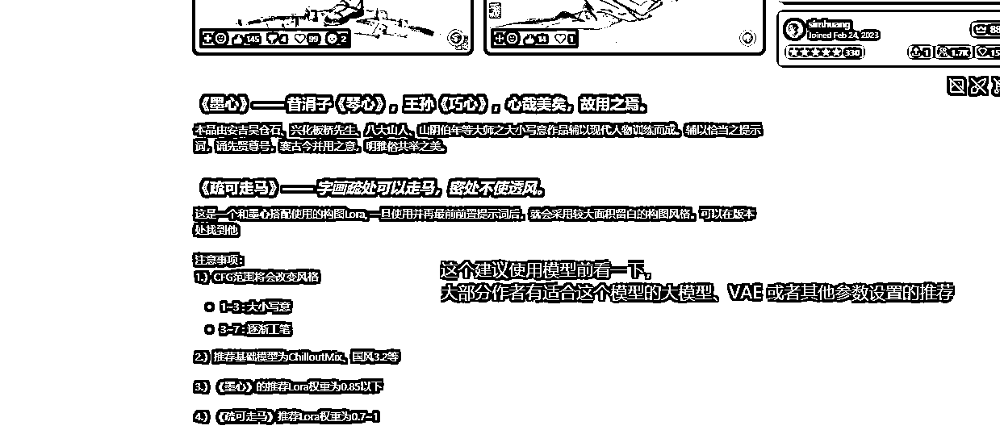
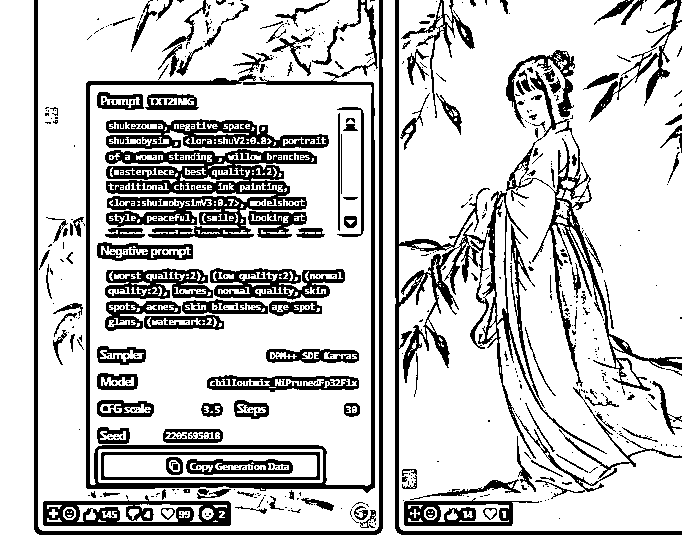
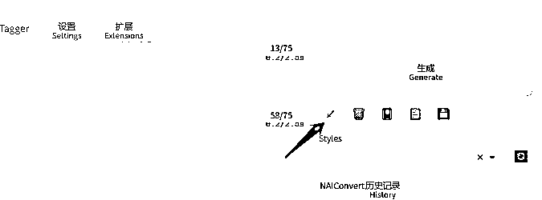

# 5.7.2 玩转 LORA 与底模：轻松复刻别人的作品

刚看到这个标题，是不是有点懵？别急，说白了，这一节就是教你怎么把别人生成的那张图，尽可能一模一样地“搬”到自己电脑上。

当你闲着没事逛 C 站，突然瞄到一个模型：哎，这个风格太戳我了，好想自己也跑一张！恭喜你，标题里的“玩法”就从这儿开始了。

C 站——这个专门为 Stable Diffusion 搭建的模型大本营，长这样：

几个实用操作点：

- 怎么筛模型？看这里：

- 单个模型的详细页面：

- 怎么看一张图的参数信息？

一句话总结就是：把作者晒图时附带的那些参数，连种子数一起，原封不动填到你的出图设置里。大模型和 LoRA 都选成同款，还原度基本就稳了。当然，细节上偶尔有点差异很正常，毕竟咱跟作者的电脑不是同一台嘛。

还有一个偷懒小技巧，能直接抄作者或别人的参数：点图片右下角的感叹号，再点复制，然后回到你的 webUI 页面，找到“生成”按钮底下的第一个箭头，单击一下，参数就自动填好了。

