# 5.7.3.2 安装包下载与准备

这套 LoRa 训练工具没有可视化界面，操作起来反而让人觉得干净利落。

我们要下载的 LoRa 解压包出自 B 站 UP 主 [秋葉 aaaki](https://space.bilibili.com/12566101)，他提供了三个下载渠道：

- 夸克网盘：[pan.quark.cn/s/d81b8754a484](https://pan.quark.cn/s/d81b8754a484)
- 百度网盘：[pan.baidu.com/s/1WMjja4uHB9tkZoBvgmm_ZA?pwd=lora](https://pan.baidu.com/s/1WMjja4uHB9tkZoBvgmm_ZA?pwd=lora)，提取码：`lora`
- GitHub：[github.com/Akegarasu/lora-scripts](https://github.com/Akegarasu/lora-scripts)

把压缩包拉下来后，你会看到三个文件：

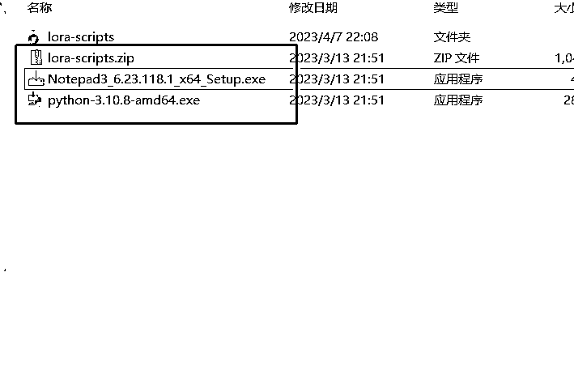

简单说明一下各自的用途：

- 第一个压缩包是训练主程序，需要先解压；解压位置随意，但路径里尽量不要出现中文。
- 第二个是文本编辑器，方便你直接修改训练相关的文本配置。
- 第三个是 Python 安装包，原作者建议的版本是 3.10.8。

接着按下面几步操作。

① 安装 Python 环境

直接用刚才下载的 Python 3.10.8 安装包，双击运行即可。在安装界面左下角，`addPython.exe to PATH` 这个选项务必勾上，它是用来配置环境变量的。然后按顺序点击数字 1、2 开始安装；安装结束后，点击箭头指示的位置，再点 `close` 收尾。

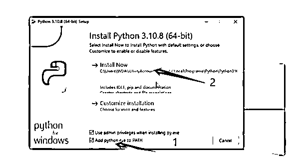
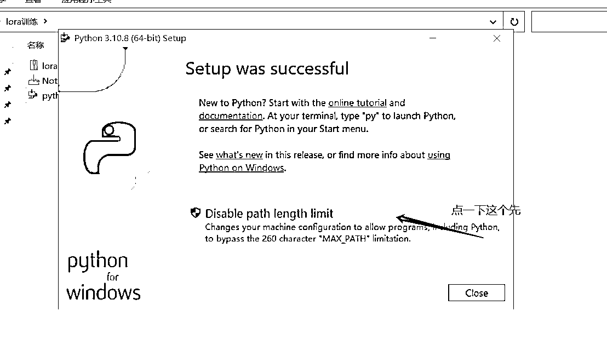

② 关闭 PowerShell 签名校验，并确认 Python 装好了

先打开命令行窗口（黑色终端），打开方法如下：

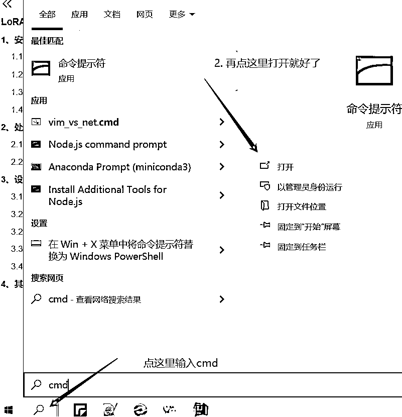

③ 在终端里执行这条命令，作用是取消 PowerShell 脚本签名校验：

`Set-ExecutionPolicy -ExecutionPolicy RemoteSigned`

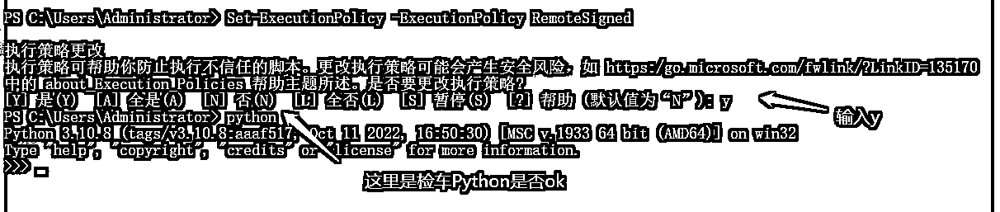

执行完后，接着输入 `python` 回车，只要能正常显示版本信息，就说明 Python 已经 OK。这个窗口随后可以关掉。

④ 配置 Notepad 文本编辑器

按下面的图示依次操作即可：

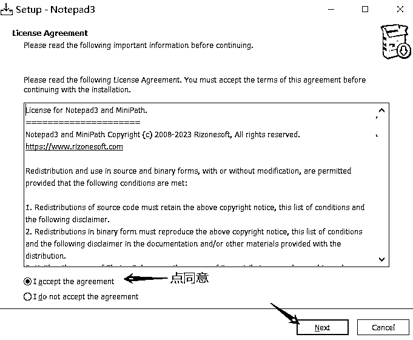
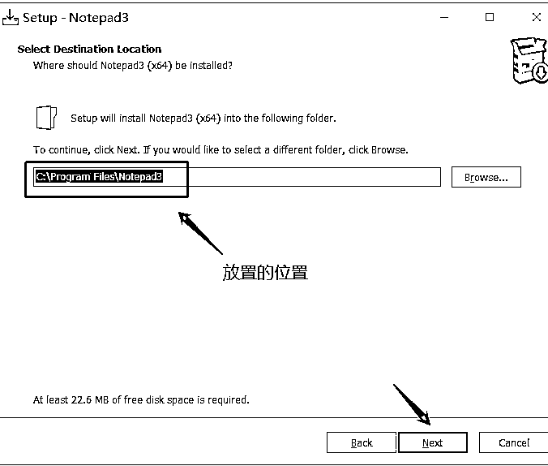
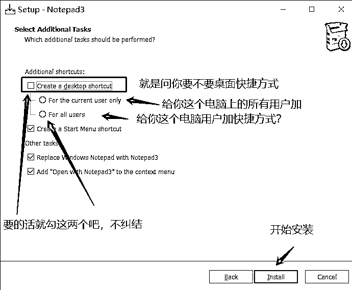

⑤ 更新主程序文件

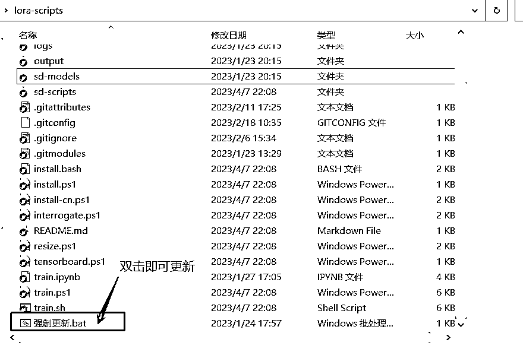

⑥ 用 PowerShell 运行依赖安装脚本

执行 `install-cn.ps1`，把所需的依赖文件装好：

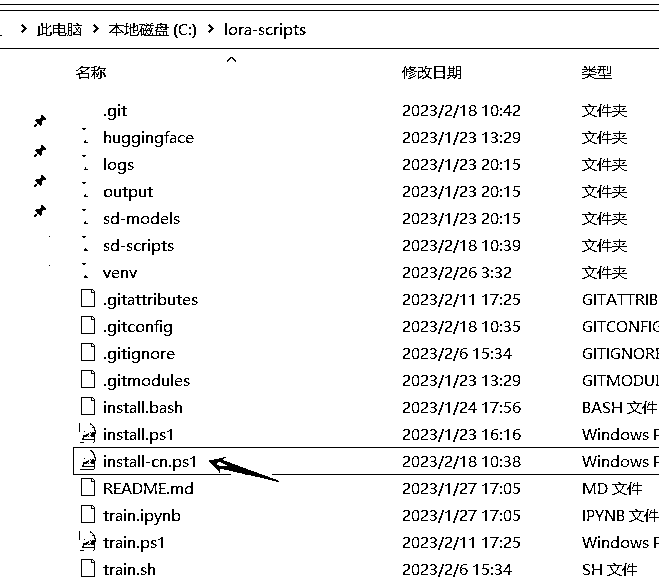
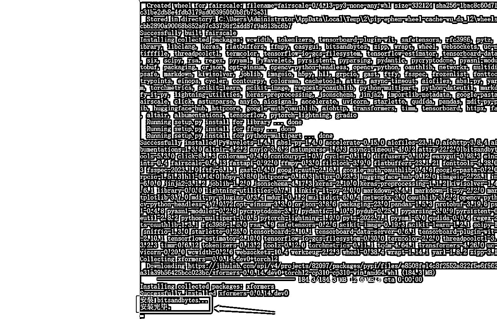