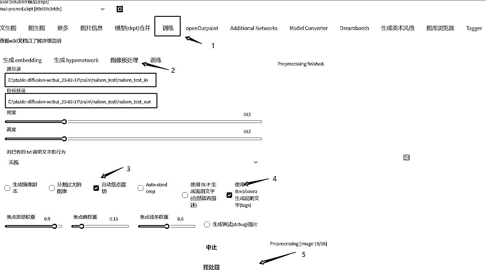

# 5.7.3.4 训练图预处理：选图、裁图、打标

进入 Stable Diffusion 页面后，先看界面下方图中标注的 1 和 2 两个位置，依次点击。

源目录里放什么？把你手动截屏或从网上下载好的图片文件夹放进去即可。图片尽量保持同一风格、同一分辨率，画面别带黑框。

目标目录则是预处理结束后，图片和相关文件要存放的地方，自己新建一个文件夹就行。

接着点击标识 3、4、5，等处理完成后，去目标目录里就能看到结果：

补充说明：

- 标识 3：原图尺寸偏大时，会以图片中心点为基准进行裁剪。我不太建议勾选。
- 标识 4：让 webUI 帮我们给图片打标签，也就是生成描述词。