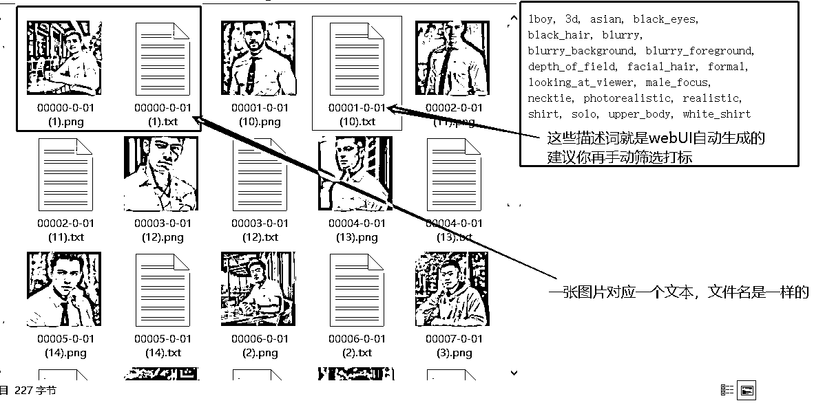

# 5.7.3.5 标签改一改，模型学得准

图片经过预处理后，每张图都会对应一个 txt 文件，里面记录的是这张图的描述词，也就是标签。对这些描述词做增删处理，就是常说的打标。

如果某些词希望固定下来，直接手动打标即可，借助工具操作也可以。所谓打标，无非是对图片对应文本里的标签做加减法：补充一些，或去掉一些。

模型会拿文本标签去匹配画面内容；标签和画面能对上，它就会把该标签与对应特征关联起来，这个标签也就成了该特征的指代。遇到画面里没被识别出来的部分，常见思路有两种，先看第一种：由你手动往每张图的文本里补一个或多个关键词。模型会把画面中未能识别、却出现在文本里的内容，当作你写进去的标签来学习；这类词往往就是模型的触发词。

比如要做一个脸型固定的女孩头像模型：先把文本里与脸有关的标签，像大眼睛、高鼻子、长眼睫毛之类，统统删掉，再补一个新词，例如 jessie。这样模型会把文本里那些对不上画面的 tag，当成新增标签去学。之后调用模型时输入 jessie，生成的脸大概率会呈现 jessie 的特征；小概率不准，则说明模型还没练到位。

