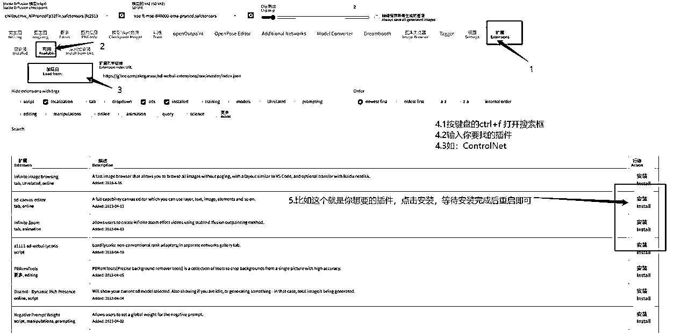
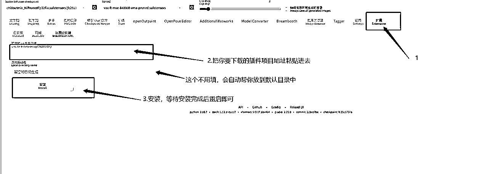
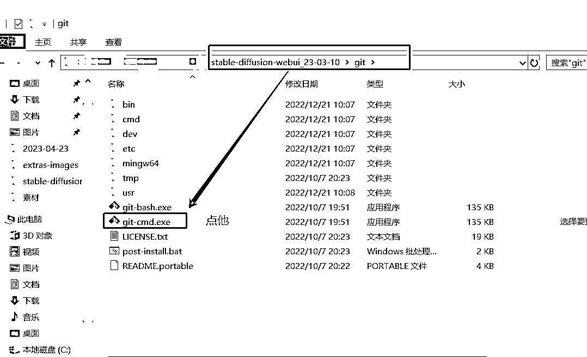
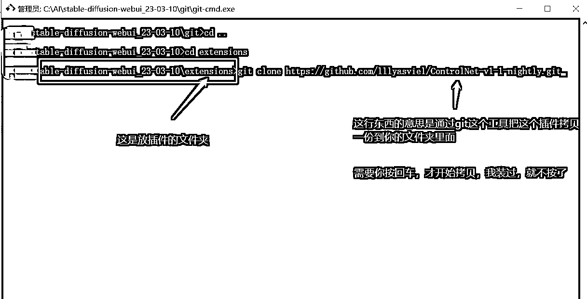
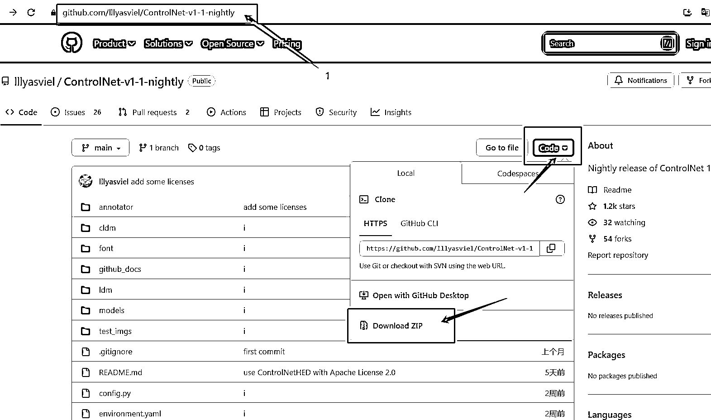

# 5.8.1.2 插件下载全攻略

给 Stable Diffusion 装插件，常见做法有三条路，下面分别说明。

**在 WebUI 界面里下载**
界面中提供了两个入口：

可用插件

从网址直接装

**用 Git 手动拉取**
前提是电脑上已装好 Git 工具。点开后会弹出黑色命令行窗口，按顺序执行：
输入 `cd ..` 回车；
输入 `cd extensions` 回车；
输入 `git clone XXXXX.git` 回车；
等待下载完成即可。
注1：上面的 XXXXX 指你要安装的插件地址。
注2：通过 Git 安装的好处是，后续插件更新会更方便。

示例：

**解压 zip 包**
这种方式不太推荐，因为以后更新插件会比较麻烦。
操作步骤：从网站下载插件压缩包，解压到 Stablediffusion 根目录\extensions 文件夹内，重启后就能使用。

