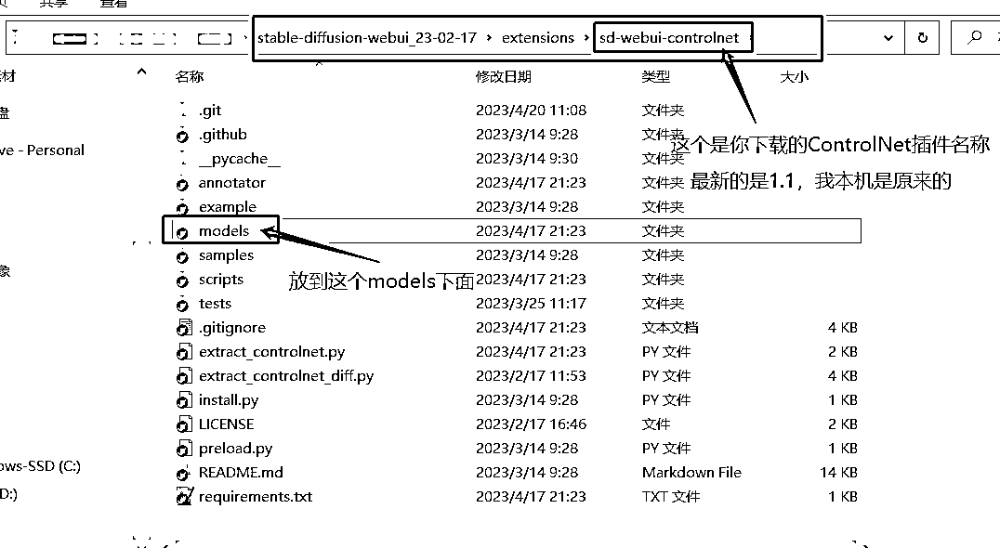

# 5.8.2.3 ControlNet1.1 模型配置全解读

下面要聊的，是 ControlNet 1.1 最新版配置说明——注意，并非旧版内容（基于官方文档整理）。

先别急着用，当前 ControlNet 和 ControlNet 1.1 还不是同一个插件。如果以前装过旧版，记得先彻底删除，再重新下载安装；等项目稳定后，新版本会合并进 ControlNet 插件中。

从架构上看，ControlNet 1.1 与 1.0 完全相同，它把过去发布过的模型全部收入其中，并在稳定性和出图质量上做了进一步优化，同时新增了几款模型。

目前 ControlNet 1.1 一共包含 14 个模型，其中 11 个是生产就绪模型、2 个为实验模型、1 个尚未完成。具体名单如下：

- `control_v11p_sd15_canny`
- `control_v11p_sd15_mlsd`
- `control_v11f1p_sd15_depth`
- `control_v11p_sd15_normalbae`
- `control_v11p_sd15_seg`
- `control_v11p_sd15_inpaint`
- `control_v11p_sd15_lineart`
- `control_v11p_sd15s2_lineart_anime`
- `control_v11p_sd15_openpose`
- `control_v11p_sd15_scribble`
- `control_v11p_sd15_softedge`
- `control_v11e_sd15_shuffle`
- `control_v11e_sd15_ip2p`
- `control_v11u_sd15_tile`

需要下载的话，直接去 Hugging Face 仓库取即可：

[`https://huggingface.co/lllyasviel/ControlNet-v1-1/tree/main`](https://huggingface.co/lllyasviel/ControlNet-v1-1/tree/main)

文件下载好之后，放到 Stable Diffusion 根目录下的 `extensions\sd-webui-controlnet\models` 文件夹里，就完成了。

