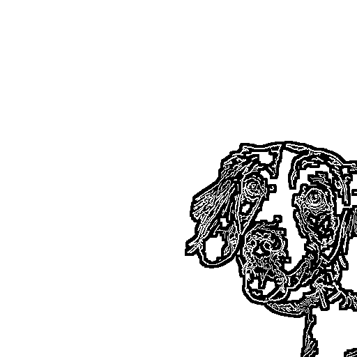
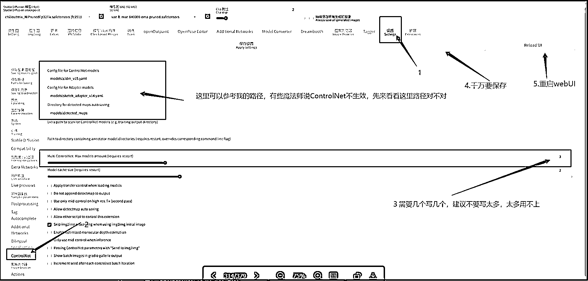
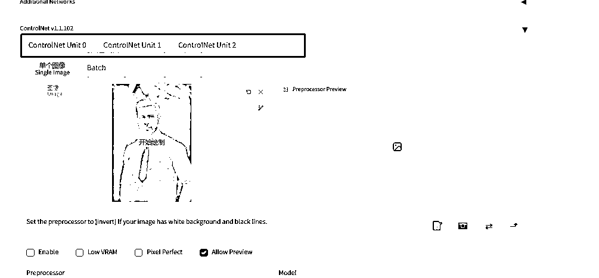

# 5.8.2.5 ControlNet 组合玩法

组合技，说白了就是让多个 ControlNet 一起上场干活。拿素材里那两只狗狗来说，做法是先用 Canny 提取出两张预处理图，再分别交给两个 ControlNet 来控制。

ControlNet0

ControlNet1

生成结果

可玩的搭配远不止这一种：线稿配骨骼、线稿配深度图、骨骼配语义分割……各种组合都值得大胆试一试。不同搭配往往能带来意想不到的效果，甚至收获小惊喜。

• 多个 ControlNet 怎么开启

照这个方式操作，就能同时启用多个 ControlNet，组合招式随便安排，连续出招也不成问题。

当你顺利搞定插件安装、日常使用，并且完成模型炼制，恭喜你——这时候你已经称得上一位出色的高阶魔法师了。

