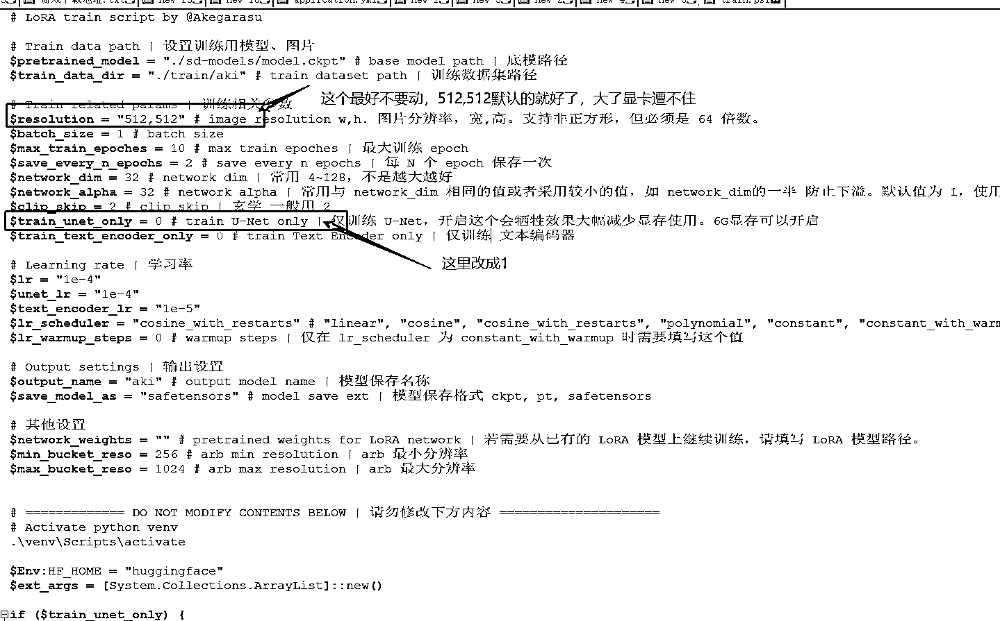
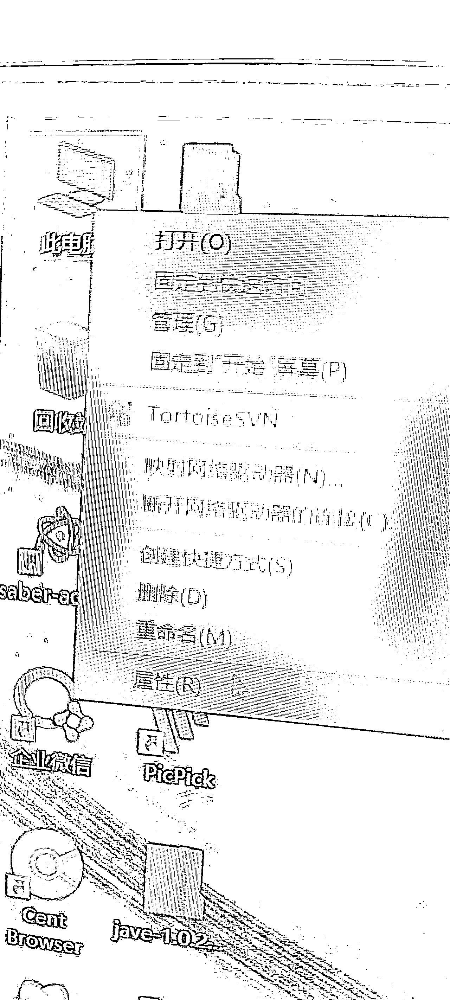
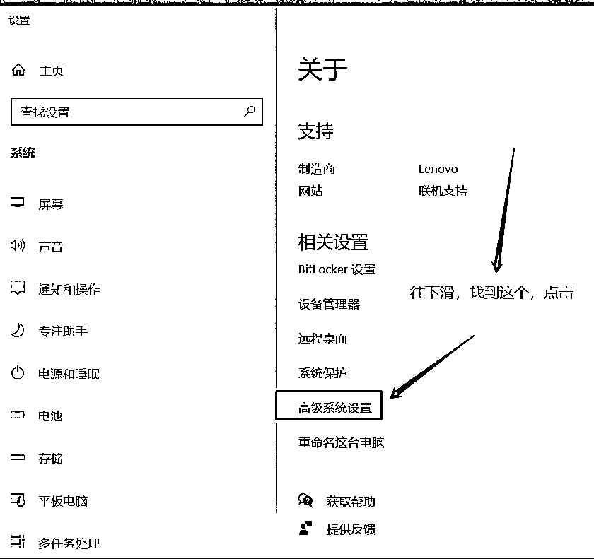
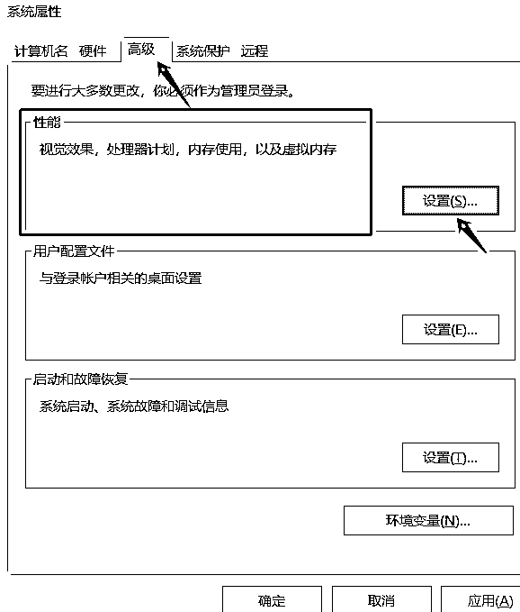
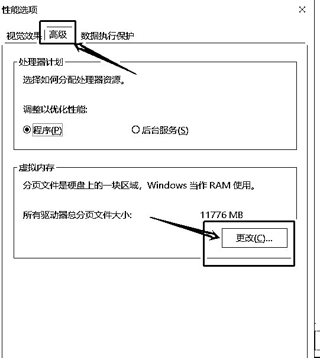
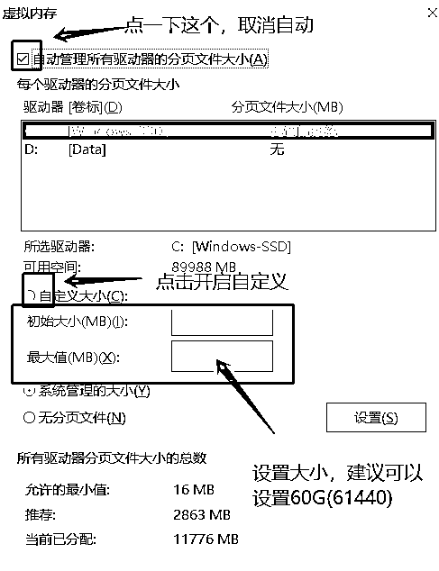

# 5.9 高频疑问速答

Q1：设备性能有限、显存仅 6GB，该如何应对？
处理方案：

Q2：系统提示“页面文件太小”并报错，该怎么解决？
解决方式：通过调整虚拟内存来处理，具体操作如下：

1. 先在桌面上找到“此电脑”图标，右键单击它，在弹出菜单里选择“属性”。
2. 进入系统页面后，从左侧导航栏点击“高级系统设置”。
3. 在系统属性窗口中切换到“高级”选项卡，找到性能区域，点击下方的“设置”按钮，进入性能选项页面。
4. 在“性能选项”窗口顶部选择“高级”标签，找到虚拟内存区域，点击“更改”按钮。
5. 弹出虚拟内存窗口后，找到“自动管理所有驱动器的分页文件大小”复选框，将里面的勾去掉。
6. 选中系统所在的驱动器，再选择“自定义大小”，在“初始大小”和“最大值”两个输入框中填入设定好的数值，然后点击“设置”按钮，最后点击窗口底部的“确定”即可。务必再点一次“设置”，否则修改不会生效！建议把数值设大一些（不够再加，记得确认；不想玩了记得改回来）。

