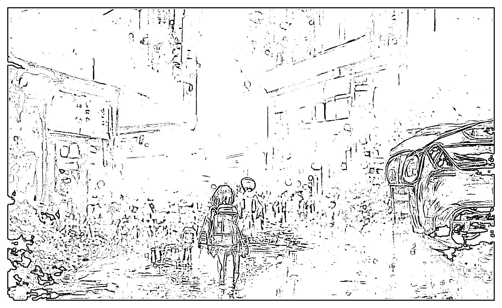
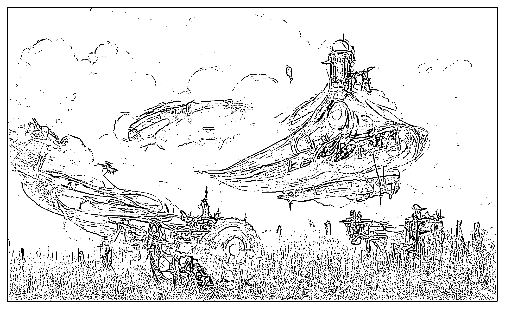
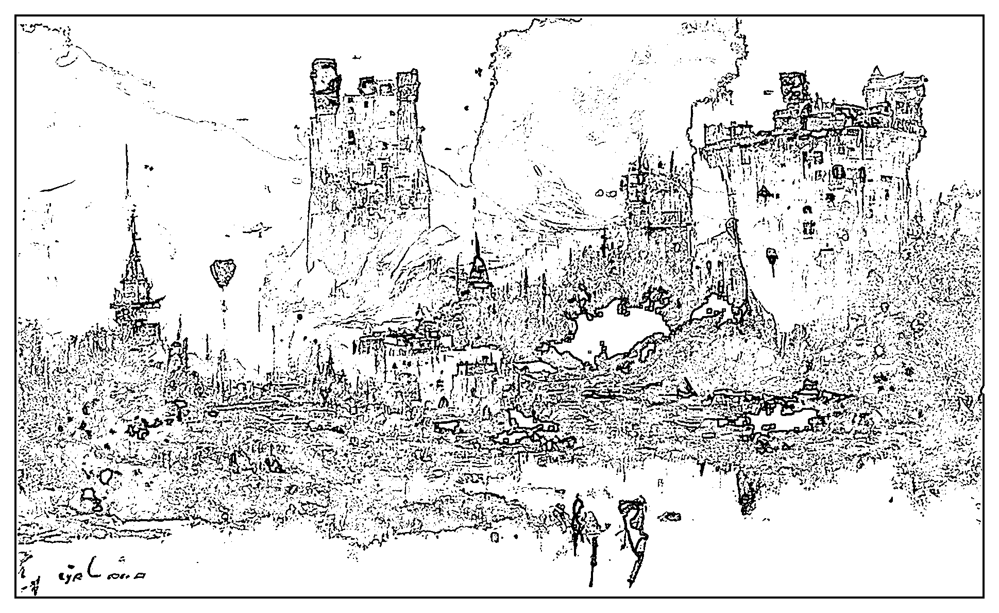
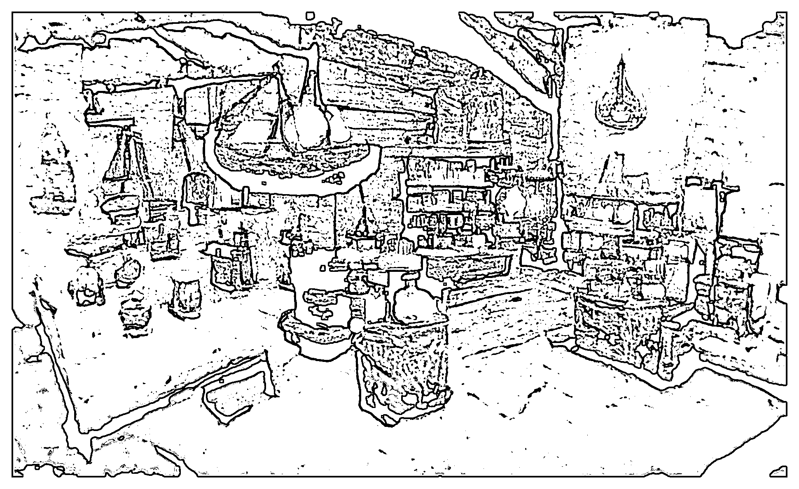
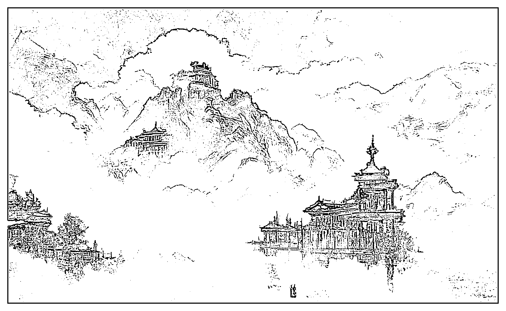
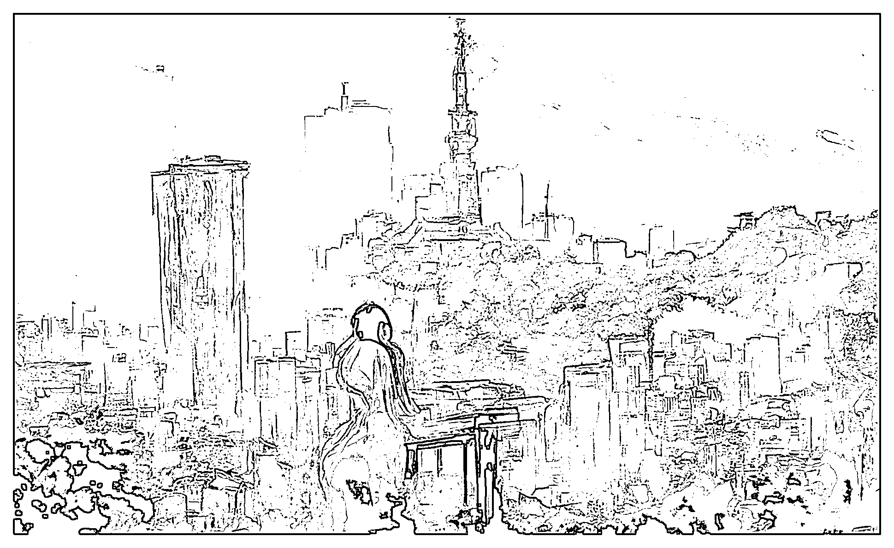
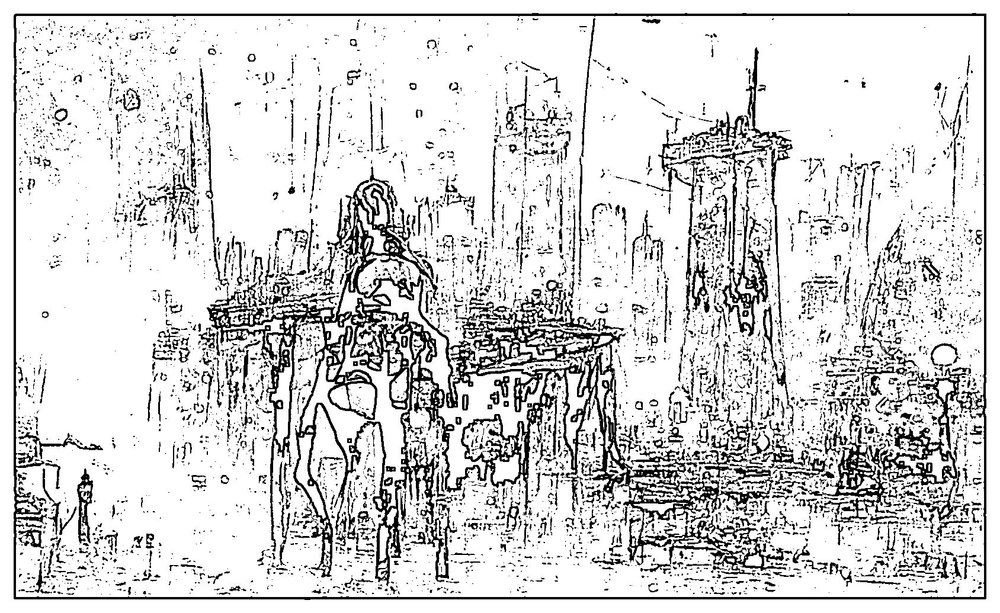
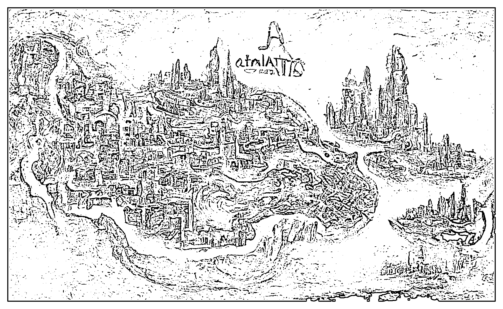
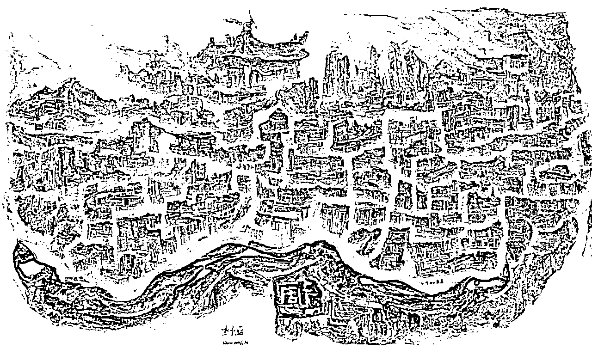

# 6.2.2 先看效果：好提示词能画出什么

先别急着自己写提示语，看看成熟案例的实际出片效果，会更容易找到手感。

操作并不复杂：挑一张你最喜欢的 AI 作品，把它对应的提示语原样复制，再按前文讲过的方法生成。说明一下，提示语原文是英文；下面的中文由我译出，只用于辅助理解。

想直接拿现成词包，以下入口任选：

1）炫彩模型词包（点开进入）
•[炫彩词包 1（图文）](https://shengcaiyoushu01.feishu.cn/file/boxcnyUY338Exse7cBJB2fQuwEc)
•[炫彩词包 2（图文）](https://shengcaiyoushu01.feishu.cn/file/boxcnUBX9NU7tr51iKb8QAzfMYe)
•[炫彩词包 3（图文）](https://shengcaiyoushu01.feishu.cn/file/boxcn1gklNHo6u1PwYqJMFrQ2qh)
•[炫彩词包 4（图文）](https://shengcaiyoushu01.feishu.cn/file/boxcnboZXjZvqmf8EBoXAvR6HDb)
•[炫彩词包 5（图文）](https://shengcaiyoushu01.feishu.cn/file/boxcn4i3e8GA7rcMD626JXC0Gbg)
•[炫彩词包 6（图文）](https://shengcaiyoushu01.feishu.cn/file/boxcnoeFLoNfkcjpcB7qFnnx1zE)
•[炫彩词包 7（图文）](https://shengcaiyoushu01.feishu.cn/file/boxcnLjme053b4TAHRUNTWcZO0b)
•[炫彩词包 8（图文）](https://shengcaiyoushu01.feishu.cn/file/boxcnWK4zTkKeuD3hyaEJpnKaPg)
•[炫彩词包 9（图文）](https://shengcaiyoushu01.feishu.cn/file/boxcn1fdUAykEvpqzE3BwS5x42f)

2）Disco Diffusion 模型词包（点开进入）
•[DD 词包 1（图文）](https://shengcaiyoushu01.feishu.cn/file/boxcnpnSLKXkZD73mpI48C4sqld)
•[DD 词包 2（图文）](https://shengcaiyoushu01.feishu.cn/file/boxcnkVoY7y0rvBuOkCJuDmjZEO)
•[DD 词包 3（图文）](https://shengcaiyoushu01.feishu.cn/file/boxcnKavem07x69bVVGeQ8thzHf)
•[DD 词包 4（图文）](https://shengcaiyoushu01.feishu.cn/file/boxcnA7PXLbbcIW6h4PpkHo7JSh)
•[DD 词包 5（图文）](https://shengcaiyoushu01.feishu.cn/file/boxcnb07Wols6rr0QNmD5PaMpfe)
•[DD 词包 6（图文）](https://shengcaiyoushu01.feishu.cn/docx/CWHVdPAKooEYQzxYHdKcbtnRnFe)

3）写实动物词库（点开进入）
•[写实动物 1（图文）](https://shengcaiyoushu01.feishu.cn/docx/W4LSd1AIkoKLcQxp1GLcJ60RnHd)
•[写实动物 2（图文）](https://shengcaiyoushu01.feishu.cn/sheets/shtcnjC4IYPy0JoToF88DWsnVIf)
•[写实动物 3（图文）](https://shengcaiyoushu01.feishu.cn/file/boxcnvJMgzexw40UyTmQwvChheb)

4）二次元类目词库（点开进入）
•[二次元词组合集](https://shengcaiyoushu01.feishu.cn/docx/A5LydeNrboHs1QxS0ezcE6eHn3g)
•[二次元图集](https://shengcaiyoushu01.feishu.cn/file/boxcnqR2X5GrzocIEUzwSC50alb)

5）婚纱礼服词包（点开进入）
•[婚纱词包 1（图文）](https://shengcaiyoushu01.feishu.cn/file/boxcnUu49jXUDBNQV6r1VVF8mKG)
•[婚纱词包 2（图文）](https://shengcaiyoushu01.feishu.cn/file/boxcnMNFC1ZqK3Jtjpd6TIrnO6b)
•[婚纱词包 3（图文）](https://shengcaiyoushu01.feishu.cn/file/boxcnhd6sYLhB7X30S2YLAtNzEe)
•[婚纱词包 4（图文）](https://shengcaiyoushu01.feishu.cn/file/boxcnrylcsk11P7Vd5rK2j3pS8e)
•[婚纱词包 5（图文）](https://shengcaiyoushu01.feishu.cn/file/boxcnSD4T5G3KGnZdyOBq9dHgih)
•[婚纱词包 6（图文）](https://shengcaiyoushu01.feishu.cn/file/boxcnC8LeOR1hc7J5eOimrG75Q7)

6）抖音爆款词包（点开进入）
•[抖音爆款 1（图文）](https://shengcaiyoushu01.feishu.cn/file/boxcn92iFuBJeUsTHyenE25vNLc)
•[快手爆款 1（图文）](https://shengcaiyoushu01.feishu.cn/file/boxcnP4ju7uauqi8FD8ESLfHWDb)

7）人物词包（点开进入）
•[人物词包（图文）](https://shengcaiyoushu01.feishu.cn/file/boxcnpYxsBggZ7Bp3QPBiXEA5Ig)

8）祈福词包（点开进入）
•[祈福词包（图文）](https://shengcaiyoushu01.feishu.cn/file/boxcnqwcJZgiKImvWs7ensjMDiV)

9）十二生肖词包（点开进入）
•[发财主题（图文）](https://shengcaiyoushu01.feishu.cn/file/boxcnL2SrC9Pd12eVpYn9gpzAah)
•[功夫主题（图文）](https://shengcaiyoushu01.feishu.cn/file/boxcnhahsjTQAPgTsHgcuvDZnEc)
•[汉服主题（图文）](https://shengcaiyoushu01.feishu.cn/file/boxcngYkzp8mC9fkdYGN03HdVBh)
•[铠甲主题（图文）](https://shengcaiyoushu01.feishu.cn/file/boxcnmyGpAP6iU3jIaUnInQKLbb)
•[唐装主题（图文）](https://shengcaiyoushu01.feishu.cn/file/boxcnkyXD8okD0HVQkgJH6zJzoc)

10）AI 绘图高热词库：点开入口即可进入，内含 200 个热门提示语。

图 1

A beautiful ultradetailed anime illustration of a city street by beeple, makoto shinkai, and thomas kinkade, anime art wallpaper 4k, trending on artstation

（超细腻动漫街景插画，融合 beeple、makoto shinkai、thomas kinkade 的笔触，4K 动漫壁纸质感，在 artstation 上颇受关注）

图 2

Spaceship about to landing on a cornfield, steampunk, clouds in the sky, by Greg Rutkowski, concept art.

（飞船正要落向玉米田，蒸汽朋克气质，云层铺满天际，Greg Rutkowski 概念艺术风格）

图 3

A beautiful painting of captivating castles on hills and mountains, along plains and rivers, by Ismail Inceoglu

（丘陵与群山、平原与河流之间，城堡群显得格外迷人，Ismail Inceoglu 的画风）

图 4

Rustic interior of an alchemy shop

（炼金术士店铺的质朴内景）

图 5

clouds surround the mountains and Chinese palaces,sunshine,lake,overlook,overlook,unreal engine,light effect,Dream, Greg Rutkowski,James Gurney,artstation

（云雾缠绕山峦与中式宫殿，阳光洒落，湖面入镜，远望、远望，虚幻引擎渲染，光效处理，梦境感，Greg Rutkowski 与 James Gurney 画风，artstation 展示）

图 6

in the morning light,Overlooking TOKYO city by greg rutkowski and thomas kinkade,Trending on artstationmakoto shinkai style

（清晨光线中，从高处看东京，greg rutkowski 和 thomas kinkade 的画风，artstation 热门，makoto shinkai 风格）

图 7

Cyberpunk city in the night seen from below,cityscape,mist,rain,artstation,Greg Rutkowski

（夜色里的赛博朋克都市，采用仰视构图，城市风貌、雾气、雨滴，artstation，Greg Rutkowski 风格）

图 8

A beautiful painting of a map of the city of Atlantis

（亚特兰蒂斯城地图，以画作形式呈现）

图 9

A beautiful painting of a map of the city of China

（中国地图，以画作形式呈现）

