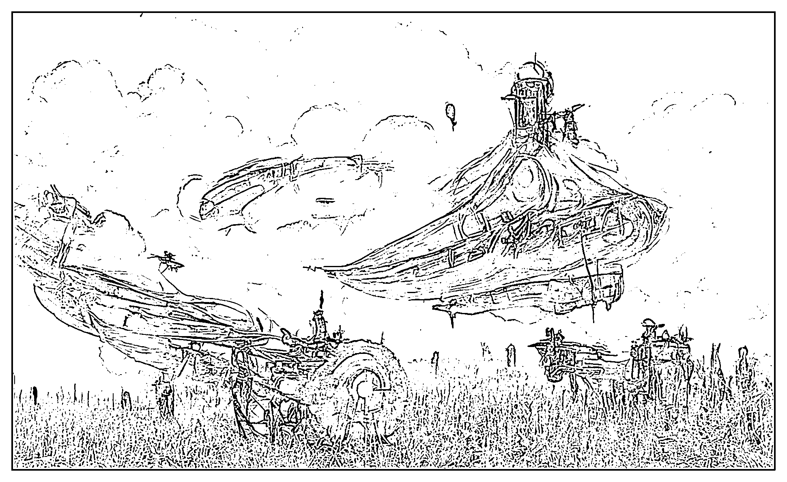
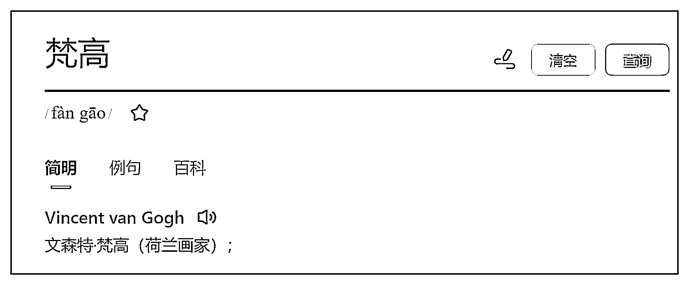
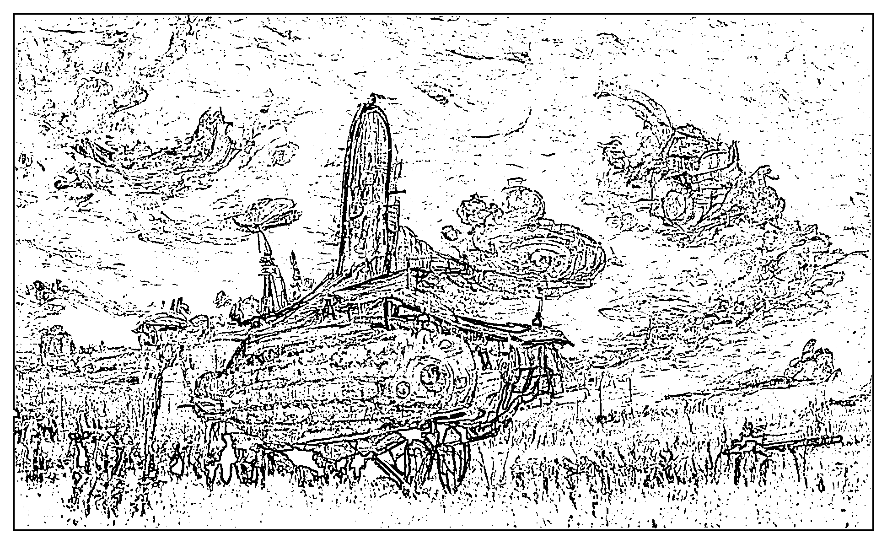
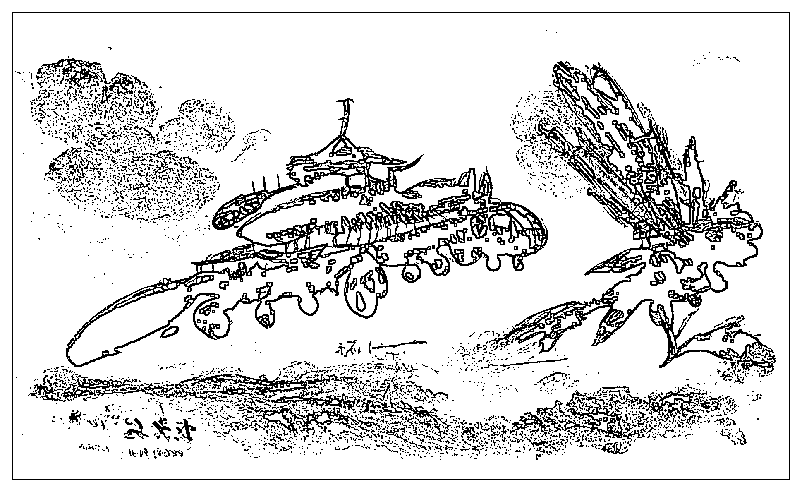
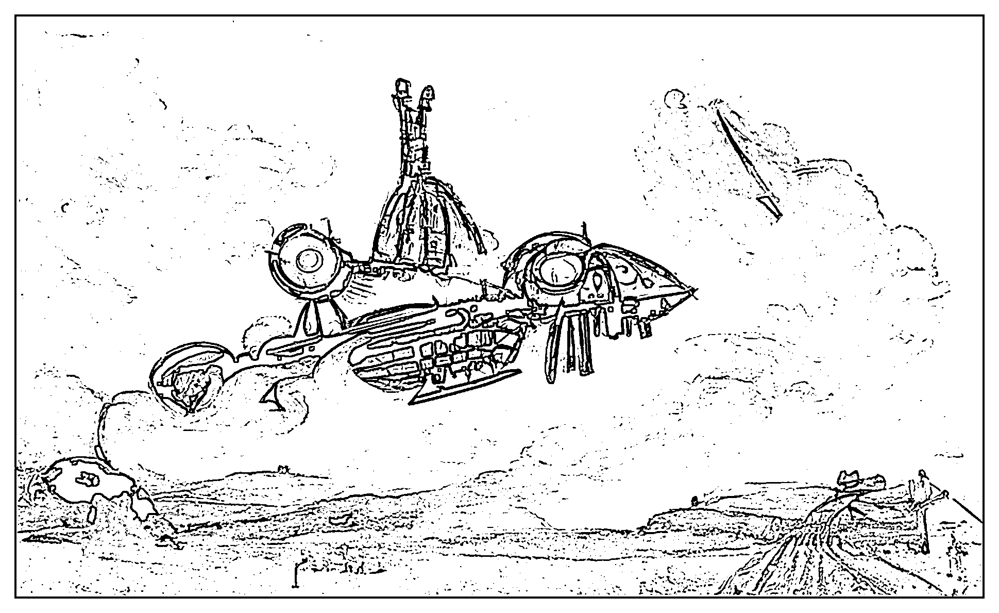
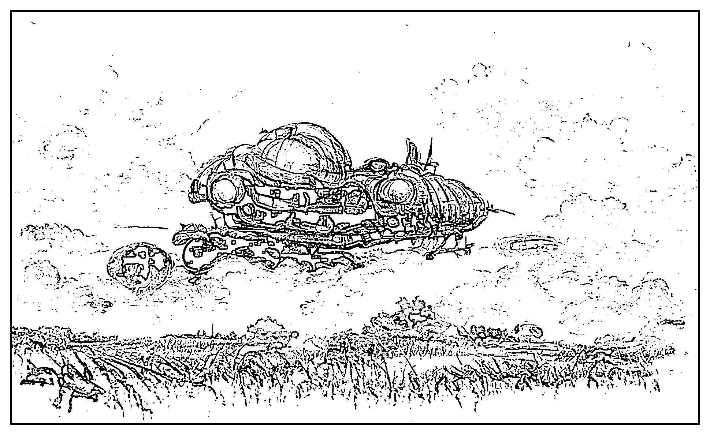
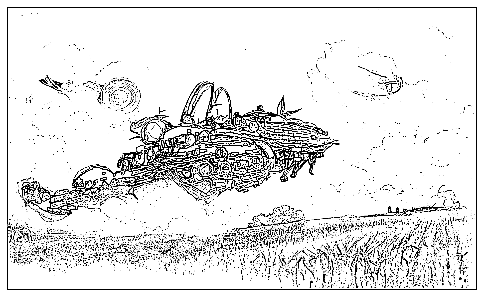
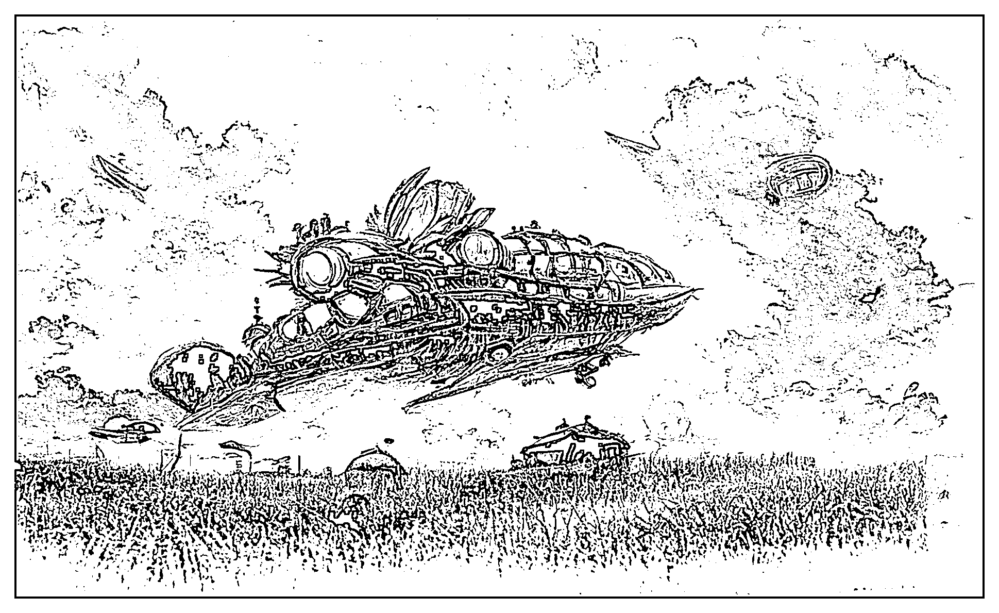

# 6.2.4 换个画师，效果大不同

画师风格会明显左右画面的笔触和整体气质，所以这里直接拿例子来说明。

先看原始提示词：

`Spaceship about to landing on a cornfield, steampunk, clouds in the sky, by Greg Rutkowski, concept art.`

（一艘即将降落在玉米田上的飞船，蒸汽朋克，天上有云，Greg Rutkowski 风格，概念艺术）

by Greg Rutkowski

其他内容都别动，只需把“by Greg Rutkowski”改成“by XXX”，例如换成梵高，就会得到：

`Spaceship about to landing on a cornfield, steampunk, clouds in the sky, by Vincent van Gogh, concept art.`

英文人名如果不会写，借助翻译工具查一下即可。

by Vincent van Gogh（梵高）

换成别的画师也是同样的道理：

by Qi baishi（齐白石）

by Picasso（毕加索）

by Akira Toriyama（鸟山明 - 七龙珠作者）

by Miyazaki Hayao（宫崎骏）

by Eiichiro Oda（尾田荣一郎 - 海贼王作者）

挑一个你喜欢的画师，把他的名字写进描述词里，画面往往会带来意想不到的惊喜。