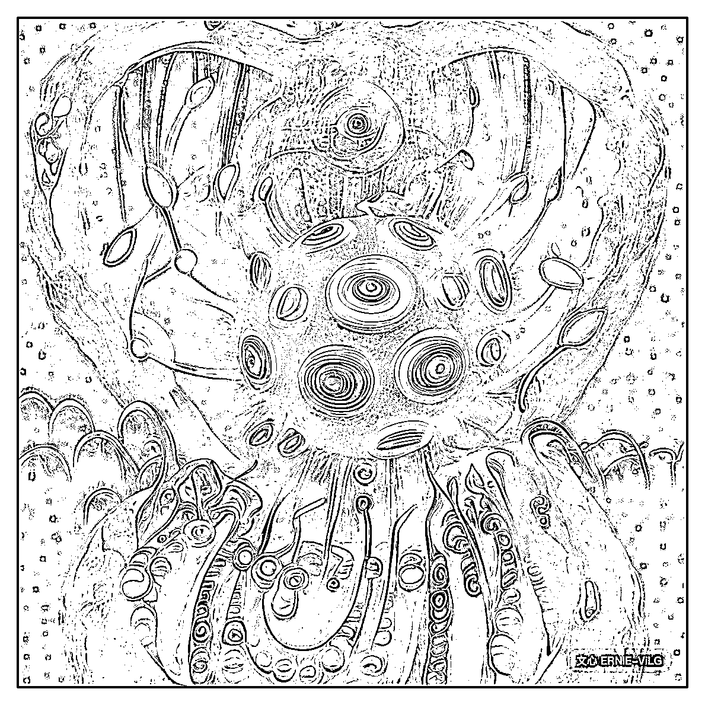

# 6.3 提示词拼装：让 AI 画出心中画面

搞懂单个词会怎样影响画面之后，接下来要学的就是把这些词搭成一套可用的“配方”，从而生成自己真正想要的图片。

基本结构可以记成：形容词 + 类型 + 细节设定 + 风格修饰词 / 参考艺术家。

说白了，就是向 AI 交代清楚：画面里要出现一个什么样的某某物，它处在怎样的环境中，构图如何安排，光影、摄影感、图片渲染方式偏向哪种，整体画风又接近什么风格：

比如下面这句，就是按这个思路拼出来的：

一个细胞的特写超现代主义插画，新海诚风格，吉田明彦风格，天野喜孝风格，超细节，高清壁纸

实际操作时，先用中文拆解会更顺手，再把整理好的描述翻译成英文输入。文心那篇描述词写法教程也值得一读：[描述词的写法（点击跳转）](https://wenxin.baidu.com/wenxin/docs#Jlbbjh075)。里面汇集了效果类描述词、风格参考词、艺术家参考词、摄影参考词，以及多种实用技巧，适合认真翻一翻。

教程里已经讲过的内容，这里不再重复；下面补充几点关于描述词的理解，这些思路对目前常见的各类 AI 绘画平台都适用。

比起干巴巴地讲文字，我们借一个可视化程度很高的描述词生成工具，把后面的内容讲清楚：[描述词生成器（点击跳转）](https://promptomania.com/generic-prompt-builder/)