# 6.3.2 构图语言：从零到一，用点击搞定AI绘画提示词

构图语言这套工具，主要拆成美术修饰、摄影语言、主色彩、维度、显示器、几何形状、感受、光线、材质、后处理、细节这几个大类。

当然，别的分类方式也存在，不过前期掌握这些已经够用了。

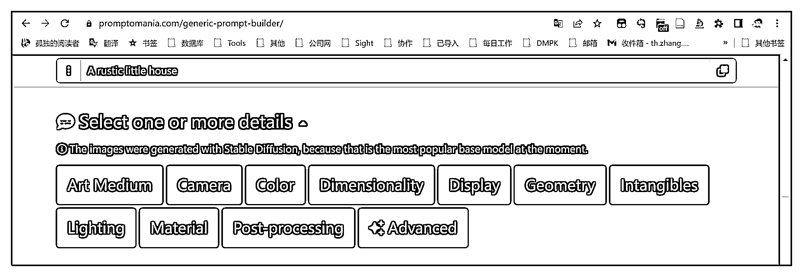

上方每一个按钮都能点，点一下就会弹出更细化的选项，方便你做下一步选择。

简单说下每个模块的意思：

•美术语言（Art Medium）：偏向绘画笔触、使用场景、图画类型这类设定；

•摄影语言（Camera）：相当于你拿着相机拍这个画面，想用什么角度、怎么曝光、取景焦点在哪；

•色彩（Color）：决定画面最终呈现的色调，没什么好多讲的；

•维度（Dimensionality）：就是 2D、3D、4D、5D 这类空间层次；

•显示器（Display）：一些像素相关的语言，按实际效果挑就行；

•几何形状（Geometry）：字面意思，指的是画面里某个主体的形状轮廓；

•感受（Intangibles）：这个比较玄，开心、快乐、郁闷这类情绪可以放进去，大、小、胖、瘦也行，甚至风水、矛盾这种说不清道不明的词也能塞进来；

•光线（Lighting）：光源处在什么位置，光是怎么打过来的；

•材质（Material）：塑料、金属、大理石之类的表面质感；

•后处理（Post-processing）：对称、折叠、加边框等等，有点像给照片做后期；

•增强（Advanced）：决定画面是堆满细节，还是走印象写意路线。

不知道该怎么选？

没关系，看不懂术语没关系，我们还能看图片。每个板块点开之后，都有示例图告诉你不同选项的区别，用眼睛做决定就行。

接下来，我每个类型挑一个，给你示范一组选法。当然，你完全可以用别的组合去自由创作。

•美术修饰

① 点开 Art Medium 选项卡

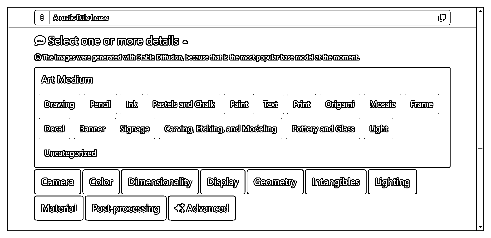

② 选 “ Print ”（输出形式）→ “ Logo ”，就是下面黄色框框里点一下：

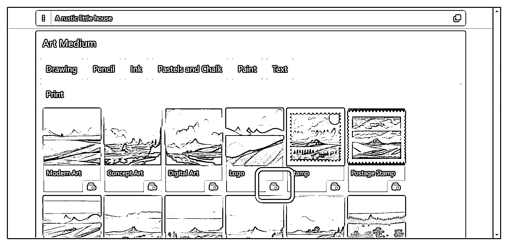

③ 点完它会立刻消失，同时上方输入框会自动补上对应的描述词：

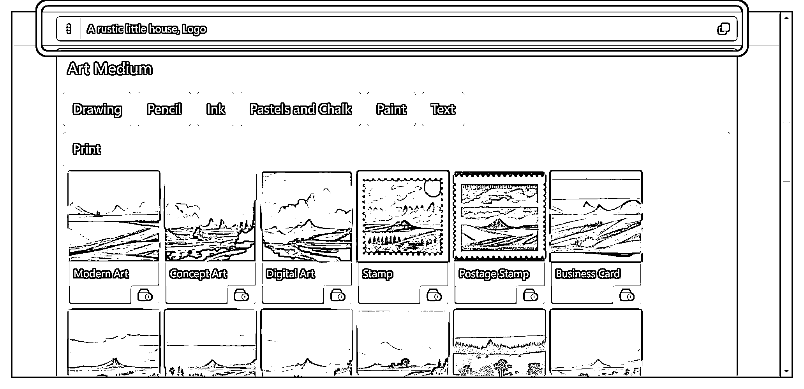

④ 这个系列不是只能选一项，你还可以继续加别的，选了之后风格就混搭在一起了。

这里提醒一句：描述词不是越多越好，当然，你也可以自己动手试试效果。

比如，我还选了 “ Drawing ”（绘图类型）→ “Illustration ”，这样画面风格就进一步被确定了：

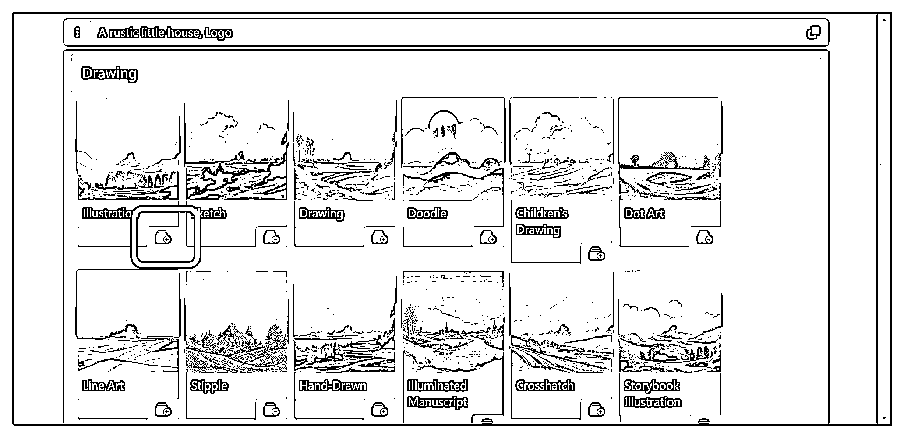

•摄影语言

照这个思路，选 “ Camera ” → “ Scenes ” → “ Time-Lapse ”

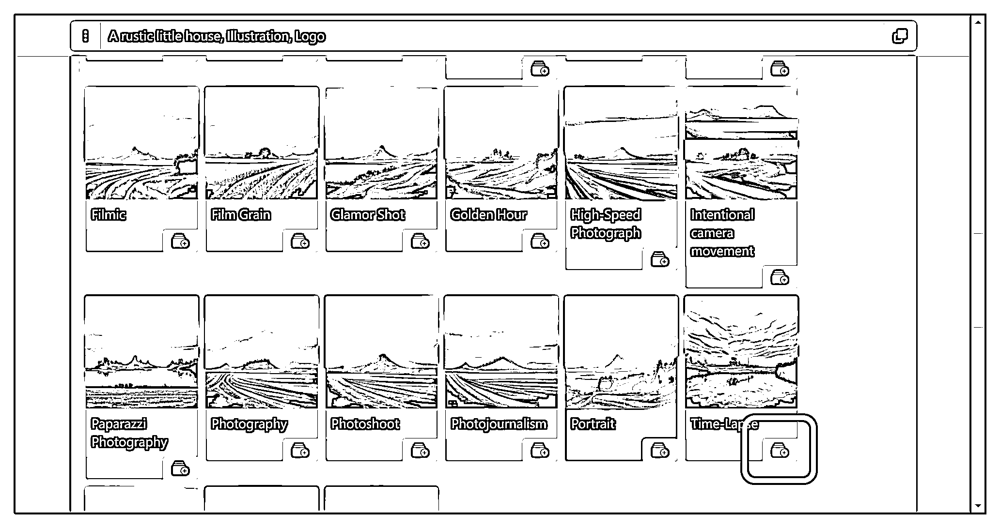

•色彩

同理想选色，就顺着 “ Color ” → “ Chromatic Palettes ” → “ Polychromatic-Colors ”

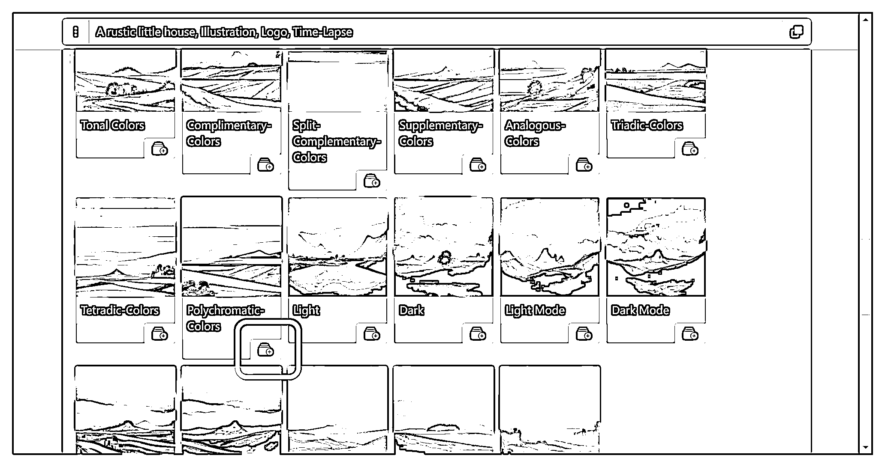

•维度

选择 “ Dimensionality ” → “ 2D-5D ” → “ 2.5D ”

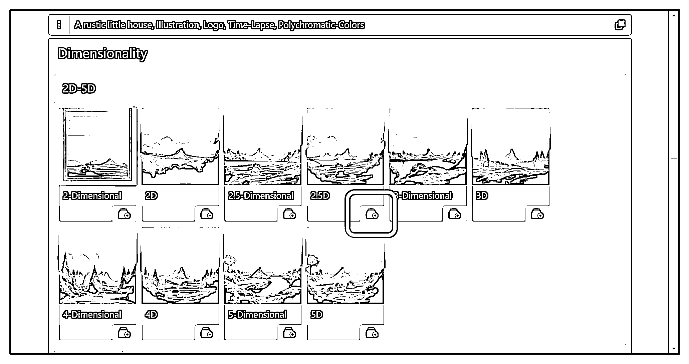

•显示器

选择 “ Display ” → “ Palettes ” → “ HDR ”

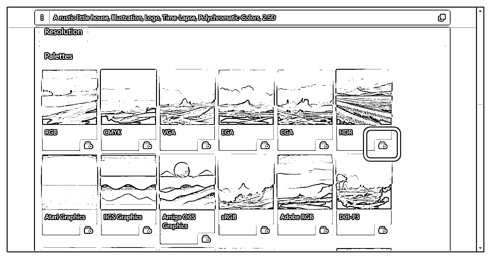

碰到不明白的词，随时可以查一下是什么意思。

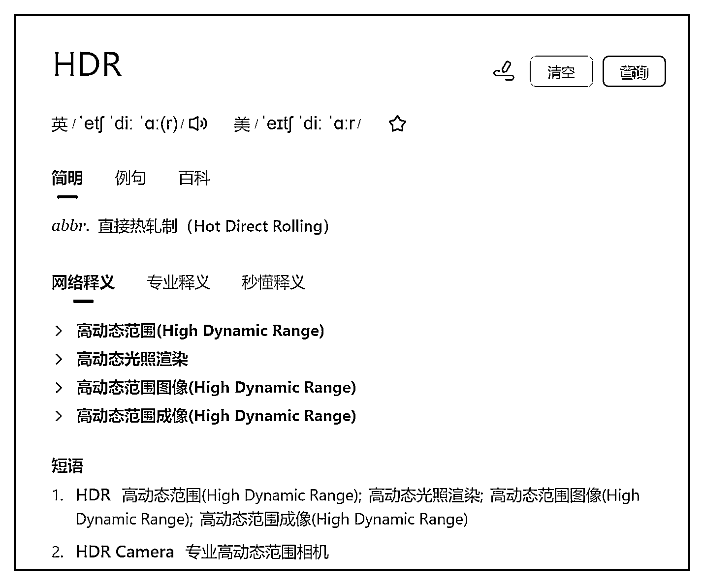

emm......查了也不明白？没关系，这事不影响大局，实在好奇就去谷歌再搜一搜。

•几何形状

“ Geometry ” → “ Bodies ” → “ Cupola ”:

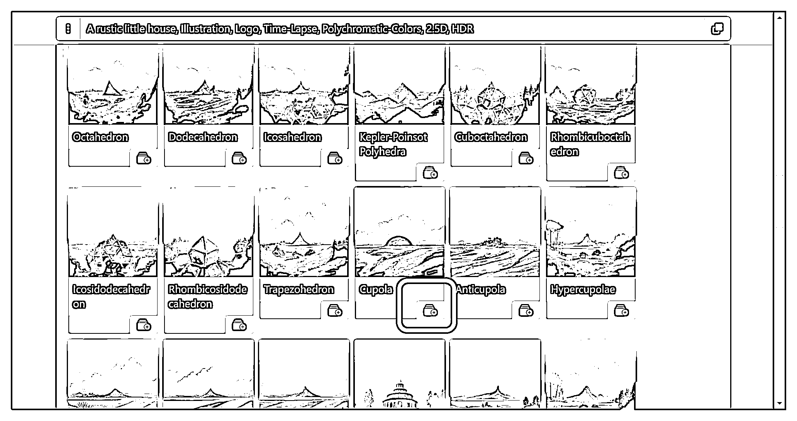

•感受

“ Intangibles ” → “ Emotions and Qualities ” → “ Happy ”:

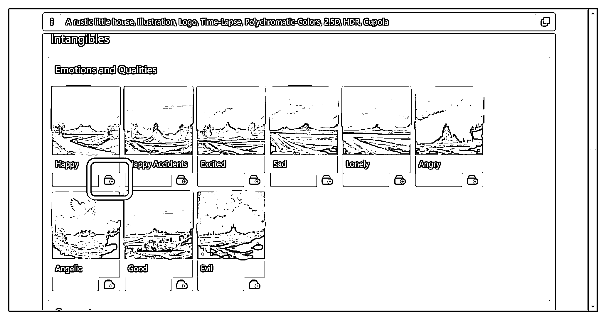

“ Intangibles ” → “ Concepts ” → “ Refreshing ”:

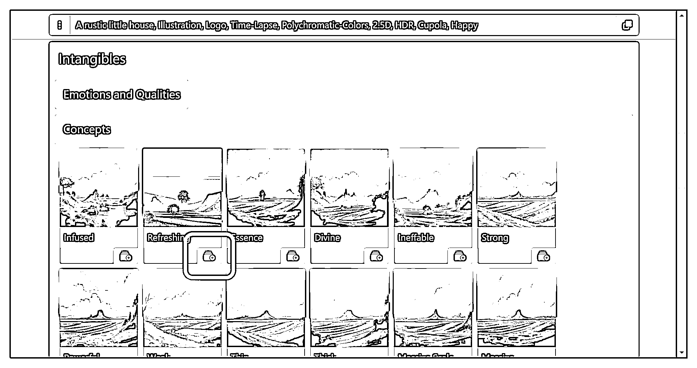

•光线

“ Lighting ” → “ Styles ” → “ Soft Lighting ”:

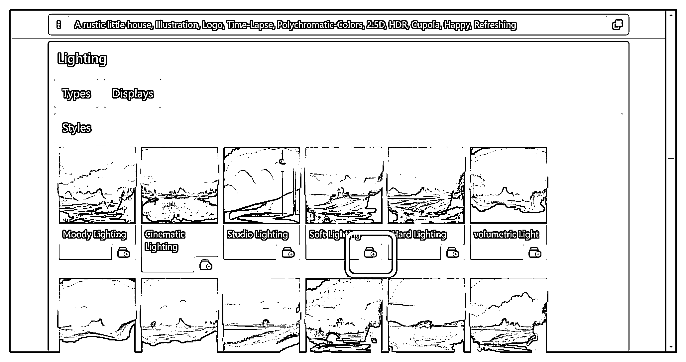

•材质

“ Material ” → “ Plants ” → “ Acorn ”:

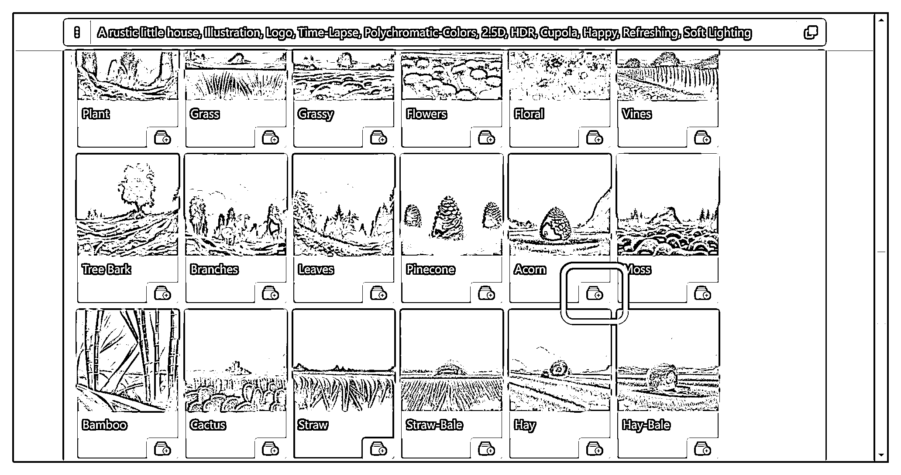

•后处理

“ Post-processing ” → “ Shaders ” → “ Ray Traced ”:

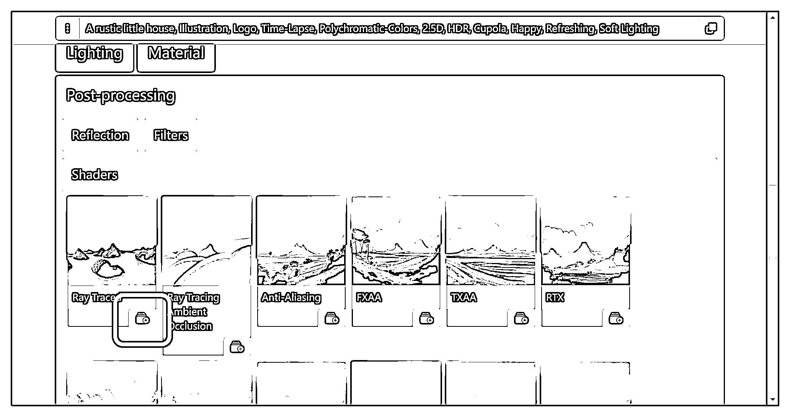

•增强

“ Advanced ” → “ detailed and intricate ”

这个特别有意思，选完之后，描述词自动蹦出来一长串：

insanely detailed and intricate, hypermaximalist, elegant, ornate, hyper realistic, super detailed

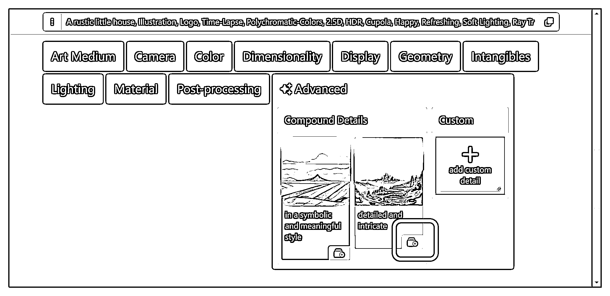

上面的选项挨个点完，输入框里会自动排好所有描述词，点右上角的复制按钮就能一键拿走。

要是觉得哪个效果看不上眼，也可以点对应效果旁边的垃圾桶按钮删掉，就像下面这个 “ Cupola ” 的处理：

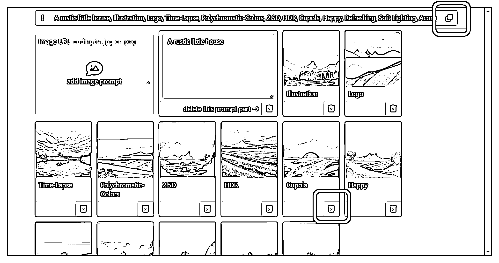

到这一步，原本那句简单的描述：A rustic little house

已经被改造成一段适合AI修图的强力提示词：

A rustic little house, Illustration, Logo, Time-Lapse, Polychromatic-Colors, 2.5D, HDR, Cupola, Happy, Refreshing, Soft Lighting, Acorn, Ray Traced, insanely detailed and intricate, hypermaximalist, elegant, ornate, hyper realistic, super detailed

需要很强的英文功底吗？完全不用，这些单词一个个查就行。

再说了，刚才这一通操作只是演示描述词是怎么拼出来的。每个人都可以根据自己的需要换一套想要的词。

把上面整理好的描述词丢进前文提到的三个生成模型里，你的专属AI绘图作品就出来了。