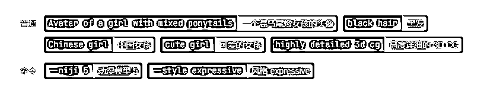
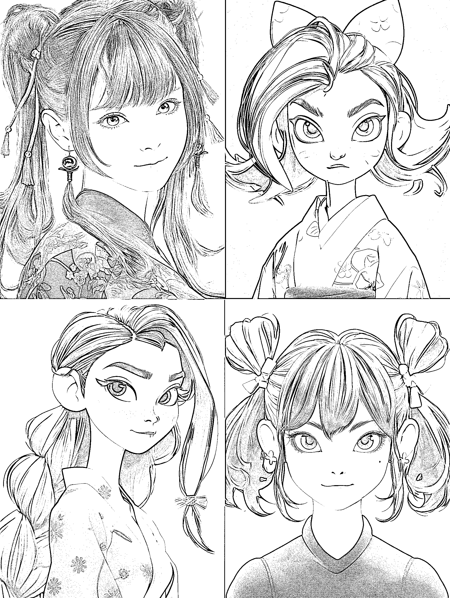
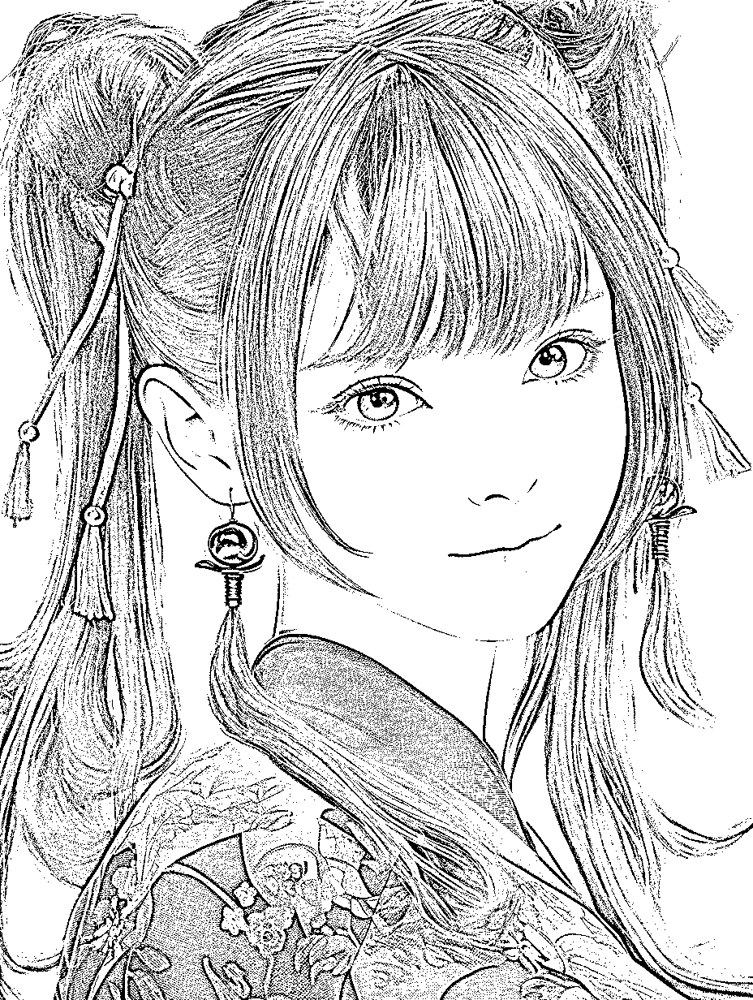

# 第 1 步：用 MidJourney 生成头像图

打开 MidJourney 后，先输入下面这条绘图指令：

/imagine prompt:Avatar of a girl with mixed ponytails, black hair, Chinese girl, cute girl, highly detailed 3d cg --niji 5 --style expressive

画面描述：一位扎着混合马尾的中国女孩头像，黑发，走可爱路线，整体是细节丰富的 3D CG，并带有 --niji 5 表现力风格。

生成效果如下：

我们从这些成图里挑出第一张女孩形象，拿来做后面的包装贴图。