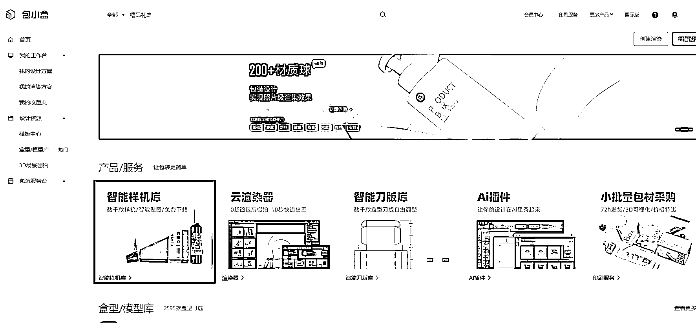
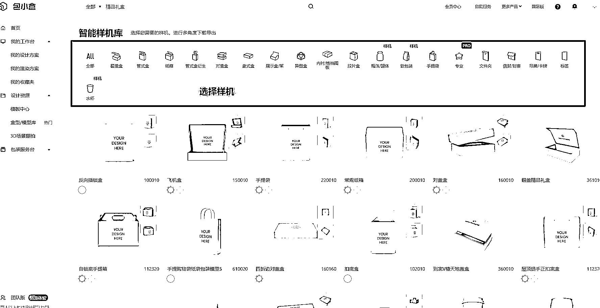
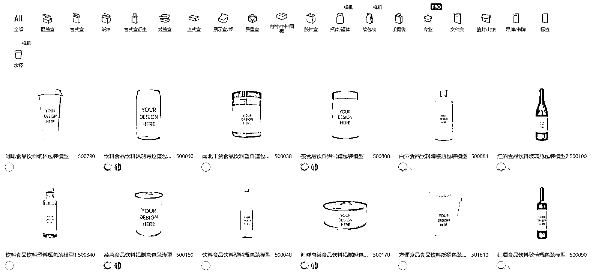
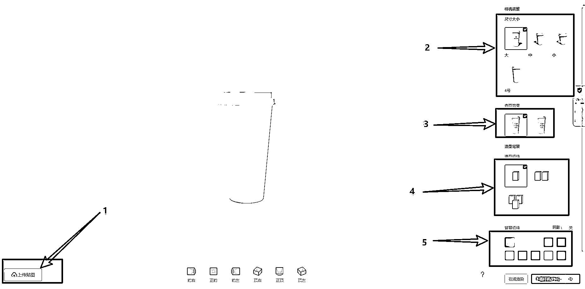
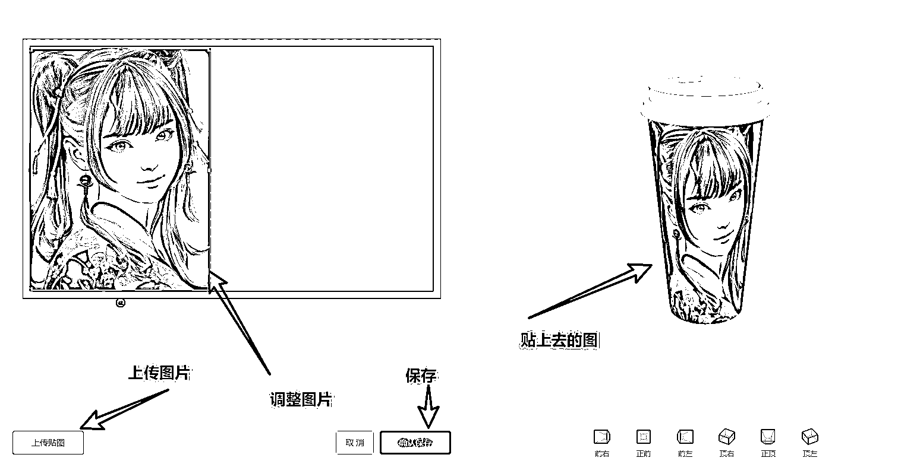
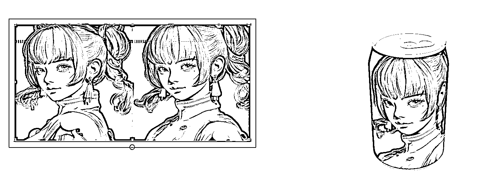

# 第 2 步：包小盒样机贴图流程

先进入包小盒官方网站并完成登录，在首页找到“智能样机库”入口：

接着从样机库里挑出你要用的产品模型，点击进入详情页。这里先拿瓶体做演示：

纸杯也可以，比如选中它：

随后把前面用 MJ 做好的图片上传，贴到产品样机上：

再替换一张图、换一个样机试试，像易拉罐出来的效果同样挺不错：

几点操作提醒：

• 如果贴的是杯子、瓶子一类产品，建议在 MJ 里把出图比例设成 16:9，成品会更合适；

• 熟悉 Adobe Illustrator（2019—2022 版本可用）的话，可以下载包小盒的 AI 插件，直接在软件里操作，效果会更理想；

• 会用 PS 就更方便：先按样机尺寸在 PS 里排好版，把文字和标签加上，再上传贴图。

