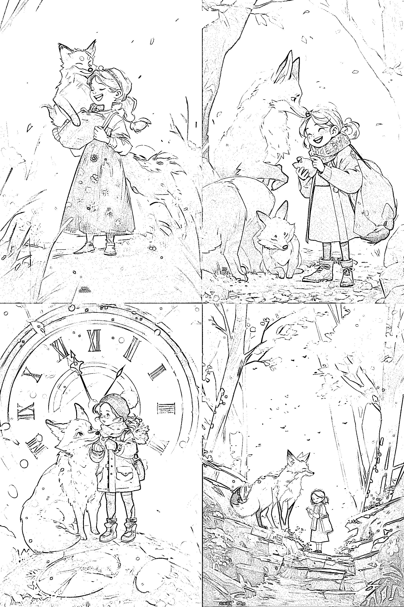
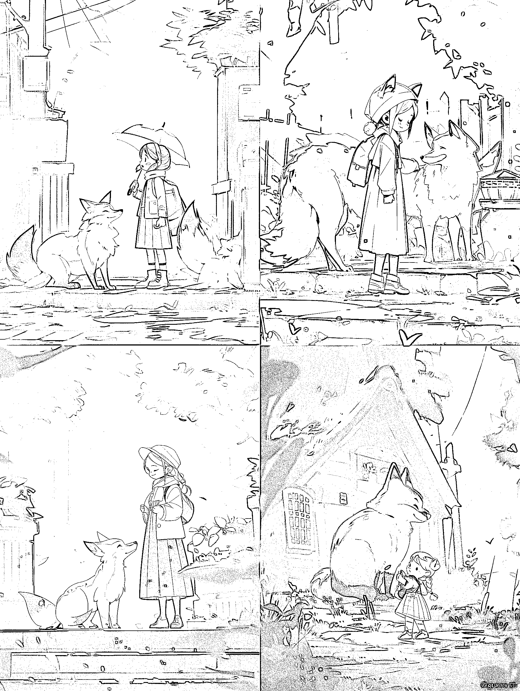
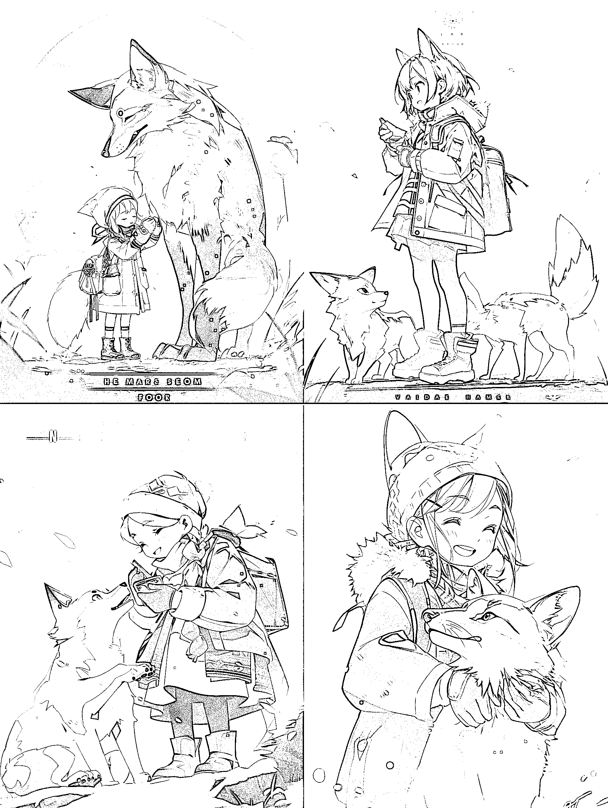
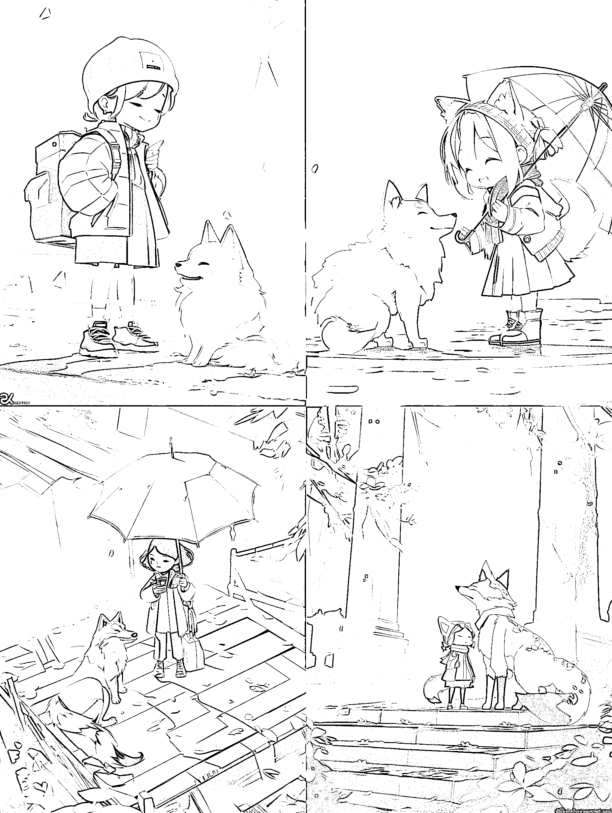
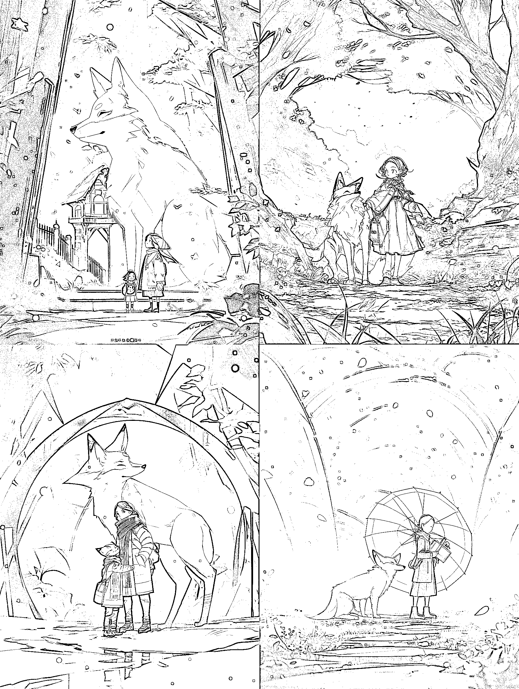
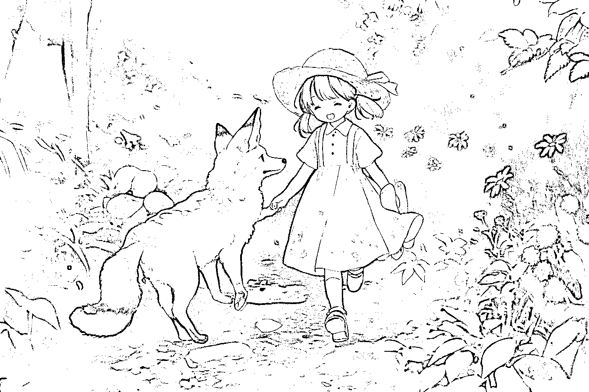
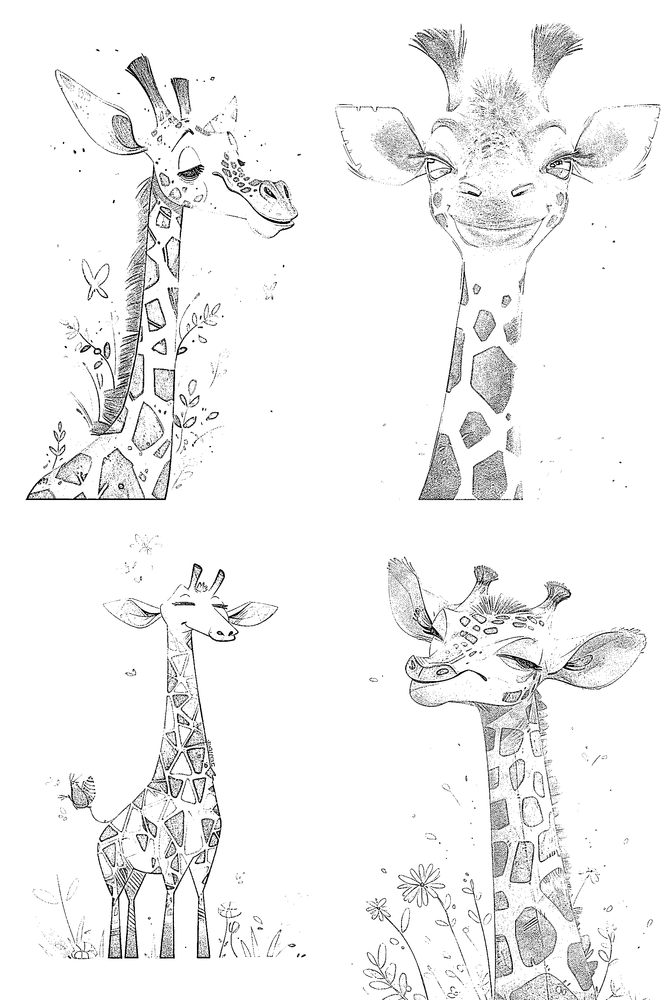
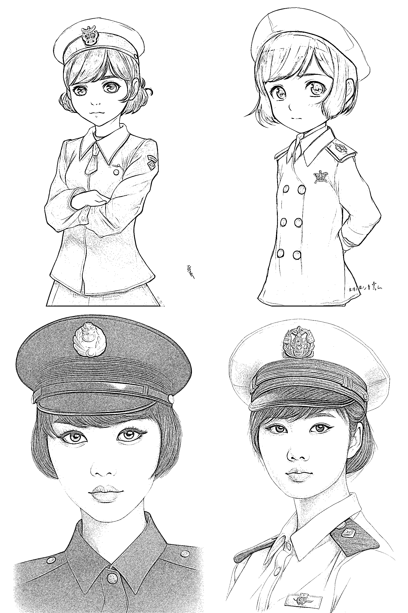
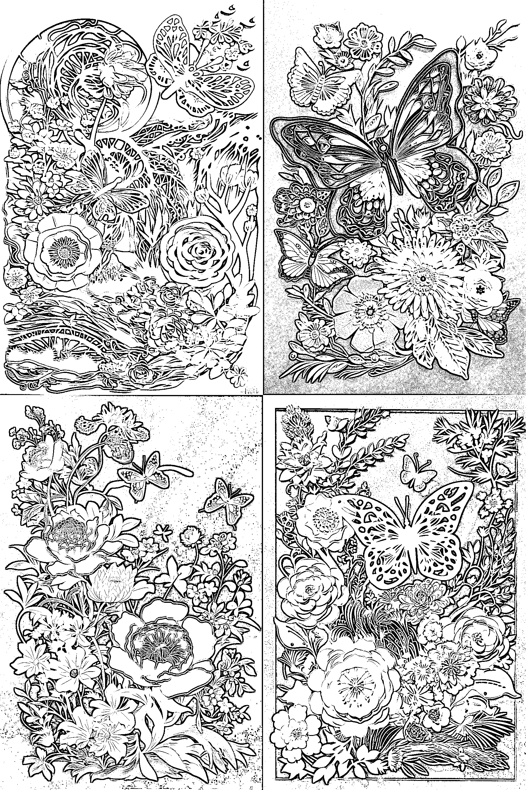

# 8.2 套个模板，出图更省心

不同画面类型，都可以先用一个很轻的起手式：**先点明画面类型，再写脑中场景**。这两块拼在一起，AI 就更容易理解方向。

下面用 niji 做对比，它支持中文提示词。我让同一组角色出镜，只替换前面的类型词，感受风格差异。示例里省略了常规参数，实际出图时按平台习惯补上比例、模型等即可：

手绘感，戴贝雷帽的少年与柴犬蹲在旧书摊前

素描感，戴贝雷帽的少年与柴犬蹲在旧书摊旁

带文字版式，戴贝雷帽的少年与柴犬靠在旧书摊边

文字类画面有个小提醒：AI 对字母的识别还不够稳，但安排文字位置的能力尚可。操作时，先把原图上的字擦除，再打上自己的标题，一张封面就成型了。做影片海报或童书封面时，这套方法很省时间。不熟 PS 也没关系，稿定设计、美图秀秀里的消除笔加文字功能，也能完成。

3D 打印质感，戴贝雷帽的少年与柴犬站在旧书摊门口

现代艺术感，戴贝雷帽的少年与柴犬坐在旧书摊角落

等最简版跑顺了，还能继续叠加：**画面类型 + 视觉风格 + 具体场景 + by 艺术家 + 额外修饰**。模板不必照搬，顺序能换、元素能删，甚至只写“风格 + 场景”也成立。

但刚开始，建议从短句起步，再慢慢加词。这样能清楚看到每个词带来的变化，也更有探索的乐趣。比如：

写实风，童书插画，雨天巷口，少年蹲下给柴犬系围巾，by 佐野洋子与 Oliver Jeffers

复古拼贴风，角色设定页，橘猫骑着小自行车穿过面包店，奶油色调，纸张纹理，米白底，by 几米与 Beatrice Blue

铅笔手绘，圆框眼镜的卷发少年，背带裤，神情俏皮，线条轻快，留白背景

层叠纸雕，东方插画，锦鲤绕莲，细节精细，立体质感

