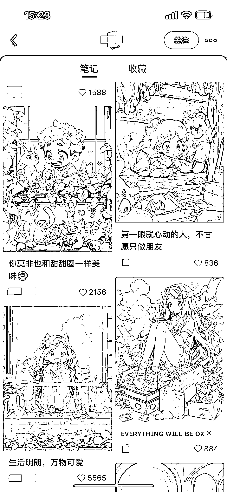
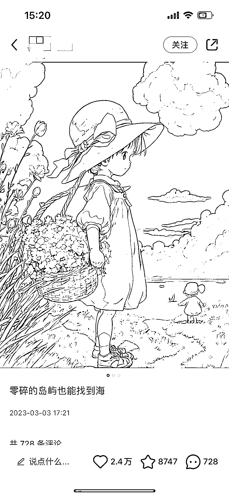
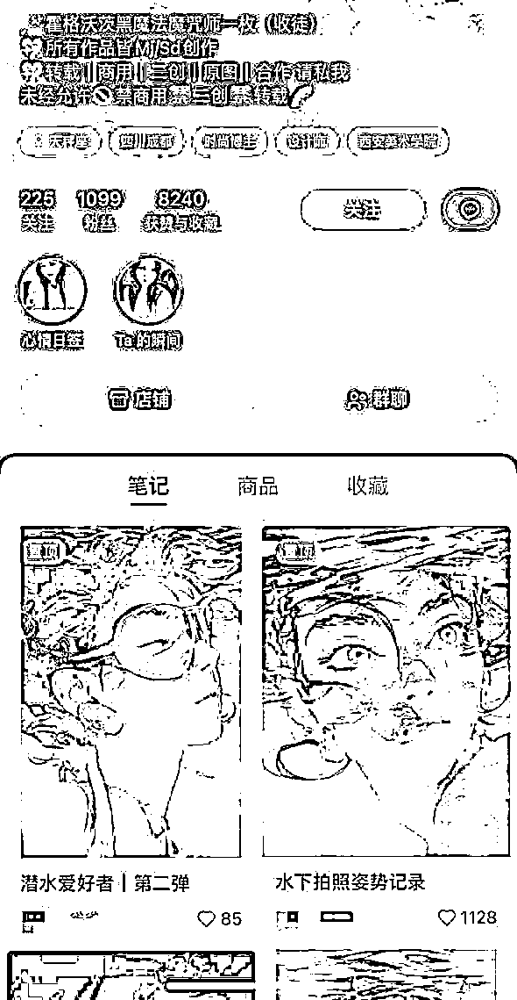
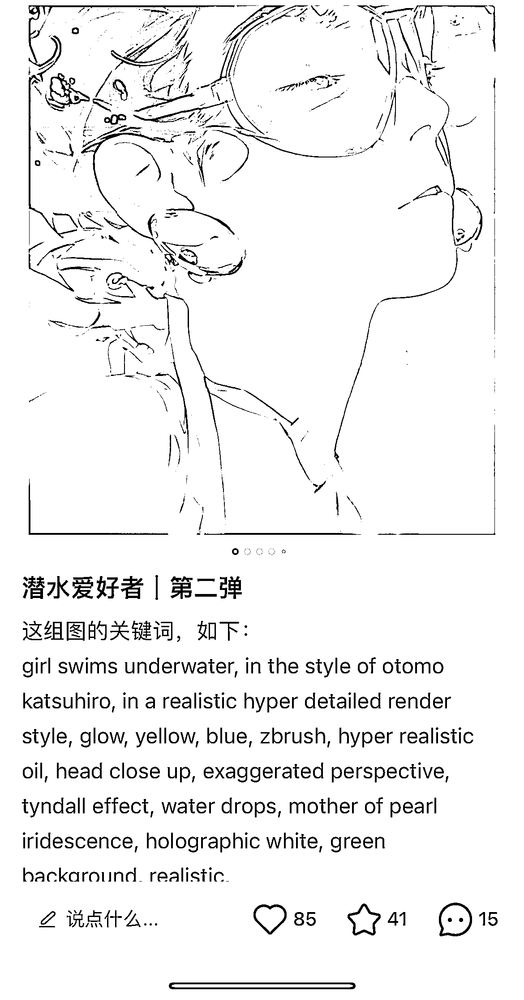
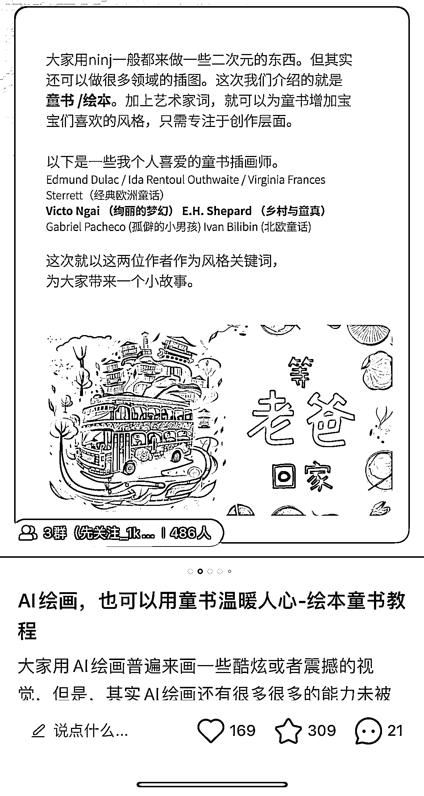
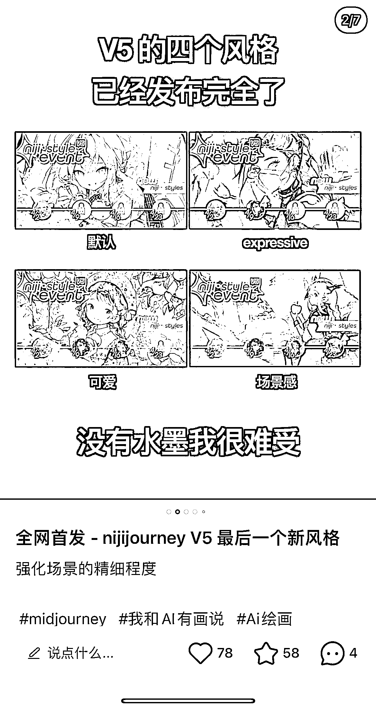

# 8.4.1.1 账号类型怎么选？

做小红书、做内容，第一步得先定好账号类型。账号类型直接决定了你的内容方向和变现潜力。目前主流的方向有两种：一种是“插画+短句语录”的轻量型，适合做壁纸、头像；另一种是“教学号”，既能简单搬运，也能系统授课，难度跨度非常大。

**类型一：插画 + 一句话语录（难度：🌟🌟）**
这类账号主打治愈感，一张插画配上一句简短语录，就能做壁纸、当头像，或者直接作为朋友圈配图。文案不需要自己想，直接参考小红书、微博上热门账号的调性，模仿着来就行。

**类型二：教学号（难度：🌟 或 🌟🌟🌟🌟🌟）**
教学号比较特殊，可以分为两个极端，一个极简单，一个很复杂。

**难度一颗星：发布图片 + 关键词**
简单到什么程度？你只需要把 Midjourney 画廊里的热门关键词拿来，用它们生成图片，再把图片和关键词一起发布就行。不需要动脑创作，也不用做教程。

**难度五颗星：通过课程/社群实现变现**
这个方向的核心是卖课或做社群，以 Midjourney 为例，你需要做到这几点：第一，真正理解关键词的组成逻辑，而不是只会复制；第二，持续学习，不断补充自己的知识库；第三，具备表达能力，能把你掌握的内容讲清楚，最终整理成一套体系化的课程，教给别人。

具体运营上，可以在小红书上持续分享你的制作过程、最新版本功能，以及多种工具的组合用法，通过持续的内容输出逐步积累影响力。但要注意，这是一个需要长期沉淀的过程，短期内不会快速变现，要有心理准备。

