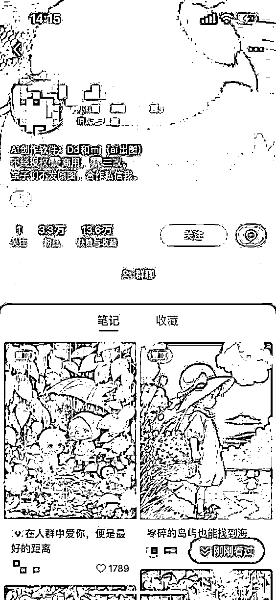
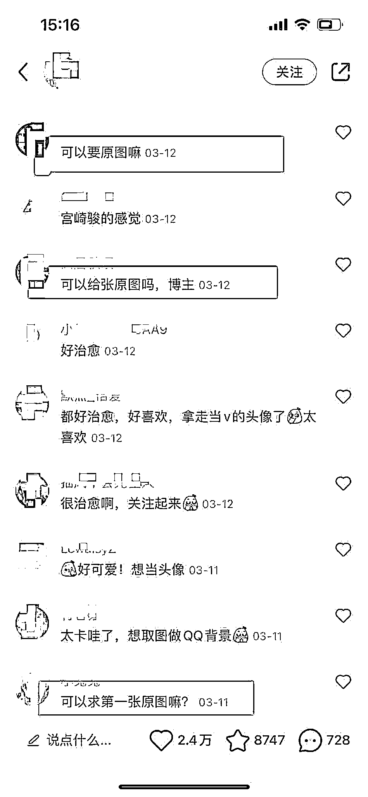
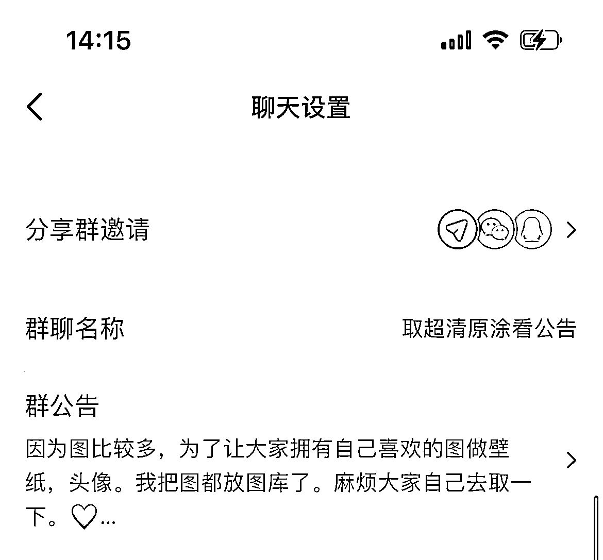
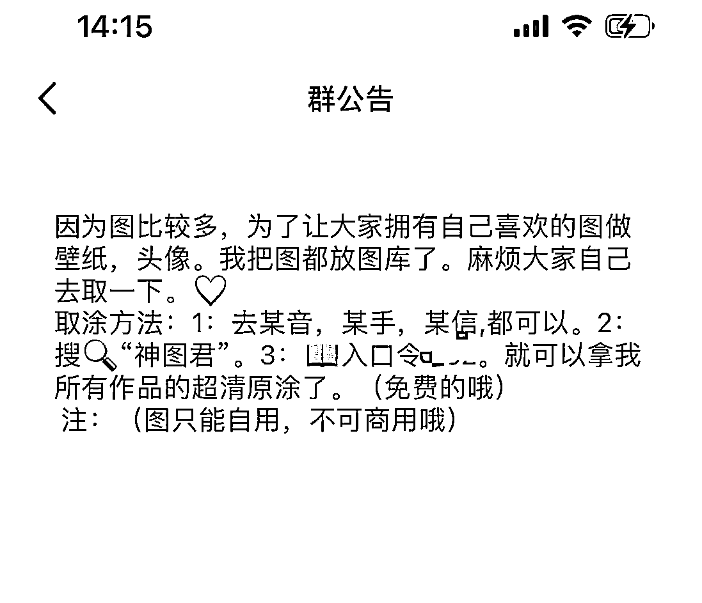
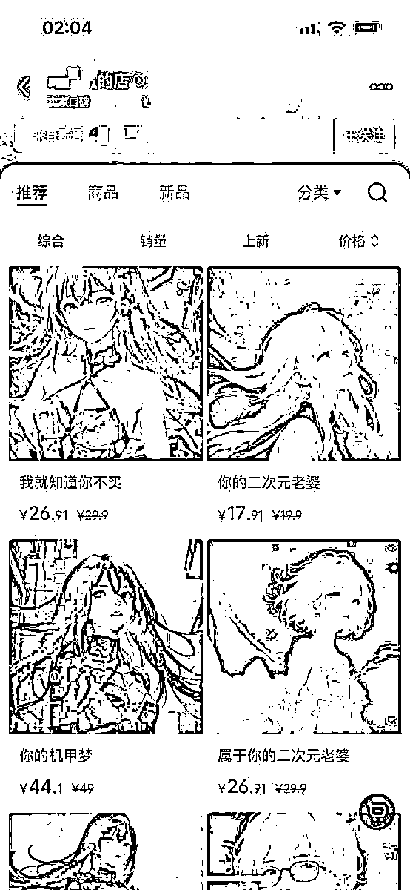
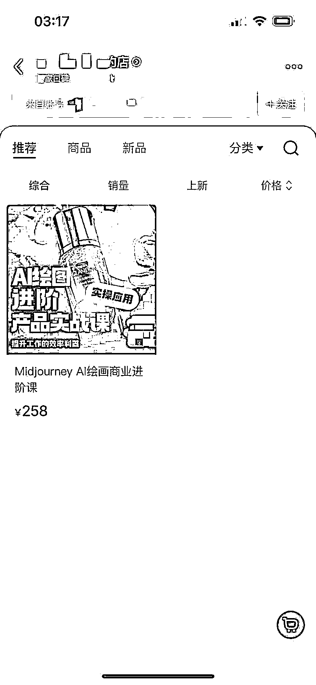

# 8.4.1.2 三条变现路

想把原图内容做成收入，实操上有三条路径可以走。

**方式一：用小红书群聊承接，引导粉丝去取图小程序**

先发布图文作品，把“免费取图”设计成吸引点。发布时可以这样设置：

粉丝对图片感兴趣后，会进入小红书群聊。把取图方式写进群公告，让对方自行搜索对应的取图小程序。用户取图时观看广告，我们就能获得广告点击收益。群公告可以参考：

**方式二：把群公告换成公众号，用公众号承接取图**

把小红书群聊公告改成自己的公众号。通过公众号取图，涨粉速度更快，也更安全，不容易出现频繁被加好友的风险。用户关注公众号后获取图片，这条路径下常见三种收益来源：

- 小程序取图收益：思路和方式一接近，在公众号里跳转到神图君等取图小程序。用户看广告取图，我们赚点击费用。要注意，部分小程序有提现门槛，比如神图君需满20元才能提现，收益不是立刻到账。如果账号内图片较多，用户多点几次，收益也可能更多。
- 网盘拉新：在公众号设置关键词回复，例如用户发送“取图1”，系统自动推送网盘链接。用户点击链接、下载APP并转存图片，我们赚取拉新奖励。这里有个现实问题：如果用户手机里已经有该网盘，就不算新用户，这部分收益可能拿不到，所以存在一定概率赚不到钱。
- 私域+网盘拉新：针对上一种可能落空的情况，可以在关键词回复里放微信二维码，让用户扫码加好友，把人导进私域，再由你发网盘链接。这样即使网盘拉新没成功，也多了一个私域粉丝。这个粉丝的获取成本为0，后续可能找你定制头像、学习课程，或者对接你的自有业务，属于隐藏价值。

另外有4点要提醒：

1. 有人拿完图就删好友，不必纠结，放宽心，下一个用户可能更合适；
2. 朋友圈要持续经营，日常发图、发内容，让用户了解你，否则很难产生下单意愿；
3. 群聊里可能混进发广告的人，发现后要及时撤回；
4. 无论用哪种方式引流，都有违规风险，提前做好心理准备。

**方式三：开小红书店铺，直接上架作品或课程**

开通小红书店铺，把AI作品或AI课程挂上去销售，实现变现：

