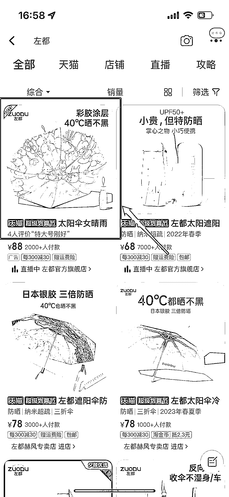
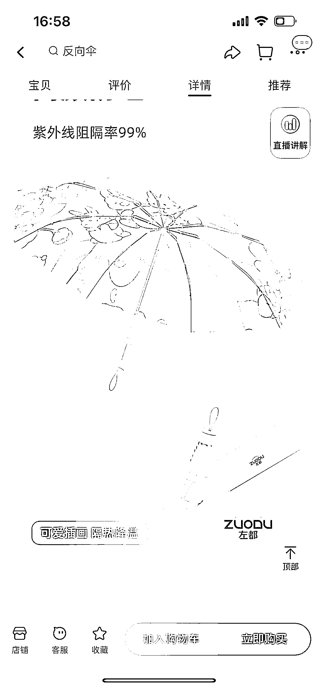

# 8.4.2 定制变现：AI绘画的直接盈利路径

AI 绘画的定制化变现，核心思路是根据客户的具体需求提供针对性解决方案，从而实现收入。常见的落地方式有以下几种：

- **按需绘制插画**：紧贴客户的个性化要求，提供一对一的插画定制服务，满足不同场景的使用需要。
- **授权商用许可**：将作品通过授权方式交给商业客户使用，例如投放到广告物料、产品包装等场合，收取相应费用。
- **打包设计关键词**：把多套插画方案（即关键词组合）整理成资源包进行售卖，让客户可以按需选购，获得更多创意选项。
- **打造插画设计工具**：开发面向用户的软件产品，帮助他人更便捷地生成插画，同时从中获取收益。

具体执行时，可围绕客户需求延伸至各类文创衍生品：包括书籍插图、文具图案、服装纹样、装饰画、海报、绘本、贴纸、雨伞印花、笔记本封面及内页插画等。

