# 9.2.1 新手起步：两种 AI 模特出图方案

这一节讲入门阶段的两条实操路线：一条用 MidJourney 的图生图来出模特，另一条用 Vega AI 做局部重绘。前者更适合基础款服装，后者对设备要求更友好，能较快完成模特局部替换。下面按操作顺序逐一说明。

**路线一：MidJourney 图生图**

先看适用范围：卫衣、T 恤、衬衫这类纯色、设计简洁的衣服，出图效果更稳；花色复杂、纹理细密的款式不建议直接套用这套流程。目标很明确——生成符合要求的模特图。

① 先写一段描述需求的话。比如：亚洲女模全身照，穿宽松舒适的运动衫，站在白底背景前；人像低机位拍摄，用佳能 EOS R5 加标准镜头，完整呈现整套服装，并让画面体现她 165 厘米的身高。

② 把这段话交给 ChatGPT 或翻译工具，转成适合 AI 绘画的英文提示词，例如：

“Full-body portrait of an Asian female model wearing a relaxed sweatshirt, standing against a white studio backdrop. A low-angle fashion portrait shot with a Canon EOS R5 and a standard lens, showing the complete outfit and indicating a height of 165 cm.”

③ 打开 Discord，把英文提示词发给 MidJourney 机器人：在输入栏键入 /imagine，后接英文提示（加号无需键入），发送后等图。

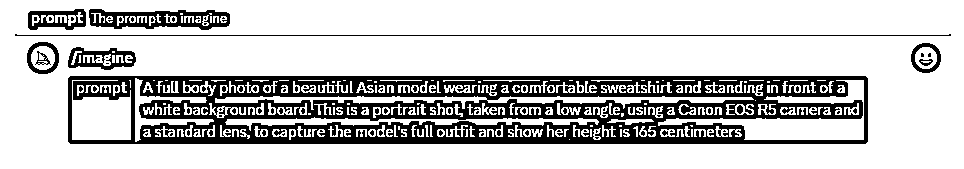

④ 系统会一次给出四张模特图。看中哪张，点对应 U1、U2、U3、U4 打开大图；四张都不理想，点蓝色刷新按钮重新来；若某张整体不错只差细节，点 V1、V2、V3、V4 继续生成更贴近要求的版本。

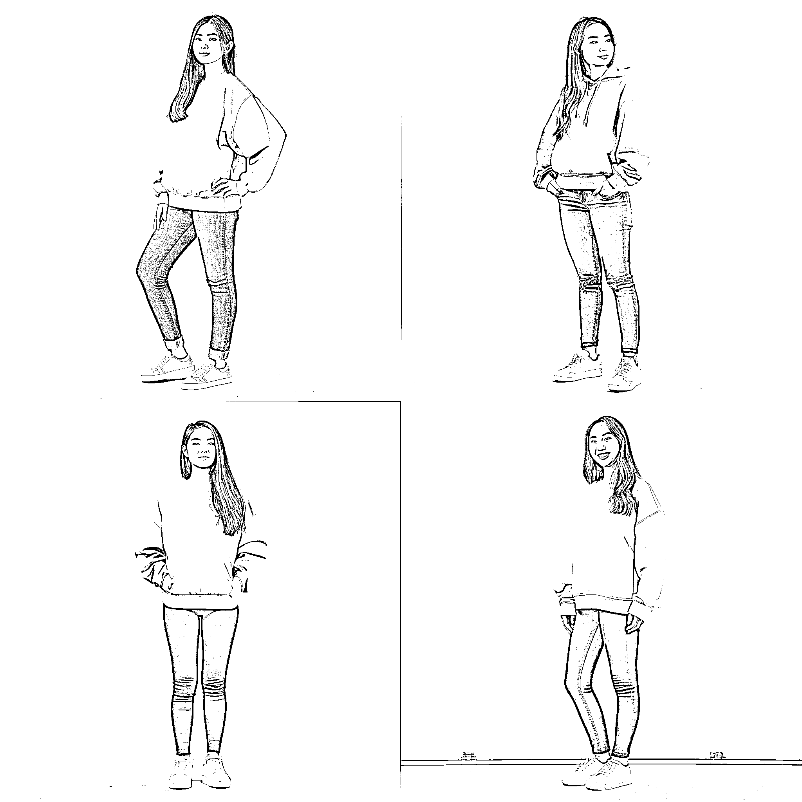

⑤ 下载选中的图，与事先准备的衣服照片一并导入 Photoshop 或同类修图工具，叠放到同一画面。

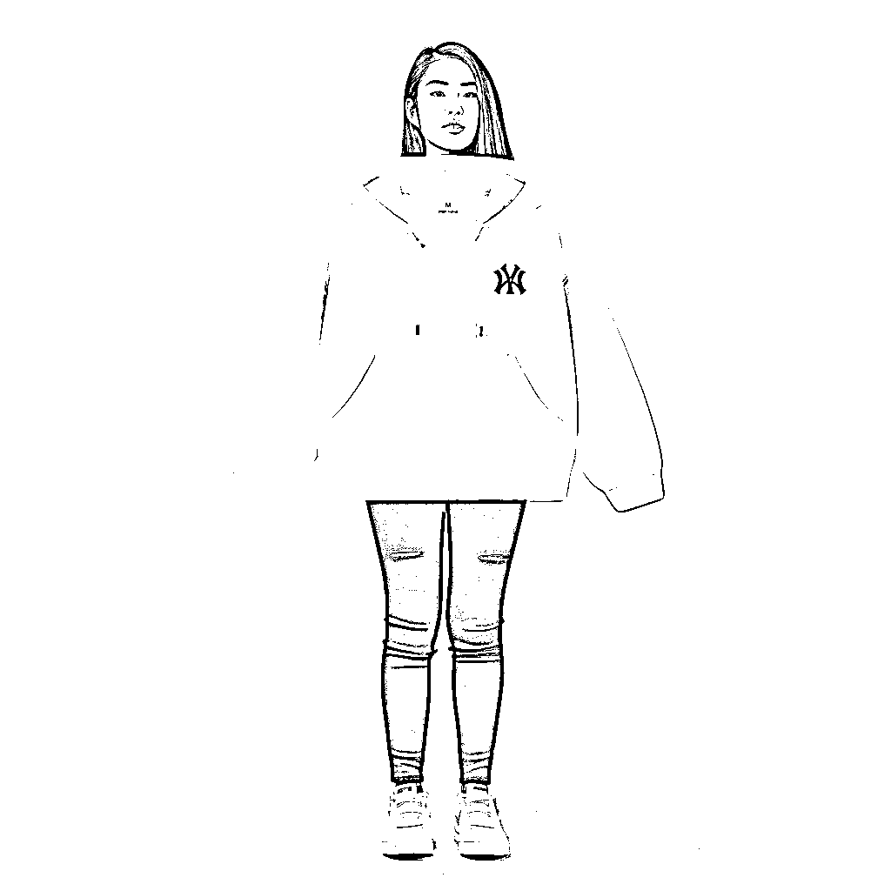

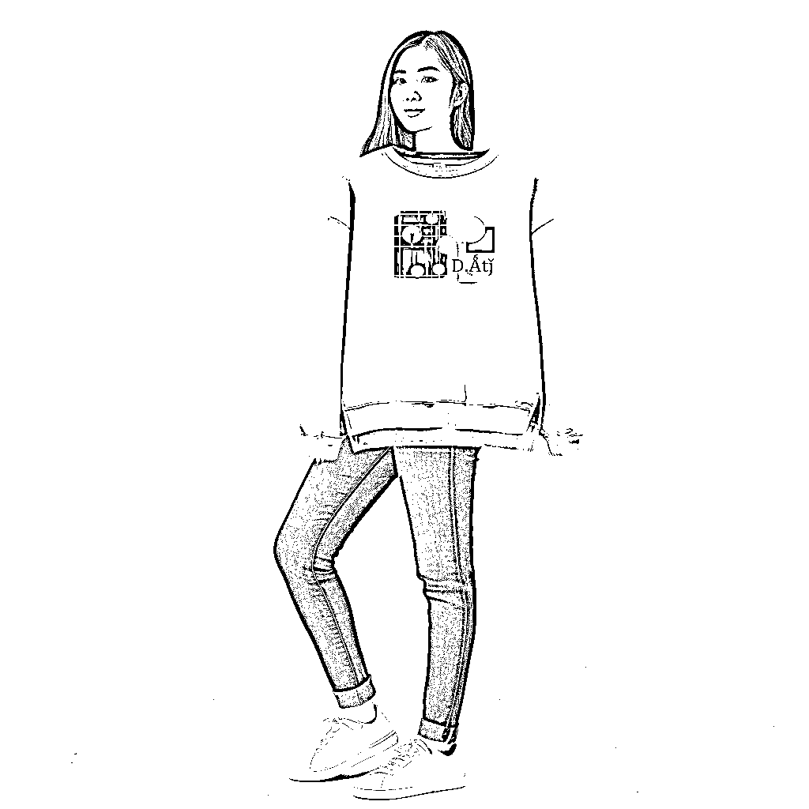

⑥ 合成图完成后，按 Shift 键将它送进 MidJourney 的 Discord 机器人对话栏；待上传成功，复制返回的图片地址。

⑦ 在输入栏敲入 /imagine，按顺序跟上图片地址、原先那条模特提示词，最后加上 --iw2（加号无需键入）；其中 --iw2 用来控制权重。发出后，穿着目标衣服的模特图就会生成。

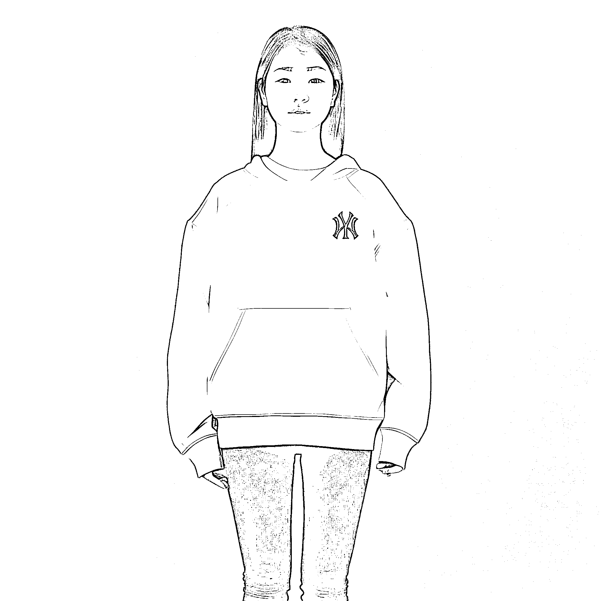

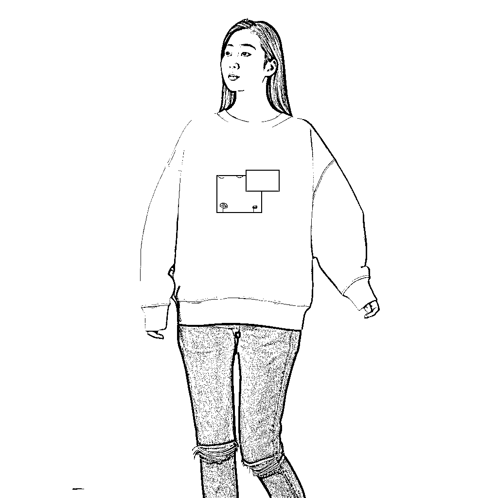

提醒：MidJourney 出图有随机性，颜色和衣服上的 logo 可能发生偏移，最后用后期修图把细节收回来即可。

**路线二：Vega AI 局部重绘**

电脑性能一般、无法顺畅运行 Stable Diffusion 源码包的人，可以走更省心、更稳当的 Vega AI 平台，快速替换模特局部。

• Vega AI 路线：可参考【三、简易方法：学会用 Vega AI 完成 AI 绘画】
• Stable Diffusion 路线：详见【五、学会用 Stable Diffusion 完成 AI 绘画】

① 找一张效果欠佳的商品模特实拍图作为样本，只改动人物区域，让画面朝目标效果靠拢。

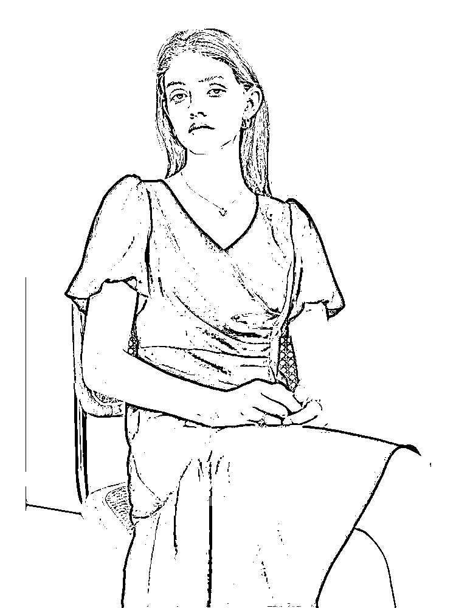

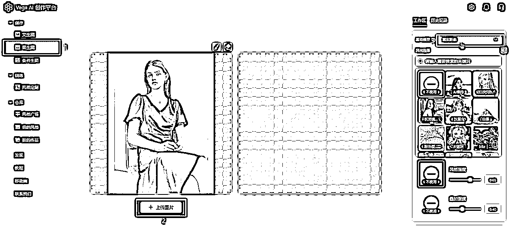

② 打开 Vega AI 创作平台，把这张图传上去，模式选图生图，风格选真实影像。

③ 调出画笔，在要替换的部位刷出遮罩；随后在文字框里填上理想模特的关键词。

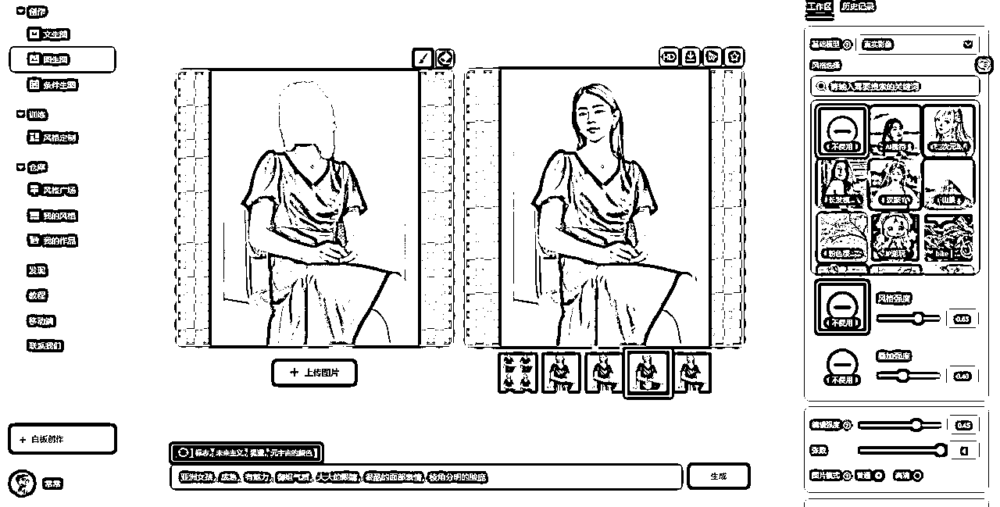

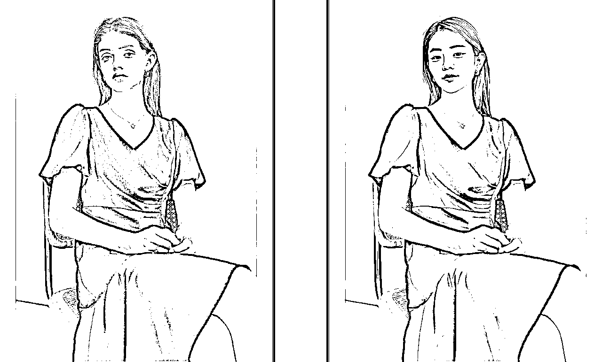

④ 按下生成键，稍候片刻让系统出图。

接着可以按上面的流程给其他图换脸。比如客户给到的需求是：把下图里的欧美模特换成亚洲模特。

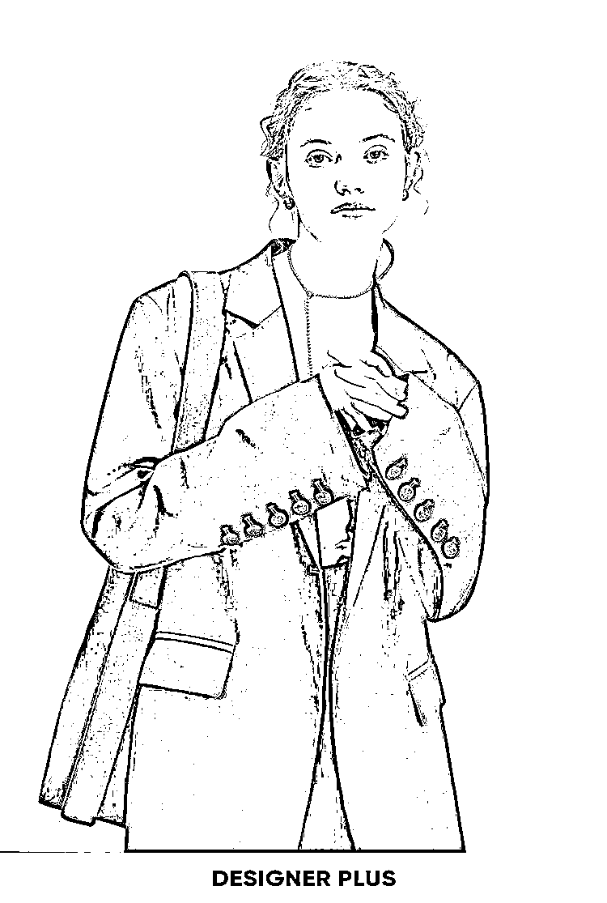

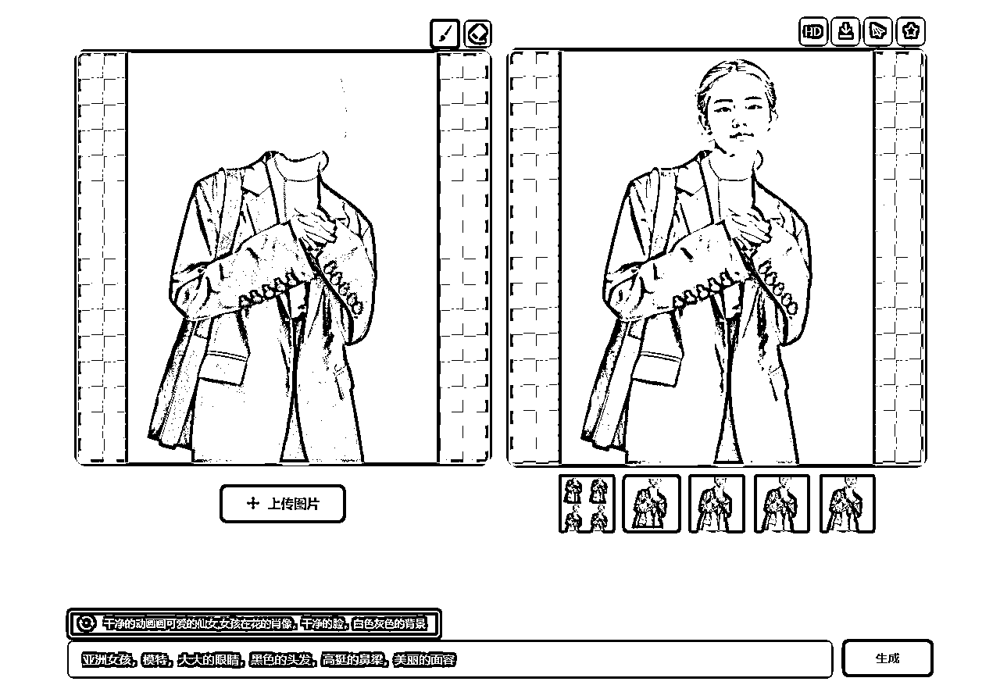

完成后的局部重绘效果见上图。但可以再想一步：这样的图能完全达到商家要求吗？

答案是否定的。症结是人物面部与身形的匹配度不足，视觉上像两个来源硬凑在一块，生硬、不连贯，面部也缺乏模特该有的表现力。

所以，AI 模特属于电商摄影下的垂直赛道，不能单独拎出来看；想让 AI 模特图达到商用要求，电商摄影的知识储备同样要跟上。

