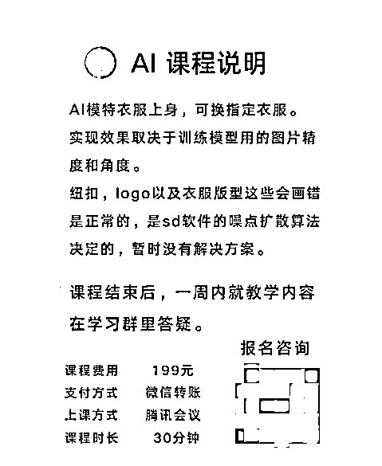
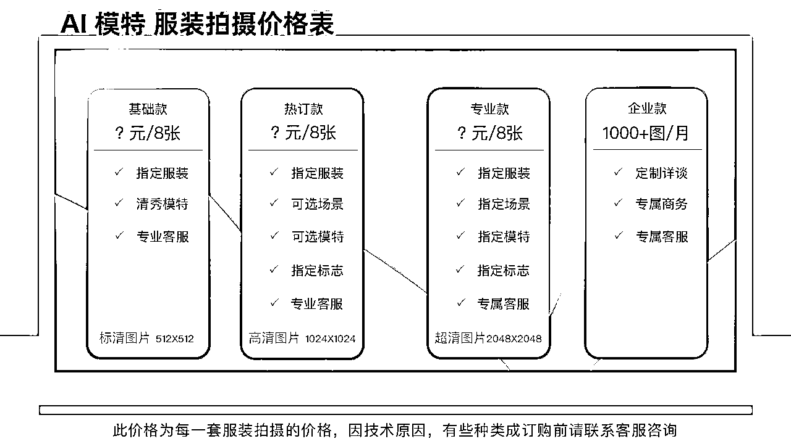

# 9.3 AI模特变现的5种思路

如果你原本就在电商行业，完全可以把“AI+电商”的现有玩法直接搬进自己的业务里用起来；即便不在电商赛道，也有不止一种变现机会可以尝试。

方式一：把制作方法做成课程出售

把用 Stable Diffusion 生成模特图、产品图的流程梳理清楚，整理成一套可售卖的课程。

方式二：对接商家，提供 AI 模特服务

在小红书、淘宝、闲鱼等平台，主动私信匹配的商家店铺，寻找合作机会。根据商家需求提供不同类型的 AI 模特服务，最终按实际交付的图片张数计费。

方式三：参与 AI 模特商业链的任意环节

不一定只做出图者。比如，有人能获取流量、积累商家资源，就可以为 AI 摄影师提供商单资源并取得收入；反过来，AI 摄影师也能为这类渠道方补充人力。任何生意都包含供应链、流量、产品交付等环节，每个环节都能找到个人价值变现的切口。

方式四：组合资源，用团队赚钱

前面提到，个人做 AI 模特绘图，效率和收益都有限，遇到商家一次要 500 张图、一周内交付的大单就很难接住。这种情况下需要团队作战：假设有 10 人，1 人负责开拓市场，1 人负责商家沟通与交付，剩下 8 人专注出图，那么每人每周完成 60 张以上是可行的。

方式五：直接成为商家

这个建议听起来大胆，但对生财的小伙伴来说可行性很高。很多人已经学过如何选品、如何运营，现在 AI 又能帮我们解决图片问题，开店成本进一步降低，图片也不再是阻挡入场的门槛。

当然，上述变现方法都还在探索初期，规则并不完善。如果你有兴趣，不妨亲自试一试。

