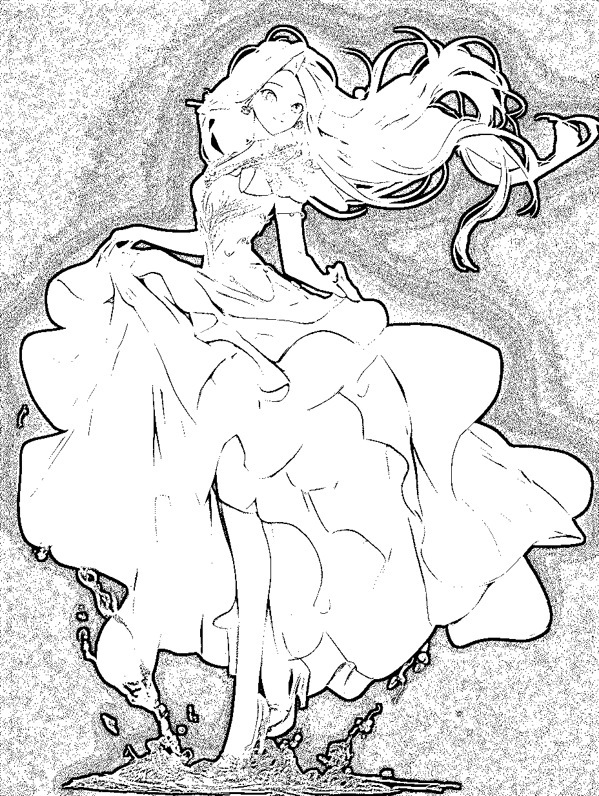
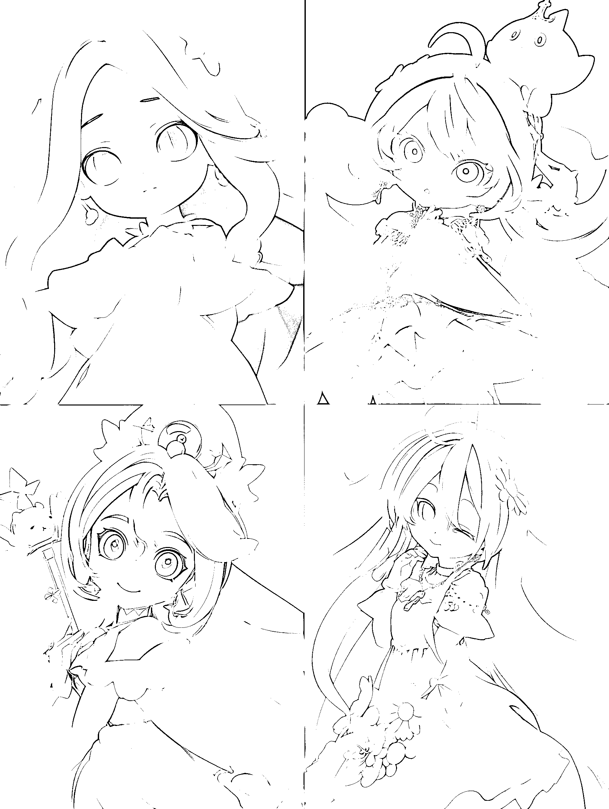
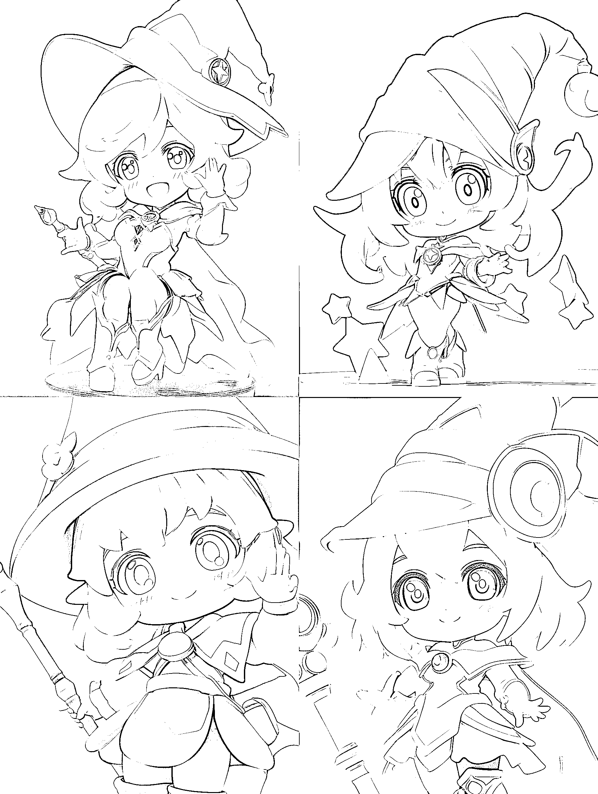
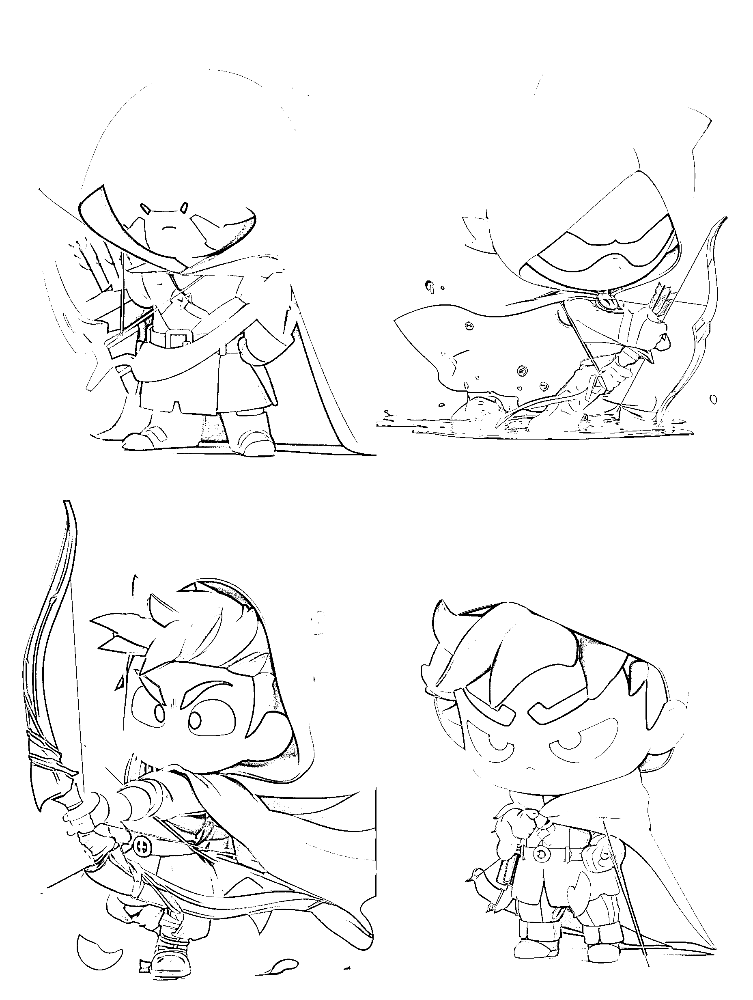
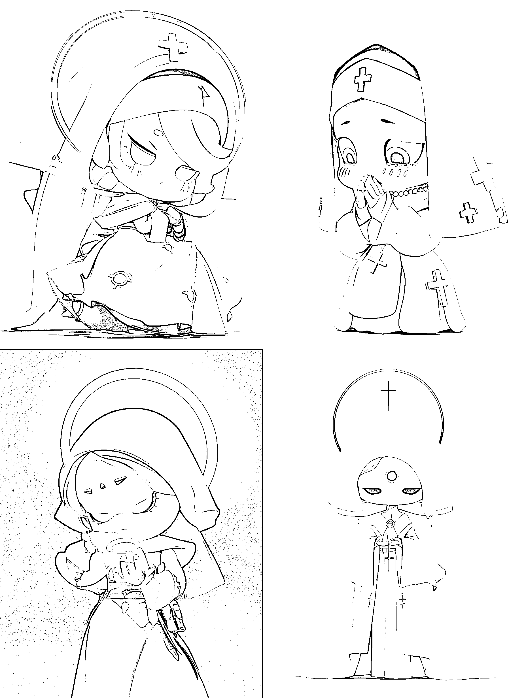
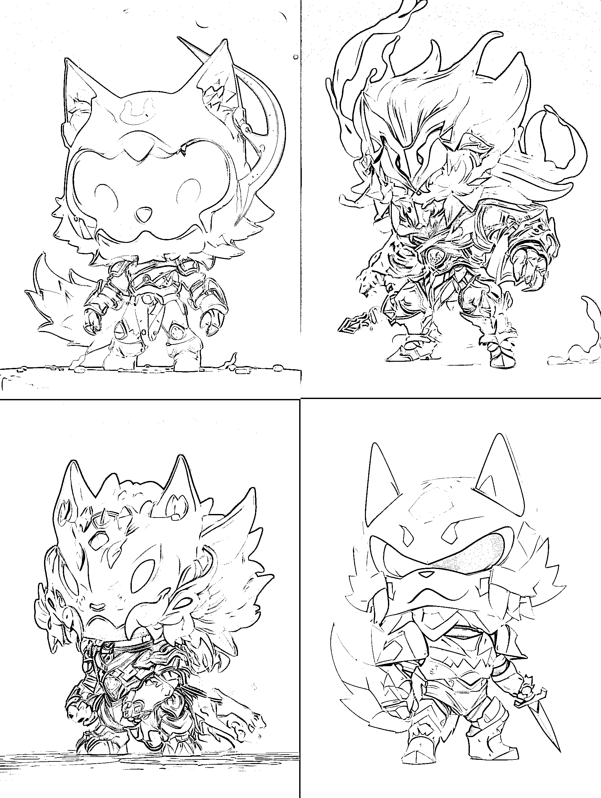

# 10.2 潮玩盲盒角色出图演示

想做潮玩盲盒质感的角色图，可以先把 MidJourney 作为起步工具。若对它的基础界面和出图流程还不熟，建议回第四章补一遍基础操作。

写提示词时，建议拆成六个槽位：画风基调、画面主角、人物特征、氛围走向、渲染方式、画质补强。把这六项按顺序填好，出图方向会稳定不少。

潮玩盲盒题材最近热度不低，下面用一组角色样例来演示。

**常规款**

Blind Box style,dynamic pose, beautiful girl, blue princess dress, white long hair, black background, lumen reflection, 3D,C4D, CGI, VFX, HD, --niji 5 --style expressive

**Q 版比例**

Blind box style, chibi, dynamic pose, beautiful girl, white princess dress, blue long hair, white background, lumen reflection, C4D, CGI, VFX, HD --niji 5 --style expressive

**全身潮玩**

Blind Box style, POPMART, chibi,Kawaii,magician cute Girl, Cute and playful posture,full body ,PVC, reflective clothing,best quality,ultra details --niji 5 --style expressive

**职业组**

先看远程定位：

Blind box style, POPMART, chibi, dynamic pose, archer, cape, green clothing, white background, lumen reflection, C4D, CGI, VFX, HD --niji 5 --style expressive

再看辅助定位：

Blind box style, POPMART, chibi, dynamic pose, priest, girl, blue clothing, white background, lumen reflection, C4D, CGI, VFX, HD --niji 5 --style expressive

最后是近战造型：

Blind box style, POPMART, chibi, dynamic pose, warrior, wolf head, red armor, white background, lumen reflection, C4D, CGI, VFX, HD --niji 5 --style expressive

