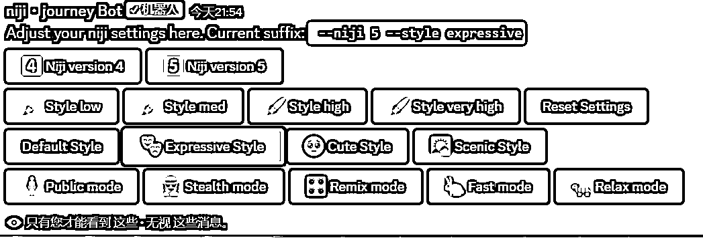

# 10.3 关键词速查清单

想做出盲盒或手办风格的作品？关键词别乱堆，先看这份常用清单。从风格基调到模型选择，一次帮你列清楚。

- **风格基调词**：默认可以从盲盒风格/手办（Blind Box style/figure）入手，用来确定整体方向。

- **主体描述**：把角色的外貌、服装、职业写具体，人物就能更立体。

- **风格选项**：3D、chibi、POPMART、平面（flat）、动漫风（anime style）、机械风（mechanical style）、复古风（retro style）、潮流风（trendy style）、科技风（technological style）、全息影像（holographic image）、酸设计（Acid designd）等，都是常用的风格关键词，单独用或组合搭配都行。

- **渲染支持**：RTX、C4D、CGI、VFX、HDR、Maya 这类渲染工具/引擎可以安排上，帮助提升画面质感。

- **模型建议**：现阶段个人更认可 niji expressive。当然，其他模型也不是不能打，只是目前试下来它的效果相对更符合预期。

以上这些关键词，基本能满足日常创作需要。如果后面有新的好工具，再随时补充。

