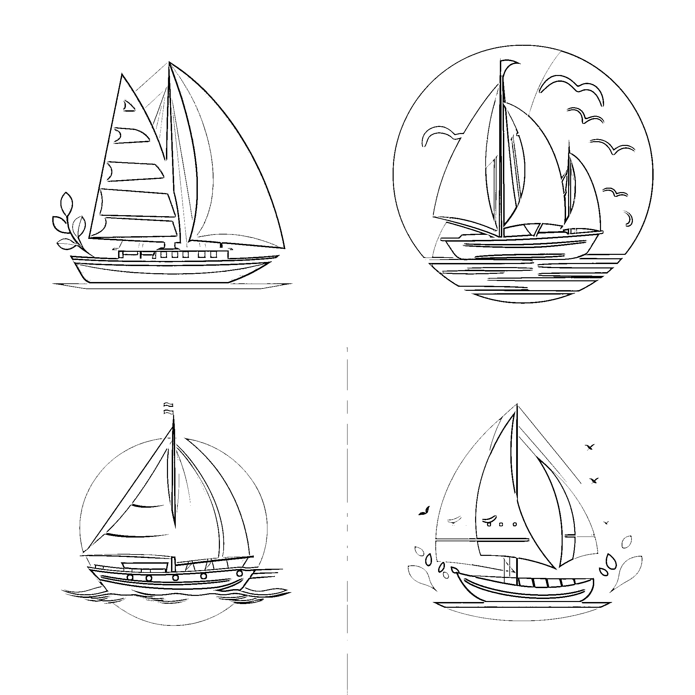
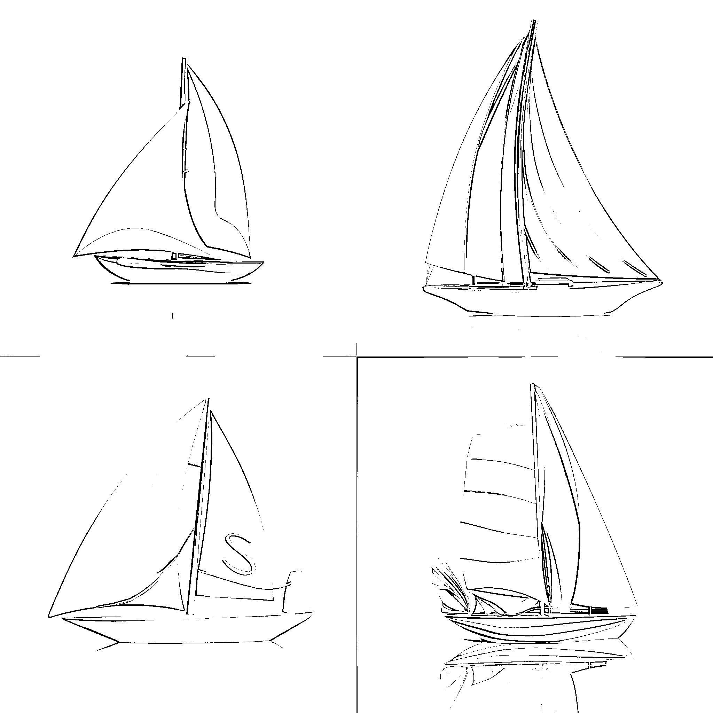
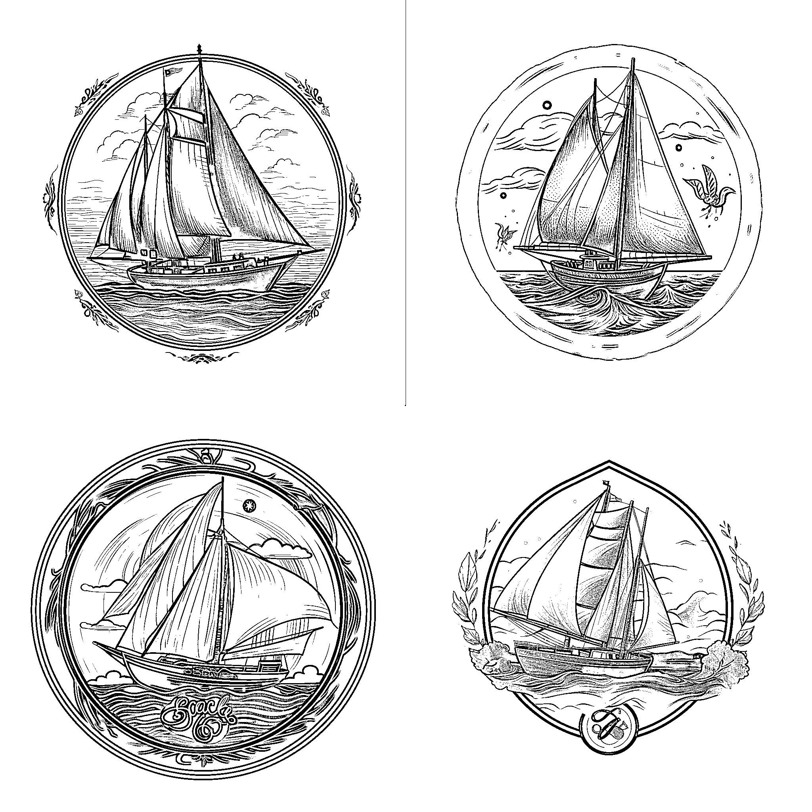
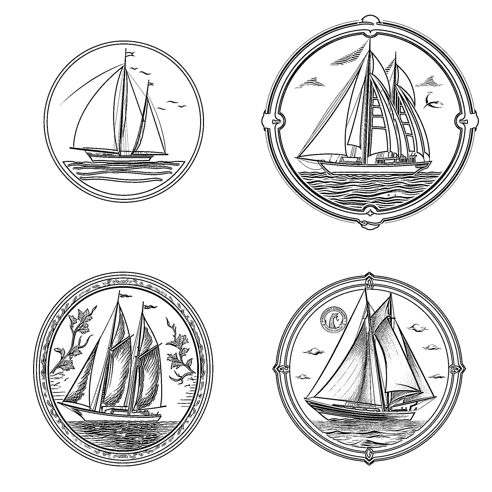
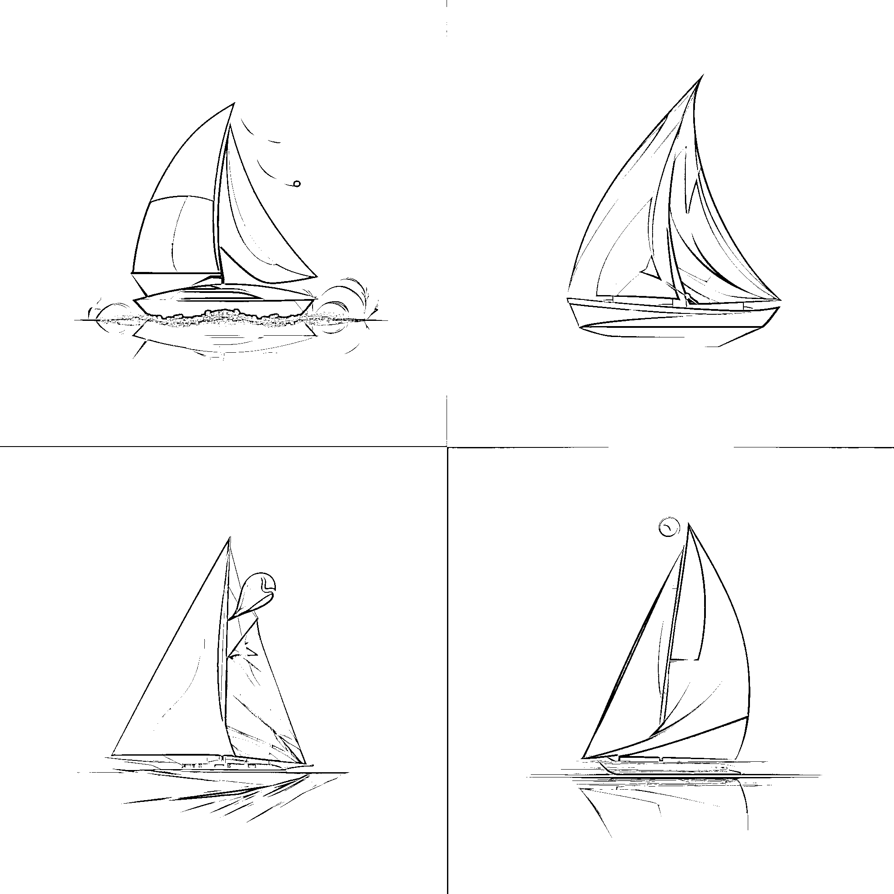

# 11.2.1 用公式快速出LOGO

想快速做出LOGO初稿，不用一上来就硬憋关键词。有个很好记的拼法：先写“LOGO 设计”，再选“LOGO 风格”，最后补上“画面主体”。三块一组合，就能迅速拆出多组可用提示词。

比如要给“生财”做一个帆船图标，套用这个思路，很快就能写出不同风格的方案。下面这些图都由 MidJourney 生成；具体工具用法可回看章节【四、学会用 MidJourney 完成 AI 绘画】。

- **扁平化风格**：绿色帆船图标，简洁扁平  
  `flat style logo design of a green sailboat --v 5`  

- **立体化风格**：绿色帆船图标，立体质感  
  `3D style logo design of a green sailboat --v 5`  

- **手绘风格**：绿色帆船图标，手绘笔触  
  `hand-drawn style logo design of a green sailboat --v 5`  

- **经典风格**：绿色帆船图标，经典稳重  
  `classic style logo design of a green sailboat --v 5`  

- **未来主义风格**：绿色帆船图标，未来感视觉  
  `futuristic style logo design of a green sailboat --v 5`  

同一个帆船图标，只要替换风格词，就能快速铺开多种视觉方向的出图关键词，方便后续筛选和继续调整。