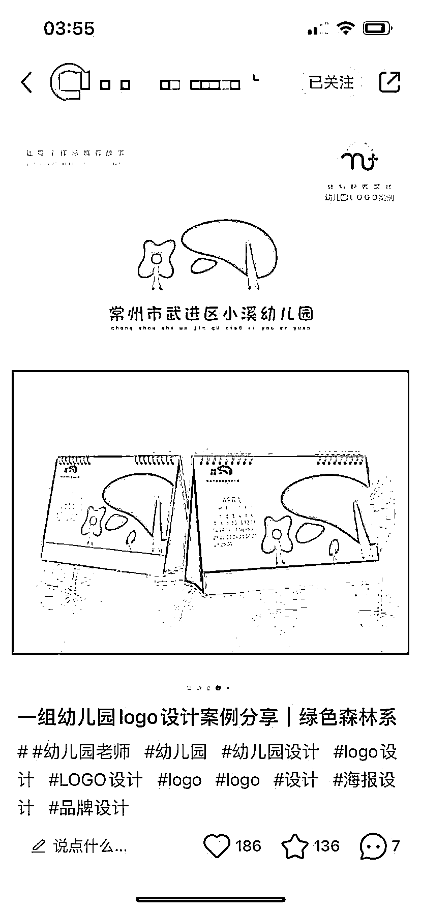
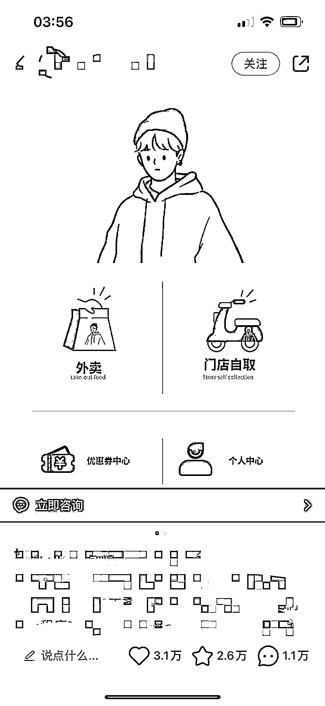
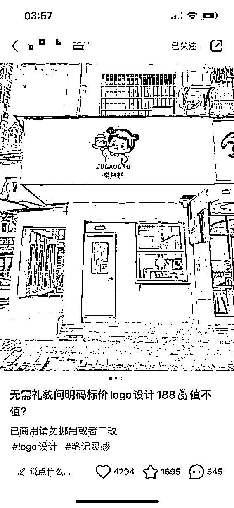
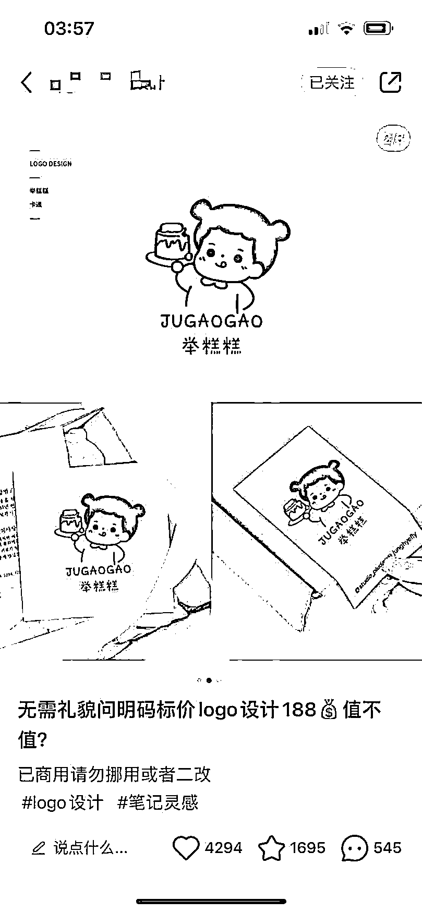
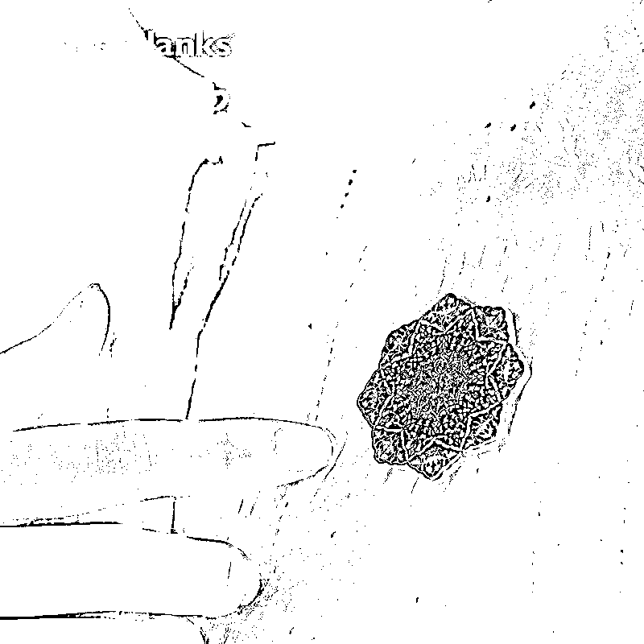
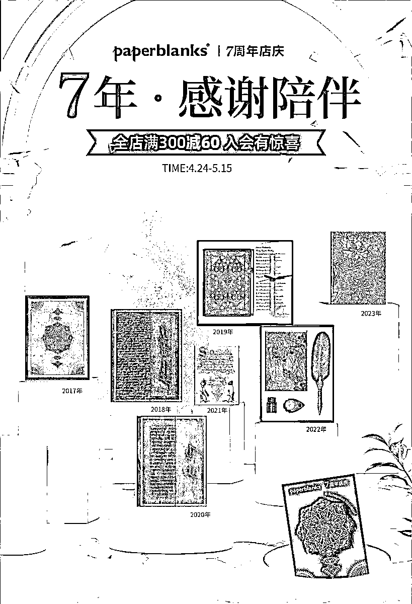

# 11.3 变现渠道

在聊怎么靠 Logo 赚钱之前，先说说 Logo 本身的特点：它要能一眼被认出、有独特性、承载含义、具备法律意识、符合整体视觉规划，还要讲究色彩搭配。这些属性决定了 Logo 设计并非零门槛，AI 绘画工具充其量只是辅助手段。真要拿去商用，还得在 AI 生成图的基础上做二次加工——比如调整字体、叠加实际应用场景，而且要能用文字把设计理念讲清楚。

在小红书发图文时，如果只放一个光秃秃的 Logo，效果往往不好。更聪明的做法是“给图赋予故事感，直接展示应用场景”：把 Logo 放到实体店门头、文创包装袋、日历、店铺小程序这些地方，让甲方老板一眼看到成品效果，下单意愿自然更强。参考如下：

能接的定制需求远不止企业标志本身，还可以延伸到周边产品：比如店铺 Logo、书籍封面、纪念徽章、书签等等，范围相当广。

