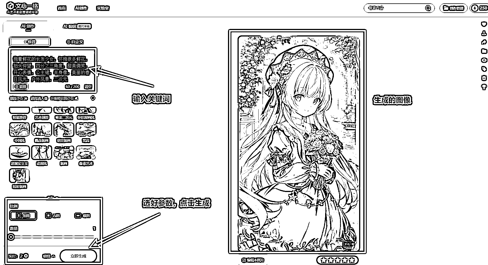
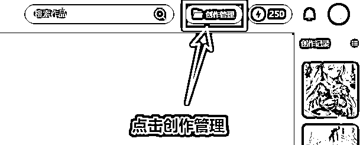
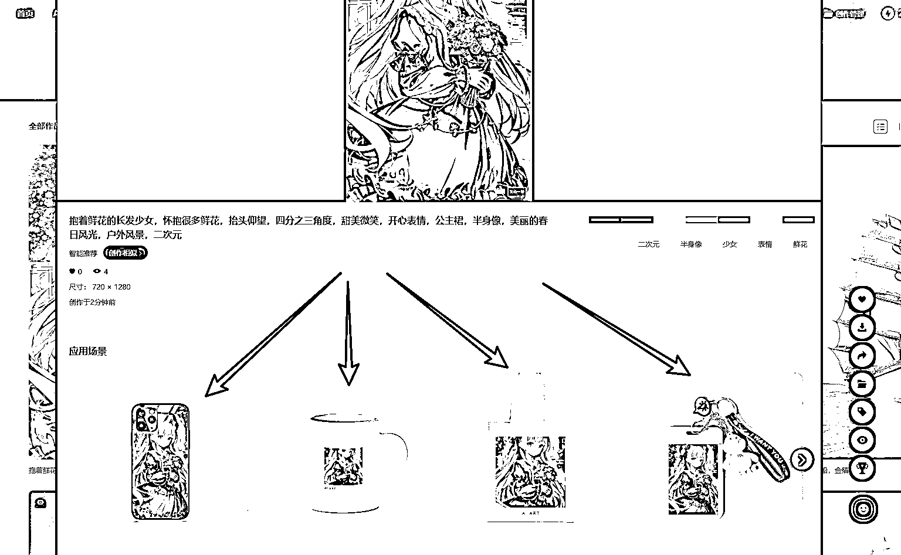
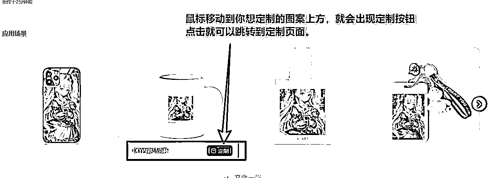
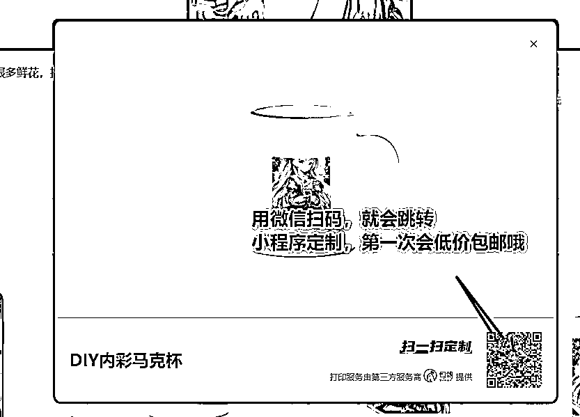
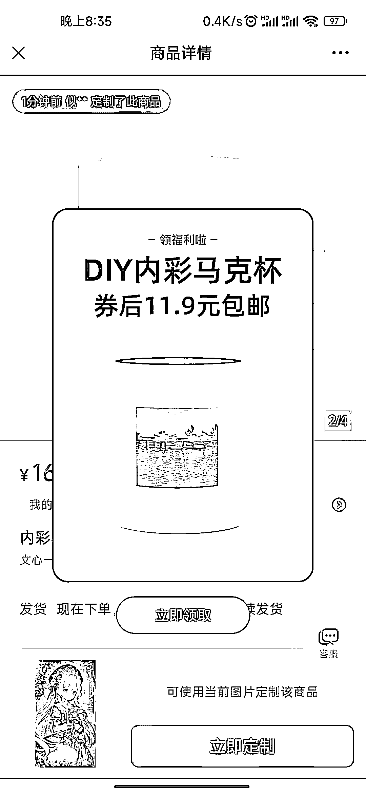
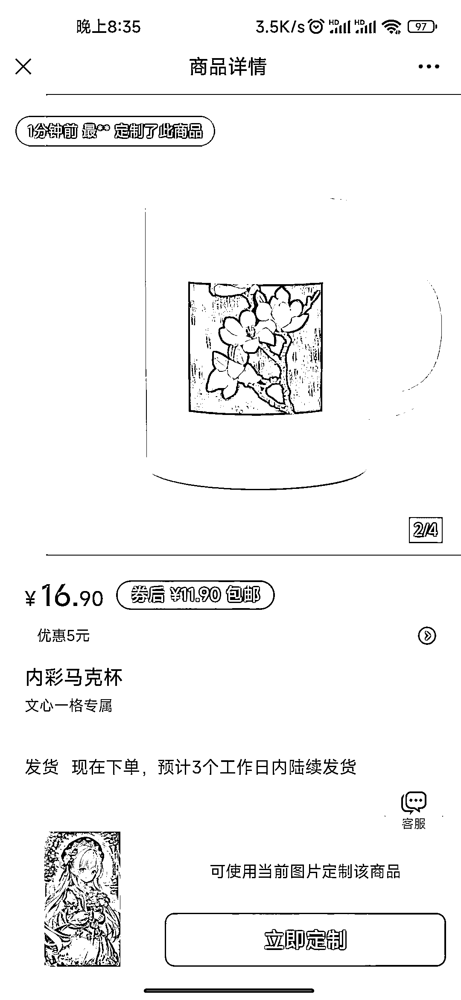
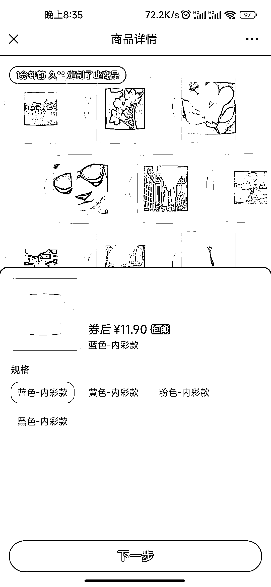
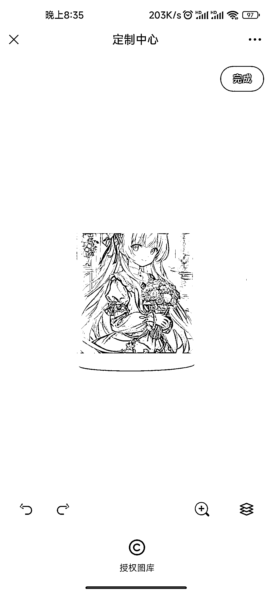
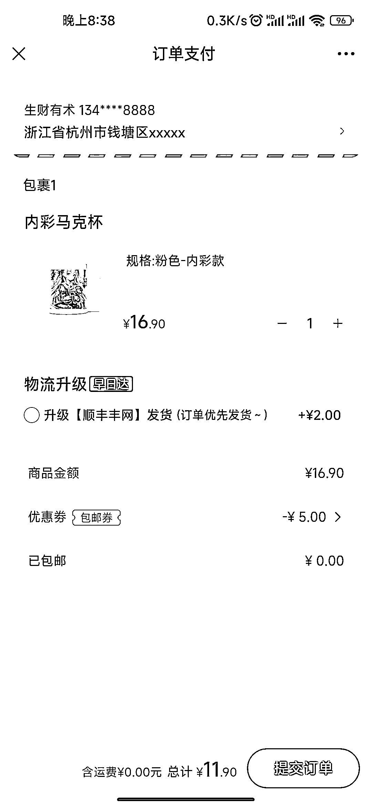

# 12.2.1 文心一格周边定制变现

想用 AI 图片做周边生意，文心一格值得一试，入口是 yige.baidu.com/。它不仅能生成图片，还支持把作品做成实物周边，马克杯、手机壳、帆布包等都能定制；不过，图片必须先通过平台审核，才能用于周边制作。

变现思路并不复杂：按照客户需求把图案做出来，先交给客户确认，再在平台定制价的基础上加一点差价，卖给有定制需求的客户。

具体操作可以参考下面的界面：

点开已经生成的那张图，页面会展示 4 种可应用的周边产品，任选一种就能进入定制：

首次定制还能领优惠券，价格会更划算。点【立即定制】，挑好款式，再点下一步：

进入定制中心后，点右上角“完成”，填好客户的收货地址并提交订单，整个定制流程就完成了：

